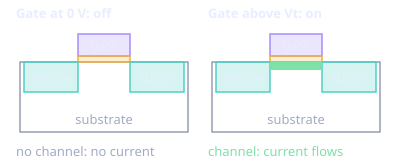
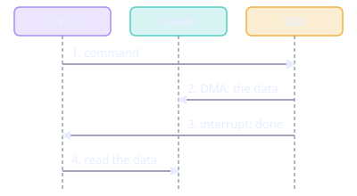
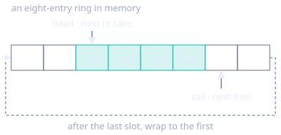

# Chapter 0 — Foundations

This chapter is the toolkit the rest of the book assumes. A solid-state drive (SSD) sits at the meeting point of physics, digital hardware, operating systems and protocols, and the later chapters move between all four quickly. Here each idea is introduced once, slowly, with numbers you can check, and each section ends by pointing at the chapter that builds on it.

If you already know what a KiB is, why a device uses direct memory access, and why a queue is a ring, skim the takeaways at the end and go straight to [Chapter 1](ch1-overview.md).

!!! abstract "In this chapter"
    - **Units and numbers** — bits and bytes, decimal versus binary prefixes, hexadecimal (§0.1–0.2)
    - **The machine** ⭐ — how a computer is wired, and storage as a numbered array of blocks (§0.3–0.4)
    - **Measuring speed** ⭐⭐ — latency, throughput and IOPS, and the latency ladder (§0.5)
    - **The hardware underneath** — the transistor as a switch; volatile and non-volatile memory (§0.6–0.7)
    - **How software talks to devices** ⭐⭐ — firmware, interrupts and polling, DMA, ring-buffer queues (§0.8–0.10)
    - **Error rates** — reading numbers like 10⁻¹⁵ (§0.11)

    Short on time? §0.4, §0.5 and §0.9–0.10 carry the most into later chapters.

---

## 0.1 Units: bits, bytes and the two kinds of kilo

A **bit** is one binary digit, 0 or 1. A **byte** is 8 bits. Capacities are counted in bytes (capital B) and link speeds usually in bits per second (small b), so "8 Gb" and "1 GB" are the same amount. Flash vendors quote a die's capacity in bits: a "1 Tb" NAND flash die holds 2⁴⁰ bits, which is 128 GiB.

That last unit is the trap. The same prefix names two different numbers:

| Prefix | Decimal (SI) | Binary (IEC) | Binary is bigger by |
|---|---|---|---|
| kilo / kibi | kB = 10³ = 1,000 | KiB = 2¹⁰ = 1,024 | 2.4% |
| mega / mebi | MB = 10⁶ | MiB = 2²⁰ = 1,048,576 | 4.9% |
| giga / gibi | GB = 10⁹ | GiB = 2³⁰ ≈ 1.074 × 10⁹ | 7.4% |
| tera / tebi | TB = 10¹² | TiB = 2⁴⁰ ≈ 1.100 × 10¹² | 10.0% |

Decimal prefixes count in powers of ten, like every other unit of measure. Binary prefixes count in powers of two, which is how memory is built: address lines double the space with every bit. The binary names (kibi, mebi, gibi, tebi) were standardized in 1998 precisely because "kilobyte" had come to mean both.

Three consequences show up throughout this book:

- **Drives are sold in decimal.** A "1 TB" drive holds 10¹² bytes. An operating system that counts in binary reports it as 931 GiB (10¹² ÷ 2³⁰). Nothing is missing; the units differ.
- **Flash is built in binary.** Dies come in powers of two, so a drive's raw flash is a binary amount. A drive sold as 128 GB but built from 128 GiB of NAND keeps 128 × 2³⁰ − 128 × 10⁹ ≈ 9.4 × 10⁹ bytes, 7.4% of its capacity, out of sight. That hidden surplus is **over-provisioning (OP)**, the spare room the drive's firmware needs to work ([Ch 1 §1.5.1](ch1-overview.md#151-basic-information); [Ch 4 §4.3](ch4-ftl.md#43-garbage-collection) shows why more of it lowers write amplification).
- **Odd capacities are deliberate.** A drive sold as 960 GB or 3.84 TB is built from the same flash as a 1 TB or 4 TB one; it keeps more back. With 1 TiB of NAND (1,099.5 GB) presented as 960 GB, the spare room is (1,099.5 − 960) ÷ 960 ≈ 14.5%.

Time uses the decimal prefixes only: 1 second = 1,000 milliseconds (ms) = 1,000,000 microseconds (µs) = 10⁹ nanoseconds (ns). Most of this book lives between a few nanoseconds and a few milliseconds.

## 0.2 Binary and hexadecimal

**Binary** writes numbers in base 2. Each position is worth twice the one to its right, so `1011` is 8 + 0 + 2 + 1 = 11. With n bits you can write 2ⁿ different values: 8 bits give 256, 32 bits give about 4.3 billion. That arithmetic sets hard limits. A 32-bit sector number with 512-byte sectors can address 2³² × 512 B = 2 TiB, which is why old partition tables could not use drives larger than 2 TiB and had to be replaced.

**Hexadecimal** (base 16) is shorthand for binary. Its digits are 0–9 then A–F (10–15), and each hex digit stands for exactly 4 bits, so a byte is always two hex digits. Hex numbers are written with a `0x` prefix (or an `h` suffix in many specifications): `0xFF` = 255, `0x1000` = 4,096 = 4 KiB. You will meet hex constantly: register addresses, command opcodes (in Non-Volatile Memory Express (NVMe), the protocol of [Chapter 6](ch6-nvme.md), a Read is opcode `02h` and a Write `01h`), flash commands (a NAND read is the sequence `00h`–`30h`, [Ch 3 §3.2](ch3-nand-flash.md)) and memory dumps.

**Bitwise operations** act on each bit position separately:

- **AND** keeps a bit only where both inputs have it. It masks: `x AND 0xFFF` keeps the low 12 bits.
- **OR** sets bits: `x OR 0x80` turns on bit 7.
- **Exclusive OR (XOR)** gives 1 where the inputs differ. Its key property is that XOR-ing the same value twice cancels: a ⊕ b ⊕ b = a. That one fact powers parity, the RAID (redundant array of independent disks) rebuild inside an SSD ([Ch 3 §3.4.4](ch3-nand-flash.md#344-raid-inside-the-ssd)) and error-correcting codes ([Supplement A](../supplements/a-ecc-coding-theory.md)).
- **Shifts** move all bits left or right; a left shift by n multiplies by 2ⁿ.

**Alignment** follows from the same arithmetic. An address is aligned to 4 KiB when it is a multiple of 4,096, which in hex means it ends in `000`: its low 12 bits are zero. Storage works in fixed-size units, so an unaligned write that straddles two units costs two internal operations instead of one.

## 0.3 How a computer is wired

A computer is a processor, its memory and its input/output devices, joined by buses:

- **The CPU (central processing unit)** has several cores. Each core has registers and small, very fast caches (L1, L2); the cores share a larger L3 cache.
- **Main memory** is DRAM (dynamic random-access memory), attached to a memory controller on the CPU itself. Programs and their data live here while they run.
- **Input/output devices** attach through **PCIe (Peripheral Component Interconnect Express)**. The CPU's PCIe root complex provides lanes; slots and M.2 sockets connect devices to them. An NVMe SSD usually takes 4 lanes. Older SATA (Serial AT Attachment) drives connect through a separate controller instead ([Chapter 5](ch5-pcie.md) covers PCIe; [Chapter 6](ch6-nvme.md) covers NVMe).

A read crosses this machine twice, once as a request going down and once as data coming back:

{ .sdd-fig }
/// figure-caption
The path of one read. Software on the host turns "part of a file" into a numbered block and a command; firmware in the drive turns that number into a place in the flash. The data then comes back up the same path.
///

On the software side, the application asks the operating system for data with a system call. The operating system's filesystem works out which blocks hold that part of the file, and the device **driver**, the only software that speaks the device's protocol, builds the command. Everything below the PCIe link happens inside the drive.

## 0.4 Storage as a block device

To the operating system a drive is a **block device**: a long, numbered array of fixed-size blocks. A block (traditionally called a sector) is 512 bytes on older and many current drives, or 4,096 bytes on drives formatted for 4 KiB sectors. The numbers run from 0 upward, and a block's number is its **logical block address (LBA)**. A 1 TB drive with 512-byte sectors exposes about 1.95 billion of them.

The interface is that simple. Nearly every request is one of three:

- **read** n blocks starting at LBA x;
- **write** n blocks starting at LBA x;
- **trim**: blocks starting at LBA x no longer hold anything needed ([Ch 4 §4.4](ch4-ftl.md#44-trim)).

Files are the **filesystem's** invention. It keeps its own records, directories and per-file metadata, saying which LBAs belong to which file, and turns "bytes 8,192 to 12,287 of this file" into "read LBAs 16 to 23" ([Supplement C](../supplements/c-flash-file-systems.md)).

The crucial point for SSDs: **an LBA is a name, not a place.** On a hard disk an LBA corresponds to an almost fixed spot on a platter. On an SSD the firmware's **flash translation layer (FTL)** writes each new version of an LBA's data to a fresh flash page and records where it went, so the same LBA lives somewhere different after every rewrite. Chapter 4 is about how that remapping works and what it costs.

## 0.5 Latency, throughput and IOPS

Three numbers describe how fast storage is, and they are not interchangeable:

- **Latency**: how long one operation takes, from request to completion. Measured in microseconds for an SSD.
- **Throughput** (or bandwidth): how much data moves per second, in MB/s or GB/s.
- **IOPS (input/output operations per second)**: how many operations complete per second.

Throughput and IOPS are tied by the transfer size:

**throughput = IOPS × transfer size**

One million 4 KiB reads per second is 10⁶ × 4,096 B ≈ 4.1 GB/s. A drive that streams 7 GB/s in 128 KiB transfers is doing only about 53,000 IOPS. Small random transfers stress IOPS; large sequential ones stress throughput.

Latency and IOPS are tied by how much work is in flight, a relation known as **Little's law**:

**operations in flight = IOPS × latency**

A program that issues one read, waits for it and only then issues the next has one operation in flight. At 100 µs per read it gets at most 1 ÷ 100 µs = 10,000 IOPS, however fast the drive is inside. To reach 1,000,000 IOPS at the same latency, 10⁶ × 100 µs = 100 operations must be outstanding at once. The number in flight is called the **queue depth**, and it is why NVMe was designed around many deep queues ([Ch 6 §6.3](ch6-nvme.md#63-the-three-treasures-in-detail)).

**Averages hide the worst case.** A storage service is judged by its slow requests, so latency is quoted as percentiles: the 99th percentile is the time that 99% of requests beat, and data centers watch the 99.99th ("four nines") as well ([Ch 1 §1.5.2](ch1-overview.md#152-performance)).

The ladder below puts the hardware on one scale. Each step of its axis is ten times the last:

{ .sdd-fig }
/// figure-caption
The latency ladder, in typical orders of magnitude. An SSD read is about a thousand times slower than DRAM and about a hundred times faster than a hard disk, and inside the flash, writing costs far more than reading and erasing more still.
///

Two lessons from the ladder run through the book. First, the gap between DRAM and flash is why an SSD needs caches, buffers and parallelism ([Chapter 2](ch2-controllers-afa.md)). Second, flash's own asymmetry (reads in tens of microseconds, writes in about a millisecond, erases in several) shapes nearly every firmware decision ([Chapter 3](ch3-nand-flash.md), [Chapter 4](ch4-ftl.md)).

## 0.6 The transistor as a switch

Every chip in this book is built from **transistors**, and the kind that matters here, the MOSFET (metal–oxide–semiconductor field-effect transistor), is a voltage-controlled switch. It has three terminals:

- the **source** and the **drain**, two doped regions set into the silicon substrate;
- the **gate**, an electrode above the gap between them, separated from the silicon by a thin insulating **oxide**.

With no voltage on the gate, nothing connects source and drain, and no current flows: the switch is **off**. Raise the gate voltage above the **threshold voltage (Vt)** and the electric field draws electrons into a thin **channel** under the oxide, which connects source to drain: the switch is **on**.

{ .sdd-fig }
/// figure-caption
A transistor is a switch worked by voltage: above the threshold voltage, a channel forms and current flows. A flash cell is this device with one change, a charge-storing layer inside the oxide.
///

A logic gate is a handful of transistors and a processor is billions of them. CMOS (complementary metal–oxide–semiconductor) logic pairs two kinds of transistor so that one of each pair is always off, which is why idle logic draws little power.

**The bridge to flash:** a flash cell is this transistor with an extra, electrically isolated layer inside the oxide that can hold electrons. Trapped electrons push the threshold voltage up, so the cell switches on only at a higher gate voltage. Reading a cell means asking one question: *does it conduct at this gate voltage?* The answer encodes the stored bits ([Ch 3 §3.1.1](ch3-nand-flash.md#311-how-a-flash-cell-works)).

## 0.7 Volatile and non-volatile memory

**Volatile** memory loses its contents when power is removed; **non-volatile** memory keeps them. An SSD uses both kinds:

| Memory | How a bit is stored | Keeps data unpowered? | Speed | Typical role |
|---|---|---|---|---|
| SRAM | a latch of six transistors | no | fastest, about 1 ns | CPU caches; the SSD controller's on-chip memory |
| DRAM | a charge on a tiny capacitor, refreshed every 64 ms or so | no | about 100 ns | main memory; the SSD's map cache |
| NOR flash | charge in a transistor; cells wired in parallel | yes | fast random reads, slow writes | boot code |
| NAND flash | charge in a transistor; cells wired in series strings | yes | page reads in tens of µs; writes by page, erases by block | the SSD's storage |

SRAM (static random-access memory) is fast but takes six transistors per bit, so there is little of it. DRAM needs one transistor and one capacitor per bit, which makes it dense and cheap, but the capacitor leaks, so every row must be refreshed many times a second. NOR flash can be read at any address quickly, which suits code that runs straight from it; NAND flash strings its cells in series to pack them densely, at the price of reading and writing whole pages and erasing whole blocks ([Ch 3 §3.1.3](ch3-nand-flash.md#313-the-hierarchy-cell-page-block-plane-die)).

The mix creates the SSD's central hazard. Data waiting in the drive's DRAM or SRAM, and the map that says where everything lives, vanish if power fails before they reach the flash. Drives answer with stored energy to finish writing ([Ch 2 §2.8.3](ch2-controllers-afa.md)) and with recovery procedures that rebuild the map ([Ch 4 §4.6](ch4-ftl.md#46-power-loss-recovery)).

## 0.8 Firmware and software

**Software** runs on the host's CPU: applications, the operating system and its drivers. **Firmware** is the program inside a device, running on the device's own processors from its own memory. An SSD controller is a small computer, with several embedded processor cores, SRAM, often DRAM, and firmware stored in flash; [Ch 2 §2.1.2](ch2-controllers-afa.md#212-controller-cpu-cpu) takes it apart.

In an SSD, firmware is most of the product. The same flash chips make a good drive or a bad one depending on the firmware: the flash translation layer, garbage collection, wear leveling, error handling and power-loss recovery are all firmware ([Chapter 4](ch4-ftl.md)). It works under constraints most software never meets. It must answer within microseconds, it usually runs with no operating system or a very small one, and power can vanish at any instruction.

A **driver** sits on the host side of the line. It is the piece of operating-system software that speaks one device protocol. Because NVMe is a standard, one NVMe driver works with every vendor's drive ([Chapter 6](ch6-nvme.md)).

## 0.9 Interrupts, polling and DMA

A CPU that hands a device some work must learn when the work is done. There are two ways:

- **Polling**: the CPU checks a status location again and again. It notices completion immediately but keeps a core busy doing nothing else.
- **Interrupts**: the device signals the CPU, which pauses what it was doing and runs a short handler. The core is free while it waits, but each interrupt costs a few microseconds of overhead.

When completions are rare, interrupts win. At millions of IOPS that overhead adds up, so fast storage stacks either batch several completions into one interrupt (interrupt coalescing) or switch to polling. A PCIe device interrupts by writing a small message to a special address, a scheme called MSI-X (message-signaled interrupts, extended), which gives each queue its own interrupt so each CPU core handles its own completions ([Chapter 6](ch6-nvme.md)).

The data itself moves by **DMA (direct memory access)**: the device reads or writes host memory on its own, and the CPU only says where. Without DMA the CPU would copy every byte of every transfer. With it, a read looks like this:

{ .sdd-fig }
/// figure-caption
One read with DMA and an interrupt. The CPU only issues the command and handles the completion; the data moves from the drive into memory without it.
///

The command names the memory buffers to fill. NVMe describes them with lists of page addresses or scatter-gather lists, so one transfer can land in pieces of memory scattered across DRAM ([Chapter 6](ch6-nvme.md)).

## 0.10 Queues and ring buffers

A host and a drive work at different speeds and at different moments, so they hand work to each other through **queues**: one side, the **producer**, adds entries, and the other, the **consumer**, takes them in order.

Storage protocols build their queues as **ring buffers**: a fixed array of slots, plus two indices.

- The **tail** is where the producer writes the next entry. After writing, it advances the tail.
- The **head** is where the consumer reads the next entry. After reading, it advances the head.
- Both indices wrap from the last slot back to the first, so the array is used as a circle.

{ .sdd-fig }
/// figure-caption
A ring buffer. The producer fills slots at the tail, the consumer empties them at the head, and both wrap around. The entries waiting are those from the head up to the tail.
///

The ring is **empty** when head equals tail. It is **full** when advancing the tail would make it equal the head, so one slot always stays empty: that is how the two states are told apart. The number of entries waiting is (tail − head) mod size.

Rings suit hardware for three reasons. Their memory is allocated once and never grows. Each side writes only its own index, so one producer and one consumer need no lock between them. And the whole state is two small numbers, which a device can be told by writing to a single register. NVMe's submission and completion queues are exactly such rings in host memory, and that register is called the **doorbell** ([Ch 6 §6.2](ch6-nvme.md#62-nvme-overview-the-command-model)).

## 0.11 Error rates and big exponents

Reliability numbers are written in scientific notation, because they are tiny: 10⁻¹⁵ means one in 10¹⁵, a million billion. They become meaningful once multiplied by how much data is involved.

**Expected errors = bits handled × error rate.** A 1 TB drive holds 8 × 10¹² bits. Reading all of it once:

- at a **raw bit error rate (RBER)** of 10⁻³, typical of worn flash before correction, produces 8 × 10⁹ bit errors, which the error-correcting code (ECC) must fix ([Supplement A](../supplements/a-ecc-coding-theory.md));
- at an **uncorrectable bit error rate (UBER)** of 10⁻¹⁵, the consumer specification, produces 8 × 10¹² × 10⁻¹⁵ = 0.008 uncorrectable errors on average: about one per 125 full-drive reads.

When the expected count is small, the chance of seeing at least one error is roughly that count: here, about 0.8% per full read. Enterprise drives promise 10⁻¹⁶, ten times better ([Ch 1 §1.5.4](ch1-overview.md#154-data-reliability)).

Two habits make such numbers easy. Think in **orders of magnitude**, powers of ten, as the latency ladder does. And convert percentages to "nines": 99.99% is four nines, one failure in 10,000.

---

## Key takeaways

1. **Two kinds of kilo**: drives are sold in decimal units and flash is built in binary, and the gap (7.4% at giga, 10% at tera) is free over-provisioning.
2. **Hex is shorthand for binary**, one digit per 4 bits; XOR's self-cancelling property is the basis of parity, RAID and ECC.
3. **A drive is a numbered array of blocks.** Files are the filesystem's invention, and on an SSD an LBA is a name, not a place.
4. **Latency, throughput and IOPS are different numbers**, tied by throughput = IOPS × size and by Little's law, operations in flight = IOPS × latency.
5. **The latency ladder**: an SSD read is about 1,000× slower than DRAM and 100× faster than a hard disk, and in flash, writes cost more than reads and erases more than writes.
6. **A transistor is a voltage-controlled switch**; a flash cell is one that can trap charge and so shift its threshold voltage.
7. **Devices work through DMA, interrupts or polling, and ring-buffer queues**: the CPU says where, the device moves the data, and head and tail indices pass the work back and forth.
8. **Error rates mean something only multiplied by the data**: 8 × 10¹² bits at 10⁻¹⁵ is 0.008 errors per full read.

---

## Key vocabulary

| Term | 中文 | Meaning |
|---|---|---|
| bit / byte | 位 / 字節（台：位元 / 位元組） | One binary digit, and a group of 8 bits. → [§0.1](#01-units-bits-bytes-and-the-two-kinds-of-kilo) |
| decimal vs binary prefix (GB / GiB) | 十進制 / 二進制前綴（台：十進位 / 二進位字首） | Powers of 1,000 versus powers of 1,024; drives are sold in the first, flash is built in the second. → [§0.1](#01-units-bits-bytes-and-the-two-kinds-of-kilo) |
| over-provisioning (OP) | 預留空間 | Flash kept back from the user for the firmware's own use. → [§0.1](#01-units-bits-bytes-and-the-two-kinds-of-kilo) |
| hexadecimal | 十六進制（台：十六進位） | Base-16 notation, one digit per 4 bits, written with a 0x prefix or h suffix. → [§0.2](#02-binary-and-hexadecimal) |
| exclusive OR (XOR) | 異或（台：互斥或） | The bitwise operation that gives 1 where inputs differ; applying it twice cancels. → [§0.2](#02-binary-and-hexadecimal) |
| alignment | 對齊 | Starting an access at a multiple of the unit size, so it does not straddle two units. → [§0.2](#02-binary-and-hexadecimal) |
| central processing unit (CPU) | 中央處理器 | The host's processor: cores, registers and caches. → [§0.3](#03-how-a-computer-is-wired) |
| cache | 緩存（台：快取） | A small, fast memory that keeps recently used data close to the processor. → [§0.3](#03-how-a-computer-is-wired) |
| driver | 驅動程序（台：驅動程式） | Operating-system software that speaks one device's protocol. → [§0.3](#03-how-a-computer-is-wired) |
| block device | 塊設備（台：區塊裝置） | A device seen as a numbered array of fixed-size blocks. → [§0.4](#04-storage-as-a-block-device) |
| sector | 扇區（台：磁區） | One block of a block device, usually 512 or 4,096 bytes. → [§0.4](#04-storage-as-a-block-device) |
| logical block address (LBA) | 邏輯塊地址（台：邏輯區塊位址） | The number of a block, as the host names it. → [§0.4](#04-storage-as-a-block-device) |
| latency | 延遲 | How long one operation takes, from request to completion. → [§0.5](#05-latency-throughput-and-iops) |
| throughput / bandwidth | 吞吐量 / 帶寬（台：傳輸量 / 頻寬） | How much data moves per second. → [§0.5](#05-latency-throughput-and-iops) |
| IOPS | 每秒讀寫次數 | Input/output operations completed per second. → [§0.5](#05-latency-throughput-and-iops) |
| queue depth | 隊列深度（台：佇列深度） | How many operations are in flight at once; by Little's law, IOPS × latency. → [§0.5](#05-latency-throughput-and-iops) |
| tail latency (percentile) | 尾延遲（百分位） | The latency that 99% or 99.99% of requests beat, which describes the slow ones. → [§0.5](#05-latency-throughput-and-iops) |
| transistor (MOSFET) | 晶體管（台：電晶體） | A voltage-controlled switch: above the threshold voltage, a channel joins source and drain. → [§0.6](#06-the-transistor-as-a-switch) |
| threshold voltage (Vt) | 閾值電壓（台：臨界電壓） | The gate voltage at which a transistor starts to conduct. → [§0.6](#06-the-transistor-as-a-switch) |
| volatile / non-volatile | 易失性 / 非易失性（台：揮發性 / 非揮發性） | Losing data without power, versus keeping it. → [§0.7](#07-volatile-and-non-volatile-memory) |
| SRAM / DRAM | 靜態 / 動態隨機存取存儲器（台：靜態 / 動態隨機存取記憶體） | Fast six-transistor memory, and dense capacitor-based memory that must be refreshed. → [§0.7](#07-volatile-and-non-volatile-memory) |
| NOR / NAND flash | NOR / NAND閃存（台：NOR / NAND快閃記憶體） | Flash with cells in parallel, read quickly at any address, versus flash with cells in dense series strings. → [§0.7](#07-volatile-and-non-volatile-memory) |
| firmware | 固件（台：韌體） | The program that runs inside a device on its own processors. → [§0.8](#08-firmware-and-software) |
| interrupt / polling | 中斷 / 輪詢 | The device signalling the CPU, versus the CPU checking repeatedly. → [§0.9](#09-interrupts-polling-and-dma) |
| direct memory access (DMA) | 直接存儲器訪問（台：直接記憶體存取） | A device reading or writing host memory itself, without the CPU copying. → [§0.9](#09-interrupts-polling-and-dma) |
| ring buffer | 環形緩衝區（台：環狀緩衝區） | A fixed array used as a circle, with a head where entries are taken and a tail where they are added. → [§0.10](#010-queues-and-ring-buffers) |
| doorbell | 門鈴寄存器（台：門鈴暫存器） | A device register the host writes to announce a new tail. → [§0.10](#010-queues-and-ring-buffers) |
| order of magnitude | 數量級 | A factor of ten; the natural scale for latencies and error rates. → [§0.11](#011-error-rates-and-big-exponents) |

---

## Check yourself

1. A drive is sold as 512 GB and built from 512 GiB of NAND. How much over-provisioning does the unit difference give, and what size does an operating system that counts in binary report?

    ??? success "Answer"
        The flash holds 512 × 2³⁰ ≈ 549.8 × 10⁹ bytes and the user sees 512 × 10⁹, so OP = (549.8 − 512) ÷ 512 ≈ 7.4%. The operating system reports 512 × 10⁹ ÷ 2³⁰ ≈ 476.8 GiB. See [§0.1](#01-units-bits-bytes-and-the-two-kinds-of-kilo).

2. Convert `0x2000` to decimal. How many KiB is that, and with 512-byte sectors, which LBA holds byte offset `0x2000`?

    ??? success "Answer"
        0x2000 = 2 × 16³ = 8,192, which is 8 KiB. With 512-byte sectors, byte 8,192 is the first byte of LBA 8,192 ÷ 512 = 16. See [§0.2](#02-binary-and-hexadecimal) and [§0.4](#04-storage-as-a-block-device).

3. Why does XOR suit parity? Four blocks A, B, C, D are stored with P = A ⊕ B ⊕ C ⊕ D, and C is lost. How is it rebuilt?

    ??? success "Answer"
        XOR-ing a value in twice cancels it (x ⊕ x = 0), so XOR-ing everything that survives leaves exactly what is missing: A ⊕ B ⊕ D ⊕ P = A ⊕ B ⊕ D ⊕ A ⊕ B ⊕ C ⊕ D = C. That is the RAID rebuild of Ch 3 §3.4.4. See [§0.2](#02-binary-and-hexadecimal).

4. An SSD answers a 4 KiB random read in 100 µs. How many IOPS does a program get if it waits for each read before issuing the next? With 64 reads in flight at the same latency, how many IOPS and what throughput?

    ??? success "Answer"
        One at a time: 1 ÷ 100 µs = 10,000 IOPS. With 64 in flight, Little's law gives 64 ÷ 100 µs = 640,000 IOPS, and 640,000 × 4,096 B ≈ 2.6 GB/s. See [§0.5](#05-latency-throughput-and-iops).

5. A drive streams 7 GB/s using 128 KiB transfers. How many IOPS is that, and why can its 4 KiB random-read IOPS be far higher?

    ??? success "Answer"
        7 × 10⁹ ÷ 131,072 ≈ 53,000 IOPS. Each large transfer moves a lot of data, so few operations saturate the bandwidth; small transfers move little each, so the same drive can complete many more of them per second, up to its limits on parallel flash reads and command handling. See [§0.5](#05-latency-throughput-and-iops).

6. Why does charge trapped in a flash cell change what a read sees?

    ??? success "Answer"
        A flash cell is a transistor with a charge-storing layer in its gate oxide. Trapped electrons raise its threshold voltage, so it switches on only at a higher gate voltage. A read applies a chosen gate voltage and checks whether the cell conducts, and the answer tells which charge level, and so which bits, the cell holds. See [§0.6](#06-the-transistor-as-a-switch).

7. Which of SRAM, DRAM and NAND flash lose their data when power is removed, and what does each do in an SSD?

    ??? success "Answer"
        SRAM and DRAM are volatile; NAND flash is not. SRAM is the controller's fast on-chip working memory, DRAM (when present) caches the map and buffers data, and NAND stores the data itself. Anything still in SRAM or DRAM when power fails is lost unless the drive saves it in time. See [§0.7](#07-volatile-and-non-volatile-memory).

8. When is polling better than interrupts, and what does it cost?

    ??? success "Answer"
        Interrupts suit rare events, because the core is free while it waits. Polling suits very high completion rates or the lowest possible latency, because it avoids each interrupt's few microseconds of overhead and notices completion at once. Its cost is a processor core kept busy checking, even when nothing is ready. See [§0.9](#09-interrupts-polling-and-dma).

9. With DMA, what work is left for the CPU in a read?

    ??? success "Answer"
        It builds the command, which includes the addresses of the memory buffers to fill, and hands it to the device; later it handles the completion, by interrupt or by polling. The data itself goes from the drive into memory without the CPU touching it. See [§0.9](#09-interrupts-polling-and-dma).

10. An 8-slot ring has head = 6 and tail = 2. How many entries are waiting, and how many more can the producer add?

    ??? success "Answer"
        Waiting entries: (2 − 6) mod 8 = 4, in slots 6, 7, 0 and 1. One slot always stays empty so that full and empty can be told apart, so the ring holds at most 7, and the producer can add 3 more. See [§0.10](#010-queues-and-ring-buffers).

11. A 4 TB drive is specified at an uncorrectable bit error rate of 10⁻¹⁶. On average, how many full reads of the drive pass per uncorrectable error?

    ??? success "Answer"
        4 TB is 3.2 × 10¹³ bits, so one full read expects 3.2 × 10¹³ × 10⁻¹⁶ = 3.2 × 10⁻³ uncorrectable errors. That is one error per 1 ÷ 0.0032 ≈ 310 full reads. See [§0.11](#011-error-rates-and-big-exponents).

12. Why is an LBA "a name, not a place" on an SSD, but not on a hard disk?

    ??? success "Answer"
        A hard disk maps each LBA to an almost fixed spot on a platter and overwrites it in place. Flash can't be overwritten in place, so the SSD's flash translation layer writes each new version of an LBA's data to a fresh page and records the new location; the LBA stays the same while its physical home keeps changing. See [§0.4](#04-storage-as-a-block-device).

---

??? info "📖 Provenance"

    This chapter is original to this site: 《深入淺出SSD》 assumes this
    background rather than teaching it. Its figures are original drawings,
    and the latency ladder shows typical orders of magnitude for 2020s
    hardware, not measurements of a particular product. The binary prefixes
    are those of IEC 60027-2 (1998, now IEC 80000-13); NVMe details follow
    the NVMe base specification (revision 2.x) as described in Chapter 6.

*Next: [Chapter 1 — SSD Overview](ch1-overview.md) — what an SSD is, how it differs from a hard disk, and the numbers that describe one.*
