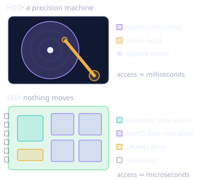
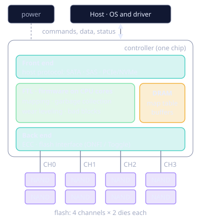
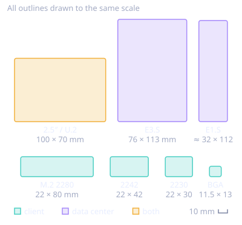

# Chapter 1 — SSD Overview (綜述)

A **solid-state drive (SSD, 固態硬盤)** stores data in semiconductor cells and moves it with nothing but electrons. A **hard disk drive (HDD, 機械硬盤)** stores data magnetically on spinning platters read by a mechanical arm. That single difference — electrons versus mechanics — explains almost everything about why SSDs beat HDDs on speed, power, noise, and durability, and it sets up every problem the rest of this book solves: flash is fast but awkward, and taming that awkwardness is an entire engineering discipline.

This chapter is the aerial view. It shows you what an SSD is made of, how it pulls off the trick of impersonating a disk, how to read a datasheet the way an engineer does, and how the market ended up shaped the way it is.

!!! abstract "In this chapter"
    - **What's inside the box** — controller, NAND flash, firmware: the three core technologies (§1.1)
    - **SSD vs HDD** — the five advantages, and the one thing disks still do better (§1.2)
    - **Fifty years in ten minutes** — from the floating gate to the AI-era capacity race (§1.3)
    - **How an SSD actually works** — the mapping table, garbage collection, wear leveling ⭐ (§1.4)
    - **Reading a datasheet** — capacity, IOPS and QoS, endurance, reliability, power, compatibility (§1.5)
    - **Form factors and the market** — 2.5″, M.2, BGA, U.2, EDSFF; who makes money and why (§1.6–1.7)

---

## 1.1 The hook (引子): what an SSD is

Speed is the first thing anyone notices. A PC that took 30–60+ seconds to boot from a hard disk boots in roughly 8 seconds from an SSD — same operating system (OS), same files, different physics. So what is this device?

Physically, an SSD is just a printed circuit board (PCB) carrying:

1. **Controller (主控)** — the brain: a specialized ASIC (application-specific integrated circuit) that manages everything on the drive
2. **NAND flash chips (閃存)** — where the data actually lives
3. **DRAM cache (緩存)** — dynamic random-access memory, the same kind a computer uses as its main memory (RAM). It is optional: budget designs use a small on-chip SRAM (static RAM) instead, or borrow some host memory through the Host Memory Buffer (HMB, §1.6.3)
4. **Support components** — power-regulation chips, resistors, capacitors
5. **Interface connector (接口)** — SATA (Serial AT Attachment), SAS (Serial Attached SCSI) or PCIe (PCI Express), compared in §1.6

On the software side the SSD runs **firmware (固件, FW)**: code executing on the controller that schedules data between the host interface and the flash, and runs the algorithms that manage flash lifespan and reliability. Hold on to this framing — **controller + flash + firmware are the three core technologies of an SSD** — because it is the table of contents of this whole subject: controllers get [Chapter 2](ch2-controllers-afa.md), flash gets [Chapter 3](ch3-nand-flash.md), and the firmware's central algorithm layer gets [Chapter 4](ch4-ftl.md).

Where does flash sit in the storage universe? Storage media divide into three families: **optical** (CD/DVD), **magnetic** (HDD, tape), and **semiconductor**. All the innovation now happens in the third family, and NAND flash dominates it. Of the challengers once billed as its successors, 3D XPoint reached the market as Intel's Optane in 2017 but was wound down in 2022, while MRAM (magnetic RAM) and RRAM (resistive RAM) remain specialty memories. As of 2026, NAND flash comes from a handful of manufacturers: Samsung, SK hynix (with its Solidigm subsidiary), Kioxia (formerly Toshiba Memory), Micron, Sandisk (spun off from Western Digital in 2025) and China's YMTC (Yangtze Memory Technologies).

---

## 1.2 SSD vs HDD

Reduced to one line each: **HDD = motor + magnetic head + platters** (a precision mechanical instrument), **SSD = flash media + controller** (a pure semiconductor device). Everything below follows from that.

{ .sdd-fig }
/// figure-caption
An HDD reaches data by spinning its platters and swinging an arm, which costs milliseconds for every random access. An SSD addresses its flash chips electronically in microseconds, and has nothing to break when it is dropped.
///

| | HDD | SSD |
|---|---|---|
| Data lives in | magnetic domains on spinning platters | charge trapped in flash cells |
| To reach data | seek: physically move a head (~ms) | address a chip electronically (~µs) |
| Random 4 KB I/O | ~100–200 IOPS (head must travel) | tens to hundreds of thousands of IOPS |
| Sequential speed | ~100–200 MB/s | ~550 MB/s (SATA) to ~14 GB/s (PCIe 5.0, as of 2026) |
| Active power | 6–8 W | ~5 W (SATA), falling to *milliwatts* at idle |
| Drop it while running | head crashes into platter — often fatal | nothing moves — usually shrugs it off |
| Noise | audible spin + seek chatter | silent |
| Form factors | 3.5″ and 2.5″ only | 2.5″, M.2 sticks, down to single 11.5 × 13 mm chips |
| Price per GB | **cheaper** — the one surviving advantage | premium, shrinking every year |

**Five advantages of SSDs, in the order buyers feel them:**

**1. Performance.** Sequential read/write is several times faster — but **random I/O is where the gap explodes**, up to hundreds of times faster in both IOPS (input/output operations per second) and latency. There's a subtlety in how this is measured: raw-throughput benchmarks (IOMeter, and FIO — the Flexible I/O tester of [Chapter 7](ch7-testing.md)) show the biggest numbers, but *user-experience* benchmarks (PCMark Vantage: boot time, application loading) are where HDDs get truly crushed, because real desktop work is dominated by random reads.

**2. Lower power.** Active power is comparable (HDD 6–8 W, SATA SSD ~5 W), but an idle SSD drops to milliwatts while a disk must keep its platters spinning. The categories you'll meet on every datasheet: peak, active (read/write), idle, standby/sleep, and **DevSleep** (Device Sleep) — an ultra-low state under 10 mW, built for laptops (§1.5.5). The scientifically fair metric is **power per IOPS**, and there an SSD delivers roughly 100× the performance per watt — which is why data centers switched.

**3. Shock resistance.** No mechanics, nothing to crash. An HDD head touching a spinning platter during a drop is permanent damage; an SSD is chips on a board.

**4. Silence.** No motor.

**5. Tiny, flexible form factors.** A disk drive cannot shrink below its platters and motor. SSDs scale down to gum-stick M.2 cards and even single soldered chips (§1.6.3).

**The one HDD advantage: price per GB.** Around 2018 the gap was roughly 8× — a 128 GB SSD cost about what a 1 TB HDD did. But flash density compounds like Moore's law, and the prediction that flash would erode disk's price advantage has largely come true: SSDs now own every performance-sensitive tier, leaving HDDs the bulk-capacity and archive tiers (§1.7).

---

## 1.3 A short history of solid-state storage

The details matter less than the arc: *expensive curiosity → niche → tipping point → explosion → consolidation → the AI-era capacity race.*

- **1967** — The foundational invention: at Bell Labs, **Dawon Kahng and Simon Sze (施敏) invent the floating-gate transistor** — a MOSFET (metal–oxide–semiconductor field-effect transistor, the basic switch inside every chip) with an extra, electrically isolated gate that traps charge. Every flash cell ever made is a descendant of this device ([Chapter 3](ch3-nand-flash.md) dissects it). Sze was born in Nanjing and educated at National Taiwan University and Stanford.
- **1976** — Dataram sells "Bulk Core": a 2 MB RAM-based SSD spanning eight large boards. RAM SSDs were blazing fast and byte-addressable but lost everything on power-off and cost a fortune; for ~20 years they stayed toys for the rich (main player: Texas Memory Systems).
- **1988** — Giant magnetoresistance (GMR) is discovered — a boon for the *other* side. GMR heads made HDDs huge and cheap, won the 2007 Nobel Prize in Physics, and kept disk king for two more decades.
- **1991** — SanDisk ships a 20 MB flash SSD: flash, unlike RAM, keeps data without power. The device finally behaves like a "disk."
- **1997–1999** — First sustained commercial flash SSDs (Altec, BiTMICRO).
- **2005–2006** — Samsung becomes the first tech giant to enter the market; laptops begin shipping with SSDs; Windows Vista is the first OS with SSD-specific support.
- **2007 — the year of revolution** — Flash SSDs (Mtron, Memoright) finally match the fastest enterprise HDDs, and the disk war begins in earnest. Texas Memory Systems' RamSan-500 reaches 2 TB at 2 GB/s.
- **2008** — The vendor count hits ~100. Intel ships the X-25E (SLC, 250/170 MB/s). EMC starts putting SSDs in enterprise arrays.
- **2009** — PureSilicon fits **1 TB into a 2.5″ SSD** using MLC (multi-level cell: 2 bits per cell, §1.5.1) flash: SSDs now match HDD capacity in the same volume while destroying them on speed. SandForce launches its first controller. Steve Wozniak joins Fusion-IO.
- **2010** — The market crosses $1B. Enterprise still buys SLC; consumers move to MLC.
- **2011–2012** — IPOs and a buying spree: OCZ buys Indilinx ($32M); LSI buys SandForce ($370M); Hynix buys LAMD. SandForce's signature trick was **real-time in-controller compression** — fiendishly hard, because compressed pages vary in size and the mapping tables must get very clever — and it made SandForce arguably the most successful controller company ever.
- **2013** — PCIe SSDs reach consumers. SATA's 6 Gbps ceiling (~560 MB/s real-world) and shallow command queue had become the bottleneck — the opening act for NVMe (NVM Express, the protocol designed for flash; [Chapter 6](ch6-nvme.md)).
- **2014** — Software ecosystems (VMware VSAN and friends) rebuild around fast storage. SanDisk buys Fusion-IO ($1.1B); Seagate buys LSI's flash divisions.
- **2015** — **Intel and Micron announce 3D XPoint**, a new memory class between DRAM and flash. WD acquires SanDisk for $19B. Toshiba samples 48-layer 3D NAND.
- **2016** — PCIe 4.0 is demonstrated; a 60 TB SAS SSD is shown; all-flash-array vendor Pure Storage out-earns the top HDD-array vendor; Violin Memory — a flash pioneer that IPO'd badly in 2013 — files for bankruptcy protection. Consolidation has arrived.
- **2017** — 3D XPoint reaches the market: Intel's Optane SSD DC P4800X (March) is the first product built on it.
- **2018** — Micron ships the first SSD built on QLC (quad-level cell, 4 bits per cell) flash, the 5210 ION, aimed at replacing hard disks for read-heavy data.
- **2019** — PCIe 4.0 reaches consumers with AMD's X570 platform and the first drives on Phison's E16 controller. Toshiba Memory becomes **Kioxia**.
- **2021** — NVMe 2.0 restructures the specification and adds Zoned Namespaces ([Chapter 4](ch4-ftl.md#411-modern-developments-from-sdf-to-zns-and-fdp) §4.11). SK hynix buys Intel's NAND and SSD business and launches it as **Solidigm**.
- **2022** — Intel winds down Optane, ending 3D XPoint as a product line.
- **2024** — AI data centers make high-capacity QLC the growth market: Solidigm announces a 122.88 TB drive.
- **2025** — Western Digital spins its flash business off as **Sandisk** (February). Consumer PCIe 5.0 drives reach about 14.8 GB/s (Samsung 9100 Pro). PCI-SIG publishes PCIe 7.0 (June), and Kioxia announces a 245.76 TB drive (July).

---

## 1.4 How an SSD actually works ⭐

*The most important section of this chapter — everything in [Chapter 4](ch4-ftl.md) grows out of it.*

??? example "🎬 Animate this — The Toy SSD Sandbox"

    This section's walkthrough as a live simulation — write, overwrite, collect, and watch write amplification (WA) respond to the over-provisioning (OP) slider.

    [Animation page](../animations/toy-ssd-sandbox.md) · [open full-screen ↗](../animations/files/toy_ssd_sandbox.html)

    <iframe src="../../animations/files/toy_ssd_sandbox.html" width="100%" height="640" class="sdd-anim" loading="lazy" title="The Toy SSD Sandbox"></iframe>

From the host's point of view an SSD *is* a hard disk: the OS sends standardized read/write **commands**, the drive returns **data and status**. All the magic is internal, in three functional blocks:

1. **Front end (前端)** — speaks the host protocol. Each interface pairs with a protocol: **SATA → ATA/AHCI** (the AT Attachment command set, through the Advanced Host Controller Interface), **SAS → SCSI** (Small Computer System Interface), **PCIe → NVMe**.
2. **FTL (Flash Translation Layer)** — the middle layer and the soul of the SSD (all of [Chapter 4](ch4-ftl.md)).
3. **Back end (後端)** — talks to the flash chips over a standard flash interface: ONFI (Open NAND Flash Interface) or Toggle ([Chapter 3](ch3-nand-flash.md#326-onfi-vs-toggle-the-protocol-war) §3.2.6).

{ .sdd-fig }
/// figure-caption
The controller's three blocks. The front end speaks the host's protocol; the FTL firmware maps logical addresses to flash, keeping its map in DRAM; the back end corrects errors and drives the flash over parallel channels.
///

**The write path:** host sends a write → the data lands in the SSD's RAM buffer → the FTL assigns each logical block a physical address in flash → once enough data accumulates, the back end flushes it out to those flash locations. Reads run the same path in reverse: look the logical address up in the map, fetch from that flash location, return.

**Why must the FTL exist at all?** Because flash **cannot be overwritten in place (不能覆蓋寫)**. A flash block must be *erased* before it can be programmed again ([Chapter 3](ch3-nand-flash.md) explains the physics). So logical block X has no fixed home: the SSD writes each incoming version wherever convenient and records the location in a **mapping table (映射表)** — logical address → physical flash address.

!!! example "Worked example: how big is the mapping table?"
    A 128 GB SSD mapped in 4 KB logical blocks has 128 GB ÷ 4 KB = 32M entries. At 4 bytes per entry the table is 32M × 4 B = **128 MB**. That is why SSDs carry DRAM roughly proportional to capacity — the classic ratio is **1 : 1000**.

**The competitive insight hiding in this architecture:** the front-end protocols are standardized, and the flash interface is standardized. Once you've picked an interface and bought your flash, **a drive's performance, reliability, and power are decided by its FTL algorithms**. That's where vendors actually differentiate — and it's why the one-sentence summary of this whole field is: *understand the FTL and you understand SSDs.*

**What else the FTL must do:**

- **Garbage collection (GC, 垃圾回收).** Since nothing is overwritten in place, updating data writes a new copy elsewhere and abandons the old one as garbage (invalid). Space fills with a mixture of valid and dead pages. GC copies the still-valid data out of mostly-garbage blocks into fresh blocks, then erases the reclaimed blocks. (Try it live in the sandbox above — watch the WA meter while you overwrite.)
- **Wear leveling (磨損平衡).** Every block endures a limited number of erase cycles, so the FTL spreads erases evenly across all blocks rather than wearing a hole in a few of them.
- **Housekeeping beyond that:** bad-block management, read-disturb handling, data-retention handling, error handling — all covered in [Chapter 4](ch4-ftl.md).

---

## 1.5 Reading a datasheet: the core product parameters

This long section teaches you to read an SSD spec sheet like an engineer, using Intel's enterprise DC S3710 as the running example. A datasheet covers four areas: basic information (capacity, media, form factor, temperature, certifications), performance (bandwidth, IOPS, latency, quality of service or QoS), endurance & reliability, and power. Two crucial things a datasheet *cannot* show: real-world return rate (RMA) and system compatibility — those you learn only from testing and reputation (§1.5.6).

### 1.5.1 Basic information

**Capacity — decimal vs binary.** Marketed capacity is decimal (128 GB = 128 × 10⁹ bytes); the flash chips inside are binary (128 GiB = 137.4 × 10⁹ bytes). The **~7% difference is not wasted** — the drive keeps it for the FTL mapping table, spare blocks for garbage collection, and bad-block replacement. This hidden surplus is called **OP (Over-Provisioning, 預留空間)**:

\[
\mathrm{OP} = \frac{\text{raw capacity} - \text{user capacity}}{\text{user capacity}}
\]

Enterprise SSDs deliberately add *more* OP than the free 7% to boost sustained performance and endurance — [Chapter 4](ch4-ftl.md) §4.3 derives exactly why more spare area means less write amplification.

**Media: SLC / MLC / TLC** — single-, multi- and triple-level cell. The names encode *bits stored per flash cell*:

| Type | Bits/cell | P/E-cycle life | Speed | Price |
|---|---|---|---|---|
| SLC (Single-Level Cell) | 1 | 50,000–100,000 | fastest | ~3×+ MLC |
| MLC (Multi-Level Cell) | 2 | 3,000–10,000 | medium | medium |
| TLC (Triple-Level Cell) | 3 | 500–1,500 | slowest | cheapest |

More bits per cell = more capacity per silicon area = cheaper per GB — paid for in speed and lifespan. (QLC, 4 bits/cell, was just emerging as this generation of drives shipped; the trade continues in the same direction.)

**2D → 3D flash.** Instead of shrinking cells further in a flat plane — which was running into physics — 3D NAND stacks cell layers vertically. Samsung's 48-layer 3D V-NAND reached 2,600 Mb/mm², about **3× the density of 2D**, i.e. roughly ⅓ the cost per GB. The industry roadmap since is simply: more layers, denser, cheaper.

**Form factor** — important enough to get its own section (§1.6).

**Temperature.** Typical ratings: operating 0 °C to 70 °C; non-operating (storage/transport) −50 °C to 90 °C. Outside those ranges, damage isn't covered by warranty.

**Certifications & compatibility logos.** Third-party standards-body test suites; passing them spares customers part of their own qualification effort.

### 1.5.2 Performance

**Three core metrics:**

- **IOPS** — I/O operations per second: **random** small-block performance (typically 4 KB). Higher is better.
- **Throughput / bandwidth (吞吐量/帶寬, MB/s)** — **sequential** large-block performance (typically 512 KB+). Higher is better.
- **Latency (時延/響應時間)** — time from command to status, reported as **average** and **maximum**. Lower is better; once latency reaches the *seconds* range, humans perceive stutter.

**Every benchmark workload is a combination of three knobs:**

1. **Random vs sequential** — are consecutive commands' LBAs (logical block addresses) contiguous?
2. **Block size** — 4 KB for random tests, 512 KB–1 MB for sequential
3. **Read/write ratio** — 100% read, 100% write, or a mix like 65:35

**Quality of Service (QoS).** Maximum latency expressed at confidence levels: the worst command among 99% ("two nines") up to 99.999% ("five nines") of all commands in a test window. Hyperscale data-center customers (Baidu, Alibaba, Tencent and their global peers) care intensely about this **tail latency**, because one slow I/O stalls an entire user-facing request that fanned out across many drives. They routinely care more about QoS than about peak IOPS. ([Chapter 7](ch7-testing.md) §7.1 shows how FIO measures it.)

**Empty drive vs full drive — the marketing tell.** Performance is measured **FOB (Fresh Out of Box, 空盤)** and at **steady state (滿盤, full)**:

- An HDD performs the same empty or full — there is no garbage collection.
- An SSD slows down dramatically once full, because every new write now triggers GC (and consumer drives may also exhaust their SLC cache).

!!! tip "The 'up to' trick"
    Consumer SSD specs quote empty-drive numbers — look for the phrase **"up to" (最高可達)**. Enterprise specs quote steady-state numbers, no "up to." You can classify a drive's market segment from that phrase alone. Watch the toy sandbox's throughput sparkline (§1.4) reproduce the FOB → steady-state cliff live.

One more subtlety: quoted latencies are measured **cache-on** — a write "completes" when the data reaches the drive's RAM buffer, not the flash. Forcing data through to flash (FUA, Force Unit Access) takes hundreds of microseconds even on SLC.

### 1.5.3 Endurance (壽命)

??? example "🎬 Animate this — The SSD Calculator Bundle"

    This section's formulas as live sliders — move an input and watch the answer (and the curve) recompute.

    [Animation page](../animations/ssd-calculators.md) · [open full-screen ↗](../animations/files/ssd_calculators.html)

    <iframe src="../../animations/files/ssd_calculators.html" width="100%" height="640" class="sdd-anim" loading="lazy" title="The SSD Calculator Bundle"></iframe>

Flash wears out as it's erased and reprogrammed, so drives are rated for a total write volume. Two interchangeable metrics express it:

- **DWPD (Drive Writes Per Day)** — how many times per day you can fill the entire drive, sustained over the warranty period (usually 5 years).
- **TBW (Terabytes Written)** — total bytes writable over the drive's life.

!!! example "Worked example: from TBW to DWPD"
    A 200 GB drive rated 3,600 TB TBW over 5 years: 3,600 TB ÷ (5 × 365 days) ≈ 1,972 GB/day ≈ 10 full drive fills per day → **10 DWPD**. (That's the enterprise S3710. A mainstream consumer drive is ~0.3 DWPD — a 30× difference in what you're paying for.)

The two formulas behind every endurance rating:

\[
\mathrm{TBW} \approx \frac{\text{Capacity} \times \text{P/E cycles}}{\mathrm{WA}}
\qquad\qquad
\mathrm{DWPD} = \frac{\mathrm{TBW}}{365 \times \text{years} \times \text{Capacity}}
\]

where **WA is Write Amplification (寫放大)** — the ratio of bytes physically written to flash vs bytes the host sent. Garbage collection forces extra internal copies, so WA > 1 in practice, and it depends heavily on firmware quality and on whether the workload is sequential (WA near 1) or random (much worse). The full treatment — including how OP buys WA down — is in [Chapter 4](ch4-ftl.md).

**Matching DWPD to the workload.** Applications split into **write-intensive (WI)** and **read-intensive (RI)** profiles, and real-world telemetry shows **83% of applications need less than 1 DWPD**. High-DWPD drives cost real money, so architects tier data: hot OLTP (online transaction processing) tables on write-intensive SSDs, warm read-mostly data on read-intensive SSDs, cold data on cheap HDDs (§1.7.2).

### 1.5.4 Data reliability

Three metrics, in causal order:

- **RBER (Raw Bit Error Rate)** — how often the raw flash flips bits *before* any correction. A property of the flash itself.
- **UBER (Uncorrectable Bit Error Rate)** — the probability that an error survives *even after* error-correcting code (ECC). The number users actually experience.
- **MTBF (Mean Time Between Failures)** — whole-product reliability, in hours.

**Why flash flips bits at all:** ① program/erase wear (P/E cycling damages the cell oxide), ② **read disturb (讀取乾擾)** — reading a page slightly stresses its neighbors, ③ **program disturb (編程干擾)** — writing disturbs neighbors too, ④ **data retention (數據保持)** loss — the trapped charge slowly leaks. ([Chapter 3](ch3-nand-flash.md) §3.3 covers the physics of all four.) The controller fights back with **ECC**: BCH (Bose–Chaudhuri–Hocquenghem) codes, and LDPC (low-density parity-check) codes in newer designs — [Supplement A](../supplements/a-ecc-coding-theory.md) builds the theory from scratch — and sometimes an internal RAID (redundant array of independent disks) layer across dies ([Chapter 3](ch3-nand-flash.md#344-raid-inside-the-ssd) §3.4.4).

The relationships to internalize, all roughly exponential:

- Stronger ECC → exponentially lower UBER.
- Lower RBER → exponentially lower UBER.
- RBER **rises as flash wears**: near end of life, raw error rates approach ~1 flipped bit per 100 read.
- RBER varies *within* a block: the worst pages can be ~100× worse than the best ones.

Typical requirements: enterprise SSDs demand UBER ≤ 10⁻¹⁶, consumer ≤ 10⁻¹⁵ — i.e. the enterprise part promises 10× fewer uncorrectable errors.

**MTBF** is computed from component failure-rate standards (MIL-HDBK-217, Bellcore/Telcordia, China's GJB/Z299B) and validated per **JESD218A**. Crucially it depends on workload: one drive can be rated 1.2M hours at 20 GB/day of writes, 2.5M hours at 10 GB/day, and 4M hours at 5 GB/day — same hardware, different stress.

### 1.5.5 Power & thermals

**Drive power states**, from awake to comatose: active → idle → standby/sleep (consumer: 100–500 mW) → **DevSleep** (< 10 mW), a newer SATA/PCIe state that lets the drive shut nearly everything off during system hibernation. Maximum active power occurs under sustained sequential writes — all flash channels busy, controller at full tilt. Most of the energy goes into the flash chips themselves; the controller draws roughly 20%.

**Host power states S0–S5** drive the SSD's transitions: S0 = working; S1/S2 = light-sleep variants; S3 = sleep (RAM stays powered, SSD off); S4 = hibernate (RAM contents are written *to the SSD*, then everything powers off); S5 = soft-off.

**The latency trade-off.** Entering and — especially — leaving a low-power state costs time. Firmware picks an idle timer: go to sleep too eagerly and the next command eats a slow wake-up; too lazily and battery drains. Low-power engineering matters enormously for laptops and much less for enterprise, which prioritizes consistent latency. Across published drive comparisons, maximum write power tracks write performance almost linearly — more parallel flash programs, more watts — which is exactly the lever thermal management pulls:

**Thermal throttling.** The controller and flash are the heat sources. When an on-board sensor crosses a threshold (say 70 °C), firmware reduces the number of parallel flash operations → the drive cools → performance drops; once it cools below the threshold, parallelism and heat return. The signature is a **sawtooth** in performance-vs-time under sustained load, most pronounced in hot ambients (50–60 °C).

### 1.5.6 System compatibility

The least quantifiable spec and the most painful in practice. A drive with beautiful benchmark numbers that a motherboard refuses to recognize is, as the engineering folklore goes, a pretty vase — nice to look at, useless. Three categories:

1. **BIOS/OS compatibility.** Consider everything the boot chain must survive: electrical link negotiation → the BIOS (Basic Input/Output System, the firmware that boots a PC) issues Identify and reads drive info (part number, firmware version) → reads SMART (Self-Monitoring, Analysis and Reporting Technology) health data → locates and loads the MBR (Master Boot Record) → the MBR reads the partition table → hands off to the partition boot record → the OS loads via ordinary reads. A failure at *any* step means a boot failure or a blue screen — and there are thousands of motherboard × BIOS × OS combinations. Serious vendors certify against a matrix of OS versions, chipsets (Intel/AMD), BIOS versions, and key applications.
2. **Electrical/hardware compatibility.** The drive must tolerate imperfect-but-in-spec signals: jitter, marginal signal integrity, temperature extremes, electromagnetic interference (EMI). Robustness here comes from careful power-regulation and signal-integrity design.
3. **Error tolerance.** When the *host* misbehaves — CRC (cyclic redundancy check) errors, dropped packets, malformed commands — the SSD must at minimum not brick itself (變磚, "turn into a brick"), and ideally return proper error status plus logs for debugging.

Compatibility is earned through long, accumulated, painful experience — every mine must be stepped on once — and that accumulated experience is a genuine competitive moat.

---

## 1.6 Form factors (接口形態)

Because SSDs are standardized commodities, standards bodies define **form factors**: physical dimensions + connector + electrical spec. The landscape by interface:

- **SATA SSDs** — the original volume leader; now mostly upgrades and low-cost systems (2.5″ and M.2).
- **PCIe (NVMe) SSDs** — the mainstream. By 2019 PCIe already made up nearly 70% of the client M.2 modules shipped (TrendFocus). Consumer = M.2; enterprise = 2.5″ U.2, the newer Enterprise and Data Center Standard Form Factor (EDSFF, §1.6.6) and add-in cards.
- **SAS SSDs** — enterprise arrays only, riding the mature SAS ecosystem; 2.5″.

{ .sdd-fig }
/// figure-caption
Common SSD form factors, drawn to one scale. Client drives shrank from the 2.5″ box to M.2 cards and soldered ball grid array (BGA) packages; data-center drives are moving from the 2.5″ U.2 shell to the EDSFF E1 and E3 families.
///

**1.6.1 — 2.5-inch.** The enterprise mainstay: a 2U server's front panel holds about two dozen hot-swappable 2.5″ bays, and every gain in flash density lands in the same shell. As of 2026, 122.88 TB QLC drives ship in U.2 (Solidigm D5-P5336), and Kioxia's LC9 reaches 245.76 TB in the 2.5″ form factor.

**1.6.2 — M.2.** Originally "NGFF" (Next Generation Form Factor), designed for ultrabooks. The naming code is **width × length in mm**: Type 2280 = 22 mm wide, 80 mm long (also 2242, 2260, 22110…). The critical detail is the **key notch**:

- **B key (Socket 2):** SATA or PCIe ×2 → up to ~2 GB/s on PCIe 3.0
- **M key (Socket 3):** adds PCIe ×4 → about 4 GB/s on PCIe 3.0, 8 GB/s on 4.0 and 16 GB/s on 5.0; the mainstream choice
- B+M-keyed cards fit both sockets.

M.2 defines only the connector and dimensions — whether a given card speaks SATA or NVMe is a product choice, which is why "it fits the slot" doesn't guarantee "it works in the slot."

**1.6.3 — BGA SSD.** The entire SSD — controller plus flash — in one soldered-down ball grid array (BGA) package, with tiny solder balls underneath instead of pins. Versus an M.2 stick: ~15% board-space saving, ~10% battery-life gain, 0.5–1.5 mm height saving, and better heat conduction through the solder balls. Samsung's PM971 (2016) opened the consumer era; Longsys's P900 (11.5 × 13 mm, PCIe Gen3 ×2, NVMe 1.3, 64-layer 3D TLC) held the "world's smallest NVMe SSD" title in its day. The P900 also showcases **HMB (Host Memory Buffer)** — the drive borrows a slice of host RAM instead of carrying DRAM, cutting cost and power ([Chapter 4](ch4-ftl.md) §4.2 weighs the trade-offs) — and Boot Partition, letting a system boot without a separate SPI flash chip.

**1.6.4 — SDP.** "SATA Disk in Package": controller + flash sealed into one tested module (33.4 × 17.2 × 1.23 mm, 1.9 g) — a semi-finished SSD needing only a case. The point is manufacturing: modular assembly cut production time from 15 days to 1 and scaled output from 15K to 100K units/day.

**1.6.5 — U.2.** Also known as SFF-8639: a 2.5″-drive connector that **unifies SATA, SAS, and PCIe on one socket**. It lets enterprise chassis offer one bay that accepts anything — the bridge form factor for the PCIe transition.

**1.6.6 — EDSFF.** The EDSFF family, defined by SNIA (the Storage Networking Industry Association) in its SFF-TA-1006 and SFF-TA-1008 specifications, is replacing 2.5″ in new data-center servers. Its hot-swappable "rulers" are shaped for density and airflow: **E1.S** (about 32 × 112 mm) stands upright in 1U servers, the long **E1.L** packs capacity, and **E3.S / E3.L** (76 mm wide) offer more power and board area. The 122 TB-class drives of 2024–2025 ship in E1.L and E3 versions as well as 2.5″.

---

## 1.7 The solid-state storage market

**1.7.1 — SSD is replacing HDD.** Consumer attach rates tell the story: 30–40% of new PCs shipped with SSDs in 2017, crossing 50% in 2018, and the SSD has since become the default boot drive in new PCs. The pace of replacement is governed by exactly one variable — **price per GB of flash** — and flash density growth keeps pushing it down.

**1.7.2 — Where each belongs: data tiering by temperature.**

- Acceleration tier → PCIe SSDs
- Hot data (frequent access) → SATA/SAS SSDs
- Warm data → fast HDDs
- Cold data → HDDs
- Archive → cheap high-capacity HDDs or tape

SSD is performance-first; HDD is capacity-per-dollar-first. (熱/溫/冷數據 = hot/warm/cold data.) A well-designed storage system uses both, each where its economics win.

**1.7.3 — Market structure.** Per 2016 TrendFocus data, **Samsung held roughly half the SSD market**, powered by owning both an industry-leading flash fab and its own controllers. The structural reason fabs dominate: **flash was 90%+ of an SSD's bill of materials** in that analysis, so whoever makes the flash controls the cost curve — especially brutal in consumer SSDs. Yet non-fab players (Kingston, Lite-ON) still carved out 5–10% each on brand and channel strength, buying flash on the market and pairing it with third-party turnkey controllers. The market is a permanent three-way dance: **flash fabs + controller vendors + channel/brand SSD makers**.

**1.7.4 — The cast as of 2026.** Consolidation renamed half the players: Toshiba Memory became Kioxia (2019), Intel's flash business became SK hynix's Solidigm (2021), and Western Digital split off Sandisk (2025). In TrendForce's ranking for the third quarter of 2025, Samsung still led NAND flash revenue (about US$6.0 billion that quarter), followed by SK Group (SK hynix with Solidigm, about US$3.5 billion), Kioxia, Micron and Sandisk; the top five together took about US$17.1 billion. Demand from AI data centers made high-capacity enterprise SSDs the market's growth engine.

---

## Key takeaways

1. **SSD = controller + NAND flash + firmware.** The interfaces are standardized at both ends; the FTL algorithms in between are where drives are actually won or lost.
2. **Flash can't overwrite in place** → mapping table → garbage collection → write amplification → wear leveling. This one causal chain generates most of the field's complexity.
3. **Datasheets have dialects.** "Up to" = consumer, empty-drive numbers; steady-state numbers = enterprise. Latency is quoted cache-on. MTBF depends on the assumed workload.
4. **Endurance is arithmetic:** TBW ≈ capacity × P/E ÷ WA. Everything vendors do — OP, better GC, compression — is an attack on WA.
5. **Price per GB is the only axis HDDs still win** — which is why tiering (hot on flash, cold on disk) is how real systems are built.

---

## Key vocabulary

| Term | 中文 | Meaning |
|---|---|---|
| solid-state drive (SSD) | 固態硬盤（台：固態硬碟） | A storage device that keeps data as charge in flash chips, run by a controller, with no moving parts. → [§1.1](#11-the-hook-what-an-ssd-is) |
| hard disk drive (HDD) | 機械硬盤（台：傳統硬碟） | A drive that stores data magnetically on spinning platters, read by a moving head. → [§1.2](#12-ssd-vs-hdd) |
| flash memory (NAND) | 閃存（台：快閃記憶體） | Non-volatile semiconductor memory that stores bits as trapped charge and must be erased before it is rewritten. → [§1.1](#11-the-hook-what-an-ssd-is) |
| (main) controller | 主控（台：主控晶片） | The processor chip that runs the firmware and manages the host interface, the flash and the data path. → [§1.1](#11-the-hook-what-an-ssd-is) |
| firmware | 固件（台：韌體） | The code running on the controller: command handling, the FTL and error recovery. → [§1.1](#11-the-hook-what-an-ssd-is) |
| cache / buffer | 緩存（台：快取） | Fast memory on the drive (DRAM or SRAM) that holds the map table and stages data in flight. → [§1.1](#11-the-hook-what-an-ssd-is) |
| storage medium | 介質（台：儲存媒體） | The physical material that holds the bits: magnetic platters, optical discs or flash cells. → [§1.1](#11-the-hook-what-an-ssd-is) |
| interface / connector | 接口（台：介面） | The physical and electrical link to the host: SATA, SAS or PCIe. → [§1.6](#16-form-factors) |
| mapping table | 映射表 | The FTL's table from each logical block address to the flash location holding its current data. → [§1.4](#14-how-an-ssd-actually-works) |
| garbage collection (GC) | 垃圾回收 | Copying the still-valid pages out of mostly-invalid blocks so those blocks can be erased and reused. → [§1.4](#14-how-an-ssd-actually-works) |
| wear leveling | 磨損平衡（台：平均抹寫） | Spreading erases evenly over all blocks so that none wears out early. → [§1.4](#14-how-an-ssd-actually-works) |
| bad block management | 壞塊管理（台：壞區塊管理） | Finding flash blocks that have failed and retiring them in favour of spares. → [§1.4](#14-how-an-ssd-actually-works) |
| erase / write (program) / read | 擦除 / 寫入(編程) / 讀取（台：抹除 / 寫入 / 讀取） | The three flash operations: erase works on whole blocks, program and read on pages. → [§1.4](#14-how-an-ssd-actually-works) |
| overwrite-in-place | 覆蓋寫（台：覆寫） | Writing new data over old data at the same address, which flash cannot do. → [§1.4](#14-how-an-ssd-actually-works) |
| endurance / lifespan | 壽命 | How much data a drive can write before it wears out, stated as TBW or DWPD. → [§1.5.3](#153-endurance) |
| write amplification (WA) | 寫放大（台：寫入放大） | Bytes the drive writes to flash divided by bytes the host asked it to write; garbage collection pushes it above 1. → [§1.5.3](#153-endurance) |
| power consumption | 功耗 | The power a drive draws in each state, from active down to DevSleep. → [§1.5.5](#155-power-thermals) |
| latency / response time | 時延 / 響應時間（台：延遲 / 回應時間） | The time from a command's arrival to its completion status. → [§1.5.2](#152-performance) |
| throughput / bandwidth | 吞吐量 / 帶寬（台：吞吐量 / 頻寬） | Data moved per second (MB/s), the measure of sequential transfers. → [§1.5.2](#152-performance) |
| random / sequential | 隨機 / 順序(連續)（台：隨機 / 循序） | Whether consecutive commands target scattered or contiguous logical addresses. → [§1.5.2](#152-performance) |
| capacity | 容量 | The user-visible size of the drive, quoted in decimal units (1 GB = 10⁹ bytes). → [§1.5.1](#151-basic-information) |
| raw capacity / user capacity | 裸容量 / 用戶容量（台：原始容量 / 使用者容量） | All the flash on board versus the space the host can use; the difference is over-provisioning. → [§1.5.1](#151-basic-information) |
| empty (fresh) drive / full drive | 空盤 / 滿盤（台：空碟 / 滿碟） | Performance measured fresh out of the box versus at steady state, after the drive has been filled. → [§1.5.2](#152-performance) |
| consumer-grade / enterprise-grade | 消費級 / 企業級 | Drive classes that differ in endurance, QoS and power-loss protection, and in how their specs are quoted. → [§1.5.2](#152-performance) |
| reliability | 可靠性（台：可靠度） | How rarely a drive returns wrong data or fails, stated as UBER and MTBF. → [§1.5.4](#154-data-reliability) |
| compatibility | 兼容性（台：相容性） | Working correctly with every host, BIOS, OS and signal condition the drive meets. → [§1.5.6](#156-system-compatibility) |
| power loss / power on | 掉電 / 上電（台：斷電 / 通電） | Losing or restoring supply power; an SSD must survive a sudden loss without corrupting its data. → [§4.6](ch4-ftl.md#46-power-loss-recovery) |
| original flash manufacturer (fab) | 原廠 | A company that makes its own NAND flash, such as Samsung, SK hynix or Kioxia. → [§1.7](#17-the-solid-state-storage-market) |
| flash chips (colloquial: "grains") | 顆粒 | Packaged NAND dies; 顆粒 is the industry's everyday word for them. → [§1.7](#17-the-solid-state-storage-market) |
| hot / warm / cold data | 熱/溫/冷數據（台：熱/溫/冷資料） | Data classified by how often it is accessed, so it can be placed on the right storage tier. → [§1.7](#17-the-solid-state-storage-market) |

---

## Check yourself

1. Why does an SSD need a mapping table when an HDD doesn't? *(Hint: what operation can't flash do in place?)*

    ??? success "Answer"
        Flash cannot be overwritten in place: a page can only be programmed again after its whole block has been erased. So every new version of a logical block is written to a fresh flash location, and the drive must record where the current copy lives. That record is the mapping table (logical address → physical flash address). An HDD can rewrite any sector where it sits, so each logical address keeps a fixed physical home and needs no table. See [§1.4](#14-how-an-ssd-actually-works).

2. A datasheet says "up to 550 MB/s." Consumer or enterprise drive — and why?

    ??? success "Answer"
        Consumer. "Up to" marks an empty-drive (fresh-out-of-box) number, which only consumer datasheets quote; enterprise datasheets quote steady-state performance, measured after the drive is full and garbage collection is running. 550 MB/s is also the practical ceiling of SATA, the usual consumer interface. See [§1.5.2](#152-performance).

3. A 480 GB SSD uses flash rated 3,000 P/E cycles and its firmware achieves WA = 2. Roughly what TBW should you expect?

    ??? success "Answer"
        About 720 TB. TBW ≈ capacity × P/E cycles ÷ WA = 480 GB × 3,000 ÷ 2 = 720,000 GB ≈ 720 TB. Over a five-year warranty that is 720 TB ÷ (5 × 365 days × 0.48 TB) ≈ 0.8 drive writes per day. See [§1.5.3](#153-endurance).

4. Your laptop hibernates (S4). What happens to the RAM contents, and which SSD power state exists specifically for this scenario?

    ??? success "Answer"
        In S4 the contents of RAM are written to the SSD and the system powers off; on resume they are read back from the drive. DevSleep is the ultra-low-power state, under 10 mW, built for this: the drive shuts almost everything off, yet can wake quickly when the system resumes. See [§1.5.5](#155-power-thermals).

5. Why can an M.2 drive with a B key never reach 4 GB/s?

    ??? success "Answer"
        A B-keyed socket carries at most two PCIe lanes (or SATA). Two PCIe 3.0 lanes move about 2 GB/s, and reaching about 4 GB/s takes four lanes, which only the M key provides. Faster PCIe generations raise every lane's rate, but the B key's lane count stays the bottleneck. See [§1.6](#16-form-factors).

---

??? info "📖 Book page map — for readers of 《深入淺出SSD》"

    This chapter grew out of, and follows the section numbering of, Chapter 1 of
    《深入淺出SSD》 (SSDFans, 2018). If you have the book, the original figures
    live here (see also the [figure atlas](../atlas/figure-atlas-animation-roadmap.md)):

    | Section | Book pages | Key figures/tables |
    |---|---|---|
    | 1.1 Introduction | pp. 1–4 | Fig 1-3 (PCB), Fig 1-4 (media taxonomy) |
    | 1.2 SSD vs HDD | pp. 4–8 | Table 1-1/1-2/1-3/1-4, Fig 1-5/1-6 |
    | 1.3 History | pp. 9–19 | Figs 1-7…1-12 |
    | 1.4 How an SSD works | pp. 19–22 | Fig 1-13 (three blocks), Table 1-5, Fig 1-14 (GC) |
    | 1.5.1 Basic info | pp. 24–29 | Table 1-6 (SLC/MLC/TLC), Fig 1-16/1-17, Fig 1-19 |
    | 1.5.2 Performance | pp. 29–33 | Fig 1-20 (QoS), Fig 1-21 (empty vs full) |
    | 1.5.3 Endurance | pp. 34–37 | Table 1-8, Figs 1-22/1-23 |
    | 1.5.4 Reliability | pp. 37–41 | Figs 1-24…1-27, Table 1-9 |
    | 1.5.5 Power | pp. 41–45 | Table 1-10, Figs 1-28/1-29/1-30 (throttling sawtooth) |
    | 1.5.6 Compatibility | pp. 45–47 | — |
    | 1.6 Form factors | pp. 47–57 | Fig 1-31, Table 1-11, Figs 1-32/1-33 (M.2 keys) |
    | 1.7 Market | pp. 57–61 | Figs 1-41/1-42/1-43 |

    Pages 61–66 of the chapter file are website reader comments — nothing to see there.

??? info "🔎 Sources for the 2026 update"

    Sections 1.1–1.3, 1.6 and 1.7 were brought up to date in November 2026 against these sources:

    - Intel Optane SSD DC P4800X, the first 3D XPoint product (March 2017) — [AnandTech](https://www.anandtech.com/show/11208)
    - Micron 5210 ION, the first QLC SSD (May 2018) — [StorageReview](https://www.storagereview.com/news/micron-begins-shipping-its-5210-ion-quad-level-cell-ssd)
    - Phison E16, the first PCIe 4.0 client SSD controller (2019) — [AnandTech](https://www.anandtech.com/show/14449)
    - Toshiba Memory renamed Kioxia (effective 1 October 2019) — [Kioxia](https://www.kioxia.com/en-jp/about/news/2019/20190718-2.html)
    - NVMe 2.0 library of specifications (June 2021) — [NVM Express via Business Wire](https://businesswire.com/news/home/20210603005088/en/NVM-Express-Announces-the-Rearchitected-NVMe-2.0-Library-of-Specifications)
    - SK hynix's acquisition of Intel's NAND and SSD business, and Solidigm's launch (December 2021) — [Solidigm](https://news.solidigm.com/en-WW/212943-sk-hynix-completes-the-first-phase-of-intel-nand-and-ssd-business-acquisition)
    - Intel winds down Optane (July 2022) — [AnandTech](https://www.anandtech.com/show/17515)
    - Solidigm D5-P5336 at 122.88 TB (13 November 2024) and its form factors — [Solidigm](https://news.solidigm.com/en-WW/243441-solidigm-122tb-drive), [product page](https://solidigm.com/products/data-center/d5/p5336.html)
    - Western Digital completes the Sandisk separation (24 February 2025) — [Western Digital](https://www.westerndigital.com/en-ae/company/newsroom/press-releases/2025/2025-02-24-western-digital-completes-planned-company-separation)
    - Samsung 9100 Pro at 14.8 GB/s (2025) — [Tom's Hardware](https://www.tomshardware.com/pc-components/ssds/samsungs-9100-pro-ssd-boasts-14-8-gb-s-read-speeds-making-it-the-worlds-fastest-consumer-drive)
    - PCIe 7.0 specification released (11 June 2025) — [PCI-SIG via Business Wire](https://www.businesswire.com/news/home/20250611299049/en)
    - Kioxia LC9 at 245.76 TB (July 2025) — [Kioxia](https://www.kioxia.com/en-jp/business/news/2025/20250722-1.html)
    - NAND flash revenue ranking, third quarter of 2025 — [TrendForce](https://www.trendforce.com/presscenter/news/20251203-12813.html)
    - Client SSD interface mix in 2019 — [TrendFocus via StorageNewsletter](https://www.storagenewsletter.com/?p=202169)
    - EDSFF dimensions: E3.S [SNIA](https://www.snia.org/sites/default/files/SSSI/CMSS24/CMSS24-Hands-The-Latest-on-Form-Factors.pdf); E1.S [AnandTech](https://www.anandtech.com/show/16248)

*Next: [Chapter 2 — SSD Controllers and All-Flash Arrays](ch2-controllers-afa.md), the machine wrapped around the flash.*
