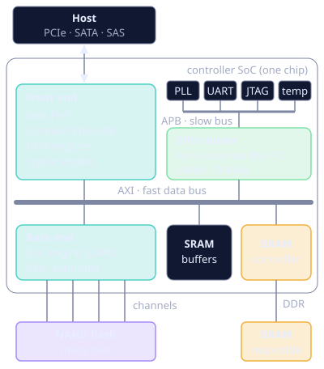
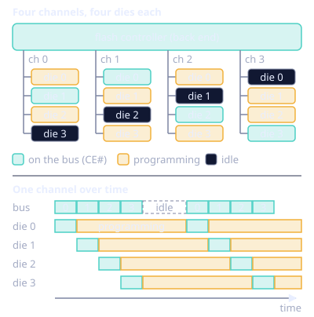
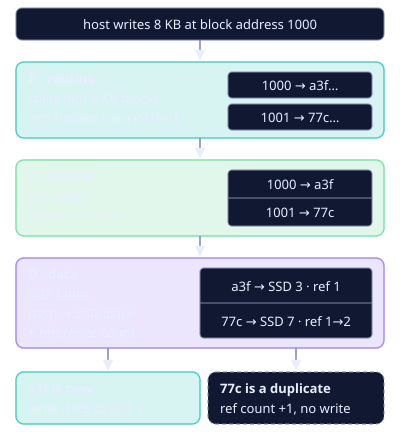

# Chapter 2 — SSD Controllers & All-Flash Arrays (主控和全閃存陣列)

[Chapter 1](ch1-overview.md) reduced a solid-state drive (SSD) to three core technologies: controller + flash + firmware. This chapter zooms into the first of them — the **controller (主控)**, the system on chip (SoC) that talks to the host on one side, drives the flash on the other, and runs the flash translation layer (FTL) in between. A controller's quality directly determines a drive's performance, lifespan, and reliability.

The chapter has three parts. The first (§2.1–2.5) dissects **the controller chip**: its internal architecture, the vendors who make it, and three case studies of real silicon. The second (§2.6–2.7) widens out **beyond the single drive**: what happens when you build an enterprise array out of dozens of SSDs, and what happens when you put compute *inside* the storage. The third (§2.8) comes back down to **the circuit board** the controller sits on: its power, memory, boot flash, sensors, and the wires to the host. If your time is limited, §2.1 and §2.6 are the load-bearing sections.

!!! abstract "In this chapter"
    - **SSD system architecture** ⭐ — front end, CPU cluster, back end, and the channel × die parallelism that sets performance (§2.1)
    - **Who makes controllers** — Marvell, Samsung, the Taiwanese and mainland-Chinese field, and how it looks in 2026 (§2.2)
    - **Three case studies** — a SATA speedster, the enterprise/consumer unification argument, an enterprise NVMe ASIC (§2.3–2.5)
    - **All-flash arrays** ⭐ — XtremIO's content-addressed architecture, dedup, and zero-IO copies (§2.6)
    - **Computational storage** — when the CPU becomes the bottleneck, move compute to the data (§2.7)
    - **The board around the controller** — power rails, DRAM, boot flash, power-loss capacitors, sensors, and the sideband wires to the host (§2.8)

---

## 2.1 SSD system architecture ⭐

An SSD controller is a **system on chip (SoC)** — a complete little computer on one chip: processor (CPU) cores, random-access memory (RAM), hardware accelerators, buses, and data encode/decode units. A typical design uses **Arm** cores and splits into a **front end** and a **back end**, linked by a fast **Advanced eXtensible Interface (AXI)** bus for data and a slow **Advanced Peripheral Bus (APB)** for peripherals. The firmware sits on top, orchestrating every hardware block to move data host ↔ flash.

Think of it as an assembly line: the **front end** is the loading dock (receives orders from the host), the **CPU + FTL** is the manager (decides what happens), and the **back end** is the warehouse crew (actually stores and retrieves goods in the flash).

{ .sdd-fig }
/// figure-caption
Inside a controller SoC. The dynamic RAM (DRAM) and the NAND flash are separate chips; everything else shares one die. Data moves between the front end, on-chip static RAM (SRAM), the DRAM controller and the back end over the fast AXI bus, while slow peripherals sit on the APB bus.
///

### 2.1.1 Front end (前端)

The front end is the **host interface controller** — where the drive talks to the computer. Three interfaces dominate:

| Interface | Speed class | Where you find it |
|---|---|---|
| **SATA** (Serial ATA) | 6 Gbps (~560 MB/s usable) | consumer & low-end enterprise; SATA 1.0 dates to 2001 (Intel/IBM/Dell/Seagate committee) |
| **SAS** (Serial Attached SCSI) | 12 Gbps per lane | enterprise; the serial successor to parallel SCSI |
| **PCIe** (PCI Express) | ~1 GB/s per lane per direction at Gen3, doubling each generation (~4 GB/s at Gen5); ×1–×32 | the high-speed path; originally Intel's "3GIO" (2001), built to replace PCI/PCI-X/AGP |

Two details worth keeping:

- **SAS (Serial Attached SCSI) is backward-compatible with SATA (Serial ATA).** SAS carries SCSI, the Small Computer System Interface command set of enterprise storage, as SATA carries ATA (AT Attachment), the command set of PC disks; a SATA drive works in a SAS environment, never the reverse. SAS carries three sub-protocols: the Serial SCSI Protocol for commands, the Serial Management Protocol for management, and the SATA Tunneling Protocol, which carries SATA traffic.
- **PCIe (PCI Express) is point-to-point, not a shared bus** — each device gets dedicated lanes and therefore dedicated bandwidth, plus active power management, error reporting, hot-plug, and quality-of-service controls. [Chapter 5](ch5-pcie.md) is devoted to it.

**What the front-end hardware actually does.** The **PHY (physical layer)** receives the raw serial bit stream and recovers digital signals. Downstream blocks parse the commands — NVM Express (NVMe, named for non-volatile memory), SATA or SAS — and move data by **direct memory access (DMA)**: dedicated engines copy data between the host's memory and the drive's buffers without a processor touching each byte. Commands queue up and data lands in fast on-chip **static RAM (SRAM)**. Encryption and compression, when needed, run in dedicated hardware — done in software they would become the bottleneck.

**A concrete walk-through — a SATA Write FPDMA (first-party DMA) command.** Worth internalizing, because it shows the front end isn't passively "receiving" — there's a handshake. FPDMA is SATA's queued transfer mode, and all SATA transfers travel as **FIS (Frame Information Structure)** packets:

1. Host puts a **Write FPDMA command FIS** on the bus.
2. The SSD checks whether its write buffer has room. If yes → it answers with a **DMA Setup FIS**; if no → it stays silent and the host waits. *(This is flow control, 流控.)*
3. Host sends a **Data FIS** of up to 8 KB.
4. Steps 2–3 repeat until all data has crossed.
5. The SSD sends a **Status FIS** — success or error — and the write is complete at the protocol level.

The front end still isn't done: the firmware's **command decoder** parses the FIS into what the FTL understands — read or write? starting logical block address (LBA) and length? special attributes — must the data reach flash before the drive reports success (Force Unit Access, FUA)? is it sequential relative to the previous command? Only then does the command join a queue for the FTL, which can now map that logical range to physical flash. (Watch this handshake play out packet-by-packet in the [Packet Dresser animation](../animations/packet-dresser.md).)

### 2.1.2 Controller CPU (主控CPU)

The CPU cluster looks like any embedded SoC: one or more cores plus their memories and peripherals — I-RAM for code, D-RAM for data, a phase-locked loop (PLL) that generates the clocks, input/output (IO) pins, timers, DMA engines, temperature sensors, power regulators — and the debug ports every firmware engineer lives in: a serial console (UART, for universal asynchronous receiver-transmitter), general-purpose input/output (GPIO) pins, and a JTAG port (named for the Joint Test Action Group that standardized it) for stepping through code on the chip.

**The design decision that matters — symmetric vs asymmetric multiprocessing:**

- **Symmetric multiprocessing (SMP):** all cores share one operating system (OS) image and one copy of code, plus shared I-RAM/D-RAM. Simpler — but cores contend for the shared memory, and contention costs speed.
- **Asymmetric multiprocessing (AMP):** each core runs *its own* code out of *its own* I-RAM/D-RAM. Cores run independently, with no memory contention.

SSD workloads decompose naturally into independent tasks, so when a controller needs more compute, AMP tends to win. Either way, the firmware architect's goal is **balancing load across cores** — no core worked to death while another idles — because that balance is where maximum throughput comes from. [Supplement G](../supplements/g-firmware.md) follows that firmware's own life: boot, updates and debugging.

### 2.1.3 Back end (後端)

??? example "🎬 Animate this — The Flash Timing & Parallelism Lab"

    The bus, the registers and the planes on one timeline — toggle pipelining and asynchronous independent plane read (AIPR) and watch the bars move.

    [Animation page](../animations/flash-timing-lab.md) · [open full-screen ↗](../animations/files/flash_timing_lab.html)

    <iframe src="../../animations/files/flash_timing_lab.html" width="100%" height="640" class="sdd-anim" loading="lazy" title="The Flash Timing & Parallelism Lab"></iframe>

Two big blocks: the **error-correcting code (ECC) module** and the **flash controller**.

**ECC module (the data codec).** Flash has an inherent bit-error rate, so every write gets ECC parity added (encoding) and every read gets checked and corrected (decoding). If errors exceed the code's correcting power, the data returns to the host flagged *uncorrectable*. The two algorithm families are **BCH (Bose–Chaudhuri–Hocquenghem) codes** and **LDPC (low-density parity-check) codes** — and LDPC has become the mainstream, because it corrects more errors per parity bit, which is exactly what denser 3D flash with triple-level cells (TLC) and quad-level cells (QLC) demands. ([Supplement A](../supplements/a-ecc-coding-theory.md) builds both from first principles.)

**Flash controller.** Issues commands in the Open NAND Flash Interface (ONFI) or Toggle standard and manages the traffic between cache and flash ([Chapter 3](ch3-nand-flash.md) §3.3 covers the flash side of this conversation).

**How the controller physically wires to flash.** The unit that executes a flash command is a **die (LUN)**. Its pin interface is startlingly narrow: **8 I/O pins** carry command, address, *and* data — all multiplexed — plus five control signals (address latch enable ALE, command latch enable CLE, write enable WE#, read enable RE#, and chip enable CE#), a ready/busy status pin (R/B#), and write-protect (WP#). CLE vs ALE tell the chip whether the bytes currently on the I/O pins are a command or an address.

**Channels and parallelism — the key performance idea.** The flash controller runs **multiple channels** in parallel, and each channel hosts multiple dies sharing one bus. Which die is being addressed? Whichever one has its **CE# (chip enable)** asserted — a channel typically offers 4–8 CE lines. More channels × more dies per channel = more operations in flight = more throughput. **This channel × die parallelism is the single biggest lever on SSD performance** — it's why the timing-lab animation above is worth ten minutes of play, and why thermal throttling (Ch 1 §1.5.5) works by *reducing* that parallelism.

{ .sdd-fig }
/// figure-caption
Channel × die parallelism. Top: each channel is one shared bus, and its chip-enable (CE#) lines decide which die is listening; at any moment one die per channel is on the bus while others program. Bottom: one channel over time. The bus hands each die its page, then serves the next die while the first one programs. Here a program lasts five transfers, so four dies leave the bus idle between rounds; real program times are many times longer than a page transfer, which is why each channel carries several dies.
///

---

## 2.2 Controller vendors

The controller is a chip business with high technical barriers (chip design and fabrication) and broad market reach. Early on there were few players; as SSDs boomed, controller startups sprang up like bamboo shoots after rain. §2.2.1–2.2.3 are a field guide to the market as it stood around 2018; §2.2.4 brings it up to 2026.

### 2.2.1 Marvell

In 2018 Marvell was the **world's #1 hard disk drive (HDD) and SSD controller vendor**. It entered SSD controllers in 2007, shipped its first SATA controller (Davinci) in 2008, and built a full product line across the low, middle and high end. Its differentiators:

- **NANDEdge** — proprietary LDPC error correction (in its 3rd generation at the time), used across its SATA/SAS/NVMe lines, supporting 2D/3D and TLC/QLC flash.
- **Artemis series (88NV1120/1160)** — the world's first PCIe NVMe controllers needing **no DRAM cache**, via **HMB (Host Memory Buffer)**: the drive borrows a slice of the host's memory instead ([Chapter 4](ch4-ftl.md) §4.2 explains the trade-off).
- A rich software development kit (**SDK**), letting partners spend their software teams on differentiation instead of plumbing.
- Aggressive process migration: first to 28 nm, then moving the line to 16 nm while competitors sat on 40/55 nm. Its 88SS1074 SATA controller shipped 50M+ units in 18 months.

### 2.2.2 Samsung

Samsung's controllers go **only into Samsung's own SSDs** — vertical integration in silicon form. The lineage is worth recognizing on datasheets: MCX (830 series) → MDX (840/840 Pro) → MEX (850 Pro/840 EVO, which added TurboWrite) → MGX/MFX (lower-capacity EVOs). Each generation raised core counts, clocks, and cache sizes — a line that continues through Pascal (990 Pro) to Presto (9100 Pro, §2.2.4).

### 2.2.3 Taiwanese & mainland-Chinese controllers

The common **Taiwanese** controllers come from **JMicron, Silicon Motion (SMI, 慧榮), and Phison (群聯)** — inexpensive and beloved by small and mid-size SSD makers. By 2018 JMicron had faded; SMI and Phison mattered:

**Silicon Motion (SMI).** A flash-controller leader since 2000, moving from memory cards and Universal Serial Bus (USB) drives to phone storage (embedded MultiMediaCard, eMMC, then Universal Flash Storage, UFS) and on to SSDs: by 2018 it had shipped 5B+ flash controllers and 100M+ SSD controllers. SMI works with every major flash fab, which gives it early sight of NAND roadmaps — and design wins even inside Intel consumer SSDs and Crucial's MX500 (SM2258H + Micron 64-layer TLC). Strengths: full **turnkey** solutions (controller → firmware → reference board → flash pairing), **NANDXtend** LDPC-based ECC (claimed up to 3× flash-life extension, in its 4th generation at the time), and a **self-developed PHY** — moving to 28 nm for PCIe Gen3 and first to target 12 nm for Gen4.

**Phison.** Founded November 2000 on the world's first single-chip USB-drive controller; by 2018 a leader across USB/SD/eMMC/UFS/SATA, a **co-founder of ONFI**, and an SD Association board member. Like SMI, it powers smaller makers and serves as the big brands' entry-level choice.

**Mainland players** as of 2018, in one breath each: **HiSilicon** (very strong, Huawei-internal only); **Unigroup/Ramaxel**; **Guoke Micro** (GK2101: 40 nm, SATA/NVMe, LDPC); **Hualan Micro** (a bridge-chip approach — SATA-to-eMMC — whose controller needs no FTL at all, trading performance and lifespan for much lower development difficulty); **DERA** (TAI controller — §2.5); **Starblaze** (spun out of Memblaze — its STAR1000 stars in §2.4); plus Shandong Huaxin, Greenliant (founded by SST's Bing Yeh), SiliconGo (硅格 — §2.3), and GigaDevice, which bought a Wuhan SSD fab and hired ex-SandForce engineers. The theme: a crowded field where survival takes patience and genuinely good products.

### 2.2.4 The field as of 2026

The same three kinds of company still make controllers, but the balance has shifted.

**Flash makers design their own.** Samsung still pairs its drives with controllers of its own design: its 9100 Pro (2025) runs on Presto, a five-core Arm Cortex-R8 controller built on Samsung's 5 nm process, beside Samsung flash and DRAM. Micron's 9650, the first PCIe 6.0 SSD to reach mass production, uses a controller Micron designed itself. Owning the controller, the flash and the firmware lets a company tune all three together.

**Merchant controllers moved to leading-edge silicon.** Phison and Silicon Motion remain the main independent suppliers, and both build their flagship PCIe 5.0 client controllers on TSMC's 6 nm process: Silicon Motion's SM2508 reached mass production in 2024, and Phison's E28 (2025) replaced the 12 nm E26. The reason is power. A PCIe 5.0 ×4 drive moves about 14 GB/s, and it has to do so within an M.2 card's thermal limits without throttling; Silicon Motion puts the SM2508 itself at about 3 W, and a whole drive built on it under 7 W.

Notice what did *not* grow: both chips still have eight NAND channels, as 2018's high-end controllers did. The speed came from faster channels instead. The SM2508 runs each channel at up to 3,600 megatransfers per second (MT/s), one byte per transfer, so eight channels carry about 28.8 GB/s — about twice what the host link can take. That headroom covers ECC parity, garbage-collection traffic, and the gaps while dies are busy (§2.1.3).

**Mainland China's merchant vendors grew up.** Maxio (聯芸科技), founded in 2014, listed on Shanghai's STAR Market in November 2024 and sells a full line of PCIe 5.0 controllers, from the MAP1806 for mid-range client drives to the MAP1803 for enterprise drives.

**Data-center controllers lead each generation.** Marvell's Bravera SC5 family (2021) was the first PCIe 5.0 SSD controller, with 8- and 16-channel versions, dual-port support for redundant servers, and a package small enough for E1.S drives. PCIe 6.0 started the same way: after Micron's in-house controller came the merchant parts — Silicon Motion's SM8466, built on TSMC's 4 nm process, and Phison's X3.

---

## 2.3 Case study: SiliconGo SG9081 — anatomy of a fast SATA controller

The three case studies that follow (§2.3–2.5) are chips from the PCIe 3.0 era, around 2018. The silicon has moved on; the design patterns have not.

Three techniques carry this design, and the pattern generalizes:

1. **HAM + GoCache accelerate small random IO.** HAM (Hardware Acceleration Module) moves hot algorithm paths into hardware, freeing the microcontroller (MCU); GoCache manages the mapping table efficiently in hardware. Together they lift small-block random performance.
2. **DMAC accelerates sequential throughput.** Large sequential transfers run through the DMA controller (DMAC) *without* occupying the MCU: the bus arbiter hands the bus to the DMAC, the transfer streams at full speed while the MCU does other work, then the bus comes back.
3. **LDPC + internal RAID (redundant array of independent disks) for reliability.** As flash went 2D → 3D, BCH stopped keeping up; LDPC corrects more errors per parity bit, and a RAID layer across the flash — the disk-array idea applied to dies — provides parity to rebuild data when a whole region fails.

!!! tip "The template hiding in this case study"
    Hardware-accelerate the small random stuff, DMA the big sequential stuff, and layer LDPC + RAID underneath. Nearly every controller in this chapter — and most on the market — follows exactly this template.

---

## 2.4 Case study: one controller for enterprise *and* consumer?

The two markets pull in different directions: enterprise SSDs prioritize random performance, latency, quality of service (QoS), and stability; consumer SSDs prioritize sequential performance, power, and price. Separate controller designs for each double the R&D bill. Can one chip serve both? Walking the six dimensions, the differences turn out to be shrinking:

1. **Cost** — enterprise tolerates higher cost, so target the consumer budget with shared hardware and differentiate in firmware.
2. **Performance** — NVMe U.2/M.2 became mainstream in both markets; in 2018 a 1U server carried 8+ U.2 drives at 300–400K random input/output operations per second (IOPS) each (plenty for most workloads), while high-end consumer M.2 already streamed ~3.5 GB/s, near enterprise sequential numbers. (By 2025, PCIe 5.0 consumer drives reached about 14.8 GB/s.) Data centers also increasingly reorganize writes into *sequential* patterns before they hit the drive, softening the enterprise random-write requirement.
3. **Endurance** — differs by market, but endurance is mostly a *flash* property; the controller's job — maximize error correction — is identical in both.
4. **Capacity** — differs, so the controller must simply support large flash configurations cheaply enough for both.
5. **Reliability** — enterprise demands ECC + die-level RAID; with 3D flash, fabs now recommend die-RAID even for consumer drives. Converged.
6. **Power** — consumer is most sensitive (batteries), needing many power states and fast wake. But power is ~20% of a data center's operating cost, so enterprise is converging here too.

**Conclusion: hardware unification is feasible; differentiation lives in firmware.** Starblaze's **STAR1000** is the proof-of-concept: SMP architecture for flexibility; error-checking on SRAM, DRAM, and every datapath (an enterprise-grade requirement); RAID5/6 made cheap by clever SRAM sharing (the RAM returns to firmware when RAID isn't in use); and an NVMe subsystem built from two 32-bit CPUs plus an NVMe hardware accelerator — hitting consumer power targets while still offering queue scheduling, high-performance scatter-gather lists (SGL), atomic operations, the host and controller memory buffers (HMB, CMB), and single-root I/O virtualization (SR-IOV) with multiple virtual functions ([Chapter 6](ch6-nvme.md) explains those NVMe features).

---

## 2.5 Case study: DERA TAI — an enterprise NVMe ASIC

NVMe was designed for modern multi-core hosts and for flash's native concurrency ([Chapter 6](ch6-nvme.md)). Inside an NVMe SSD, enormous numbers of IO transactions are in flight at once, each demanding hardware work — some of it compute-heavy (ECC codecs, encryption) — under a tight power budget. That's why serious NVMe controllers are **highly customized application-specific integrated circuits (ASICs) co-designed with their NAND-management firmware**, not general-purpose chips.

**DERA TAI:** PCIe Gen3 ×8 (or ×4) front end, many NAND channels, strong ECC, and **ECC plus cyclic redundancy check (CRC) protection on every internal datapath**. It targets the enterprise, so the two design pillars are **performance stability** and **data reliability** — enterprise applications want consistently low latency, which means engineering away jitter by finely scheduling front-end IO against background work. (Rated at 500K random-write / 1,250K random-read IOPS.)

Its reliability toolbox is a checklist of enterprise-grade mechanisms:

- **Per-channel ECC at 100 bits / 1 KB** — balancing decoder complexity, silicon area, power, and *deterministic* decode latency.
- **Active fault management** — flash degrades gradually (error rates climb before hard failure), so TAI tracks per-page raw error rates in real time, proactively retires failing regions, and feeds real wear data into **wear leveling** decisions.
- **Chip-to-chip redundancy** — RAID across dies: if one chip's block goes bad, rebuild it from the others ([Chapter 3](ch3-nand-flash.md#344-raid-inside-the-ssd) §3.4.4 shows the mechanism).
- **Power-loss protection** — hardware monitors the supply and fails over to backup capacitors to preserve in-flight data (§2.8.3 sizes the capacitors; [Supplement D](../supplements/d-power-management.md) covers power management).
- **Thermal/power self-monitoring** — dynamic throttling to survive poorly ventilated installations.

---

## 2.6 All-Flash Arrays (AFA) ⭐

An all-flash array (AFA) is a big enterprise storage box built from many SSDs. The instructive example — and this section's case study throughout — is **EMC XtremIO (XIO)**, which EMC made generally available in November 2013; the hardware described below is that first generation.

*The mental model to carry through: an AFA is "an array of SSDs" the way an SSD is "an array of flash dies" — but each level up is a qualitative leap that demands a re-designed architecture, not just more of the same.*

### 2.6.1 The anatomy

A standard XtremIO array is two or more **X-Bricks** linked by **InfiniBand**. One X-Brick contains:

- 1 high-end uninterruptible power supply (UPS)
- **2 storage controllers**
- a **DAE** (Disk Array Enclosure) full of SSDs, each SAS-connected to both controllers
- (in multi-brick arrays) 2 InfiniBand switches for the controller interconnect

**A storage controller is just an Intel server**: two Xeon E5 CPUs in a non-uniform memory access (NUMA) layout, 256 GB RAM per CPU, two InfiniBand controllers, two SAS host bus adapters (HBAs) — with every cable duplicated for redundancy.

**Capacity math:** one X-Brick = 10 TB raw, 7.5 TB usable — but with the typical ~5:1 dedup + compression ratio, ~37.5 TB *effective*. **Real deployment numbers:** a 2-X-Brick array ran 550 virtual machines (VMs) serving 7,000 users, averaging 350–400 MB/s at 20K IOPS with peaks of 20 GB/s and 200K IOPS. The management console shows the live data-reduction ratio (e.g. 2.5:1 = dedup 1.5:1 × compression 1.7:1) alongside per-SSD and aggregate bandwidth/IOPS/latency.

### 2.6.2 Hardware architecture

XtremIO was EMC's assault on the AFA market, designed **from the ground up around flash characteristics** rather than adapted from a disk array. Each X-Brick's DAE holds **25 × 400 GB eMLC SSDs** — enterprise multi-level-cell (MLC) flash with roughly 10× the endurance of ordinary MLC — plus two **BBUs** (battery backup units; the second is for redundancy).

**Scale-out:** X-Bricks cascade to 4 (later 8), interconnected by **40 Gbps InfiniBand** on the back end; hosts connect over **8 Gbps Fibre Channel (FC) or 10 Gbps iSCSI** (Internet SCSI, carried over IP networks); SSDs attach via **6 Gbps SAS**. Each controller also carries two local SSDs — for dumping in-memory metadata on power loss (dedup is memory-hungry: every stored block needs a hash entry) — and two SAS disks for the OS. The separation is deliberate: controllers own their system disks, the DAE holds only user data, so **controllers can be upgraded without touching stored data**.

**The "real performance" lesson.** Many vendors quote peak numbers from an empty array — or worse, from DRAM cache hits. What matters is **steady state**: XtremIO's per-brick ratings — **100K IOPS** at 100% 4KB write, **150K** at 50/50, **250K** at 100% read — are measured **with the array over 80% full**, because only then is garbage collection running inside the SSDs and the numbers honest. This is the array-scale version of the fresh-out-of-box (FOB) versus steady-state lesson from [Chapter 1](ch1-overview.md#152-performance), and adding bricks scales these numbers linearly.

### 2.6.3 Software architecture — the real value

Storage hardware is commoditized; **software is the product**. (If an iPhone ran Android, would anyone queue overnight for it?) XIO's software weapons:

- **Dedup** — saves capacity, and *because it eliminates duplicate writes*, it also reduces write amplification, extending flash life.
- **Thin provisioning** — volumes take capacity only as data actually lands.
- **Mirroring** without capacity/performance penalty.
- **XDP (XtremIO Data Protection)** — RAID 6-class data protection.
- **VAAI integration** — vStorage APIs for Array Integration, VMware's offload interface (§2.6.4).

**Six design principles**, each a direct answer to a flash property:

1. **Everything for random performance** — any block on any node costs the same to access, so performance scales linearly with nodes.
2. **Minimize write amplification** — fewer background writes, longer flash life.
3. **No global garbage collection** — the SSDs' own controllers already collect garbage well; duplicating it at array level would only add write amplification. Let each layer do its job.
4. **Content-based placement** — a block's location derives from a *hash of its content*, not its logical address. Data spreads evenly and randomly by construction.
5. **True Active/Active** — LUNs have no owning controller; any node serves any volume, so a node failure degrades capacity, not architecture.
6. **Linear scalability** — capacity and performance grow together as bricks are added.

**Why does XIO run in Linux *user space*?** Three reasons, one of them legal: (1) **speed** — no kernel-mode context switches on the IO path; (2) **simpler development** — no kernel interfaces, kernel memory management, or kernel crash semantics; (3) **the GPL** — kernel code must be open-sourced, and XIO's algorithms are the crown jewels. (Open-sourced, the array couldn't command premium prices — high tech sold at cabbage prices.) One process, **X-ENV**, runs per CPU and deliberately grabs *all* CPU and memory — to use 100% of the hardware, to prevent any other process from disturbing latency, and to stay portable. That portability was proven when EMC moved XIO onto its standard white-box servers after the acquisition: no field-programmable gate arrays (FPGAs), no custom silicon anywhere, so the software rides each new Intel generation for free.

### 2.6.4 Workflow — how IO actually flows

Six software modules. Three move data — **R, C, D** — and three control the system — **P** (Platform: hardware monitoring, one per node), **M** (Management: volumes, LUN masking via the XtremIO Management Server; one active + one standby), **L** (Cluster: membership, one per node).

The data path trio:

- **R (Routing)** — the gatekeeper: owns the FC/iSCSI ports, translates SCSI into XIO's internal commands, **splits all IO into 4 KB blocks**, and **computes each block's SHA-1 hash** (Secure Hash Algorithm 1: a 20-byte fingerprint of the block's content).
- **C (Control)** — owns the **A2H (address-to-hash) table**, which maps each logical address to the hash of the data stored there; the home of mirroring, dedup accounting, and auto-expansion.
- **D (Data)** — owns the **H2P (hash-to-physical) table**, which maps each hash to a physical SSD address — *placement depends only on content* — and performs the actual SSD IO plus XDP protection.

**Read:** host → R (split into 4 KB) → C (A2H: address → hash) → D (H2P: hash → physical → read).

**Fresh write:** host → R (split, hash) → C (hash not found — new entry) → D (allocate physical address, write).

**Duplicate write:** host → R (split, hash) → C (hash **found**) → D **writes nothing and increments the block's reference count**. Dedup isn't a background scrubber — it happens *inline, on the write path, for free*.

{ .sdd-fig }
/// figure-caption
One 8 KB write through XtremIO's data modules (addresses in 4 KB blocks, hashes shortened). Where a block lands depends only on its hash, and a duplicate costs a table update instead of an SSD write.
///

**The payoff — copying with zero IO.** When an ESXi host (VMware's hypervisor) clones a virtual machine (VM) through **VAAI**, R routes the request to a C module, which copies a *metadata address range* in the A2H table; D sees every target block is a duplicate and just bumps reference counts. **An entire VM copy causes no SSD data IO at all.** The catch: those metadata updates live in RAM, so power loss is the dread scenario — hence a journaling scheme that copies each metadata change into a remote controller's memory over remote direct memory access (RDMA) and persists it via XDP.

**Module placement follows the silicon.** Each controller runs one X-ENV per CPU: **R+C on CPU1, D on CPU2** — because the SAS host bus adapter (HBA) hangs off CPU2's PCIe lanes (Sandy Bridge integrated the PCIe root complex into the CPU), and D is the module that talks to the SSDs. Software arranging itself around the hardware topology, and re-arranging when the topology changes, is XIO's quiet superpower.

**Inter-module communication** all rides InfiniBand — **RDMA** for data, **remote procedure calls (RPC)** for control. Out of a total IO latency of 600–700 µs, InfiniBand contributes only 7–16 µs — which is why adding X-Bricks doesn't add latency: a 4 KB block enters at some R, its hash lands on a statistically random C, and no node is special. That's the mechanism behind "linear scalability."

### 2.6.5 Use cases

Enterprise flash is expensive, so an AFA doesn't replace big-capacity storage area network (SAN) arrays. It wins where the working set is small but hot: **virtual desktop infrastructure (VDI)**, **databases**, **SAP**. Databases benefit twice — raw performance *plus* near-free copies for dev/test replicas. Real deployments ran **2,500–3,500 VDI VMs on a single X-Brick at sub-millisecond latency** — VDI is dedup heaven, since thousands of VMs share nearly identical OS images.

**What makes an AFA architecturally distinctive?** Versus an SSD: it does **no** garbage collection, wear leveling, or read-disturb handling — the member SSDs' controllers own all of that. Versus a traditional disk array: its defining features are **inline dedup** and **RAID6-style protection that always writes to new addresses**.

---

## 2.7 Computational storage — SSDs that compute

**The problem.** Data is exploding (a single autonomous test car can generate terabytes a day) while the three legs of infrastructure grew unevenly: networks got fast, storage got fast (by 2018, PCIe 3.0 ×8 SSDs exceeded 4 GB/s) — but CPU scaling stalled as Moore's law slowed. **Compute became the bottleneck**: data now streams off the SSD faster than the CPU can process it, especially for image/video pipelines and deep learning.

**The idea: move compute into the storage.** Fangyi Technology's **CFS (Computing Flash System)** is the pattern: a **field-programmable gate array (FPGA) riding a PCIe 3.0 ×8 SSD** (~5 GB/s). Data streams off the flash straight into the FPGA, which filters/transforms/analyzes it and sends only *results* to the host. Every part returns to its natural role: **CPU controls, FPGA computes, SSD stores.**

**Why it matters.** A self-driving car's sensors produce ~1 GB/s. CPU plus graphics processing unit (GPU) compute boxes for the job draw kilowatts — a thermal and electrical hazard in a vehicle — while FPGAs deliver the needed throughput at a fraction of the power (Audi's autonomous platform chose FPGAs). Only PCIe SSDs can even *record* that sensor stream (>1 GB/s sustained writes), data that today mostly gets discarded; an FPGA-SSD both stores it and analyzes it in place. The same logic drives AI storage: run the hardware algorithm where the data lives, ship back only the answers.

**Where it stands in 2026.** The idea has since been standardized. In January 2024 NVM Express released two command sets for it: *Computational Programs*, which lets a host load, activate and run programs on a drive, and *Subsystem Local Memory*, which gives those programs memory inside the drive that the host can read and write with NVMe commands. SNIA (the Storage Networking Industry Association) publishes a Computational Storage API, an application programming interface built to work with both.

---

## 2.8 The board around the controller

A controller can't run on its own. Look at any SSD's circuit board and, beside the controller and the flash packages, you find a handful of supporting parts: a chip that makes the right voltages, DRAM for the map, a small flash chip holding the first code to run, a temperature sensor, and, on enterprise drives, a row of capacitors. The connector carries more than data lanes, too: a few slow *sideband* wires let the host reset the drive, manage its clock and talk to it out of band. This section takes the parts one at a time.

{ .sdd-fig }
/// figure-caption
The board around the controller, with M.2's signal names. Enterprise drives add the capacitor bank; DRAM-less drives drop the DRAM and borrow host memory instead ([§4.2.3](ch4-ftl.md#423-hmb-host-memory-buffer)).
///

### 2.8.1 Power: the PMIC and its rails

The host supplies one voltage: 3.3 V on an M.2 connector, and 12 V on U.2 and on EDSFF (Enterprise and Data Center Standard Form Factor) drives, which also get a small 3.3 V auxiliary supply that keeps their management logic alive. The chips on the board need several others. The controller's core logic runs below 1 V on a modern process, and its PCIe PHY and input/output pins need rails of their own. DRAM needs about 1.1–1.2 V (for the DDR4 and LPDDR4 generations), and each NAND package needs a core supply (VCC, about 2.5–3.3 V) plus a lower supply for its I/O pins (VCCQ, 1.2 or 1.8 V).

A **power management IC (PMIC)** makes them all: switching (buck) converters for the high-current rails, small low-dropout (LDO) linear regulators for the quiet ones, and the logic to start them in the right order.

The order matters. The rails must come up in a defined **sequence**, and the PMIC holds the controller in reset until every rail is stable; its *power-good* signal is the controller's permission to start running code. The PMIC also watches its input. A sagging supply is the first sign of a power failure, and the PMIC raises an alarm so the firmware can react (§2.8.3).

### 2.8.2 DRAM: the map table's home

Most controllers keep their working state in a DRAM chip beside them. The biggest tenant is the mapping table: with a 4-byte entry for every 4 KB page, it needs about 1 GB of DRAM per 1 TB of flash, the 1/1000 rule of [§4.2.2](ch4-ftl.md#422-how-mapping-works-and-the-dram-question). Write buffers and firmware metadata take the rest.

Client drives usually carry low-power DRAM (LPDDR4 or LPDDR4X) or ordinary DDR4 (DDR stands for double data rate). Enterprise drives protect their DRAM with ECC, because one flipped bit in the map silently sends a read to the wrong place, or lets a write land on someone else's data. DRAM-less designs drop the chip to save cost, power and board space: they keep part of the map in on-chip SRAM and, over NVMe, borrow host memory through the Host Memory Buffer ([§4.2.3](ch4-ftl.md#423-hmb-host-memory-buffer)).

### 2.8.3 Power-loss protection: capacitors that buy milliseconds

When the supply disappears, an SSD may hold data that exists only in its RAM: writes it has already reported complete (acknowledged from its write buffer) and map updates not yet saved to flash. Client drives mostly live with this. The host forces out what it must keep, with a Flush command or writes marked Force Unit Access, and after power returns the FTL rebuilds its map from what reached the flash ([§4.6](ch4-ftl.md#46-power-loss-recovery)). Enterprise drives promise more: a write they acknowledge is durable. So they carry **power-loss protection (PLP)**, a bank of capacitors that keeps the drive running for the tens of milliseconds it needs to save everything:

1. The PMIC sees its input fall below a threshold and disconnects the drive from the host supply, so the capacitors can't drain back into the host.
2. The capacitor bank now feeds the rails.
3. The firmware gets a power-fail interrupt. It stops taking commands, writes the buffered data and the pending map updates to flash (often in fast single-level-cell (SLC) mode), and then lets the power go.

Sizing the bank is energy arithmetic. A capacitor \( C \) charged to voltage \( V \) stores \( E = \tfrac{1}{2} C V^2 \), but the hold-up converter can only draw it down to some minimum voltage, so the usable energy between \( V_1 \) and \( V_2 \) is \( \tfrac{1}{2} C \, (V_1^2 - V_2^2) \). Because the energy grows with the square of the voltage, many designs charge the bank well above the supply voltage.

!!! example "Worked example: sizing a capacitor bank"
    A drive draws 10 W and needs 20 ms to save its buffers: 10 W × 0.02 s = **0.2 J**.

    - Charged to 30 V and usable down to 10 V, the bank holds ½ × C × (30² − 10²) = 400 × C joules, so C = 0.2 ÷ 400 = **500 µF**.
    - Charged only to a 12 V supply and usable down to the same 10 V, it holds ½ × C × (12² − 10²) = 22 × C joules, so it needs C ≈ **9,100 µF**: eighteen times as much capacitance.

The capacitors are electrolytic or tantalum-polymer parts, and their capacitance fades with age, so enterprise firmware tests the bank from time to time. A failed bank shows up as a critical warning in the drive's SMART log (Self-Monitoring, Analysis and Reporting Technology, the drive's health report), because the drive can no longer keep its promise.

### 2.8.4 Boot: ROM first, then flash

A controller starts in stages. Its first instructions sit in a **boot ROM (read-only memory)**, fixed in the silicon when the chip was made. That code can never change, so it is kept small: set up the clocks, find the next stage, check it, and jump to it. Many boards keep that next stage, the **bootloader**, in a small serial **NOR flash** chip on a Serial Peripheral Interface (SPI) bus. NOR reads reliably without the machinery NAND needs (error correction, read retry), so the ROM can fetch from it with simple code. Other designs skip the NOR chip and store the bootloader in a reserved area of the NAND itself, written in robust SLC mode with several copies.

The main firmware image is far larger and always lives in flash. Firmware updates write a new image while keeping a known-good copy to fall back on, so a power failure in the middle of an update can't leave the drive unable to boot. On secure-boot designs, each stage checks the next stage's cryptographic signature before running it.

### 2.8.5 Temperature: sensors and throttling

Heat limits how much parallelism a drive can use ([§1.5.5](ch1-overview.md#155-power-thermals)). The controller measures its own die temperature with an on-chip sensor, many boards add a sensor near the NAND, and NAND dies carry sensors of their own. The firmware combines the readings into one **composite temperature**, which NVMe reports in its SMART log alongside up to eight individual sensors. The drive also states two limits in its Identify Controller data:

- the **warning composite temperature threshold (WCTEMP)**: above it the drive is running too hot, and it counts the minutes spent there;
- the **critical composite temperature threshold (CCTEMP)**: above it the drive may shut down to protect itself and its data.

Throttling keeps the drive below these limits by doing less at once: fewer dies active, lower clocks, sometimes a slower PCIe link. That is why a hot drive's speed falls in steps rather than smoothly. With Host Controlled Thermal Management (HCTM), the host can also set two trip points of its own, one for light throttling and one for heavy throttling.

### 2.8.6 Sideband signals: reset, clock, wake and management

Besides the PCIe lanes and their 100 MHz reference clock (REFCLK), an M.2 connector carries a few slow single-wire signals. A `#` in a signal's name means it is active when low.

- **PERST#** (the PCIe reset signal). The host holds it asserted while power and REFCLK settle; releasing it starts the drive's boot and link training. The drive must be quick: link training has to start within 20 ms, and the host may begin reading the drive's configuration space after 100 ms ([§5.10](ch5-pcie.md#510-pcie-reset) has the rules). The boot ROM and early firmware are tuned for that deadline.
- **CLKREQ#** (clock request). The drive holds it low while it needs REFCLK. Releasing it lets the host stop the clock during deep link sleep, in the L1 substates of [Supplement D §D.1](../supplements/d-power-management.md#d1-pcie-link-power-states-aspm).
- **PEWAKE#** (the PCIe wake signal). The drive pulls it low to ask the host to restore power and the link after the deepest sleep states, when only auxiliary power remains.
- **SMBus** (System Management Bus): two wires, derived from the I²C chip-to-chip bus, that let a management controller read the drive's temperature, health and identity without the operating system. On an M.2 drive it is optional.

SMBus is the backbone of *out-of-band* management in data centers. A server's baseboard management controller (BMC) polls every drive over SMBus using NVMe-MI, the NVMe Management Interface, so fans can be adjusted and failing drives flagged even while the operating system is down. U.2 and EDSFF connectors carry PERST# and SMBus too, and add signals of their own; EDSFF's PWRDIS (power disable), for example, lets a server power-cycle a hung drive without anyone pulling it out. [Supplement I §I.6](../supplements/i-data-center.md#i6-managing-fleets-nvme-mi-and-the-bmc) covers fleet management in full.

### 2.8.7 Client and enterprise boards compared

| | Client (M.2) | Enterprise (U.2, E1.S, E3.S) |
|---|---|---|
| Supply | 3.3 V | 12 V, plus 3.3 V auxiliary |
| Power-loss protection | usually none; the FTL recovers after power returns | capacitor bank |
| DRAM | DRAM, or DRAM-less with HMB | DRAM with ECC |
| Sideband use | reset, clock request, wake | reset, SMBus management (NVMe-MI), power disable |
| Host ports | one | often two (dual-port), so two storage controllers can reach the drive |

---

## Key takeaways

1. **A controller is a small computer**: front end (host protocol + flow control), CPU cluster (SMP/AMP running the FTL), back end (ECC codec + flash controller).
2. **Channel × die parallelism is the throughput lever.** Everything from datasheet IOPS to thermal throttling traces back to how many flash operations are in flight.
3. **The controller-design template**: hardware-accelerate random IO, DMA the sequential IO, and lay LDPC + die-RAID underneath.
4. **Hardware converges, firmware differentiates** — one silicon design can serve consumer and enterprise; the firmware decides which drive it becomes.
5. **XtremIO's lesson in layering**: address data by content hash, dedup inline, copy by reference count, and *don't* redo the garbage collection your SSDs already do.
6. **Computational storage inverts the data flow**: when the CPU is the bottleneck, ship compute to the data, not data to the compute.
7. **The board is part of the design.** A PMIC sequences the rails, DRAM holds the map, a boot ROM and boot flash start the firmware, capacitors on enterprise drives buy the milliseconds needed to save data at power loss, and sideband wires let the host reset the drive, stop its clock, wake it and manage it out of band.

---

## Key vocabulary

| Term | 中文 | Meaning |
|---|---|---|
| (main) controller | 主控（台：主控晶片） | The SoC that runs the firmware and moves data between the host interface and the flash. → [§2.1](#21-ssd-system-architecture) |
| system on chip (SoC) | 片上系統（台：系統單晶片） | One chip holding processor cores, memory, buses and hardware engines: a complete small computer. → [§2.1](#21-ssd-system-architecture) |
| front end / back end | 前端 / 後端 | The controller's host-facing half (protocol, command decode, DMA) and its flash-facing half (ECC, flash interface). → [§2.1](#21-ssd-system-architecture) |
| host interface | 主機接口（台：主機介面） | The link to the computer and the protocol spoken over it: SATA, SAS, or PCIe with NVMe. → [§2.1.1](#211-front-end) |
| PHY / physical layer | 物理層（台：實體層） | The circuitry that sends and receives the raw serial bit stream on the link. → [§2.1.1](#211-front-end) |
| direct memory access (DMA) | 直接內存訪問（台：直接記憶體存取） | Hardware that copies data between memory and a device without a processor moving each byte. → [§2.1.1](#211-front-end) |
| command decode/parsing | 命令解析（台：指令解析） | Turning a host command into what the FTL needs: read or write, start address, length and flags. → [§2.1.1](#211-front-end) |
| flow control | 流控（台：流量控制） | A receiver holding off a sender until it has room, as an SSD does by withholding SATA's DMA Setup FIS. → [§2.1.1](#211-front-end) |
| FIS (Frame Information Structure) | 幀信息結構（台：訊框資訊結構） | SATA's packet: commands, DMA setup, data and status all travel as FISes. → [§2.1.1](#211-front-end) |
| write buffer / buffer | 寫緩存 / 緩衝（台：寫入快取 / 緩衝區） | RAM where incoming write data waits before it is programmed into flash. → [§2.1.1](#211-front-end) |
| SMP / AMP | 對稱/非對稱多處理 | Cores sharing one code image and one memory (symmetric) versus each core running its own code from its own memory (asymmetric). → [§2.1.2](#212-controller-cpu-cpu) |
| flash controller | 閃存控制器（台：快閃記憶體控制器） | The back-end block that issues ONFI or Toggle commands to the NAND and moves data over the channels. → [§2.1.3](#213-back-end) |
| channel | 通道 | One shared bus from the flash controller to a group of dies; separate channels work in parallel. → [§2.1.3](#213-back-end) |
| enable signal / select signal | 使能信號 / 選通信號（台：致能訊號 / 選通訊號） | Control pins such as chip enable (CE#), which picks the die that listens on a shared channel. → [§2.1.3](#213-back-end) |
| encode / decode | 編碼 / 解碼 | Adding ECC parity to data on its way into flash, and using it to find and fix errors on the way out. → [§2.1.3](#213-back-end) |
| error-correcting code (ECC) | 糾錯碼（台：錯誤更正碼） | Redundant bits stored with the data that let the controller detect and correct bit errors; SSDs use the BCH and LDPC families. → [§2.1.3](#213-back-end) |
| turnkey solution | 交鑰匙方案（台：統包方案） | A controller sold with firmware, a reference board and flash pairing, so a small brand can ship a drive quickly. → [§2.2.3](#223-taiwanese-mainland-chinese-controllers) |
| hardware acceleration module | 硬件加速模塊（台：硬體加速模組） | Logic that runs a hot firmware path, such as map lookups, in hardware so the processor is free for other work. → [§2.3](#23-case-study-silicongo-sg9081-anatomy-of-a-fast-sata-controller) |
| unified / normalized (design) | 歸一化 | One controller design serving both enterprise and consumer drives, with the firmware making the difference. → [§2.4](#24-case-study-one-controller-for-enterprise-and-consumer) |
| redundancy / parity check | 冗餘校驗（台：冗餘檢查） | Extra data, such as parity across dies or a CRC on a data path, that lets the controller detect or rebuild damaged data. → [§2.5](#25-case-study-dera-tai-an-enterprise-nvme-asic) |
| all-flash array (AFA) | 全閃存陣列（台：全快閃陣列） | An enterprise storage system built only from SSDs, with software designed around flash. → [§2.6](#26-all-flash-arrays-afa) |
| storage controller | 存儲控制器（台：儲存控制器） | In an array, the server that runs the storage software and connects the hosts to the drives. → [§2.6.1](#261-the-anatomy) |
| DAE (disk array enclosure) | 磁盤陣列存儲櫃（台：磁碟陣列機箱） | The shelf of drives in an array, cabled to both storage controllers. → [§2.6.1](#261-the-anatomy) |
| cascade / scale-out | 級聯（台：串接） | Growing one system by adding units (X-Bricks), so capacity and performance rise together. → [§2.6.2](#262-hardware-architecture) |
| deduplication | 去重（台：重複資料刪除） | Storing identical blocks once and pointing every copy at the single stored block. → [§2.6.3](#263-software-architecture-the-real-value) |
| compression | 壓縮 | Encoding data in fewer bytes before it is stored. → [§2.6.3](#263-software-architecture-the-real-value) |
| mirroring | 鏡像 | Keeping two copies of the data, so either can serve it if the other fails. → [§2.6.3](#263-software-architecture-the-real-value) |
| user space / kernel space | 用戶態 / 內核態（台：使用者空間 / 核心空間） | Where ordinary programs run versus where the operating-system kernel runs; XtremIO runs in user space. → [§2.6.3](#263-software-architecture-the-real-value) |
| metadata | 元數據（台：中繼資料） | Data about data, such as XtremIO's address-to-hash and hash-to-physical tables. → [§2.6.4](#264-workflow-how-io-actually-flows) |
| reference count | 引用數（台：參照計數） | How many logical addresses point at one stored block; a duplicate write raises it instead of writing data. → [§2.6.4](#264-workflow-how-io-actually-flows) |
| routing module | 路由模塊（台：路由模組） | XtremIO's R module: it owns the host ports, splits IO into 4 KB blocks and hashes each one. → [§2.6.4](#264-workflow-how-io-actually-flows) |
| computational storage | 帶計算功能的存儲（台：運算型儲存） | Putting processing, such as an FPGA, inside the drive so that only results travel to the host. → [§2.7](#27-computational-storage-ssds-that-compute) |
| power management IC (PMIC) | 電源管理芯片（台：電源管理晶片） | The chip that turns the supply voltage into the board's rails and brings them up in the right order. → [§2.8.1](#281-power-the-pmic-and-its-rails) |
| power-loss protection (PLP) | 掉電保護（台：斷電保護） | Capacitors and firmware that keep a drive running long enough to save its buffered data when power fails. → [§2.8.3](#283-power-loss-protection-capacitors-that-buy-milliseconds) |
| boot ROM / bootloader | 啟動ROM / 引導程序（台：開機ROM / 開機載入程式） | The fixed first code in the controller's silicon, and the next stage it loads from flash. → [§2.8.4](#284-boot-rom-first-then-flash) |
| sideband signal | 邊帶信號（台：邊帶訊號） | A slow single-purpose wire beside the data lanes, such as PERST# (reset) or CLKREQ# (clock request). → [§2.8.6](#286-sideband-signals-reset-clock-wake-and-management) |
| reference clock (REFCLK) | 參考時鐘（台：參考時脈） | The 100 MHz clock the host sends alongside the PCIe lanes. → [§2.8.6](#286-sideband-signals-reset-clock-wake-and-management) |
| System Management Bus (SMBus) | 系統管理總線（台：系統管理匯流排） | A two-wire management bus on the connector, used to monitor drives through NVMe-MI. → [§2.8.6](#286-sideband-signals-reset-clock-wake-and-management) |
| out-of-band management | 帶外管理（台：頻外管理） | Monitoring and controlling a device over a separate path, such as SMBus, that works without the host operating system. → [§2.8.6](#286-sideband-signals-reset-clock-wake-and-management) |

---

## Check yourself

1. A single flash channel hosts 8 dies. What signal does the controller use to pick which die to talk to, and why do more dies mean more performance?

    ??? success "Answer"
        Chip enable (CE#). All dies on a channel share its 8 I/O pins, so the controller asserts the CE# line of exactly one die to say which one the bytes on the bus are for. More dies mean more operations in flight: a die spends most of a program or read busy inside itself, and while it is busy the controller uses the bus to feed the other dies, so their slow array operations overlap. See [§2.1.3](#213-back-end).

2. In the SATA Write FPDMA handshake, what does the SSD do if its write buffer is full — and what is that mechanism called?

    ??? success "Answer"
        It stays silent: it doesn't send the DMA Setup FIS, and the host waits. When buffer space frees up, the drive sends DMA Setup and the host sends the next Data FIS. This is flow control (流控): the receiver paces the sender so that data never arrives with nowhere to go. See [§2.1.1](#211-front-end).

3. XtremIO derives a data block's storage location from its *content*, not its logical address. Name two capabilities this design directly enables.

    ??? success "Answer"
        Inline deduplication: identical blocks produce identical hashes, so a duplicate is caught on the write path and stored only once, with a reference count. Even distribution: hashes are effectively random, so blocks spread evenly over all SSDs and nodes, which gives linear scalability without hot spots. Zero-IO copies, where cloning a VM only copies address-to-hash entries, follow from the same design. See [§2.6.3](#263-software-architecture-the-real-value) and [§2.6.4](#264-workflow-how-io-actually-flows).

4. Copying a VM on XtremIO involves almost no SSD reads or writes. Explain what actually happens instead.

    ??? success "Answer"
        Through VAAI, the hypervisor asks the array to do the copy instead of moving the data itself. A C module copies the range of A2H entries (address → hash) from the source addresses to the destination addresses. Every hash already exists, so D treats each block as a duplicate and only increments its reference count. The copy is a metadata operation in RAM, made safe against power loss by journaling the changes to another controller over RDMA. See [§2.6.4](#264-workflow-how-io-actually-flows).

5. Why does XtremIO deliberately *not* perform its own garbage collection, even though it's a flash-based system?

    ??? success "Answer"
        Because every member SSD already runs garbage collection inside its own controller. A second, array-level layer would move data that the SSDs then move again, adding write amplification and wear for no benefit. XtremIO instead writes in ways that keep the SSDs' job easy, always to new addresses and with inline dedup cutting the volume, and lets each layer do its own job. See [§2.6.3](#263-software-architecture-the-real-value).

6. Give one performance reason and one legal/business reason XIO runs in Linux user space rather than kernel space.

    ??? success "Answer"
        Performance: user space avoids kernel-mode context switches on the IO path, and the one X-ENV process per CPU can take all the CPU and memory for itself. Legal and business: Linux kernel code falls under the GPL and would have to be published as open source, giving away XtremIO's core algorithms; user-space code can stay proprietary. Simpler development, without kernel interfaces or kernel crash semantics, is a third reason. See [§2.6.3](#263-software-architecture-the-real-value).

7. A computational-storage SSD puts an FPGA next to the flash. What bottleneck is this solving, and why not just use a faster CPU?

    ??? success "Answer"
        The CPU. Storage and networks got faster while CPU performance growth slowed, so data now streams off the SSD faster than the host can process it, and hauling all of it to the CPU wastes bandwidth. Faster CPUs aren't arriving at the pace needed, and for streaming jobs such as filtering, video or inference they use far more power than an FPGA running the algorithm in hardware, which matters in a car. Processing next to the flash sends only results to the host. See [§2.7](#27-computational-storage-ssds-that-compute).

8. An enterprise SSD must keep drawing 12 W for 25 ms after the host's power fails, to save its buffers. Its capacitor bank is charged to 32 V, and the hold-up converter works down to 12 V. Roughly how much capacitance does it need?

    ??? success "Answer"
        About 680 µF. The energy needed is 12 W × 0.025 s = 0.3 J. The usable energy in the bank is ½ × C × (32² − 12²) = ½ × C × 880 = 440 × C joules. So C = 0.3 ÷ 440 ≈ 0.00068 F = 680 µF. Charged only to 12 V, the same bank would hold almost no usable energy, which is why designs charge it above the supply voltage. See [§2.8.3](#283-power-loss-protection-capacitors-that-buy-milliseconds).

9. Which sideband signal starts an SSD's boot and link training, which one lets the host stop the reference clock in deep sleep, and which carries out-of-band management?

    ??? success "Answer"
        PERST#: the host holds it asserted while power and the reference clock settle, and releasing it lets the drive boot and train the link. CLKREQ#: the drive releases it when it doesn't need the clock, so the host can stop REFCLK in the L1 substates. SMBus: the two-wire bus over which a baseboard management controller reads the drive's temperature and health through NVMe-MI, without the operating system. See [§2.8.6](#286-sideband-signals-reset-clock-wake-and-management).

---

??? info "📖 Book page map — for readers of 《深入淺出SSD》"

    This chapter follows the section numbering of Chapter 2 of《深入淺出SSD》
    (SSDFans, 2018); the XtremIO material draws on Vijay Swami's XtremIO
    architecture write-up. Original figures by section:

    | Section | Book pages | Key figures/tables |
    |---|---|---|
    | 2.1 Architecture | pp. 1–11 | Fig 2-1 (SoC), Table 2-1 (speeds), Fig 2-6 (FPDMA), Fig 2-7 (back end), Fig 2-8 (die wiring) |
    | 2.2 Vendors | pp. 11–22 | Figs 2-9…2-12, Table 2-2 |
    | 2.3 SiliconGo | pp. 22–23 | Fig 2-14 |
    | 2.4 Unified design | pp. 23–26 | Table 2-3, Fig 2-15 (STAR1000) |
    | 2.5 DERA TAI | pp. 26–28 | Fig 2-16, Table 2-4 (performance) |
    | 2.6 AFA / XtremIO | pp. 28–50 | Figs 2-17…2-33, Table 2-5 |
    | 2.7 Computational storage | pp. 50–52 | — |

    §2.2.4 and §2.8 are new in this edition and have no counterpart in the book.

??? info "🔎 Sources for the 2026 update"

    Sections 2.2.4, 2.6, 2.7 and 2.8 were written or brought up to date in November 2026 against these sources:

    - Samsung 9100 Pro and its Presto controller (5 nm, five Arm Cortex-R8 cores) — [Tom's Hardware](https://www.tomshardware.com/pc-components/ssds/samsung-9100-pro-ssd-review), [TechPowerUp](https://www.techpowerup.com/review/samsung-9100-pro-2-tb/single-page.html); Pascal in the 990 Pro — [StorageReview](https://www.storagereview.com/review/samsung-9100-pro-ssd-review-gen5-speed-for-power-users)
    - Silicon Motion SM2508: TSMC 6 nm, eight channels at up to 3,600 MT/s, about 3 W for the controller and under 7 W for a drive (August 2024) — [Silicon Motion](https://siliconmotiontechnologycorporation.gcs-web.com/news-releases/news-release-details/silicon-motion-launches-best-performancewatt-pcie-gen5-ssd), [AnandTech](https://anandtech.com/show/21509)
    - Phison E28 on TSMC 6 nm, replacing the 12 nm E26 (2025) — [Tom's Hardware](https://www.tomshardware.com/pc-components/ssds/phison-unveils-next-generation-high-end-pcie-5-0-ssd-platform-ps5028-e28), [Phison brochure](https://www.phison.com/images/products_datasheet/ProductBrochure_Consumer_PS5028-E28.pdf)
    - Marvell Bravera SC5, the first PCIe 5.0 SSD controllers (May 2021) — [Marvell](https://www.marvell.com/company/newsroom/marvell-introduces-bravera-ssd-controllers-to-enable-the-highest-performing-data-center-flash-storage-solutions.html), [AnandTech](https://www.anandtech.com/show/16703)
    - Micron 9650, the first PCIe 6.0 SSD in mass production, on an in-house controller; Silicon Motion SM8466 (TSMC 4 nm) and Phison X3 — [Tom's Hardware](https://www.tomshardware.com/pc-components/ssds/worlds-first-pcie-6-0-ssd-enters-mass-production-with-28gb-s-speeds-micron-9650-series-ssds-support-air-and-liquid-cooling), [Tom's Hardware](https://www.tomshardware.com/tech-industry/the-current-state-of-pcie-6-0-ssds-and-controllers-marvell-phison-and-smi-prepare-controllers-as-drives-finally-come-to-market-following-years-of-delays)
    - Maxio's STAR Market listing (29 November 2024) — [Deloitte China](https://www.deloitte.com/cn/en/about/press-room/deloitte-assists-listing-of-maxio-technology-on-sse-star-market.html); its PCIe 5.0 controllers — [Tom's Hardware](https://www.tomshardware.com/pc-components/ssds/maxio-develops-pcie-gen5-ssd-controllers-for-up-to-148-gbs-ssds)
    - XtremIO general availability (14 November 2013) — [EMC via PR Newswire](https://prnewswire.com/news-releases/emc-announces-general-availability-of-xtremio-all-flash-array-231895521.html)
    - NVMe Computational Programs and Subsystem Local Memory command sets (January 2024) — [NVM Express via Business Wire](https://www.businesswire.com/news/home/20240116830074/en)
    - M.2 sideband pins (PERST#, CLKREQ#, PEWAKE#, optional SMBus) and the 3.3 V supply — [congatec AN43](https://www.congatec.com/fileadmin/user_upload/Documents/Application_Notes/AN43_M.2_Pinout_Descriptions_and_Reference_Designs.pdf)
    - EDSFF connector signals, including SMBus and PWRDIS (SFF-TA-1009) — [SNIA SFF specifications](https://www.snia.org/technology-communities/sff/specifications)
    - Power-loss protection circuits: boost-charged hold-up capacitors and eFuse input protection — [Qorvo](https://www.qorvo.com/design-hub/blog/exploring-qorvos-power-loss-protection-and-power-management-one-chip-solution-for-ssds), [Texas Instruments SLVAF70](https://www.ti.com/lit/pdf/slvaf70)
    - Composite temperature, WCTEMP / CCTEMP, Host Controlled Thermal Management, and the SMART critical warning for a failed backup device — [NVM Express Base Specification](https://nvmexpress.org/specifications/)

*Next: [Chapter 3 — NAND Flash](ch3-nand-flash.md) — the unruly physics of how a cell actually holds a bit.*
