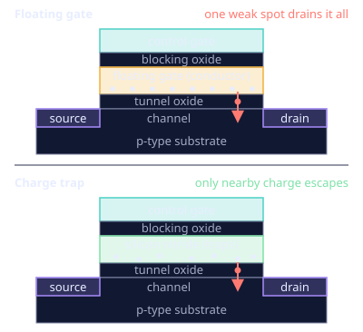
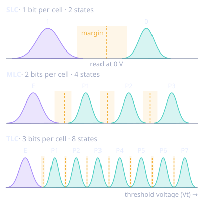
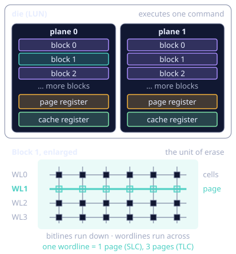
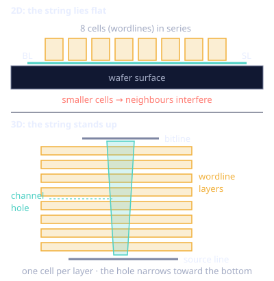
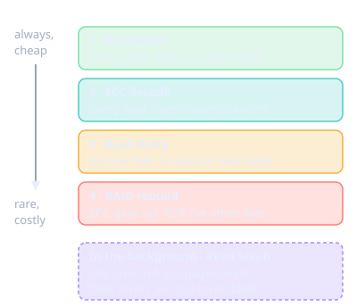
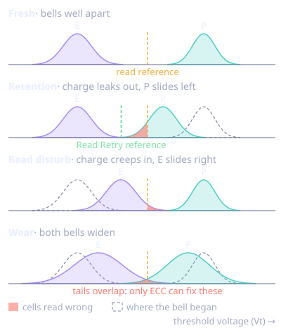
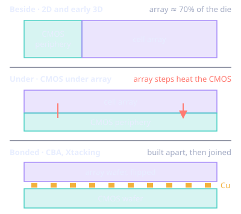

# Chapter 3 — The Storage Medium: NAND Flash (閃存)

[Chapter 1](ch1-overview.md) saw the whole drive; [Chapter 2](ch2-controllers-afa.md) dissected the controller. This chapter goes all the way down — to the **physics of a single flash cell**, where one bit of your data is a few dozen electrons trapped behind an insulator — then builds back up through chip architecture, the electrical protocols, and the many ways flash *fails*.

Two physical facts about flash generate almost everything else in this book:

1. **You must erase before you can write — nothing is overwritten in place.** This single constraint forces garbage collection and the whole flash translation layer (FTL) of [Chapter 4](ch4-ftl.md).
2. **Each block survives only a limited number of erase cycles.** This forces wear leveling and the entire reliability apparatus.

Everything from write amplification to enterprise endurance ratings is downstream of those two sentences.

!!! abstract "In this chapter — four movements plus a modern coda"
    - **The physics** — how a cell stores a bit; SLC/MLC/TLC; the cell → block → die hierarchy; 3D stacking; charge trap; PCM and the end of 3D XPoint (§3.1)
    - **The electrical reality** — timing modes, the command set, addressing, ONFI vs Toggle (§3.2, reference-grade; skim freely)
    - **Why flash is hard** — bad blocks, read/program disturb, wear, retention, the Lower-Page trap (§3.3) ⭐
    - **Fighting back** — Read Retry, ECC, in-drive RAID, randomization (§3.4) ⭐
    - **Modern NAND** — independent plane reads and wafer-bonded dies, the BiCS8-era additions (§3.5)

    Short on time? §3.1.1–3.1.4 and §3.3 are the heart.

---

## 3.1 Flash physical structure

### 3.1.1 How a flash cell works ⭐

Nearly every solid-state drive (SSD) uses **NAND flash**, a **non-volatile** memory — it keeps data with the power off. The basic unit is a **cell**: an NMOS-like transistor with an extra **floating gate (浮柵)** sandwiched between insulating layers, sitting between the control gate above and the channel below. Electrons trapped in the floating gate stay put when power disappears — that isolation *is* the non-volatility.

- **Write (program):** apply a positive voltage to the control gate → electrons tunnel *through* the insulator *into* the floating gate.
- **Erase:** apply a positive voltage to the substrate → electrons are pulled back *out* of the floating gate.

{ .sdd-fig }
/// figure-caption
A flash cell is a transistor with a charge-storage layer between two oxides. In a floating gate (top) the stored electrons move freely through a conductor, so one weak spot in the tunnel oxide can drain them all; in charge trap (bottom, §3.1.6) each electron stays where it was caught.
///

The floating-gate transistor was invented at Bell Labs in 1967 by **Dawon Kahng and Simon Sze (施敏)** — by the story, inspired over lunch by a layered cheesecake: *what if we put something extra in the middle of a metal–oxide–semiconductor field-effect transistor (MOSFET)?* Sze received a lifetime achievement award at the 2014 Flash Memory Summit, and there's a fair case he deserved more — the discoverers of giant magnetoresistance (GMR), the effect that kept the *hard disk* dominant, won a Nobel Prize for it.

### 3.1.2 SLC / MLC / TLC: the threshold-voltage picture ⭐

??? example "🎬 Animate this — The Vt Distribution Playground"

    Bells for one, two and three bits per cell in one window — drag wear, retention and read count and watch every Ch 3 failure mode happen.

    [Animation page](../animations/vt-playground.md) · [open full-screen ↗](../animations/files/vt_playground.html)

    <iframe src="../../animations/files/vt_playground.html" width="100%" height="640" class="sdd-anim" loading="lazy" title="The Vt Distribution Playground"></iframe>

Single-level cells (SLC), multi-level cells (MLC) and triple-level cells (TLC) differ in **how many bits one cell stores** — which physically means **how finely you subdivide the electron count** in the floating gate.

The one diagram to internalize in this whole chapter is the **threshold-voltage (Vt) distribution**: x-axis = threshold voltage, y-axis = number of cells. Cells programmed to the same value don't sit at exactly one voltage — they form a *bell curve* around a target. Reading a cell means testing which voltage band it falls into.

{ .sdd-fig }
/// figure-caption
Each bell is the population of cells programmed to one state, spread along the threshold-voltage axis; the dashed lines are the read references a read tests against. Every extra bit per cell doubles the number of bells in the same voltage window, so the shaded margins between neighbours shrink from SLC's wide gap to TLC's slivers.
///

- **SLC (1 bit)** — two states, one clean divide. Erased reads **1**, programmed reads **0**. (Writing a 1 means "do nothing"; writing a 0 means "inject charge.")
- **MLC (2 bits)** — four states: four electron-count bands to tell apart (think: <10 electrons = state A, 11–20 = B, 21–30 = C, more = D).
- **TLC (3 bits)** — eight states, finer still.

**The fundamental trade-off:** on the same silicon, SLC → MLC → TLC stores 1 → 2 → 3 bits, so cost per GB falls. But more bands means (a) programming must place the electron count more precisely → **slower writes**, (b) reading must test more reference voltages → **slower reads**, and (c) the bells sit closer together → **less margin → shorter endurance**. Performance and lifespan rank **SLC > MLC > TLC**; capacity-per-dollar ranks the other way. 3D TLC is the mainstream as of 2026, and quad-level cells (QLC: 4 bits, sixteen bands) are spreading through high-capacity drives, continuing the same trade.

### 3.1.3 The hierarchy: cell → page → block → plane → die ⭐

??? example "🎬 Animate this — Why SSDs need an FTL — NAND flash, animated"

    Pages, blocks and the no-overwrite rule — the hierarchy this section describes, animated stage by stage.

    [Animation page](../animations/nand-flash-animation.md) · [open full-screen ↗](../animations/files/nand-flash-animation.html)

    <iframe src="../../animations/files/nand-flash-animation.html" width="100%" height="640" class="sdd-anim" loading="lazy" title="Why SSDs need an FTL — NAND flash, animated"></iframe>

A flash chip is millions of cells in a strict nesting — memorize this ladder:

**cell → (page) → wordline → block → plane → die (LUN) → chip**

- A **wordline** carries one or more **pages**: SLC = 1 page per wordline; MLC = 2 (**Lower Page** + **Upper Page**); TLC = 3 (Lower, Upper, Extra).
- A **block** is the set of wordlines **sharing one substrate** — which is exactly why erase happens at block granularity (§3.1.4).
- A **die (LUN, a logical unit)** is **the basic unit that receives and executes a flash command.** Two dies can run *different* commands simultaneously — a key source of parallelism — but within one die, classically only one operation runs at a time. (§3.5.1 shows how modern flash relaxes this for reads.)
- A **plane** (1, 2, now commonly 4 per die) has its own **Cache Register** and **Page Register**, each one page in size.

{ .sdd-fig }
/// figure-caption
The hierarchy. A die runs commands; its planes each own a page register and a cache register; a plane holds many blocks; and inside a block, the cells along one wordline form a page (three pages in TLC). The block's cells share one substrate, so the block is what an erase clears.
///

**Why two registers?** All media transfers happen **a whole page at a time**: writes go controller → Cache Register → flash array; reads go array → register → controller. Two registers let the chip **overlap bus transfer with media access**: while page N streams out of the Cache Register to the controller, page N+1 is already loading from the media into the Page Register (**Cache Read / Cache Program**). The slower operation hides behind the faster one.

!!! note "A definitional subtlety that bites timing calculations"
    Quoted flash "read time" and "program time" cover only the media ↔ Page Register hop — **not** the register ↔ controller bus transfer. Keep the two separate when you reason about throughput (the timing-lab animation in §3.2.5 draws them as separate bars).

**Multi-plane operation — a big cheap win.** Load several planes' Cache Registers, then commit them together. With a 1.5 ms program and 50 µs transfer: two pages single-plane = (1.5 ms + 50 µs) × 2; dual-plane = 1.5 ms + 2 × 50 µs — **nearly 2× the write speed**. Reads gain the same way.

**Endurance by cell type:** maximum erase cycles fall from SLC (up to ~100K) → MLC (thousands to tens of thousands) → TLC (hundreds to a few thousand). And as process nodes shrank into the 1X nm era, capacity rose while raw performance and reliability *worsened* — pushing ever more of the burden onto firmware. That's the recurring theme of this book: **the medium gets worse; the algorithms get better.**

### 3.1.4 Read, write, erase: the actual voltages

- **Erase:** ~20 V on the P-well; quantum tunneling pulls electrons out of every floating gate in the block; the whole block reads "1" (−Vt). Blocks not being erased float their gates — no field, no tunneling.
- **Write:** the target wordline gets a high voltage with its bitline at 0 V → electrons tunnel into the floating gate → "0". Cells to be left alone get their bitline at ~2 V, suppressing tunneling.
- **Read:** all *other* wordlines get ~5 V (forcing those transistors to conduct regardless of state); the target wordline gets 0 V. An erased cell (−Vt) conducts → the bitline sense amp reads "1"; a programmed cell (+Vt) stays off → "0".

Don't memorize the numbers — they vary by chip. Internalize the pattern: **erase = whole block to all-1s via the substrate; write = inject charge to make 0s; read = sense conduction at 0 V.**

### 3.1.5 3D flash

**The wall 2D hit.** For a decade, planar flash shrank cells to cut cost — but smaller cells sit closer together, and **cell-to-cell interference grows** as spacing shrinks, until shrinking further stopped reducing cost-per-good-bit.

**The 3D answer: stop shrinking, start stacking.** Stand the channel upright and stack wordlines "floor by floor" like a building. Each generation adds roughly 40% more gate layers — cutting cost ~40% per generation *without* shrinking the cell. The cells actually got *bigger* again, so **interference dropped** even as density soared. This is the technology that let SSDs chase hard disk drives out of the mainstream (flash-market share of SSDs rose from 23% to 43% between 2013 and 2017).

{ .sdd-fig }
/// figure-caption
The same series string, flat and standing. In 2D (top) shrinking the cells brought neighbours close enough to interfere; in 3D (bottom) the string runs up a channel hole through the wordline layers, one cell per layer, and the etched hole narrows toward the bottom.
///

**Two milestone architectures:** **BiCS** (Bit Cost Scalable, Toshiba 2007) and **TCAT** (Terabit Cell Array Transistor, Samsung 2009). They differ in cell-string structure and erase method — BiCS: polysilicon gates, erase by gate-induced drain leakage (GIDL), narrower program/erase window; TCAT: metal gates, bulk erase, wider window. Against 2D, TCAT delivered **−84% interference, >10× endurance, half the program time, −67% threshold-voltage shift**. Layer counts marched 24 → 32 → 48 → 64, roughly doubling density each step — and kept going. As of 2026, Samsung's 286-layer V-NAND has been in mass production since 2024 and SK hynix's 321-layer flash since 2025; Kioxia's 332-layer BiCS10 was sampling, and Samsung and SK hynix were working toward about 400 layers. (§3.5.2 explains why layer count alone no longer decides who leads.)

**3D's own headaches:**

1. **More layers → smaller string current** and **growing top-vs-bottom differences**. More pages per block also concentrates more reads per block → worse read disturb → lower read-pass voltages → weaker signal margins.
2. **Layer-to-layer variation:** the etched channel hole tapers — bottom cells have smaller holes (higher coupling → faster erase) and thinner gate films (shorter retention). The firmware increasingly has to treat *layers* differently, not just blocks.

### 3.1.6 Charge-trap flash: the other way to hold an electron

**Charge Trap (CT, 電荷捕捉)** replaces the floating gate's *conductor* with an **insulator** — usually silicon nitride, Si₃N₄ — riddled with "traps" that catch electrons. The classic analogy: a floating gate stores electrons like **water** (they slosh freely inside the container); charge trap stores them like **cheese** (each electron is stuck where it landed). The figure in §3.1.1 shows the two side by side.

**Why "stuck" wins:**

- **Insensitive to tunnel-oxide wear.** In a floating gate, once the oxide thins or ages, the free-sloshing electrons leak out through any weak point. Trapped electrons can't reach the weak point.
- **Far less cell-to-cell coupling.** Two nearby *conductors* form a capacitor (C = εS/4πkd) — so floating-gate neighbors disturb each other, worse as distance d shrinks. An insulator mostly opts out of this.
- **Lower program/erase voltage.** The CT stack is physically shorter, and the same tunneling field needs less voltage across less distance (E = U/d) → less oxide stress, slower wear, lower power.

**The cost:** CT is *worse* at read disturb and data retention than floating gate. The market's verdict anyway: **every major vendor now builds 3D flash on charge trap.** Micron was the last floating-gate holdout; it switched to charge-trap cells with its replacement-gate generations in 2020 (128 layers, then 176).

### 3.1.7 3D XPoint and the emerging-memory zoo

**The gap being targeted:** DDR4 dynamic RAM (DRAM) moves ~46–61 GB/s but forgets everything at power-off; a 4-lane PCIe (Peripheral Component Interconnect Express) 3.0 SSD tops out ~4 GB/s and Serial ATA (SATA) at ~600 MB/s. The dream: **DRAM-class speed that survives power loss.** The candidate list: ReRAM/memristor, FeRAM, magnetoresistive RAM (MRAM), PRAM/PCM, cbRAM/PMC, SONOS, CMOx.

**Phase-Change Memory (PCM)** is the most mature. The physics: a chalcogenide (typically **GST**, Ge₂Sb₂Te₅) switches between an **amorphous** state (disordered like glass — high resistance) and a **crystalline** state (ordered like snowflakes — low resistance). Two stable, distinguishable states = one bit.

- **Read:** measure resistance — low (crystalline) = "0", high (amorphous) = "1".
- **Write:** a microscopic heater melts and re-forms the material — a short, very hot pulse freezes it amorphous; a longer, gentler pulse lets it crystallize.

PCM's attractions over flash: byte-addressable, **no erase-before-write**, fast, low power, and orders-of-magnitude longer endurance — organized in a familiar bitline/wordline matrix. Intel/Micron's 3D XPoint (Ch 1 §1.3, 2015) was the first mass-market attempt to fill the DRAM-flash gap with this class of memory. It did not survive: Micron stopped developing 3D XPoint in 2021, concluding the market wouldn't support the investment, and sold the Utah fab that made it; Intel wound down its Optane products in 2022. The gap between DRAM and flash remains open.

---

## 3.2 Talking to a flash chip: the electrical protocols

*Reference-grade detail on how the controller physically drives a chip. Skim unless you do hardware or firmware work — but read §3.2.6, which everyone should know.*

### 3.2.1 Asynchronous timing

Flash interfaces come **async** (slow, no clock) and **sync** (fast, clocked). Async: each data-out is triggered by an **RE_n** pulse, each data-in by **WE_n**. The signal cast, which you met from the controller side in [Chapter 2](ch2-controllers-afa.md#213-back-end): **CLE** (command latch enable: the bytes on the bus are a command), **ALE** (address latch enable: the bytes are an address), **CE_n** (chip enable, which selects the chip — the industry calls one selectable target "a CE"), **WE_n**, **RE_n**, **R/B_n** (ready/busy). Datasheet timing parameters (tWP, tWH, tWC, tDS, tDH) specify pulse widths and setup/hold windows.

### 3.2.2 Synchronous timing

Sync adds a clock (**CLK**) and a **data strobe (DQS)**, and modern flash runs **double data rate (DDR)** — data on both clock edges, so 100 MHz → 200 megatransfers per second (MT/s). DQS frames every transfer window (driven by the flash on reads, by the controller on writes) so the receiver samples at the right instant; **W/R_n** sets direction.

### 3.2.3 The command set

The controller drives flash with two-phase command sequences (Open NAND Flash Interface (ONFI) 2.3 shown): **Read (00h–30h)**, **Multi-plane Read (00h–32h)**, **Change Read Column (05h–E0h** — fetch from an offset within the loaded page), **Block Erase (60h–D0h)**, **Read Status (70h)** and **Read Status Enhanced (78h**, multi-LUN), **Page Program (80h–10h)**, **Multi-plane Program (80h–11h)**, **Read ID (90h)**, **Read Parameter Page (ECh** — the chip describes its own geometry and capabilities), **Get/Set Features (EEh/EFh)**.

### 3.2.4 Addressing

Two coordinates: the **column address** is the byte offset *within* a page; the **row address**, high bits to low, is **LUN → block → page**. The plane number hides in the **lowest bit(s) of the block address** — which is why multi-plane operations pair odd/even blocks. Vendor quirk: all planes in a multi-plane op must share the same *page* address; Intel/Micron and Toshiba allow different *block* addresses, Samsung requires the same.

### 3.2.5 Read / write / erase on the wire

??? example "🎬 Animate this — The Flash Timing & Parallelism Lab"

    The bus, the registers and the planes on one timeline — toggle pipelining and asynchronous independent plane read (AIPR) and watch the bars move.

    [Animation page](../animations/flash-timing-lab.md) · [open full-screen ↗](../animations/files/flash_timing_lab.html)

    <iframe src="../../animations/files/flash_timing_lab.html" width="100%" height="640" class="sdd-anim" loading="lazy" title="The Flash Timing & Parallelism Lab"></iframe>

- **Read:** 00h → 2 column bytes + 3 row bytes → 30h; status bit SR[6] goes Busy while the array loads the register, then data streams out.
- **Program:** 80h → address (**column normally 0 — pages must be filled from the start, or you risk data errors**) → data into the register → 10h to commit; SR[6] Busy → Ready.
- **Erase:** 60h → LUN + block row address → D0h. Block granularity only.

### 3.2.6 ONFI vs Toggle: the protocol war ⭐

There are **two** flash interface standards, and the split is pure industry politics. Flash was long dominated by **Samsung and Toshiba** (~70% share together). In 2006, **Intel and Micron formed the ONFI alliance** (Open NAND Flash Interface) to standardize the interface — pulling in flash makers (Hynix, SanDisk), controller vendors (LSI, Marvell, SMI, JMicron, Phison), system makers (Kingston, Seagate, WD…), and IP firms (Synopsys). Samsung and Toshiba answered by allying with *each other* — cross-licensing and co-developing **Toggle NAND**.

Where it landed: ONFI 4.0 (2014) and contemporary Toggle both reached **800 MT/s**; market share split roughly **50/50** (Samsung/Toshiba slightly ahead); the pinouts aren't even very different. The real technical distinction: **Toggle** has no free-running clock — writes are strobed by **DQS** differential edges, reads by the controller's **REN** differential signal; **ONFI** synchronizes everything to a clock, but its strobe/clock weren't differential, making edges more noise-prone. Tellingly, **ONFI 3.0's NV-DDR2 mode dropped the clock and adopted differential DQS + REN — converging on Toggle's approach.**

The two have been drifting together ever since, and a neutral standard sits between them: since 2011 the JEDEC Solid State Technology Association (JEDEC), the memory industry's standards body, has published JESD230, a common NAND interface that ONFI and Toggle parts interoperate on. Its 2024 revision, JESD230G, reaches **4,800 MT/s**, six times the 800 MT/s of 2014 (BiCS8 runs at about 3,600 MT/s, §3.5.2).

---

## 3.3 Why flash is hard: the failure modes ⭐

### 3.3.1 The five problems — a catalog to know cold

Note which are **permanent** and which are **non-permanent** (cured by erasing the block):

1. **Bad blocks** — blocks have finite life; wear can damage cells **permanently**. Chips also ship with **factory bad blocks** and grow new ones in service — hence mandatory bad-block management ([Chapter 4](ch4-ftl.md#47-bad-block-management) §4.7), error-correcting code (ECC) on everything, and retirement of blocks whose error counts exceed correction capacity.
2. **Read disturb (讀干擾)** — reading a page puts pass voltage on all *other* wordlines in the block (to force them conducting, §3.1.4). Each read is a faint program pulse on those neighbors; enough reads flip bits. **Non-permanent.** Affects the block's *other* pages, not the one being read.
3. **Program disturb (寫干擾)** — programming also lightly writes neighbors: cells meant to stay "1" ("stressed cells") sit on strings at positive voltage while their wordline fires. **Non-permanent.** Unlike read disturb, it can hit **both** other pages *and* the page being written.
4. **Cell-to-cell coupling** — floating gates are conductors; neighbors form capacitors; one cell's charge shifts another's apparent threshold (§3.1.6 explained why charge trap suffers less).
5. **Charge leakage** — stored charge slowly escapes over time. **Non-permanent.** (This is data retention, expanded in §3.3.6.)

All flash suffers all five; process node, 2D vs 3D, and vendor recipes shift the mix. Firmware's whole job ([Chapter 4](ch4-ftl.md)) is living with them.

### 3.3.2 Endurance: the physics of wearing out

For a correct read, the erased (−Vt) and programmed (+Vt) distributions must stay **separated** (§3.1.2). Accumulating erase cycles blurs that separation in three ways:

1. Erased cells' threshold drifts *up* toward 0 V → weaker channel current at read → sensed as programmed.
2. Programmed cells' threshold drifts *down* toward 0 V → sensed as erased.
3. Programmed cells' threshold drifts *too high* (> read-pass voltage) → the cell won't conduct even as a "pass" transistor — which corrupts reads of *every other page* on its bitline.

**The mechanism:** the tunnel oxide degrades with every erase. The aging oxide accumulates **charge traps** that swallow electrons in transit, so programs place less charge than intended and the distributions creep toward each other. Because the *erased* threshold rises with wear, drives verify erases (all wordlines at 0 V; any bitline with no current ⇒ some cell failed to erase ⇒ retire the block as bad).

**The three levers that extend life in practice:** **wear leveling** (no block dies early), **lower write amplification** (less wear per byte of user data), and **stronger ECC** (tolerate a higher raw error rate). All three are Chapter 4's business.

### 3.3.3 Flash testing

Why do SSD makers test flash — isn't that the fab's job? Three reasons: shipped flash isn't guaranteed defect-free; SSD assembly has its own yield problems (voids in the solder of ball grid array (BGA) packages are a classic); and cheaper flash from secondary channels needs screening. So every chip is exercised before a drive ships: per-CE Reset + Read ID, then read/write tests per LUN and plane with multiple data patterns (all-0s, all-1s), tracking flip rates. Failing chips are replaced — and often live a second life in Universal Serial Bus (USB) drives.

!!! tip "The flash quality ladder"
    Required flash quality rises **USB drive → consumer SSD → enterprise SSD**, in step with write intensity. Enterprise drives get the best original flash; USB sticks get what's left. Worth remembering when a bargain drive seems too cheap.

### 3.3.4 MLC's rules — and the Lower-Page corruption trap ⭐

MLC/TLC blocks must be written **in strict page order** (0, 1, 2, 3…). Two reasons: one physical cell carries two (or three) pages, and the **Lower Page must be programmed before the Upper Page**; and coupling compensation assumes earlier pages are already in place. (Reads have no ordering rule; SLC has no rule at all.)

The consequences stack up:

- Lower max erase counts → wear leveling matters more.
- Lower Pages program fast, Upper Pages slow → per-page write latency is uneven.
- No out-of-order writes → less scheduling freedom.
- And the big one:

!!! warning "Lower-Page corruption"
    Programming the Upper Page re-shapes the *whole cell's* charge based on the Lower Page already in it. **Lose power mid-Upper-Page-program, and the previously committed Lower Page data is destroyed too.** This violates storage's most sacred rule — *data acknowledged as written stays written* — because a page that succeeded long ago dies in someone else's power failure. (Losing the write that was actually in flight is considered acceptable; losing a *different, older* write is not.)

**Mitigations.** Consumer drives: write Lower Pages only (expensive); pair Lower+Upper in one pass (needs One-Pass Programming support); flush pending Upper Pages before entering sleep; keep a backup copy of Lower-Page data in another block until its Upper Page lands; or run MLC blocks in SLC mode as a staging cache and migrate later via garbage collection (GC). Enterprise drives can't nap, so they carry **capacitors**: tens of milliseconds of reserve power — enough to finish in-flight programs, flush caches, and save the mapping table ([Chapter 2 §2.8.3](ch2-controllers-afa.md#283-power-loss-protection-capacitors-that-buy-milliseconds) sizes that capacitor bank; [Chapter 4](ch4-ftl.md#46-power-loss-recovery) §4.6 covers the recovery logic).

### 3.3.5 Read disturb in the field

A war story that generalizes: a customer's read performance sagged steadily over weeks; the culprit was read disturb. The mechanism connects §3.3.1 to performance: read disturb injects electrons → the Vt distribution drifts **right** (retention drifts it **left**); with the old reference voltage, reads start failing and the drive burns time on error recovery. Drift rate scales with **read count** and with **wear** (aged oxide admits electrons more easily).

The management strategy: **count reads per block**, and before the count reaches the vendor's threshold, **refresh** — read the data out, erase the block, rewrite (or move the data elsewhere). Refreshing consumes back-end bandwidth, which is precisely *why* heavy read disturb shows up as a performance drop. (Research suggests lowering the pass voltage helps; vendors don't expose that knob, and too low causes read failures.)

### 3.3.6 Data retention: how long does data survive?

No storage lasts forever — the oldest surviving paper maps are ~2,000 years old and fading; even words carved in rock erode. Flash's version: **retention ends when accumulated bit-flips exceed what ECC can correct.**

**The physics.** Programmed electrons sit behind the tunnel oxide, but each has some probability of leaking back to the channel. Enough leakage and a programmed cell reads erased. Retention depends on oxide thickness (~4.5 nm theoretically yields ~10-year retention) — and on wear, through **Trap-Assisted Tunneling (TAT)**: an aged, trap-riddled oxide becomes slightly conductive, so electrons escape *faster* from worn cells. Hence the double squeeze: more erase cycles → shorter retention. Near end of life (~3,000 cycles for the MLC of this era), even freshly written data errors easily. Rules of thumb: SLC retains for years; TLC can be months.

**The countermeasure — Read Scrub.** Named for ZFS's scrub feature: patrol the data *before* it's needed. The SSD scans itself during idle time; any page whose correctable-flip count crosses a threshold gets rewritten to a fresh location. Retention errors are headed off while they're still correctable.

---

## 3.4 Fighting back: the data-integrity stack ⭐

Flash error rates grow with wear, retention time, and process shrink — so SSDs stack defenses: **Read Retry, ECC, internal RAID (a redundant array of independent disks, built here across dies), Read Scrub, and randomization.**

{ .sdd-fig }
/// figure-caption
The integrity stack as a ladder: each rung is costlier and rarer than the one above, and Read Scrub works in the background to keep pages from reaching the lower rungs.
///

### 3.4.1 Sources of read error, consolidated

Five causes, all visible as Vt-distribution movements (and all reproducible in the playground animation below):

1. **Erase-cycle wear** — trap buildup distorts programming (§3.3.2).
2. **Data retention** — leakage shifts distributions **left**.
3. **Read disturb** — accumulated soft-programming shifts them **right**.
4. **Cell-to-cell interference** — a neighbor's state nudges the victim's apparent Vt.
5. **Write errors** — mainly the MLC two-pass sequence: if a Lower Page is already corrupt when its Upper Page programs, the cell lands in the wrong final state — and **the internal Upper-Page program does not ECC-check the Lower Page it builds on**. (TLC one-pass programming sidesteps this by writing all pages of a wordline together.)

{ .sdd-fig }
/// figure-caption
The failure modes as bell movements. Cells that cross the read reference read wrong (red). After retention or read disturb the bells are still apart, so a shifted reference (Read Retry) reads them correctly; after heavy wear the tails overlap, and only ECC can fix the stragglers.
///

### 3.4.2 Read Retry

??? example "🎬 Animate this — The Vt Distribution Playground"

    Bells for one, two and three bits per cell in one window — drag wear, retention and read count and watch every Ch 3 failure mode happen.

    [Animation page](../animations/vt-playground.md) · [open full-screen ↗](../animations/files/vt_playground.html)

    <iframe src="../../animations/files/vt_playground.html" width="100%" height="640" class="sdd-anim" loading="lazy" title="The Vt Distribution Playground"></iframe>

The drift failures (retention, read disturb) share a saving grace: the distributions moved, but they're usually still *separated* — the data is intact, just misread against a stale reference voltage. **Read Retry re-reads with shifted reference voltages** until one lands between the bells. As long as adjacent states haven't overlapped, retry recovers everything. The refinement, **Advanced Read Retry**, first reads the *neighboring* cells, then reads the target twice with different references and picks the result the neighbors vote for.

### 3.4.3 ECC: error-correcting codes ⭐

??? example "🎬 Animate this — Stronger ECC in action"

    The algebraic error hunt of BCH (Bose–Chaudhuri–Hocquenghem) codes and an LDPC (low-density parity-check) Tanner graph converging by message passing, side by side.

    [Animation page](../animations/ecc-bch-ldpc.md) · [open full-screen ↗](../animations/files/ecc_bch_ldpc.html)

    <iframe src="../../animations/files/ecc_bch_ldpc.html" width="100%" height="640" class="sdd-anim" loading="lazy" title="Stronger ECC in action — BCH & LDPC"></iframe>

Every controller carries an ECC engine ([Chapter 2](ch2-controllers-afa.md#213-back-end) placed it in the back end). The algorithms: **BCH** (Bose–Ray-Chaudhuri–Hocquenghem) and **LDPC** (Low-Density Parity-Check), with LDPC taking over as flash got denser. Parity lives in each page's **spare area**, so **correction strength is capped by spare-area size** — more spare bytes, stronger code. [Supplement A](../supplements/a-ecc-coding-theory.md) derives both algorithms from first principles.

**Static vs dynamic ECC.** Most drives fix the user-data/parity split for life (**static**). But young flash barely errs while old flash errs constantly — so some drives run **dynamic ECC**: start with less parity (more user data per page → effectively more over-provisioning (OP) → lower write amplification, better bus utilization), then strengthen the code as wear accumulates. Dynamic schemes can also vary **by location**: strong dies and Lower Pages get light parity; weak dies and Upper Pages get heavy parity.

### 3.4.4 RAID inside the SSD ⭐

??? example "🎬 Animate this — Stripe RAID & the Chained Warships"

    A real exclusive-OR (XOR) rebuild, then the GC trap: one block can't move alone when a parity equation chains the stripe.

    [Animation page](../animations/stripe-raid.md) · [open full-screen ↗](../animations/files/stripe_raid.html)

    <iframe src="../../animations/files/stripe_raid.html" width="100%" height="640" class="sdd-anim" loading="lazy" title="Stripe RAID & the Chained Warships"></iframe>

When flips exceed ECC's power, the last line of defense is **RAID across dies** (typically RAID 5): dies 0–3 hold data, die P holds their **XOR**; when one die's page turns uncorrectable, XOR the survivors to rebuild it. Limits apply — RAID 5 absorbs exactly *one* uncorrectable member per stripe, and parity costs user capacity. No free lunch.

**Why in-SSD RAID is genuinely hard.** Disk RAID updates parity *in place* — and flash can't overwrite (§3.1.1). New writes land at new locations, which is survivable *while the old stripe members stay put*. The catastrophe scenario: **garbage collection moves one block out of a stripe** — the parity equation now points at reclaimed space. So the central rule of SSD RAID is that **the whole stripe garbage-collects together**: written together, moved together, erased together. Like the chained warships at Red Cliffs — stable in formation, but inflexible (unfinished stripes must be padded before sleep → extra write amplification; sometimes a stripe full of valid data must be collected wholesale) — and sharing fate by design.

### 3.4.5 Data randomization

Write raw user data straight to flash and errors climb, because **flash is pattern-sensitive**: long runs of 0s or 1s create **charge imbalance** that degrades noise margins. Randomization fixes two physical problems:

1. **Cleaner state separation** — scrambled data keeps every Vt bell tight and isolated; patterned data fattens some bells until, with drift, they invade their neighbors.
2. **Evened-out coupling** — a cell's threshold is most disturbed by its four direct neighbors; random data statistically balances those influences.

So a **randomizer** (vendors often suggest the Advanced Encryption Standard, AES, simply as a good scrambler) sits in the write path, keeping the physical bit stream near 50/50. Order of operations: ECC parity is computed, then the whole payload is randomized just before hitting flash (some designs swap the two stages).

---

## 3.5 Modern NAND: two BiCS8-era innovations

*The first edition ends at §3.4. These two topics arrived with recent flash generations and complete the picture — both matter enormously in current firmware work.*

### 3.5.1 Independent plane operations (IPR / AIPR) ⭐

**The classic constraint** (§3.1.3, §3.2.4): multi-plane operations run in lockstep — same command, same page address, issued together — and the die is "the basic unit that executes a command," one operation at a time.

**Modern NAND relaxes this — for reads.** From roughly the BiCS5 / 6th-gen V-NAND era, and standard by BiCS8 (BiCS generation 8, Kioxia's 218-layer flash), chips support **Independent Plane Read (IPR)**, usually in asynchronous form (**AIPR**): each plane executes its *own* read at its *own* address, *started at its own time*. A 4-plane die behaves like four smaller dies — **for reads**.

**Why reads only?** Reads are short and dominate quality of service (QoS); programs are long, power-hungry, and share the die's charge-pump budget. So programs stay lockstep while reads go independent.

**Why it matters:**

- **Random-read IOPS (input/output operations per second) and tail latency.** The classic collision — a read queued behind another read on the same die — now happens only when both target the same *plane*. The unit of read parallelism drops from die to **plane**, extending Chapter 2's ladder: channels × dies × *planes-for-reads*. (Toggle AIPR on in the §3.2.5 timing-lab animation and watch the read bars unstack.)
- **Firmware implications:** the flash scheduler tracks *per-plane* busy state; hot data wants to be **striped across planes** so reads don't collide; cache-read pipelining (§3.1.3's two registers) operates per plane.

### 3.5.2 Peripheral circuits: beside → under → bonded ⭐

A NAND die isn't just the array — it needs **peripheral CMOS** (complementary metal–oxide–semiconductor) logic: charge pumps (the ~20 V of §3.1.4), sense amplifiers, page buffers, input/output (IO) circuits, the command state machine. *Where that periphery lives* has become a defining architectural choice:

- **Generation 1 — periphery beside the array** (2D and early 3D): CMOS sits next to the array, spending die area — array efficiency only ~70%.
- **Generation 2 — CuA (CMOS under Array**; Micron from 64L, Samsung's "COP"): build the CMOS first, stack the array on top. Efficiency jumps — but the array's high-temperature process steps now *cook the finished CMOS*, degrading it, and it worsens as layer counts (and thermal budget) climb. The periphery is hostage to the array's process.
- **Generation 3 — wafer bonding: CBA (CMOS Bonded to Array).** Build the **CMOS wafer and the array wafer separately**, each on its own optimal process, then bond them face-to-face through millions of micron-scale copper contacts. YMTC (Yangtze Memory Technologies) pioneered it as "Xtacking"; **KIOXIA/WD's CBA debuts with BiCS8 (218 layers)** — the first wafer-bonded NAND from that alliance. The wins: the CMOS is never cooked (BiCS8's headline ~3,600 MT/s interface speed comes straight from this), array efficiency approaches ideal (periphery takes no array-side area — leading bit density *without* the tallest stack), and the two wafers scale on independent roadmaps.

{ .sdd-fig }
/// figure-caption
Three answers to "where does the periphery go?": beside the array, under it, or on a separate wafer bonded to it.
///

**The takeaway:** the competitive lever in NAND is shifting from raw layer count to *architecture* — periphery placement, bonding, IO speed. BiCS8's spec sheet (moderate 218 layers, top-tier density and interface speed) only makes sense once you know CBA is under the hood.

---

## Key takeaways

1. **Two physical facts rule everything:** erase-before-write (→ FTL, GC) and finite erase cycles (→ wear leveling, ECC). The rest of the book is corollary.
2. **The Vt distribution is the master diagram.** Wear widens the bells, retention slides them left, read disturb slides them right, and every recovery trick (Read Retry, stronger ECC) is a way of still telling the bells apart.
3. **Know the ladder**: cell → page/wordline → block (erase unit, shared substrate) → plane (registers) → die (command unit) → chip — and that modern flash breaks the "one op per die" rule for reads (AIPR).
4. **MLC's ordering rules have teeth**: Lower-Page corruption breaks "written means safe," and enterprise capacitors exist largely because of it.
5. **The integrity stack layers cheap-to-expensive**: randomize always, ECC every read, Retry when references drift, RAID-rebuild when ECC fails — and scrub in the background before any of it is needed.
6. **The medium keeps getting worse as density rises; the system keeps getting better.** 3D stacking, charge trap, and wafer bonding are how the industry keeps that bargain going.

---

## Key vocabulary

| Term | 中文 | Meaning |
|---|---|---|
| flash memory (NAND) | 閃存（台：快閃記憶體） | Non-volatile memory whose cells sit in series strings; it is erased a block at a time and programmed a page at a time. → [§3.1.1](#311-how-a-flash-cell-works) |
| (storage) cell | 存儲單元（台：儲存單元） | One transistor that holds one or more bits as trapped charge. → [§3.1.1](#311-how-a-flash-cell-works) |
| floating gate | 浮柵（台：浮動閘極） | A conducting layer, isolated by oxides, whose trapped electrons set the cell's threshold voltage. → [§3.1.1](#311-how-a-flash-cell-works) |
| charge trap (CT) | 電阱 / 電荷捕捉 | A cell design that stores electrons in traps in an insulating nitride layer instead of a conducting floating gate. → [§3.1.6](#316-charge-trap-flash-the-other-way-to-hold-an-electron) |
| control gate / substrate | 控制極 / 襯底（台：控制閘極 / 基板） | The gate a read or program voltage is applied to, and the silicon body beneath the cells, which erase acts through. → [§3.1.1](#311-how-a-flash-cell-works) |
| channel (transistor) | 溝道（台：通道） | The strip of silicon under the gate that conducts when the cell is switched on. → [§3.1.1](#311-how-a-flash-cell-works) |
| tunnel oxide | 隧道氧化層（台：穿隧氧化層） | The thin insulator electrons tunnel through to enter or leave the storage layer; it wears with every cycle. → [§3.3.2](#332-endurance-the-physics-of-wearing-out) |
| quantum tunneling | 量子隧道效應（台：量子穿隧效應） | Electrons crossing an insulator under a strong field, the effect that programs and erases a cell. → [§3.1.4](#314-read-write-erase-the-actual-voltages) |
| threshold voltage | 閾值電壓（台：臨界電壓） | The gate voltage at which a cell starts to conduct; the stored charge sets it, so it encodes the data. → [§3.1.2](#312-slc-mlc-tlc-the-threshold-voltage-picture) |
| non-volatile | 非易失性（台：非揮發性） | Keeping data with the power off. → [§3.1.1](#311-how-a-flash-cell-works) |
| block / page | 塊 / 頁（台：區塊 / 頁） | The erase unit (all wordlines sharing one substrate) and the read/program unit (the cells along one wordline). → [§3.1.3](#313-the-hierarchy-cell-page-block-plane-die) |
| wordline / bitline | 字線 / 位線（台：字元線 / 位元線） | The rows that select a page of cells and the columns along which each cell is sensed. → [§3.1.3](#313-the-hierarchy-cell-page-block-plane-die) |
| plane | 平面 | A slice of a die with its own registers; planes can work in parallel within one die. → [§3.1.3](#313-the-hierarchy-cell-page-block-plane-die) |
| cache register / page register | 緩存寄存器 / 頁寄存器（台：快取暫存器 / 頁暫存器） | A plane's two page-sized buffers, which let a bus transfer overlap an array access. → [§3.1.3](#313-the-hierarchy-cell-page-block-plane-die) |
| read disturb | 讀干擾（台：讀取干擾） | Bit errors that build up in a block's other pages because every read stresses them with pass voltage. → [§3.3.5](#335-read-disturb-in-the-field) |
| program disturb | 寫干擾 / 編程干擾（台：寫入干擾） | Unwanted charge added to cells near the ones being programmed. → [§3.3.1](#331-the-five-problems-a-catalog-to-know-cold) |
| coupling capacitance | 耦合電容 | The capacitance between neighbouring cells that lets one cell's charge shift another's threshold. → [§3.3.1](#331-the-five-problems-a-catalog-to-know-cold) |
| charge leakage | 電荷泄漏（台：電荷洩漏） | Stored electrons slowly escaping through the oxide, the cause of retention errors. → [§3.3.6](#336-data-retention-how-long-does-data-survive) |
| data retention | 數據保存期（台：資料保存期） | How long written data stays readable before leakage creates more errors than ECC can fix. → [§3.3.6](#336-data-retention-how-long-does-data-survive) |
| wear leveling | 磨損平衡（台：平均抹寫） | Spreading erases evenly over all blocks so that none wears out early. → [§3.3.2](#332-endurance-the-physics-of-wearing-out) |
| write amplification (WA) | 寫放大（台：寫入放大） | Bytes written to flash divided by bytes the host wrote; lowering it slows wear. → [§3.3.2](#332-endurance-the-physics-of-wearing-out) |
| bad block | 壞塊（台：壞區塊） | A block that can no longer hold data reliably, from the factory or from wear, and is retired. → [§3.3.1](#331-the-five-problems-a-catalog-to-know-cold) |
| 3D flash | 三維閃存（台：3D 快閃記憶體） | NAND built as vertical strings through a stack of wordline layers instead of on a flat surface. → [§3.1.5](#315-3d-flash) |
| stacked gate layers | 堆疊柵極層（台：堆疊閘極層） | The wordline layers of 3D flash; each one forms a cell where it meets a channel hole. → [§3.1.5](#315-3d-flash) |
| phase-change memory (PCM) | 相變存儲器（台：相變化記憶體） | Memory that stores a bit as the amorphous or crystalline state of a chalcogenide; 3D XPoint belonged to this family. → [§3.1.7](#317-3d-xpoint-and-the-emerging-memory-zoo) |
| amorphous / crystalline state | 無定形態 / 晶體態（台：非晶態 / 結晶態） | PCM's high-resistance (disordered) and low-resistance (ordered) states. → [§3.1.7](#317-3d-xpoint-and-the-emerging-memory-zoo) |
| synchronous / asynchronous | 同步 / 異步（台：同步 / 非同步） | Interface timing with a clock and strobe versus pulse-driven timing without a clock. → [§3.2.2](#322-synchronous-timing) |
| addressing | 尋址（台：定址） | Naming a location on the chip: LUN, block and page in the row address, byte offset in the column address. → [§3.2.4](#324-addressing) |
| row address / column address | 行地址 / 列地址（台：列位址 / 行位址） | The address of a page (LUN, block, page) and the byte offset within it. Note the swap: the mainland calls a row 行, Taiwan calls it 列. → [§3.2.4](#324-addressing) |
| error-correcting code (ECC) | 糾錯碼（台：錯誤更正碼） | Redundant bits stored with the data that let the controller detect and correct bit errors; SSDs use the BCH and LDPC families. → [§3.4.3](#343-ecc-error-correcting-codes) |
| read retry | 重讀（台：重新讀取） | Re-reading a page with shifted reference voltages when decoding fails. → [§3.4.2](#342-read-retry) |
| read scrub | 掃描重寫 / 數據巡檢（台：資料巡檢） | Scanning data in idle time and rewriting pages whose error counts are climbing. → [§3.3.6](#336-data-retention-how-long-does-data-survive) |
| data randomization / scrambling | 數據隨機化 / 擾碼（台：資料隨機化 / 擾碼） | Scrambling data before it is written, so the stored bits stay near half ones and half zeros. → [§3.4.5](#345-data-randomization) |
| exclusive OR (XOR) | 異或（台：互斥或） | The bitwise operation RAID parity uses: XOR-ing the survivors of a stripe rebuilds the missing member. → [§3.4.4](#344-raid-inside-the-ssd) |
| independent plane read (IPR / AIPR) | 獨立平面讀取 | Each plane running its own read at its own address and time, which makes the plane the unit of read parallelism. → [§3.5.1](#351-independent-plane-operations-ipr-aipr) |

---

## Check yourself

1. Flash's two core physical constraints each force one SSD algorithm. Name both constraints and the algorithm each one forces.

    ??? success "Answer"
        Erase before write: a page can't be overwritten in place, and erase works only on whole blocks, so new data goes to fresh pages and stale copies pile up; garbage collection reclaims them, with a mapping table tracking where everything lives. Finite erase cycles: each block survives only a limited number of program/erase cycles, so wear leveling spreads erases evenly and no block wears out early. See [§3.1.4](#314-read-write-erase-the-actual-voltages) and [§3.3.2](#332-endurance-the-physics-of-wearing-out).

2. Going SLC → MLC → TLC, capacity per area rises but three things get worse. What are they, and what's the single underlying reason?

    ??? success "Answer"
        Write speed, read speed and endurance. The single reason is that each extra bit doubles the number of threshold-voltage states packed into the same voltage window. Programming must place the charge more precisely, so writes slow down; reads must test more reference voltages, so reads slow down; and the bells sit closer together, so less wear or leakage pushes a cell across a boundary, which shortens life. See [§3.1.2](#312-slc-mlc-tlc-the-threshold-voltage-picture).

3. Erase happens at *block* granularity but read/write at *page* granularity. What physical fact makes erase a block-level operation?

    ??? success "Answer"
        The cells of a block share one substrate (P-well). Erase pulls electrons out by putting about 20 V on that substrate, which acts on every cell built on it at once, so the whole block erases together. Reads and programs are steered by individual wordlines and bitlines, so they can target a single page. See [§3.1.3](#313-the-hierarchy-cell-page-block-plane-die) and [§3.1.4](#314-read-write-erase-the-actual-voltages).

4. Explain the Lower-Page-corruption problem and why it violates the usual "write returned success = data is safe" rule.

    ??? success "Answer"
        In MLC one cell holds both a Lower Page and an Upper Page, and programming the Upper Page reshapes the cell's charge based on the Lower Page already stored there. If power fails during that Upper-Page program, the cell can end up in neither state, destroying the Lower Page as well, even though its write completed successfully long before. The usual rule says an acknowledged write stays safe; here an old, acknowledged write is lost because of a different, later one. See [§3.3.4](#334-mlcs-rules-and-the-lower-page-corruption-trap).

5. Data Retention shifts the threshold-voltage distribution one direction; Read Disturb shifts it the other. Which way does each go, and which technique exploits the fact that the states are still *separated*?

    ??? success "Answer"
        Retention lets charge leak out, so programmed cells slide left, toward lower voltage. Read disturb adds a little charge with every read, so cells, especially erased ones, slide right. In both cases the bells usually stay apart, only shifted against a stale reference, so Read Retry re-reads with shifted reference voltages until one falls between the bells again. See [§3.4.1](#341-sources-of-read-error-consolidated) and [§3.4.2](#342-read-retry).

6. Why is building RAID *inside* an SSD harder than building it across ordinary disks? What single operation is the central problem, and what must be done about it?

    ??? success "Answer"
        Disk RAID updates parity in place, but flash can't overwrite, so a stripe's members and its parity stay valid only while they stay where they were written. Garbage collection is the problem: if it moves one block out of a stripe, the parity no longer matches the data. So the whole stripe must be garbage-collected together, written, moved and erased as a unit, at the cost of extra write amplification and less freedom for the FTL. See [§3.4.4](#344-raid-inside-the-ssd).

7. Why must user data be randomized before writing to flash — give one of the two physical reasons.

    ??? success "Answer"
        Either one. Cleaner state separation: long runs of identical bits create charge imbalance that widens some bells until, with drift, they overlap their neighbours; scrambled data keeps every bell tight. Or evened-out coupling: a cell is disturbed most by its neighbours' states, and random data balances those influences statistically. See [§3.4.5](#345-data-randomization).

8. A floating gate stores charge in a conductor; Charge Trap stores it in an insulator. Give two advantages CT gains from that, and one thing it does *worse*.

    ??? success "Answer"
        Any two of: it tolerates tunnel-oxide wear, because trapped electrons can't flow to a weak spot; it has far less cell-to-cell coupling, because an insulator doesn't form a capacitor with its neighbours; and it programs and erases at lower voltage, which stresses the oxide less. It is worse at read disturb and data retention. See [§3.1.6](#316-charge-trap-flash-the-other-way-to-hold-an-electron).

9. With AIPR, what replaces the die as the unit of read parallelism — and what new data-placement concern does that create for firmware?

    ??? success "Answer"
        The plane: each plane runs its own read at its own address and time, so read parallelism becomes channels × dies × planes. Firmware must track busy state per plane and spread hot data across planes, so that reads of popular data don't queue behind each other on one plane. See [§3.5.1](#351-independent-plane-operations-ipr-aipr).

---

??? info "📖 Book page map — for readers of 《深入淺出SSD》"

    This chapter follows Chapter 3 of《深入淺出SSD》(SSDFans, 2018);
    §3.5 covers 2nd-edition additions (their §5.4.3 and §5.5.4). Original
    figures by section:

    | Section | Book pages | Key figures/tables |
    |---|---|---|
    | 3.1.1–3.1.2 Cell & Vt | pp. 1–5 | Figs 3-1…3-5, Table 3-2 |
    | 3.1.3–3.1.4 Hierarchy & voltages | pp. 5–12 | Figs 3-6…3-11 |
    | 3.1.5 3D flash | pp. 13–21 | Figs 3-12…3-19 |
    | 3.1.6 Charge trap | pp. 21–24 | Figs 3-20…3-23 |
    | 3.1.7 PCM / 3D XPoint | pp. 24–32 | Figs 3-25…3-30, Table 3-3 |
    | 3.2 Protocols | pp. 32–44 | Figs 3-31…3-42, Tables 3-5/3-6 |
    | 3.3 Failure modes | pp. 44–58 | Figs 3-43…3-52 |
    | 3.4 Integrity stack | pp. 58–69 | Figs 3-53…3-62 |

??? info "🔎 Sources for the 2026 update"

    Sections 3.1.2, 3.1.5–3.1.7 and 3.2.6 were brought up to date in November 2026 against these sources:

    - Micron's move from floating gate to charge-trap cells with replacement gate (176 layers, November 2020) — [AnandTech](https://www.anandtech.com/show/16230)
    - Micron ends 3D XPoint development and sells the Lehi fab (2021) — [Micron Form 10-K, fiscal 2021](https://www.sec.gov/Archives/edgar/data/723125/000072312521000065/mu-20210902.htm)
    - Intel winds down Optane (July 2022) — [AnandTech](https://www.anandtech.com/show/17515)
    - Layer counts in 2026: Samsung 286, SK hynix 321, Kioxia BiCS10 332 sampling, plans near 400 — [TrendForce](https://www.trendforce.com/news/2026/06/12/news-the-race-to-400-layer-nand-roadmaps-and-key-technologies-driving-samsung-sk-hynix-and-kioxia/)
    - JEDEC JESD230G at up to 4,800 MT/s (November 2024), and the first JESD230 (2011) — [JEDEC via Business Wire](https://www.businesswire.com/news/home/20241118637716/en/JEDEC-Announces-Enhanced-NAND-Flash-Interface-Standard-With-Increased-Speeds-and-Efficiency)

*Next: [Chapter 4 — The FTL](ch4-ftl.md) — how firmware turns this fragile, can't-overwrite, wears-out medium into a reliable disk.*
