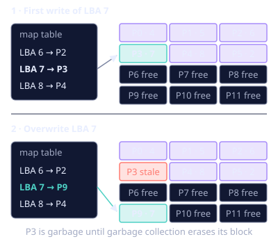
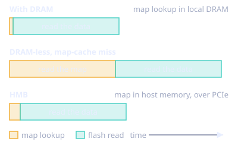
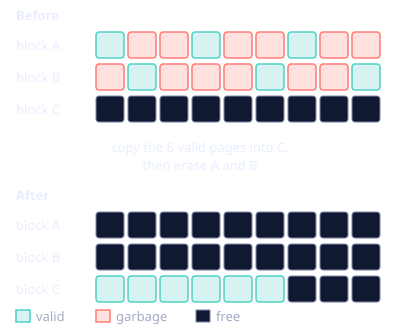
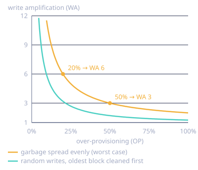
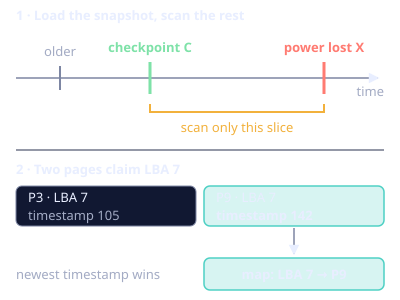
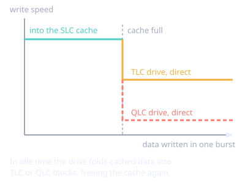

# Chapter 4 — The Core Technology: FTL (Flash Translation Layer)

[Chapter 3](ch3-nand-flash.md) left you with a fragile medium: flash that can't be overwritten, wears out, disturbs its own neighbors, and forgets over time. This chapter is about the software that tames it. The **FTL (Flash Translation Layer)** turns that unruly medium into something that looks, from the outside, like an ordinary reliable disk — and it is where solid-state drives are actually won or lost, because the interfaces at both ends are standardized and the algorithms in between are not ([Chapter 1](ch1-overview.md#14-how-an-ssd-actually-works) made that argument; this chapter is the payoff).

This is the longest and most important chapter of the book. Section 4.1 frames the problem; then every section is one FTL job. If your time is limited, **§4.2, §4.3, and §4.6** are the ones to know cold.

!!! abstract "In this chapter"
    - **Why an FTL at all** — seven flash facts, seven firmware jobs (§4.1)
    - **Mapping** ⭐ — page maps, the 1/1000 DRAM rule, DRAM-less designs, HMB (§4.2)
    - **Garbage collection** ⭐⭐ — plus write amplification and over-provisioning, the conceptual heart (§4.3)
    - **Trim** — telling the SSD what's dead (§4.4) · **Wear leveling** — dynamic vs static (§4.5)
    - **Power-loss recovery** ⭐⭐ — rebuilding the map from metadata, snapshots (§4.6)
    - **Bad blocks** (§4.7) · **SLC cache** (§4.8) · **Read-disturb & retention handling** (§4.9)
    - **Host-based FTL** — Fusion-IO and Baidu's SDF (§4.10) → **ZNS and FDP**, the modern standards they became (§4.11)

---

## 4.1 FTL overview ⭐

**What the FTL is:** the translator between the host's **logical address space** and the flash's **physical address space**. Every write records a logical → physical mapping; every read looks one up. That's the original job — but flash's quirks pile many more on top.

**Seven flash facts, and the FTL work each one creates.** This list is the "why" behind the entire chapter:

1. **No overwrite in place** → a **mapping table** (new data goes somewhere new) *and* **garbage collection** (the old copies become garbage that must be reclaimed).
2. **Limited erase (P/E) life per block** → **wear leveling**.
3. **Reads disturb neighbors** → read-disturb handling (refresh blocks before their read counts corrupt data).
4. **Charge leaks over time** → retention handling (scan and rewrite aging data — noting that a drive that's never powered on can't defend itself).
5. **Factory and grown bad blocks** → **bad-block management**.
6. **Multi-level and triple-level cell (MLC/TLC) Lower-Page corruption** ([Ch 3 §3.3.4](ch3-nand-flash.md#334-mlcs-rules-and-the-lower-page-corruption-trap)) → power-loss safety mechanisms.
7. **MLC/TLC can run in fast single-level-cell (SLC) mode** → the **SLC cache** opportunity.

**Where the FTL lives:** **Host-Based** (the FTL runs on the host's own processor and memory — the famous Fusion-IO) or **Device-Based** (the FTL runs on the drive's controller). Almost all modern SSDs are device-based, so this chapter assumes that; host-based returns with force in §4.10–4.11.

---

## 4.2 Mapping management ⭐

??? example "🎬 Animate this — Mapping Lookup Paths"

    Designs with dynamic RAM (DRAM), without it, with a Host Memory Buffer (HMB) and with a Host Performance Booster (HPB) racing the same read — the two-flash-access penalty as two long bars.

    [Animation page](../animations/mapping-paths.md) · [open full-screen ↗](../animations/files/mapping_paths.html)

    <iframe src="../../animations/files/mapping_paths.html" width="100%" height="640" class="sdd-anim" loading="lazy" title="Mapping Lookup Paths"></iframe>

### 4.2.1 Mapping granularity

Three schemes, trading table size against performance:

- **Block mapping** — map whole *blocks*. Tiny table, but **terrible small writes**: changing one logical page means read-whole-block, modify, rewrite-whole-block. This is what Universal Serial Bus (USB) drives use — which is exactly why USB sticks have dreadful random performance.
- **Page mapping** — map every *page*: any logical page to any physical page. A much bigger table, but excellent performance, especially random writes. **SSDs use page mapping.**
- **Hybrid mapping** — block-map the drive, page-map within a block. In between on both axes.

The rest of the chapter assumes page mapping.

### 4.2.2 How mapping works, and the DRAM question ⭐

The host addresses the drive by **logical block address (LBA)**; each LBA names a **logical page** (512 B / 4 KB / 8 KB…). The controller reads and writes flash in **physical pages** (usually larger, so several logical pages pack into one physical page). Every write updates a **map table** entry; every read consults it.

{ .sdd-fig }
/// figure-caption
An overwrite never touches the old page. The new data goes to a free page, the map entry moves with it, and the old copy becomes garbage for garbage collection (§4.3) to reclaim.
///

!!! example "Worked example: the 1/1000 rule"
    A 256 GB solid-state drive (SSD) with 4 KB logical pages has 256 GB ÷ 4 KB = 64M entries; at 4 bytes each the map is 64M × 4 B = **256 MB**. In general the map table is **~1/1000 of drive capacity** (1/1024 exactly). That's why SSDs carry roughly **1 GB of DRAM per 1 TB of flash** — the whole table lives there for one-lookup reads.

**DRAM-less designs.** Entry-level SSDs and mobile storage (embedded MultiMediaCard, eMMC, and Universal Flash Storage, UFS — [Supplement B](../supplements/b-ufs.md)) skip the DRAM for cost and power. The table moves to a **two-level scheme**: a small first-level index in on-chip static RAM (SRAM) points into the big second-level table, which lives *in flash* with a small cache in SRAM. The price: on a cache miss, a read needs **two flash accesses** (fetch the mapping, then the data) instead of one — halving random-read throughput. Sequential reads stay cheap (one loaded map chunk serves many neighbors); random reads pay full price. The animation above races these designs side by side.

### 4.2.3 HMB — Host Memory Buffer ⭐

The middle path, standardized in version 1.2 of NVMe (Non-Volatile Memory Express, the protocol of [Chapter 6](ch6-nvme.md)): the host lends the SSD a slice of *its own* random-access memory (RAM), which the drive uses for the map table (and sometimes data cache). Performance lands between onboard-DRAM and DRAM-less: host RAM over PCIe (Peripheral Component Interconnect Express) is slower than local DRAM but vastly faster than a flash read (~40 µs). Marvell's 88NV1140 (CES 2016) was first silicon; the ball grid array (BGA) drives of [Ch 1 §1.6.3](ch1-overview.md#16-form-factors) lean on it. One firmware subtlety: an HMB drive must still function (degraded) when the host declines to grant the buffer.

{ .sdd-fig }
/// figure-caption
Where the map lives sets the price of a random read. A DRAM-less drive that misses its map cache pays a second flash read; HMB turns that into a short trip to host memory.
///

!!! note "How it aged"
    HMB stopped being exotic years ago — the entire budget/mid-range consumer NVMe market is now essentially DRAM-less-with-HMB. This section turned out to be a forecast.

### 4.2.4 Flushing the map table

The table must reach flash before power-off and reload at power-on — but to survive *unexpected* power loss, firmware also flushes periodically during operation, so a crash loses only a small recent slice. Triggers: enough new mappings, enough data written, enough blocks consumed. Strategy choice: **full update** (rewrite the whole table — simple, but heavy write traffic → latency spikes and extra write amplification (WA, §4.3.2)) vs **incremental update** (write only dirty entries — light traffic, but firmware must track dirtiness). Hold this thought: §4.6's checkpoints are the same idea wearing a bigger job.

---

## 4.3 Garbage collection ⭐⭐

??? example "🎬 Animate this — The Toy SSD Sandbox"

    This section's walkthrough as a live simulation — write, overwrite, collect, and watch WA respond to the over-provisioning (OP) slider.

    [Animation page](../animations/toy-ssd-sandbox.md) · [open full-screen ↗](../animations/files/toy_ssd_sandbox.html)

    <iframe src="../../animations/files/toy_ssd_sandbox.html" width="100%" height="640" class="sdd-anim" loading="lazy" title="The Toy SSD Sandbox"></iframe>

The single most important section of the book: **garbage collection (GC)**, and the two concepts welded to it — **Write Amplification (WA)** and **Over-Provisioning (OP)**.

### 4.3.1 The GC principle, via a toy SSD

Build a tiny SSD in your head (or play with the live one above — it's the same machine):

- 4 channels, each with 1 die; dies operate in parallel.
- Each die: 6 blocks; each block: 9 pages. Total 24 blocks = 216 pages.
- **20 blocks' worth = user capacity** as the host sees it; **4 blocks = OP**, invisible reserve.

The life story:

1. **Sequential writes stripe across the 4 dies** — parallelism first, always. Keep writing until *user* capacity is full. The flash itself isn't full — OP remains.
2. **Overwrite some logical pages.** No overwrite in place, so new versions land in fresh (OP) space and the old copies become **garbage**. Keep overwriting until every block is a mix of valid data and garbage and no free block remains.
3. The host wants to write more. There is nowhere to put it. **Now GC must run:** pick garbage-heavy blocks, **read out the still-valid pages, rewrite them into a fresh block, erase the originals.** Free space returns.

{ .sdd-fig }
/// figure-caption
One garbage-collection pass. Six page writes (the valid data moved into C) buy back twelve pages of free space; the fewer valid pages a victim holds, the cheaper the pass.
///

**Why "SSDs get slower as they fill" is real science, not folklore:**

- **Sequential workloads** kill whole blocks at once — garbage clusters, GC is often just an erase with no data movement. Even a full drive stays fast.
- **Random workloads** scatter garbage everywhere — every reclaimed block still holds valid pages that must be moved first. GC gets expensive exactly when you're busiest.
- Fresh out of box there's free space and **no GC at all**; once the drive has been filled, **every write can trigger GC**. That's the FOB → steady-state cliff from [Ch 1 §1.5.2](ch1-overview.md#152-performance), now with its mechanism exposed.

### 4.3.2 Write amplification ⭐

??? example "🎬 Animate this — The SSD Calculator Bundle"

    This section's formulas as live sliders — move an input and watch the answer (and the curve) recompute.

    [Animation page](../animations/ssd-calculators.md) · [open full-screen ↗](../animations/files/ssd_calculators.html)

    <iframe src="../../animations/files/ssd_calculators.html" width="100%" height="640" class="sdd-anim" loading="lazy" title="The SSD Calculator Bundle"></iframe>

GC writes data the host never asked for, so the flash absorbs more writes than the host sent:

\[
\mathrm{WA} = \frac{\text{data written to flash}}{\text{data written by the host}}
\]

- **Empty drive, no GC: WA ≈ 1** — and before SandForce, 1 was the floor.
- **SandForce broke the floor** with inline compression: 8 KB squeezed to 4 KB before writing → WA as low as ~0.5 (absent GC). ([Ch 1 §1.3](ch1-overview.md#13-a-short-history-of-solid-state-storage) told that company's story.)
- **Once GC runs, WA > 1.** Worked example: a reclaim pass frees a 36-page region containing 12 valid pages. The SSD rewrites those 12, then fills the freed 24 with new host data — 36 pages physically written for 24 pages of host writes: **WA = 36 ÷ 24 = 1.5**.

**Why WA matters:** every extra internal write burns P/E cycles (lifespan) and back-end bandwidth (performance). Recall [Ch 1 §1.5.3](ch1-overview.md#153-endurance): terabytes written (TBW) ≈ capacity × P/E ÷ **WA** — the FTL's quality shows up directly in the endurance rating.

**Why more OP lowers WA — follow the arithmetic, it's the key insight.** Define

\[
\mathrm{OP} = \frac{\text{flash space} - \text{user space}}{\text{user space}}
\]

With 216 pages of flash and garbage spread evenly (worst case):

- **User space 180 pages → OP 20%.** Valid data occupies 180/216 = 0.83 of every block: a 9-page block holds ~7.5 valid + 1.5 garbage. Reclaiming it writes 9 pages to gain 1.5 pages of room → **WA = 9/1.5 = 6**.
- **Shrink user space to 144 → OP 50%.** Valid fraction 144/216 = 0.67: ~6 valid + 3 garbage per block. Write 9 to gain 3 → **WA = 9/3 = 3**.

**Bigger OP → more garbage per block → less valid data moved per reclaim → lower WA** — and better full-drive performance to match. (Real greedy GC picks the *most*-garbage blocks rather than average ones, so real WA beats these worst-case numbers; the calculator above plots the whole curve.)

{ .sdd-fig }
/// figure-caption
WA against OP, computed from two models. The upper curve is this section's worst case, WA = (1 + OP) ÷ OP, through the two worked points. The lower curve models uniform random writes with the oldest block cleaned first (its WA is about 3.2 at 20% OP and 1.7 at 50%); greedy victim choice does better still. Either way, the first few percent of OP buy the most.
///

**The complete list of things that raise WA:** small OP, random writes, poor GC victim selection, wear leveling's own data movement, read-disturb/retention refreshes, no compression, and **no Trim** (§4.4).

### 4.3.3 GC implementation — three steps

**Step 1: pick the victim block.** The standard **greedy** policy: least valid data (least to move, most gained). To find that block instantly, firmware maintains a **valid-page count (VPC) per block**, updated on every write: increment the block receiving the page, decrement the block holding the page's old copy. A common refinement folds **wear leveling** in by also weighting **erase count** — least-valid and least-worn rarely coincide, so a weight balances them (saves a separate WL pass, at the cost of sometimes picking a victim with more valid data → higher WA).

**Step 2: find the victim's valid data.** Three designs, trading RAM against speed:

- **Valid-page bitmap** — a per-block bitmap of which pages are valid; GC reads only those. Fast, but the bitmaps cost RAM — fine with DRAM, painful DRAM-less (real blocks have thousands of pages, and the bitmaps themselves must swap in and out of SRAM).
- **Read-everything + metadata check** — every stored page carries metadata (its LBA, timestamp). GC reads the whole block, and for each page asks the map: do you still point here? Simple firmware, no extra structures — but it reads garbage too, and on DRAM-less drives every check may fetch map entries from flash. Slow.
- **P2L table** — the middle path: store a per-block **physical-to-logical** list alongside the block; on reclaim, load it and verify each LBA against the map. No wasted data reads, still needs map lookups.

**Step 3: rewrite the valid data** into a fresh block, update the map.

### 4.3.4 When GC runs

- **Foreground GC** — reactive: free blocks dropped below threshold mid-workload; GC runs in the write path. This is the one that hurts latency.
- **Background GC** — proactive: collect during idle time so free blocks are ready. (Some battery-minded drives skip it and sleep instead.)
- **Host-managed GC** — the OCZ Saber 1000 HMS (2015) let the *host* schedule background tasks, so admins could push GC into known idle windows for predictable latency. Hold that thought — §4.10–4.11 are what it grew into.

---

## 4.4 Trim ⭐

**The problem.** Deleting a file is an OS-side bookkeeping act — the SSD isn't told. Inside the drive, the mappings persist and the dead data still counts as *valid*, so **GC keeps faithfully relocating data the user already deleted**: wasted writes (higher WA), wasted lifespan, slower GC.

**The fix.** **Trim** — an ATA (AT Attachment) command (Data Set Management; SCSI, the Small Computer System Interface, calls the same thing UNMAP (Trim's SCSI and UFS name), and NVMe calls it **Deallocate**) by which the OS (Windows 7+ onward) tells the drive which LBAs just died. GC then discards instead of relocating.

**What Trim actually touches** — three FTL structures: the **map table** (LBA → physical), the **VPBM** (valid-page bitmap per block), and the **VPC** (valid-page count per block, the GC victim-sorter). Trim marks the pages invalid in all three. Note: **Trim does not trigger GC** — it only marks; the space returns at the next collection. (The toy sandbox's Trim toggle shows the difference vividly: delete a "file" with Trim off and watch GC keep dragging the corpse around.)

---

## 4.5 Wear leveling ⭐

**Goal:** equalize erase counts so no block dies early. Unmanaged, hot blocks burn their P/E budget, turn bad, and the drive dies young — and each flash generation makes this more urgent (SLC ~100K cycles → MLC thousands → TLC ~1–2K or less).

**Vocabulary first:** **cold data** = rarely updated (OS images, movies); **hot data** = frequently updated (creates garbage constantly). **Old block** = high **erase count (EC)**; **young block** = low. The FTL tracks EC per block.

**The two algorithms:**

- **Dynamic WL** — *hot data onto young blocks*: whenever a fresh block is needed, pick a low-EC one. Simple and always on.
- **Static WL** — *cold data onto old blocks*. The subtle one. Cold data, once written, just sits; its blocks' ECs freeze while every other block keeps cycling — imbalance grows silently. Static WL deliberately migrates cold data onto worn blocks: the veterans get light duty, the young blocks absorb the churn. Mechanically it *is* GC — except the victim is chosen for holding cold data, not for garbage count.

**The cold/hot mixing trap.** If static WL writes cold data into the same destination blocks as fresh user writes or GC traffic, those blocks become half-cold, half-hot: the hot half turns to garbage, GC reclaims the block, and the cold half — still valid — gets relocated *again*. And again. Extra movement, extra WA, forever. **Solution:** give static WL its own dedicated destination blocks; pure-cold blocks generate no garbage and never volunteer for GC, so the cold data finally sits still. (Simpler firmware mixes and eats the WA; WA-sensitive designs separate.)

---

## 4.6 Power-loss recovery ⭐⭐

??? example "🎬 Animate this — Power-Loss Rebuild & Snapshots"

    Yank the power, then watch the map rebuild from metadata tags — and the timestamp duel resolve stale copies.

    [Animation page](../animations/power-loss-rebuild.md) · [open full-screen ↗](../animations/files/power_loss_rebuild.html)

    <iframe src="../../animations/files/power_loss_rebuild.html" width="100%" height="640" class="sdd-anim" loading="lazy" title="Power-Loss Rebuild & Snapshots"></iframe>

**Graceful power-off** is easy: the host warns the drive (on Serial ATA (SATA), the *Idle Immediately* command), which flushes buffered user data, flushes the map table, saves block state (open blocks, write pointers, used/free lists), then signals ready. Next boot reloads everything and resumes.

**Unexpected power loss is the hard case.** Two separate dangers:

1. **Buffered user data dies.** Writes without Force Unit Access (FUA) are acknowledged the moment they land in the drive's RAM ([Ch 1 §1.5.2](ch1-overview.md#152-performance)'s cache-on subtlety). Power vanishes, RAM vanishes, and the host believes data that no longer exists was saved. (The classic parable: you deposit ¥1,000,000; the power fails before the bank's database writes it; the ATM next morning shows your old balance of ¥10.)
2. **Lower-Page corruption** ([Ch 3 §3.3.4](ch3-nand-flash.md#334-mlcs-rules-and-the-lower-page-corruption-trap)): dying mid-Upper-Page-program can destroy *already-committed* Lower-Page data.

**Why does a non-volatile device fear power loss at all?** Because it's only *mostly* non-volatile: the RAM holding the write buffer and the live map table is not. Enterprise drives add **capacitors** — milliseconds of reserve energy to flush RAM on the way down ([Ch 2 §2.8.3](ch2-controllers-afa.md#283-power-loss-protection-capacitors-that-buy-milliseconds) sizes the capacitor bank; even then firmware must assume the flush might not finish). Replacing the volatile RAM with persistent memory such as 3D XPoint would have made the whole drive honestly non-volatile, but 3D XPoint was discontinued in 2022 ([Ch 3 §3.1.7](ch3-nand-flash.md#317-3d-xpoint-and-the-emerging-memory-zoo)), so capacitors and careful firmware remain the answer.

**Rebuilding the map — the core of recovery.** Buffered user data is gone for good, but the map table is reconstructible, because **every stored page carries metadata: its LBA and a timestamp**. Read physical page Pa X and you learn "I am logical page La Y" — one mapping recovered. Scan the whole flash and you recover them all. Two wrinkles:

- **Stale copies.** The same LBA exists in many places (every overwrite left a corpse). The **timestamp** arbitrates: newest wins. (The animation's "timestamp duel" is exactly this.)
- **Speed.** A full scan of a TB-class drive takes minutes to tens of minutes. Unacceptable at boot.

**The fix: checkpoints (snapshots).** Periodically persist the RAM state — map table, cached data, plus drive state (erase counts, read counts, block info) — exactly like a graceful shutdown, done on a timer. After a crash at time X with last snapshot at C, boot loads C and **rescans only the writes between C and X**. Recovery time collapses from "scan the drive" to "scan the recent slice." (§4.2.4's incremental flush was this idea in miniature.)

{ .sdd-fig }
/// figure-caption
Recovery in two moves: load the last snapshot and rescan only what was written after it; when two pages claim the same LBA, the newer timestamp wins.
///

---

## 4.7 Bad-block management

**Two species:** **factory bad blocks** (born bad, marked by the vendor) and **grown bad blocks** (fail in service, mostly from wear).

**Finding them:**

- **Factory:** fresh flash reads all-0xFF except where the vendor stamped a **non-0xFF marker** on bad blocks (Toshiba, for example, marks the first byte of data and spare areas of the first and last pages). First-boot firmware scans per the datasheet and builds the **bad-block table**. Some vendors pre-store the list in a persistent region instead (Micron's one-time-programmable, OTP, area) — read it, skip the scan.
- **Grown:** they announce themselves — **UECC** (uncorrectable ECC error: more bit errors than the error-correcting code (ECC) can fix), erase failure, or program failure. Table them, retire them, rescue what's readable (the in-drive RAID, a redundant array of independent disks built across dies, of [Ch 3 §3.4.4](ch3-nand-flash.md#344-raid-inside-the-ssd) is the backstop when rescue fails).

**Two management strategies:**

- **Skip** — writes simply step over bad blocks. Simple, but parallelism wobbles: with 4 dies, a skip can momentarily drop striping from 4 dies to 1. Unstable performance.
- **Replace** — each die reserves spares; a bad block is remapped (via a **remap table**) to a spare *on the same die*. Parallelism holds steady at 4 — but beware the **bucket effect**: total usable life is capped by the worst die's spare pool.

---

## 4.8 SLC cache

**The idea:** MLC/TLC blocks can be *operated* in SLC mode — one bit per cell. No extra chips: firmware simply designates blocks. Those blocks become fast, rugged staging space for **burst performance**.

**Four reasons to bother:** (1) SLC-mode writes are much faster; (2) **no Upper Page → no Lower-Page corruption risk** for buffered data; (3) sidesteps a flash defect where partially-written MLC/TLC blocks can throw ECC errors on read; (4) far more endurance in SLC mode.

**Who uses it:** **consumer drives and mobile storage** — they crave burst speed and usually lack capacitors, so SLC mode doubles as power-loss protection. **Enterprise drives generally don't**: they sell *sustained* performance (a cache that collapses when full is a liability, not a feature) and they have capacitors.

**Write policies:**

- **Forced SLC** — everything lands in SLC first; GC migrates to TLC later. Maximum protection, but sustained throughput pays double (migrate out + write in). Subtlety: the migration itself risks Lower-Page corruption — unless the SLC source is kept until the TLC destination block completes, preserving a recovery copy.
- **Non-forced SLC** — use SLC while it lasts, then write TLC directly. Better sustained behavior, weaker protection.

**Sourcing the cache:** **static** (dedicated blocks), **dynamic** (borrow any block as needed), or hybrid.

{ .sdd-fig }
/// figure-caption
The SLC cache's signature (schematic): burst speed until the cache fills, then the native cells' speed. In idle time the drive folds the cached data into its native triple-level (TLC) or quad-level (QLC) cells and frees the cache again.
///

!!! note "How it aged"
    SLC caching is now universal in TLC/QLC consumer drives, and the "burst then collapse" the text warns about is exactly why reviewers measure *sustained* writes: a quad-level-cell (QLC) drive can take GB/s into its (huge, dynamic) SLC cache, then fall to ~100 MB/s when it fills. The dynamic variant won, because on a near-empty drive it can be enormous.

---

## 4.9 Read-disturb & data-retention handling

The two slow poisons from [Chapter 3](ch3-nand-flash.md#331-the-five-problems-a-catalog-to-know-cold), now from the FTL's chair. Opposite mechanisms, symmetric medicine.

**Read disturb (RD).** Reads soft-program the block's other pages, flipping bits **1 → 0** over thousands of reads. Preventive care: **count reads per block**; near the threshold, **refresh** (rewrite the data, reset the counter). Counts persist across power cycles. Three refinements separate good firmware from crude:

- **Don't over-refresh:** threshold reached ≠ data actually degraded. Check the real flip count first; if low, raise the threshold and defer (refreshes cost time and P/E).
- **Age-dependent thresholds:** RD immunity *drops* as blocks wear — a fixed lifetime threshold is wrong; the threshold should fall as PE count rises.
- **Non-blocking refresh:** interleave refresh with host input/output (IO). Blocking refresh freezes commands for block-sized latencies — modern firmware never does.

**Data retention (DR).** No insulator truly imprisons every electron. Leakage flips bits **0 → 1** (the opposite direction) over months and years. The FTL's defense: on power-up and during idle, **scan** the flash; when flip counts pass threshold, **refresh**. This is why a drive left in a drawer for a year may boot slowly (the FTL is busy repairing) — or not at all. And the hard limit: **an unpowered SSD can't defend itself.** The electrons leak; nobody's home. That is the concrete reason SSDs make poor cold-archival media — worth stating plainly to anyone planning offline backups.

---

## 4.10 Host-Based FTL ⭐

The chapter's closing argument revisits where the FTL should *live* — and plants the seed for everything in §4.11.

**Device-based FTL: perfect for vendors, imperfect for users.** The three-layer split — host driver (a standard application programming interface, API), onboard controller (the whole FTL), flash — standardized beautifully: processor (CPU) vendors ship PCIe, OS vendors ship drivers, SSD vendors build to spec. But the drawbacks accumulate at the high end:

- One generic FTL, no per-application tuning.
- Controller ASICs (application-specific integrated circuits) are expensive and slow to design — while flash changes *yearly*.
- Enterprise workloads hit the generic controller's performance and feature ceilings.

**The host-based architecture:** expose raw flash to the host; let host software manage placement, GC, and wear. The on-drive controller shrinks to a **field-programmable gate array (FPGA) doing ECC and flash timing**. Fusion-IO made this famous; hyperscalers (Google, Microsoft, Baidu) built their own.

**Case study — Baidu's Software-Defined Flash (SDF, ASPLOS'14).** Hyperscalers run ~100K+ servers; they optimize brutally. SDF's simplifications read like a checklist of this chapter, deleted:

1. **No garbage collection.** Applications write in **whole-erase-block multiples** (e.g., 8 MB), so blocks are always entirely live or entirely dead — erase and reuse, nothing to relocate. Consequences: no GC bandwidth tax, **no OP reserve needed**, no relocation → **WA = 1** → maximum lifespan.
2. **No internal RAID** (redundant array of independent disks) — the data layer above already keeps 3 replicas.
3. **Minimal FPGA controller** — ECC, bad blocks, address translation, dynamic WL only.
4. **Every channel exposed** — the application chooses placement and parallelism.
5. **Radically thin software stack** — no filesystem, no block layer, no scheduler: the app IOCTLs synchronous writes into the PCIe driver. **Software latency: 12 µs → 2–4 µs.**

The lesson: tailor the drive to a known workload, keep only the essential functions, and enormous cost and latency fall away. The industry then spent a decade standardizing exactly that lesson:

---

## 4.11 Modern developments: from SDF to ZNS and FDP

*The first edition ends with Baidu's research prototype. Since then, "let the host manage the flash" became two ratified NVMe standards with shipping products. The lineage:*

**Baidu SDF / Fusion-IO (≈2014) → Open-Channel SSD → ZNS (NVMe 2.0, ~2020–21) → FDP (NVMe TP4146, Dec 2022)**

Each step keeps the same insight — *the host knows things about its data that a blind FTL can't* — while lowering the adoption cost.

### The FTL's bill at hyperscale

Everything this chapter built (mapping, GC, OP, WL) is the FTL doing its job — and at data-center scale, the same mechanisms became the bill:

- **Write amplification:** enterprise workloads commonly run **WA ≈ 2–5×** (Western Digital and academic measurements); pathological random-write cases reach ~15× with thin OP. Every multiple is flash wear the customer paid for and bandwidth they didn't get.
- **Over-provisioning:** conventional drives reserve **7–28%** of the flash — capacity bought but never addressable.
- **DRAM:** the 1/1000 rule (§4.2.2) means ~1 GB per TB, in dollars and watts, scaling linearly forever.

Alibaba, Microsoft, NetApp, Western Digital and others concluded the FTL's local optimizations had become globally detrimental — and pushed NVMe toward host-directed placement.

### ZNS — Zoned Namespaces (NVMe 2.0)

The standardized descendant of Open-Channel: the drive becomes **zones**; **writes within a zone must be sequential**, and a zone must be **reset** (erased) before rewriting. Placement and garbage collection move up to the host. The payoffs map one-to-one onto the bill above:

- **Internal WA → ≈ 0**: the host's sequential discipline means the drive almost never relocates anything.
- **OP → minimal**: no internal GC, no reserve to feed it.
- **DRAM → SRAM**: mapping whole zones (hundreds of MB) instead of 4 KB pages shrinks the table so far it fits on-controller.
- **QLC becomes viable** for more workloads, since the drive no longer multiplies writes.

**The catch:** ZNS demands a **log-structured host** — applications must be rewritten to write sequentially and to run their own GC ([Supplement C](../supplements/c-flash-file-systems.md)'s Flash-Friendly File System (F2FS) is exactly the kind of software that fits). That engineering bill limited adoption — the same friction that had limited Open-Channel. The next standard priced that in.

### FDP — Flexible Data Placement (NVMe TP4146)

The industry's answer to "ZNS is right but too expensive to adopt," driven by **Google and Meta** (merging their SmartFTL and Direct Placement Mode proposals) with Samsung, ratified December 2022, and part of the NVMe 2.1 base specification since August 2024:

- **Backward compatible.** Ordinary LBA writes plus an *optional placement hint*. The drive **keeps** its map, its GC, its bad-block handling. Unhinted applications run unchanged; a non-FDP-aware host can still read the drive. (Neither is true of ZNS.)
- **The mechanism:** the host tags related writes with a **Reclaim Unit Handle (RUH)**, steering them into a shared **Reclaim Unit (RU)** — a group of NAND flash blocks that will fill and die together. This kills the "I/O blender": without FDP, many applications' data interleaves across every block, so any deletion leaves garbage smeared everywhere; with FDP, each application's data expires together and GC finds whole-dead reclaim units.
- **The payoff:** Samsung's TP4146 authors project a **write amplification factor (WAF) ≈ 1 as the new normal** — eliminating most OP, roughly doubling drive lifetime and write rate at the same density. Micron's CacheLib/Aerospike tests confirm real reductions. Ecosystem support (Linux 6.2 passthrough, the Storage Performance Development Kit (SPDK), xNVMe, CacheLib) arrived fast precisely because adoption is cheap.

### How to hold the trade-off

- **ZNS**: strictest control, guaranteed WAF ≈ 1 — for systems *designed* around sequential writes, willing to own GC.
- **FDP**: most of the benefit at a fraction of the engineering — for the enormous installed base that wants lower WAF without a rewrite.

Momentum since 2023 favors FDP for general adoption; ZNS holds the purpose-built log-structured niche. Either way the through-line of this chapter stands: **move placement knowledge from the blind FTL to the informed host, and drive WA toward 1** — the exact quantity §4.3 taught you to fear.

### And the medium keeps sinking: QLC and beyond

The first edition treats TLC as the frontier; today **QLC is mainstream** and penta-level cells (PLC, 5 bits per cell) have been researched. Every rule in this chapter gets harsher with each bit — thinner margins, shorter endurance, slower programs, worse retention — which is exactly why the WA-reduction machinery above, the giant dynamic SLC caches of §4.8, and Chapter 3's LDPC (low-density parity-check) codes all matter more each generation. The FTL's job never gets easier; the medium gets worse and the software compensates. That's the industry's standing bargain.

---

## Key takeaways

1. **Seven flash facts → seven FTL jobs.** Mapping, GC, wear leveling, retention/read-disturb care, bad blocks, power-loss safety, SLC caching — all forced moves, not features.
2. **The 1/1000 rule** sizes the map table (and the DRAM bill); DRAM-less designs pay with a second flash access, HMB splits the difference.
3. **GC + WA + OP is one subject.** WA = flash writes ÷ host writes; more OP → more garbage per victim block → less relocation → lower WA. The whole endurance equation (TBW ≈ capacity × P/E ÷ WA) hangs on it.
4. **Trim marks, GC reclaims** — without Trim the drive faithfully preserves your deleted files' corpses at the cost of your drive's lifespan.
5. **Power-loss recovery = metadata + timestamps + checkpoints.** The map is rebuildable because every page knows its own LBA; snapshots keep the rebuild short.
6. **Static wear leveling exists because cold data freezes erase counts** — and it needs its own destination blocks, or the cold data migrates forever.
7. **The host-based idea won slowly, then all at once:** SDF → Open-Channel → ZNS → FDP, all attacking the same number (WA → 1) by telling the drive what the host knows.

---

## Key vocabulary

| Term | 中文 | Meaning |
|---|---|---|
| Flash Translation Layer (FTL) | 閃存轉換層（台：快閃記憶體轉換層） | The drive's firmware that maps logical addresses to flash pages and runs garbage collection, wear leveling and recovery. → [§4.1](#41-ftl-overview) |
| mapping / map table (L2P) | 映射 / 映射表 | The logical-to-physical table that records which flash page holds each logical page. → [§4.2.2](#422-how-mapping-works-and-the-dram-question) |
| logical / physical address | 邏輯地址 / 物理地址（台：邏輯位址 / 實體位址） | The address the host uses, and the place in flash where the data actually sits. → [§4.1](#41-ftl-overview) |
| logical page / physical page | 邏輯頁 / 物理頁（台：邏輯頁 / 實體頁） | The host-sized unit the map tracks, and the flash page that stores it, often holding several logical pages. → [§4.2.2](#422-how-mapping-works-and-the-dram-question) |
| block / page / hybrid mapping | 塊映射 / 頁映射 / 混合映射（台：區塊映射 / 頁映射 / 混合映射） | Mapping granularities: whole blocks (small table, slow small writes), single pages (big table, fast), or a mix. → [§4.2.1](#421-mapping-granularity) |
| two-level mapping | 二級映射 | A DRAM-less scheme: a small index in SRAM points to map pages kept in flash and cached on demand. → [§4.2.2](#422-how-mapping-works-and-the-dram-question) |
| Host Memory Buffer (HMB) | 主機內存緩衝區（台：主機記憶體緩衝區） | An NVMe feature that lets a drive borrow a slice of host RAM for its map table. → [§4.2.3](#423-hmb-host-memory-buffer) |
| garbage collection (GC) | 垃圾回收 | Reclaiming space: pick victim blocks, copy their valid pages elsewhere, then erase them. → [§4.3.3](#433-gc-implementation-three-steps) |
| write amplification (WA) | 寫放大（台：寫入放大） | Data written to flash divided by data the host wrote; GC, wear leveling and refreshes push it above 1. → [§4.3.2](#432-write-amplification) |
| over-provisioning (OP) | 預留空間 | Flash kept beyond the user capacity, as a fraction of user space; more OP makes GC cheaper and WA lower. → [§4.3.2](#432-write-amplification) |
| valid data / invalid (garbage) data | 有效數據 / 無效(垃圾)數據（台：有效資料 / 無效(垃圾)資料） | Pages still mapped to an LBA, versus stale copies that only wait to be erased. → [§4.3.1](#431-the-gc-principle-via-a-toy-ssd) |
| valid-page count (VPC) | 有效頁數 | A per-block count of valid pages that lets GC find the cheapest victim at once. → [§4.3.3](#433-gc-implementation-three-steps) |
| source block / destination block | 源閃存塊 / 目標閃存塊（台：來源區塊 / 目標區塊） | The victim block GC copies valid data out of, and the fresh block it copies into. → [§4.3.3](#433-gc-implementation-three-steps) |
| foreground / background GC | 前臺/後臺垃圾回收（台：前景/背景垃圾回收） | GC forced into the write path when free blocks run out, versus GC done ahead of time in idle periods. → [§4.3.4](#434-when-gc-runs) |
| Trim | Trim 指令 | The host telling the drive which LBAs it no longer needs (Deallocate in NVMe, UNMAP in SCSI), so GC stops copying them. → [§4.4](#44-trim) |
| wear leveling | 磨損平衡（台：平均抹寫） | Keeping erase counts even: dynamic wear leveling sends hot data to young blocks, static moves cold data onto old ones. → [§4.5](#45-wear-leveling) |
| dynamic / static wear leveling | 動態/靜態磨損平衡（台：動態/靜態平均抹寫） | Placing new, hot writes on young blocks, versus deliberately moving cold data onto worn blocks. → [§4.5](#45-wear-leveling) |
| cold data / hot data | 冷數據 / 熱數據（台：冷資料 / 熱資料） | Data rarely updated versus data rewritten often; mixing the two in one block causes needless GC. → [§4.5](#45-wear-leveling) |
| erase count (EC) | 擦除次數（台：抹除次數） | How many times a block has been erased, tracked per block to drive wear leveling. → [§4.5](#45-wear-leveling) |
| power-loss recovery | 掉電恢復（台：斷電復原） | Rebuilding a consistent map and drive state after the power is cut without warning. → [§4.6](#46-power-loss-recovery) |
| normal / abnormal power loss | 正常/異常掉電（台：正常/異常斷電） | Power-off after the host warns the drive and it flushes everything, versus power vanishing without warning. → [§4.6](#46-power-loss-recovery) |
| metadata | 元數據（台：中繼資料） | Information stored with each flash page, chiefly its LBA and a timestamp, which lets the map be rebuilt. → [§4.6](#46-power-loss-recovery) |
| timestamp | 時間戳（台：時間戳記） | A sequence number written with each page; during a rebuild the newest copy of an LBA wins. → [§4.6](#46-power-loss-recovery) |
| snapshot / checkpoint | 快照 / 檢查點 | A periodic save of the map and drive state, so a rebuild only scans pages written since. → [§4.6](#46-power-loss-recovery) |
| bad block | 壞塊（台：壞區塊） | A block the FTL has retired; it is recorded in the bad-block table and never written again. → [§4.7](#47-bad-block-management) |
| factory / grown bad block | 出廠/增長壞塊（台：出廠/增長壞區塊） | Bad from manufacture and marked by the vendor, versus failing in service through an erase, program or uncorrectable read failure. → [§4.7](#47-bad-block-management) |
| skip / replace strategy | 略過 / 替換策略 | Stepping over bad blocks, versus remapping each one to a spare on the same die so parallelism stays steady. → [§4.7](#47-bad-block-management) |
| remap table | 重映射表 | The table that redirects each replaced bad block to its spare. → [§4.7](#47-bad-block-management) |
| SLC cache | SLC 緩存（台：SLC 快取） | TLC or QLC blocks run in fast, robust one-bit-per-cell mode to absorb bursts of writes. → [§4.8](#48-slc-cache) |
| burst performance | 突發性能（台：突發效能） | Write speed while the SLC cache lasts, as opposed to the sustained speed once it is full. → [§4.8](#48-slc-cache) |
| host-based / device-based | 主機端 / 設備端（台：主機端 / 裝置端） | An FTL run by software on the host, versus one run by the drive's own controller. → [§4.10](#410-host-based-ftl) |
| software-defined flash (SDF) | 軟件定義閃存（台：軟體定義快閃記憶體） | Baidu's host-managed flash design, which writes whole erase blocks and so needs no GC. → [§4.10](#410-host-based-ftl) |
| Zoned Namespaces (ZNS) | 分區命名空間 | NVMe zones that must be written sequentially and reset as a whole, moving placement and GC to the host. → [§4.11](#zns-zoned-namespaces-nvme-20) |
| Flexible Data Placement (FDP) | 靈活數據放置（台：彈性資料放置） | NVMe hints that steer related writes into shared reclaim units, cutting WA while the drive keeps its FTL. → [§4.11](#fdp-flexible-data-placement-nvme-tp4146) |

---

## Check yourself

1. Name the two physical facts about flash that force the FTL to exist, and the FTL job each one directly creates.

    ??? success "Answer"
        No overwrite in place: new data must go to a fresh page, which forces a mapping table to track where each logical page lives, and garbage collection to reclaim the stale copies. Limited erase life per block: blocks wear out, which forces wear leveling to spread erases evenly. See [§4.1](#41-ftl-overview).

2. Why do SSDs use *page* mapping instead of *block* mapping, and what's the concrete downside (the reason USB drives use block mapping)?

    ??? success "Answer"
        Page mapping lets any logical page live in any physical page, so a small write updates one map entry and writes one page; block mapping would force a read-modify-write of a whole block for every small update, which ruins random-write performance. The cost is a much bigger table, about 1/1000 of capacity, which needs DRAM or a two-level scheme. USB drives choose block mapping to keep the table tiny and accept terrible random writes. See [§4.2.1](#421-mapping-granularity).

3. State the map-table size rule of thumb, and compute the table size for a 1 TB SSD with 4 KB pages and 4-byte entries.

    ??? success "Answer"
        The map is about 1/1000 of capacity (1/1024 exactly, since each 4-byte entry covers 4 KB). For 1 TB: 10¹² B ÷ 4,096 B ≈ 244 million entries × 4 B ≈ 0.98 GB, so about 1 GB of DRAM. That is the "1 GB of DRAM per TB of flash" rule. See [§4.2.2](#422-how-mapping-works-and-the-dram-question).

4. Define write amplification. A GC pass reclaims a block set with 20 valid squares, after which 40 new user squares can be written. What's the WA?

    ??? success "Answer"
        WA = data written to flash ÷ data written by the host. The pass rewrites the 20 valid squares and then the 40 new user squares land: 60 squares written to flash for 40 from the host, so WA = 60 ÷ 40 = 1.5. See [§4.3.2](#432-write-amplification).

5. Explain in one sentence *why* increasing OP lowers write amplification.

    ??? success "Answer"
        With more spare flash, the blocks GC picks hold less valid data, so each reclaim copies fewer pages to free the same amount of space. See [§4.3.2](#432-write-amplification).

6. Without Trim, what does the SSD wrongly keep doing to deleted data, and what two things does that hurt?

    ??? success "Answer"
        It keeps treating deleted data as valid, so garbage collection keeps copying those dead pages from block to block. That raises write amplification, which wears out the flash sooner (lifespan), and it makes GC slower, which costs performance. See [§4.4](#44-trim).

7. Static wear leveling deliberately moves *cold* data onto *worn* blocks. Why is that necessary — what problem does cold data create if left alone?

    ??? success "Answer"
        Cold data sits still, so the blocks holding it are never erased: their erase counts freeze while every other block keeps cycling, and the life left in those blocks goes unused while the rest wear out. Moving cold data onto worn blocks lets the old blocks rest and puts the young ones back into circulation, evening out wear. See [§4.5](#45-wear-leveling).

8. After an unexpected power loss, user data in the RAM buffer is gone forever, but the map table can be rebuilt. What packed-in information makes rebuilding possible, and what specifically resolves multiple stale copies of the same LBA?

    ??? success "Answer"
        Every flash page stores metadata alongside its data: the LBA it belongs to and a timestamp. Scanning the pages recovers each LBA's physical location, and when several pages claim the same LBA, the one with the newest timestamp wins. See [§4.6](#46-power-loss-recovery).

9. What is a checkpoint/snapshot, and what problem with map-table rebuilding does it solve?

    ??? success "Answer"
        A periodic save of the RAM state, the map table plus drive state such as erase and read counts, to flash, like a graceful shutdown done on a timer. It solves rebuild time: after a crash the drive loads the last snapshot and rescans only the pages written since, instead of scanning the whole drive, which can take tens of minutes. See [§4.6](#46-power-loss-recovery).

10. Read Disturb flips bits one way; Data Retention flips them the other way. State both directions, and explain why a drive left unpowered for a year may fail to boot.

    ??? success "Answer"
        Read disturb adds charge and flips bits 1 → 0; retention leaks charge and flips bits 0 → 1. An unpowered drive can't scan and refresh its data, so retention errors pile up for the whole year. At power-up the FTL must find and repair them before the drive is ready, which slows the boot; if the errors exceed what ECC can correct, data, possibly including the firmware's own metadata, is lost and the drive may not boot at all. See [§4.9](#49-read-disturb-data-retention-handling).

11. Trace the lineage from Baidu's SDF to today's FDP. What single problem are all of these attacking, and what's the fundamental thing they all move from the device to the host?

    ??? success "Answer"
        Baidu SDF and Fusion-IO (host-managed raw flash) → Open-Channel SSD → ZNS (NVMe 2.0) → FDP (TP4146, in NVMe 2.1). All attack write amplification, and with it the cost of over-provisioning and DRAM. They move knowledge of data placement, which data belongs together and will die together, from the device's blind FTL to the host. See [§4.11](#411-modern-developments-from-sdf-to-zns-and-fdp).

12. ZNS achieves near-zero internal write amplification but saw limited adoption; FDP achieves *most* of the benefit and adopted faster. What's the key architectural difference that explains the adoption gap?

    ??? success "Answer"
        ZNS takes the FTL's work away from the drive: writes within a zone must be sequential and the host must run its own garbage collection, so applications must be rewritten to be log-structured. FDP keeps the drive's FTL (map, GC, bad blocks) and only adds optional placement hints to ordinary writes, so it is backward compatible: unmodified software still works, and adopters can add hints gradually. See [§4.11](#411-modern-developments-from-sdf-to-zns-and-fdp).

---

??? info "📖 Book page map — for readers of 《深入淺出SSD》"

    This chapter follows Chapter 4 of《深入淺出SSD》(SSDFans, 2018), pp. 1–72;
    §4.11 is a post-2018 supplement from industry/standards sources. Original
    figures by section:

    | Section | Book pages | Key figures/tables |
    |---|---|---|
    | 4.1 Overview | pp. 1–4 | Figs 4-1/4-2 (host- vs device-based) |
    | 4.2 Mapping | pp. 4–15 | Figs 4-3…4-13, Table 4-1 |
    | 4.3 GC / WA / OP | pp. 16–43 | Figs 4-14…4-34 (toy SSD; Fig 4-25 = OP↔WA curve), Tables 4-3…4-9 |
    | 4.4 Trim | pp. 43–46 | Figs 4-35…4-37 |
    | 4.5 Wear leveling | pp. 46–51 | Figs 4-38…4-42 |
    | 4.6 Power-loss recovery | pp. 51–56 | Figs 4-43…4-46 |
    | 4.7 Bad blocks | pp. 56–61 | Figs 4-47…4-51 |
    | 4.8 SLC cache | pp. 61–64 | Table 4-10 |
    | 4.9 RD & DR | pp. 64–66 | — |
    | 4.10 Host-based FTL | pp. 66–72 | Figs 4-52…4-57 (Baidu SDF) |

    This edition's OP-to-WA chart is computed from the models described in §4.3.2 (`scripts/figures/op_wa.py`), not redrawn from Fig 4-25.

??? info "🔎 Sources for the 2026 update"

    Sections 4.6 and 4.11 were brought up to date in November 2026 against these sources:

    - Flexible Data Placement in the NVMe 2.1 base specification (August 2024) — [NVMe revision 2.1 changes](https://nvmexpress.org/wp-content/uploads/NVM-Express-Revision-2.1-Changes-09_05_24.pdf), [TechPowerUp](https://www.techpowerup.com/325310/nvm-express-releases-nvme-2-1-specifications)
    - The end of 3D XPoint (Micron 2021, Intel 2022) — see [Chapter 3's sources](ch3-nand-flash.md#317-3d-xpoint-and-the-emerging-memory-zoo)

*Next: [Chapter 5 — PCIe](ch5-pcie.md). We leave the flash behind and take the highway: topology, the layered protocol, TLPs, and how bits actually travel between host and drive.*
