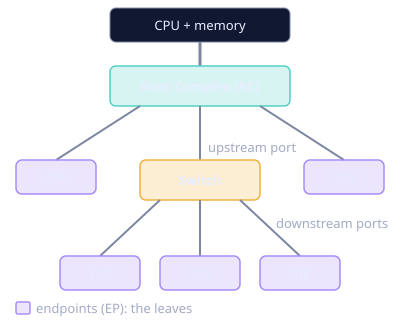
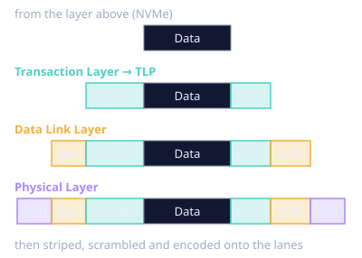
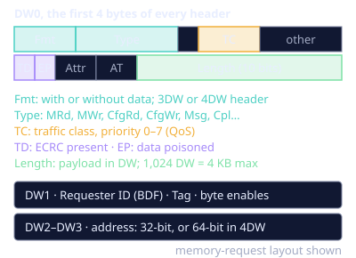
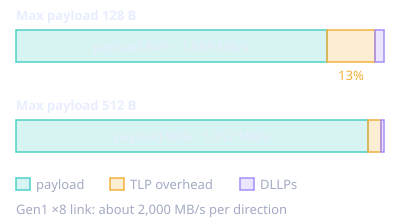
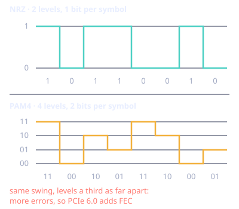

# Chapter 5 — PCIe

[Chapters 3](ch3-nand-flash.md) and [4](ch4-ftl.md) were about flash and the firmware that tames it. Now we pivot completely: **PCIe (Peripheral Component Interconnect Express)** is the high-speed *interface* — the road between host and solid-state drive (SSD). Nothing in this chapter touches flash physics; it's about how bits travel across a serial link: the topology, the layered protocol, the packets that carry your data, and how a packet finds its destination.

Three running analogies carry the chapter, and they're genuinely good: **highway lanes** (link width), **phone vs walkie-talkie** (full- vs half-duplex), and **getting dressed and undressed** (how each protocol layer wraps and unwraps a packet). Keep them; they compress a 1,000-page specification into something you can reason with.

!!! abstract "In this chapter"
    - **Speed** ⭐ — lanes, generations, encoding overhead, and the IOPS ceiling every interface imposes (§5.1)
    - **Topology** ⭐ — the RC / Switch / Endpoint tree (§5.2) · **The three-layer stack** ⭐⭐ — the core mental model (§5.3)
    - **TLPs** — types (§5.4) and structure (§5.5) · **Config space & BARs** — how devices become addressable (§5.6) · **Routing** (§5.7)
    - **Data Link Layer** — ACK/NAK and credit flow control (§5.8) · **Physical Layer** — differential serial signaling (§5.9)
    - **Resets** (§5.10) · **MPS tuning** (§5.11) · **Hot-plug & U.2** (§5.12) · **Why you never get the theoretical number** ⭐ (§5.13)
    - **Modern developments** — PCIe 4.0 → 7.0 and 8.0 under way, and the PAM4/FLIT/FEC break at 6.0 (§5.14)

    Short on time? §5.1–5.4 give you the working mental model; the rest is depth.

---

## 5.1 Starting with speed ⭐

??? example "🎬 Animate this — The SSD Calculator Bundle"

    This section's formulas as live sliders — move an input and watch the answer (and the curve) recompute.

    [Animation page](../animations/ssd-calculators.md) · [open full-screen ↗](../animations/files/ssd_calculators.html)

    <iframe src="../../animations/files/ssd_calculators.html" width="100%" height="640" class="sdd-anim" loading="lazy" title="The SSD Calculator Bundle"></iframe>

Why PCIe for SSDs? Because the ~560 MB/s ceiling of SATA (Serial AT Attachment) was strangling flash ([Ch 1 §1.3](ch1-overview.md#13-a-short-history-of-solid-state-storage), the 2013 turning point). Let's build the PCIe numbers up properly.

**Lanes = highway lanes.** A link's width is its number of **lanes** (×1, ×2, ×4… up to ×32). Each lane has *separate* transmit and receive wire pairs, so traffic flows both directions **simultaneously** — the spec calls it **dual-simplex**, effectively full-duplex.

**PCIe vs SATA = phone vs walkie-talkie.** SATA also has separate send/receive wires but only one direction may transmit at a time (**half-duplex**). PCIe is a phone call — both sides talk at once; SATA is a walkie-talkie.

**The bandwidth math — worth doing once.** Quoted PCIe bandwidth is *bidirectional*; halve it for one direction.

| Gen | Line rate | Encoding | Per-lane bidirectional | Per direction |
|---|---|---|---|---|
| PCIe 1.0 | 2.5 GT/s | 8b/10b | 0.5 GB/s | 0.25 GB/s |
| PCIe 2.0 | 5 GT/s | 8b/10b | 1 GB/s | 0.5 GB/s |
| PCIe 3.0 | 8 GT/s | 128b/130b | ~2 GB/s | ~1 GB/s |

- **8b/10b** (Gen 1/2): every 8 data bits travel as 10 wire bits — 20% overhead buying DC balance and an embedded clock. Gen1 ×1 = (2.5 Gbps × 2 directions) ÷ 10 = **0.5 GB/s**. Scale by lane count.
- **Gen3 broke the pattern:** rather than doubling to 10 gigatransfers per second (GT/s), it went to 8 GT/s *and switched to 128b/130b* (2 overhead bits per 128) — effective bandwidth still doubled. Gen3 ×1 = (8 Gbps × 2 × 128/130) ÷ 8 ≈ **2 GB/s**.
- These GB/s figures already include encoding overhead — don't subtract it twice.

Real SSDs use at most **×4**: PCIe 3.0 ×4 = 8 GB/s bidirectional, **4 GB/s per direction** (the theoretical ×32 maximum of 64 GB/s exists only on paper).

!!! tip "The interface's I/O ceiling — a five-second calculation with a career's worth of uses"
    At 4 GB/s per direction, a Gen3 ×4 link moves at most 4 GB ÷ 4 KB = **1M 4 KB input/output operations per second (IOPS)** — before protocol overhead. No drive on that link exceeds ~1,000K IOPS, *whether the media is flash or 3D XPoint*. The interface is the ceiling. (Redo this arithmetic every generation — §5.14 does.)

**Why serial beats parallel.** PCI (Peripheral Component Interconnect, PCIe's parallel predecessor) moved 32/64 bits per clock in parallel; PCIe moves 1 bit per lane — and wins. At high clock rates, parallel buses hit two walls: **flight-time skew** (the receiver waits for the slowest wire, worse with length) and **clock skew** (the shared clock's own drift). PCIe removes the walls by removing the clock wire: the clock is **embedded in the data stream** by the encoding and recovered by the receiver, so trace length and frequency stop being limits. (Multiple lanes reintroduce a mild skew — the receiver waits for the slowest *lane* — handled internally by the de-skew logic.)

---

## 5.2 Topology: the tree ⭐

**PCI was a shared bus** — devices took turns, arbitrating for control. **PCIe is a tree** with three node types:

- **Root Complex (RC)** — the root; it *speaks for the processor (CPU)*, bridging CPU and memory to the PCIe world. Internally it hosts Bus 0 and fans out ports through internal bridges. The spec deliberately doesn't pin down its innards — the *role* is what matters.
- **Switch** — a branch: expands ports (think Universal Serial Bus (USB) hub) and routes traffic for everything below. One **upstream port** (toward the RC), several **downstream ports**; switches chain freely. Internally, a switch is itself a small bus with bridges.
- **Endpoint (EP)** — a leaf: the actual devices (SSD, network card (NIC), graphics processor (GPU)) implementing **Functions**.

{ .sdd-fig }
/// figure-caption
The PCIe tree. Every link is point-to-point and belongs to the two devices at its ends; the switch fans one upstream link out into several downstream ones.
///

**Point-to-point, not shared.** Every device owns its lanes and their bandwidth outright. Two endpoints *could* talk directly in theory, but in practice nearly all traffic is **Endpoint ↔ RC** (or EP → RC → EP) — different vendors' devices rarely speak each other's data formats. (Bridges converting PCIe ↔ legacy PCI exist; ignore them.)

---

## 5.3 The three-layer stack ⭐⭐

??? example "🎬 Animate this — The Packet Dresser & ACK/NAK Lab"

    Negative acknowledgments (NAK) and acknowledgments (ACK) at work: dress a Transaction Layer Packet (TLP) layer by layer, then let the Jammer corrupt the wire and watch the link recover.

    [Animation page](../animations/packet-dresser.md) · [open full-screen ↗](../animations/files/packet_dresser.html)

    <iframe src="../../animations/files/packet_dresser.html" width="100%" height="640" class="sdd-anim" loading="lazy" title="The Packet Dresser & ACK/NAK Lab"></iframe>

PCIe is layered — three layers, each serving the one above:

1. **Transaction Layer** — creates and parses **TLPs** (Transaction Layer Packets); flow control, quality of service (QoS), transaction ordering. *Your data lives here.*
2. **Data Link Layer** — creates and parses **DLLPs** (Data Link Layer Packets); runs **ACK/NAK** (link-level error recovery), flow control, power management.
3. **Physical Layer** — the wire work: stripe bytes across lanes and de-stripe them, scramble/descramble (spreading 0s and 1s to cut electromagnetic interference (EMI)), encode 8b/10b or 128b/130b, transmit.

**The "getting dressed" picture — the key intuition of the whole chapter.** Data descends the stack, each layer adding a garment:

- The upper layer (a command protocol — NVM Express ([NVMe](ch6-nvme.md), from Non-Volatile Memory Express), next chapter) hands **data** to the Transaction Layer.
- Transaction Layer adds a **Header** in front and an **ECRC** (end-to-end CRC, a cyclic redundancy check over the whole TLP) behind → a **TLP**.
- Data Link Layer adds a **Sequence Number** in front and an **LCRC** (link CRC, checked on every hop) behind.
- Physical Layer adds **Start** and **End** framing, stripes across lanes, scrambles, encodes, transmits.

{ .sdd-fig }
/// figure-caption
A TLP getting dressed. Each layer wraps what it receives from above; the receiver strips the layers in reverse, checking each layer's cyclic redundancy check (CRC) as it goes.
///

The receiver undresses in reverse: Physical strips the framing → Data Link checks sequence + LCRC (bad → demand retransmission; good → strip) → Transaction checks ECRC and delivers. Where PCI's data ran the bus naked, PCIe's data travels fully clothed.

**Everyone implements all three layers** — RC ports, every switch port, every endpoint. So RC → Switch → EP1 involves *multiple* dress/undress cycles: the switch must undress arriving TLPs at least far enough to read the destination, then re-dress and forward. **Why must a mere forwarding switch implement the Transaction Layer?** Because the destination address lives *inside the TLP* — no Transaction Layer, no routing.

---

## 5.4 TLP types ⭐

The Transaction Layer speaks four request dialects:

- **Memory** — read/write memory space. The mainstream traffic.
- **IO (input/output)** — legacy only; new PCIe devices are memory-mapped. Ignore it.
- **Configuration** — read/write config space; **only the RC may initiate**, mostly during power-on enumeration (§5.6).
- **Message** — interrupts, errors, power management. New with PCIe: PCI carried these on dedicated **sideband wires**; PCIe deleted the wires and moved everything **in-band** as packets.

**Posted vs Non-Posted — the postal metaphor.** "Posted" = mailed: drop the letter in the box and move on.

- **Posted** = no response expected: **only Memory Write and Message.**
- **Non-Posted** = response required: everything else — Config read/write, IO, and crucially **Memory Read**.
- *Why is Memory Write Posted?* Not waiting lets the sender fire the next write immediately → write throughput. The residual risk of a silently failed write is covered by the Data Link Layer's ACK/NAK (§5.8).
- *Why is Memory Read Non-Posted?* A read that returns nothing is nothing — the returned data *is* the response.

**Completions.** Every Non-Posted request draws a **Completion TLP**: for reads, a **CplD** (Completion with Data); for the surviving writes (Config Write), a status-only Cpl. So the entire TLP universe = **Request TLPs + Completion TLPs**.

Worked examples worth keeping:

- **Memory Read:** Endpoint C sends **Memory Read (MRd)** TLPs up to the RC; the RC fetches from memory and answers with CplDs. One request can ask for at most **4 KB** (the Length field's limit, §5.5), and each completion carries at most the path's Max Payload Size (§5.11). So a 16 KB read is **at least 4 MRds out**, and with a 256 B Max Payload Size, **64 CplDs back**.
- **Memory Write:** the RC sends a **Memory Write (MWr)** carrying data through the switch to device B. Posted — B sends no completion (a completion here would be legs drawn on a snake). A 16 KB write is **at least 4 MWr TLPs** (64 at a 256 B Max Payload Size), with no replies.

---

## 5.5 TLP structure

Every TLP has the same silhouette: **Header** (mandatory — an animal can lack hands and feet, but not a head), optional **data payload** (a Memory Read carries none), optional **ECRC**. A TLP is born in the sender's Transaction Layer and dies in the receiver's.

**The Header** is **3DW or 4DW** (DW = doubleword = 4 bytes). The fields that matter:

- **Fmt** — with/without data; 3DW vs 4DW.
- **Type** — MRd, MWr, CfgRd (configuration read), CfgWr (configuration write), Msg, Cpl…
- **TC (Traffic Class)** — priority 0–7; the QoS knob.
- **TD** — ECRC present? · **EP** — data is *poisoned*; keep away.
- **Length** — payload length in DW; 10 bits → 1024 DW max = **the 4 KB TLP limit**.

{ .sdd-fig }
/// figure-caption
The header's first doubleword holds the fields above; the next carries who is asking (the requester's Bus/Device/Function number, or BDF) and the last one or two the address.
///

**Header size rules:** Config and Completion TLPs are always **3DW**; Messages always **4DW**; Memory TLPs are **3DW below 4 GB addresses, 4DW above** (a 64-bit address needs the extra DW).

**How each type addresses its target:**

- **Memory TLP:** destination = memory address; source = **Requester ID** — the sender's **BDF (Bus, Device, Function)**.
- **Configuration TLP:** target = BDF, plus Ext Reg + Register Number as the offset into config space. Type 0 → endpoint, Type 1 → switch.
- **Message TLP:** 4DW; a **Message Code** says what it is (interrupt, error, power event…).
- **Completion TLP:** destination = the original requester's ID, copied back; carries a **Completion Status** (success, or one of several failures).

---

## 5.6 Config space and BARs ⭐

??? example "🎬 Animate this — The Enumeration & Routing Explorer"

    The Base Address Register (BAR) all-1s sizing trick and Base/Limit routing, played out on a live tree.

    [Animation page](../animations/enum-routing.md) · [open full-screen ↗](../animations/files/enum_routing.html)

    <iframe src="../../animations/files/enum_routing.html" width="100%" height="640" class="sdd-anim" loading="lazy" title="The Enumeration & Routing Explorer"></iframe>

**Config space.** Every PCIe Function carries a standardized register file — layout fixed by the spec, so any host can read any vendor's device the same way. PCI allotted 256 B (64 B header + 192 B capabilities); **PCIe extends it to 4 KB**, first 256 B backward-compatible.

**The 64 B Config Header** comes as **Type 0** (endpoint) or **Type 1** (switch port). Read-only registers — **Vendor ID, Device ID, Class Code, Revision** — let a device introduce itself. The stars of the header, though, are the **BARs**.

**BARs — Base Address Registers — solve this problem: the CPU can only address host memory, not PCIe devices.** So how does it reach a device's registers and buffers?

By **memory-mapping**, brokered by the RC: at boot, each device's exposed internal spaces are mapped into regions of the **host memory address space** (address space, not dynamic RAM (DRAM)). When the CPU touches such an address, the **RC recognizes it** and generates the corresponding TLP toward the device. All device access is therefore *indirect*, through the RC.

**The all-1s sizing trick** — how boot software builds the map (watch it live in the animation above):

1. Read BAR0 (initial value).
2. **Write all-1s** to BAR0.
3. Read back: the bits that *refused to change* are vendor-hardwired and reveal the space's **size and attributes**. Low 12 bits stuck? The space is 2¹² = 4 KB. The lowest 4 bits encode: IO or memory mapped, 32- or 64-bit, **prefetchable or not** (some registers self-clear on read — those spaces must never be prefetched).
4. Allocate a free region of that size in the host memory map; write its **base address** into BAR0.
5. Repeat for BAR1–BAR5 (endpoints have up to 6 BARs; switch ports have 2).

**BDF and the enumeration arithmetic.** A device may expose several **Functions** (a card that's both disk and NIC), each with its own config space. Addressing unit = Function = **BDF**: up to **256 buses × 32 devices × 8 functions**. At 4 KB config space each, the whole config universe maps to 256 × 32 × 8 × 4 KB = **256 MB** of host address space. Config space itself can't be reached through a Base Address Register (BAR) — the BARs *live in* config space; the bootstrap has to come from the RC's dedicated config mechanism. Hence the rule: **only the RC initiates config access.**

---

## 5.7 TLP routing ⭐

Three ways a TLP finds its destination — **address routing**, **ID routing**, **implicit routing** — and each TLP type has its dialect.

**1. Address routing** (Memory, and legacy IO). The routing tables live in switch config space: each switch port is a **bridge** whose config declares the address window below it via **Memory Base / Memory Limit** registers.

- An **endpoint** compares the TLP address to its own BARs: inside → accept; else ignore.
- A **switch port**, downstream-bound: check own BARs (accept if hit); else find the downstream port whose [Base, Limit] window contains the address and **forward**; no window → reject.
- **Upstream-bound:** own BARs → accept; falls in a downstream window → reject (it shouldn't be climbing); otherwise pass upward.

**2. ID routing** (Configuration and Completion; Messages optionally). Routes on **BDF**. Endpoints compare their own ID. Switch ports use three config registers — **Primary Bus** (the bus on the port's upstream side), **Secondary Bus** (the bus immediately below), **Subordinate Bus** (the highest-numbered bus anywhere below). If the TLP's target bus ∈ [Secondary, Subordinate], forward down that port; if it equals the switch's own ID, accept; else reject.

**3. Implicit routing** (Messages only). Some messages simply mean "to the RC" or "from the RC to everyone" — no address needed; the Type field's low 3 bits encode it. An RC broadcast (011b) is copied by a switch to *every* downstream port; an endpoint accepts broadcasts and terminate-at-receiver (100b) messages. Messages may also use address or ID routing, but implicit is their home mode.

---

## 5.8 Data Link Layer ⭐

??? example "🎬 Animate this — The Packet Dresser & ACK/NAK Lab"

    Negative acknowledgments (NAK) and acknowledgments (ACK) at work: dress a Transaction Layer Packet (TLP) layer by layer, then let the Jammer corrupt the wire and watch the link recover.

    [Animation page](../animations/packet-dresser.md) · [open full-screen ↗](../animations/files/packet_dresser.html)

    <iframe src="../../animations/files/packet_dresser.html" width="100%" height="640" class="sdd-anim" loading="lazy" title="The Packet Dresser & ACK/NAK Lab"></iframe>

A TLP is born and dies at the Transaction Layer, but every hop in between belongs to the Data Link Layer, whose job is **guaranteed delivery**: add **Sequence Number + LCRC** on the way out; verify, strip, and acknowledge on the way in; reject and demand retransmission on error.

Its own packets are **DLLPs** (Data Link Layer Packets) — and unlike TLPs, a DLLP travels exactly **one hop** (RC ↔ switch port, switch ↔ switch, switch ↔ EP), so it needs no routing information. Four kinds: **ACK/NAK**, **flow control**, **power management**, vendor-specific. Six bytes each (eight on the wire).

**The ACK/NAK machine** (run the Jammer in the animation to watch it work). The sender parks every transmitted TLP in a **Replay Buffer** until acknowledged. The receiver, per TLP:

- **LCRC bad** → **NAK** carrying the last-good sequence number. Sender flushes acknowledged TLPs and **retransmits** the rest. (Wire errors are transient; the retry almost always lands.)
- **LCRC good** → check the sequence number:
    - *Expected* → ACK (possibly one ACK covering several TLPs, to save bandwidth); sender clears its buffer.
    - *Too high* (got 13, expected 12) → a TLP vanished → NAK at last-good; sender replays from the gap.
    - *Too low* (got 10, expected 12) → a **duplicate** from an over-eager sender timeout → silently discard, ACK anyway.

Only verified TLPs are undressed and passed up. A corrupted *DLLP* is simply dropped — the protocol self-heals on the next good one.

**Flow control — credits.** A sender must never overrun a slow receiver. The receiver periodically advertises its buffer space (**credits**) via flow-control DLLPs; the sender transmits only what fits. Note the elegant asymmetry: **flow control governs TLPs, never DLLPs** — DLLPs are six bytes and exempt, because *someone would have to flow-control the flow-control packets*.

---

## 5.9 Physical Layer

The errand-runner that actually moves bits. Two halves:

**Electrical:** one phrase to keep — **serial bus, differential signaling**. Each direction is a wire *pair*; the bit is the *difference* between them. Noise hits both wires nearly equally and cancels in the difference — a single-ended 0.8 V signal bumped to 1.5 V by a spike flips its bit; a differential pair shrugs. That noise immunity is what lets the frequency climb. For SSD work, "serial + differential = why PCIe is fast" is genuinely all you need; the rest belongs to the spec.

**Logical — the transmit pipeline:**

1. TLP/DLLP arrives from above into the **Tx buffer**.
2. Add **Start/End framing** so the receiver can find packet edges (Gen3 drops the End symbol).
3. **Byte-stripe** across the lanes.
4. **Scramble** each lane (exclusive-OR (XOR) with a pseudo-random stream — EMI control).
5. **Encode** — 8b/10b (Gen1/2) or 128b/130b (Gen3): DC balance plus the **embedded clock** that made the no-clock-wire trick of §5.1 possible.
6. Serialize and drive the pairs. The receiver runs the pipeline backwards.

**Ordered Sets** — the Physical Layer's own packet species, never seen above it: link training, speed changes, link power states. Full cast now on stage: **TLPs** carry data, **DLLPs** carry link housekeeping, **Ordered Sets** manage the physical link itself.

---

## 5.10 PCIe reset

A thicket of terms, tamed by hierarchy:

- **Conventional Reset**
    - **Fundamental Reset** (hardware-level; reinitializes nearly all state):
        - **Cold Reset** — main power (Vcc) cycled; Vaux stays.
        - **Warm Reset** — system-triggered with Vcc held (mechanism left to the platform).
    - **Hot Reset** — non-fundamental, signaled **in-band** by TS1 ordered sets.
- **FLR (Function Level Reset)** — resets a *single Function*.

**Sticky bits.** Some register fields survive every reset short of losing auxiliary power. They exist for **debugging**: error state written before a link reset is still there to read after — often the only witness to what went wrong.

**How resets reach an SSD.** Fundamental Reset arrives as the **PERST#** pin (the PCIe reset signal): power stabilizes → "Power Good" asserts → chipset toggles PERST#. A design that ignores PERST# must self-reset on detecting stable power. **Hot Reset** is two consecutive TS1s with the hot-reset bit set; the Link Training and Status State Machine (**LTSSM**) walks L0 → Recovery → Hot Reset → Detect, clearing all but sticky bits. Software fires it via the bridge's **Secondary Bus Reset** bit (and there's a **Link Disable** bit to hold a link down).

**FLR.** *The link is a road; the Functions are cars. One car breaks down — fix the car, don't close the road.* FLR resets one Function's state, **preserving** sticky bits, HwInit (EEPROM-loaded) registers, and a few link-shared settings (Max Payload Size, Active State Power Management (ASPM) Control, Captured Power, VC). It must finish within **100 ms**. The subtle hazard: **stale completions** — CplDs from a pre-FLR transaction arriving into a post-FLR world and corrupting it. The safe sequence: quiesce all software access → clear the Command Register → poll **Transactions Pending** until clear (or wait out the completion timeout) → FLR → wait 100 ms → reconfigure. On exit, link training must start within 20 ms; software waits ≥100 ms before Config Requests; a not-yet-ready device answers **CRS** (Configuration Retry Status) and has up to **1 second** to come alive before the system gives up on it.

---

## 5.11 Max Payload Size & Max Read Request Size ⭐

Two knobs in the **Device Control Register**, and a genuinely practical tuning lever.

**MPS (Max Payload Size)** — the largest payload one TLP may carry (spec ceiling 4 KB). The constraint that bites: **every device on the path must run the same MPS, no higher than the weakest device's capability**. Enumeration collects everyone's capability and the operating system (OS) writes the *minimum* into all Device Control Registers. Plug a state-of-the-art SSD into an old motherboard advertising MPS = 128 B, and every TLP on that path shrinks to 128 B — the strong stooping to the weak.

**Max Read Request Size** — the largest single Memory Read a device may issue (up to 4 KB), and it **may exceed MPS**: a 512 B read against MPS = 128 B is answered by 4 × 128 B CplDs. Two uses: the OS balances bandwidth among multiple SSDs with it, and it controls read efficiency — read-request TLPs carry *no payload*, pure overhead, so small request sizes multiply them. Moving 64 KB with 128 B requests takes **512 request TLPs**; with 4 KB requests, sixteen. Set it big for big transfers.

---

## 5.12 PCIe SSD hot-plug

**Why it became necessary.** The first PCIe SSDs (Fusion-IO's fame) were **add-in cards** — fast, but: few slots, power-limited capacity, thermal risk, and above all **no hot-swap**. A failed card meant service-down, power-off, open-the-chassis — unacceptable at data-center scale.

**The fix: U.2 (SFF-8639)** — PCIe in a 2.5″-drive package, hot-swappable from the server's front panel like any enterprise hard disk ([Ch 1 §1.6.5](ch1-overview.md#16-form-factors) introduced the connector). Chassis take 24+ U.2 bays; drives hold primary data (not just cache) under RAID (redundant arrays of independent disks); a failed drive is identified by its panel light and swapped **with zero downtime**. Dense flash servers replaced racks of disk arrays — with the power and cooling savings deciding the argument.

**What hot-plug actually requires.** For disks on SATA or on SAS (Serial Attached SCSI; SCSI is the Small Computer System Interface), hot-plug is the host bus adapter's (HBA's) problem; a PCIe SSD hangs *directly off the CPU's PCIe lanes*, so the **driver** owns hot-plug — with cooperation from the SSD (inrush-current limiting on insertion; surprise-removal detection), the backplane (must be validated for U.2 hot-plug), and the OS and the Basic Input/Output System (BIOS) (someone must own the events). The safe removal ritual: stop all IO → unmount filesystems → detach driver/block device → pull the drive.

---

## 5.13 PCIe link performance-loss analysis ⭐

??? example "🎬 Animate this — The SSD Calculator Bundle"

    This section's formulas as live sliders — move an input and watch the answer (and the curve) recompute.

    [Animation page](../animations/ssd-calculators.md) · [open full-screen ↗](../animations/files/ssd_calculators.html)

    <iframe src="../../animations/files/ssd_calculators.html" width="100%" height="640" class="sdd-anim" loading="lazy" title="The SSD Calculator Bundle"></iframe>

Why you never get the theoretical number — six taxes between line rate and real throughput:

1. **Encoding** — 8b/10b costs 20% (Gen1/2); 128b/130b makes it negligible (Gen3+).
2. **TLP overhead** — Header + ECRC + Sequence + LCRC + framing ≈ **20–30 B per TLP** wrapping the payload.
3. **Traffic overhead** — periodic **SKP** ordered sets compensate clock drift (like SATA's ALIGN): 4 B (Gen1/2) or 16 B (Gen3) every ~1538 symbol times, inserted between TLPs.
4. **Link protocol** — the ACK/NAK machinery itself. Batching ACKs helps, but the Replay Buffer is finite — batch too much and it fills, stalling transmission.
5. **Flow control** — periodic **UpdateFC** DLLPs; less frequent updates need bigger receiver buffers.
6. **System parameters** — MPS, Max Read Request Size, and **RCB (Read Completion Boundary)**: the RC may legally slice read completions at address-aligned 64/128 B boundaries, which is why one read often returns as a shower of small CplDs.

!!! example "The worked calculation — do it once, reuse it forever"
    **Given:** 200 MemWr TLPs, MPS = 128 B, PCIe Gen1 ×8.

    - Gen1 symbol time: 1 byte per 4 ns per lane → 8 lanes move 8 B per 4 ns.
    - One TLP: (128 B payload + 20 B overhead) ÷ 8 B × 4 ns = **74 ns**.
    - One DLLP: 8 B ÷ 8 × 4 ns = **4 ns**. Assume 1 ACK per 5 TLPs (40 total), 1 UpdateFC per 4 TLPs (50 total).
    - Payload moved: 200 × 128 B = 25,600 B. Time: 200×74 + 40×4 + 50×4 = **15,160 ns**.
    - **Throughput ≈ 25,600 / 15,160 ns ≈ 1,689 MB/s.** Raise MPS to 512 B and it becomes **≈ 1,912 MB/s** — enough to retire any SATA drive, on Gen1 hardware. (Reads run the same math, with CplD sizes subject to the RCB.)

{ .sdd-fig }
/// figure-caption
The worked example as shares of the link's time. Bigger payloads spread the fixed per-TLP overhead over more data.
///

---

## 5.14 Modern developments: PCIe 4.0 → 7.0

*The first edition stops at Gen3, noting 4.0 was "just released." Four generations later, one architectural break matters. From PCI-SIG and industry sources.*

**The ladder, on PCI-SIG's metronomic double-every-three-years cadence:**

| Gen | Spec year | Line rate | Signaling / encoding | Per lane, per direction | ×4 SSD, per direction |
|---|---|---|---|---|---|
| 3.0 | 2010 | 8 GT/s | NRZ, 128b/130b | ~1 GB/s | ~4 GB/s |
| 4.0 | 2017 | 16 GT/s | NRZ, 128b/130b | ~2 GB/s | ~8 GB/s |
| 5.0 | 2019 | 32 GT/s | NRZ, 128b/130b | ~4 GB/s | ~16 GB/s |
| 6.0 | 2022 | 64 GT/s | **PAM4 + FLIT + FEC** | ~8 GB/s | ~32 GB/s |
| 7.0 | 2025 | 128 GT/s | PAM4 + FLIT + FEC | ~16 GB/s | ~64 GB/s |

PCI-SIG released the PCIe 7.0 specification in June 2025 (128 GT/s; up to 512 GB/s bidirectional at ×16), and in August 2025 announced PCIe 8.0: 256 GT/s, up to 1 TB/s bidirectional at ×16, planned for release to members by 2028. The three-year doubling continues, now driven by AI clusters, hyperscale storage, and 800G networking rather than consumer demand.

**The architectural break at 6.0 — the part worth understanding.** Everything this chapter taught about encoding assumes **NRZ** (non-return-to-zero) signaling (two voltage levels, one bit per symbol) and 128b/130b framing; Gens 4 and 5 simply doubled the NRZ clock and kept the model. But copper ran out of frequency headroom, so 6.0 made three coordinated changes:

- **PAM4** (4-level pulse-amplitude modulation) replaces NRZ: **four** voltage levels = **2 bits per symbol** — the line rate doubles (32 → 64 GT/s) *without* doubling the clock. The price: four levels crammed into the same voltage swing are far more noise-sensitive, which forces —
- **FEC (Forward Error Correction)**: a lightweight code fixes most wire errors inline, *complementing* (not replacing) §5.8's ACK/NAK retransmission; and
- **FLIT (flow control unit) encoding**: fixed-size flow-control units replace the Start/End-framed variable packets of §5.3/§5.5 on the wire — FEC needs fixed-size codewords to chew on.

{ .sdd-fig }
/// figure-caption
NRZ and PAM4 at the same symbol rate. PAM4 carries twice the bits, but its four levels sit a third as far apart, so it needs forward error correction.
///

Reasoning about a Gen4/Gen5 SSD? This chapter's model is exact. Gen6+? Remember the trio: **PAM4 + FLIT + FEC**.

**Where real drives are (as of 2026):** Gen4 ×4 ≈ 7–7.5 GB/s is the consumer mainstream; Gen5 ×4 ≈ 14–15 GB/s is the enthusiast/enterprise high end; Gen6 reached mass production first in data-center drives, with Micron's 9650 reading at up to 28 GB/s; Gen7 products are still years out.

**Recompute the ceiling** (the §5.1 habit): Gen5 ×4 at ~14 GB/s per direction → 14 GB ÷ 4 KB ≈ **3.4M** 4 KB IOPS, versus ~1M at Gen3 ×4. The lesson survives every generation: *the interface, not the medium, often sets the IOPS ceiling* — only the number moves.

**And U.2 is passing the torch:** modern data centers increasingly use **EDSFF** (Enterprise and Data Center Standard Form Factor) drives instead — the E1.S and E1.L rulers and the E3.S family — purpose-built for NVMe density, thermals, and hot-plug. Everything §5.12 says about *why* hot-plug matters still holds; the connector moved on.

---

## Key takeaways

1. **Serial + differential + embedded clock** is why PCIe scales where parallel PCI could not — no clock wire, no flight-time skew wall.
2. **Bandwidth per direction = line rate × encoding efficiency × lanes ÷ 2**, and the **IOPS ceiling** (bandwidth ÷ block size) is a calculation you should redo reflexively for every link you meet.
3. **Three layers, three packet species:** TLPs (data, end-to-end), DLLPs (link housekeeping, one hop), Ordered Sets (physical link management). The dressing/undressing picture organizes everything.
4. **Only Memory Write and Message are Posted**; everything else draws a Completion. One read request can return many completions (MPS limit, RCB slicing).
5. **BARs + the all-1s trick** are how devices get addresses; **BDF + Base/Limit windows** are how packets find them; **only the RC initiates config**.
6. **ACK/NAK + credits make the link reliable** — and are also overhead taxes, which is why measured throughput always trails the datasheet (§5.13's arithmetic).
7. **MPS is a path-wide minimum** — one weak device throttles the whole chain.
8. **Past Gen5, the rules change:** PAM4 + FLIT + FEC at Gen6+ — same layered model, new wire physics.

---

## Key vocabulary

| Term | 中文 | Meaning |
|---|---|---|
| lane | 通道 (Lane) | One transmit pair plus one receive pair; links bundle lanes (×1, ×4, ×16) to add bandwidth. → [§5.1](#51-starting-with-speed) |
| link | 鏈路 (Link)（台：連結） | The connection between two PCIe ports, made of one or more lanes. → [§5.1](#51-starting-with-speed) |
| dual-simplex / full-duplex / half-duplex | 雙單工 / 全雙工 / 半雙工 | Both directions at once on separate wires (PCIe), both at once in general, or one direction at a time (SATA). → [§5.1](#51-starting-with-speed) |
| serial / parallel bus | 串行 / 並行總線（台：序列 / 平行匯流排） | Sending bits one after another on few wires, versus many bits at once on many wires sharing a clock. → [§5.1](#51-starting-with-speed) |
| differential signaling | 差分信號（台：差動訊號） | Sending each bit as the difference between two wires, so noise that hits both cancels out. → [§5.9](#59-physical-layer) |
| bandwidth | 帶寬（台：頻寬） | Data moved per second; for PCIe, quoted per direction or for both directions combined. → [§5.1](#51-starting-with-speed) |
| topology | 拓撲結構（台：拓樸結構） | How the devices of a system are connected; PCIe's is a tree. → [§5.2](#52-topology-the-tree) |
| tree structure | 樹形結構（台：樹狀結構） | A hierarchy with one root, branches (switches) and leaves (endpoints). → [§5.2](#52-topology-the-tree) |
| Root Complex (RC) | 根複合體 | The root of the PCIe tree, which connects the CPU and memory to PCIe and alone may start configuration. → [§5.2](#52-topology-the-tree) |
| switch | 交換機 (Switch)（台：交換器） | A branch of the tree that fans one upstream port out into several downstream ports and routes TLPs between them. → [§5.2](#52-topology-the-tree) |
| endpoint | 端點 (Endpoint) | A leaf device, such as an SSD or network card, that implements one or more Functions. → [§5.2](#52-topology-the-tree) |
| upstream / downstream port | 上游 / 下游端口（台：上游 / 下游埠） | A port facing toward the Root Complex, versus one facing away from it. → [§5.2](#52-topology-the-tree) |
| point-to-point | 點到點（台：點對點） | Each link connects exactly two devices and its bandwidth is theirs alone. → [§5.2](#52-topology-the-tree) |
| layered structure | 分層結構 | Splitting the protocol into layers that each wrap the one above: transaction, data link, physical. → [§5.3](#53-the-three-layer-stack) |
| Transaction Layer | 事務層（台：交易層） | The top layer: builds and parses TLPs, and handles ordering and flow control. → [§5.3](#53-the-three-layer-stack) |
| Transaction Layer Packet (TLP) | 事務層數據包（台：交易層封包） | The packet that carries requests, completions and data end to end. → [§5.4](#54-tlp-types) |
| Data Link Layer | 數據鏈路層（台：資料連結層） | The middle layer: sequence numbers, LCRC, ACK/NAK retry and credits, hop by hop. → [§5.8](#58-data-link-layer) |
| Data Link Layer Packet (DLLP) | 數據鏈路層數據包（台：資料連結層封包） | A small one-hop packet for acknowledgments, flow-control credits and power management. → [§5.8](#58-data-link-layer) |
| Physical Layer | 物理層（台：實體層） | The bottom layer: framing, striping, scrambling, encoding and differential signaling. → [§5.9](#59-physical-layer) |
| packet | 數據包（台：封包） | A unit of data with its own header and checks, as sent across a link. → [§5.3](#53-the-three-layer-stack) |
| payload | 有效載荷（台：酬載） | The data a TLP carries, as opposed to its header and checks. → [§5.5](#55-tlp-structure) |
| sequence number | 序列號（台：序號） | A number the Data Link Layer stamps on each TLP so the receiver can detect gaps and duplicates. → [§5.8](#58-data-link-layer) |
| retransmission (retry) | 重傳 | Resending TLPs from the replay buffer after a NAK or timeout. → [§5.8](#58-data-link-layer) |
| flow control | 流量控制 / 流控 | A receiver advertising credits for its free buffer space, so the sender never overruns it. → [§5.8](#58-data-link-layer) |
| configuration space | 配置空間（台：組態空間） | The standard register file of every Function, 4 KB in PCIe, holding IDs, capabilities and BARs. → [§5.6](#56-config-space-and-bars) |
| Base Address Register (BAR) | 基地址寄存器（台：基底位址暫存器） | A config register that holds where one of a device's memory regions appears in the host's address space. → [§5.6](#56-config-space-and-bars) |
| memory mapping | 內存映射（台：記憶體映射） | Making a device's registers appear as host memory addresses, so the CPU reaches them with ordinary reads and writes. → [§5.6](#56-config-space-and-bars) |
| enumeration | 枚舉（台：列舉） | The boot-time walk of the tree that finds every Function, sizes its BARs and assigns addresses. → [§5.6](#56-config-space-and-bars) |
| Bus/Device/Function (BDF) | 總線/設備/功能號（台：匯流排/裝置/功能編號） | The address of one PCIe Function: up to 256 buses × 32 devices × 8 functions. → [§5.6](#56-config-space-and-bars) |
| routing | 路由 | How a TLP finds its destination: by address, by ID (BDF), or implicitly. → [§5.7](#57-tlp-routing) |
| implicit routing | 隱式路由（台：隱含路由） | Routing used by messages that just mean "to the Root Complex" or "to everyone". → [§5.7](#57-tlp-routing) |
| sideband signal | 邊帶信號（台：邊帶訊號） | A dedicated wire beside the data path; PCIe moved most of PCI's onto in-band messages. → [§5.4](#54-tlp-types) |
| in-band | 帶內（台：頻內） | Carried as packets over the data link itself rather than on separate wires. → [§5.4](#54-tlp-types) |
| scramble / de-scramble | 加擾 / 去擾（台：擾碼 / 解擾） | Mixing the bit stream with a pseudo-random pattern (and undoing it) to avoid long runs that cause EMI. → [§5.9](#59-physical-layer) |
| encode / decode | 編碼 / 解碼 | Turning data into line codes such as 8b/10b or 128b/130b, which embed the clock, and back again. → [§5.9](#59-physical-layer) |
| Max Payload Size (MPS) | 最大有效載荷（台：最大酬載大小） | The largest payload one TLP may carry, set to the smallest capability on the path. → [§5.11](#511-max-payload-size-max-read-request-size) |
| hot-plug | 熱插拔 | Inserting or removing a drive while the system runs, as U.2 and EDSFF bays allow. → [§5.12](#512-pcie-ssd-hot-plug) |
| performance loss | 性能損耗（台：效能損耗） | The gap between line rate and real throughput, from encoding, packet overhead and the link protocol. → [§5.13](#513-pcie-link-performance-loss-analysis) |

---

## Check yourself

1. Why is PCIe called "Express," and what fundamental physical-transmission difference lets serial PCIe beat parallel PCI at high speed? Name the two skew problems parallel buses hit.

    ??? success "Answer"
        It is the fast ("express") successor to the parallel PCI bus. A parallel bus sends many bits at once on many wires with a shared clock, so at high frequency it hits flight-time skew (bits on different wires arrive at different times, worse with longer traces) and clock skew (the shared clock drifts against the data). PCIe sends bits serially on differential pairs and embeds the clock in the encoded data, so the receiver recovers it and neither skew limits the speed. See [§5.1](#51-starting-with-speed).

2. PCIe 3.0 ×4 gives 4 GB/s per direction. Compute the theoretical 4 KB IOPS ceiling, and explain why the underlying media (flash vs 3D XPoint) can't change it.

    ??? success "Answer"
        4 GB/s ÷ 4 KB ≈ 1 million 4 KB IOPS per direction, before protocol overhead. Every 4 KB transfer has to cross the link, so whatever sits behind it, flash or 3D XPoint, can't complete more 4 KB transfers per second than the link carries. See [§5.1](#51-starting-with-speed).

3. Name the three PCIe layers top-to-bottom, and the packet type each one generates.

    ??? success "Answer"
        Transaction Layer → TLPs (requests, completions and data); Data Link Layer → DLLPs (acknowledgments, flow-control credits, power management); Physical Layer → Ordered Sets (link training and link-state management). See [§5.3](#53-the-three-layer-stack) and [§5.9](#59-physical-layer).

4. Which two TLP types are Posted, and what's the performance reason Memory Write is Posted?

    ??? success "Answer"
        Memory Write and Message. A posted write needs no reply, so the sender can fire the next write at once instead of waiting a round trip, which keeps write throughput high; the Data Link Layer's ACK/NAK still guarantees delivery on each hop. See [§5.4](#54-tlp-types).

5. A device needs to read 16 KB from host memory. How many request TLPs does it send, and how many completion TLPs come back? Why the asymmetry?

    ??? success "Answer"
        At least 4 requests: one Memory Read can ask for at most 4 KB, the Length field's limit and the largest Max Read Request Size. Completions are limited by the Max Payload Size instead, so with a 256 B MPS each 4 KB request comes back as 16 completions, 64 in all, or more if the Root Complex splits them at the read completion boundary. Requests carry no data, only a description of what's wanted; completions carry all of it, in MPS-sized pieces. See [§5.4](#54-tlp-types) and [§5.11](#511-max-payload-size-max-read-request-size).

6. What does a BAR do, and walk through how system software discovers a device's memory-space size at boot (the write-all-1s trick).

    ??? success "Answer"
        A BAR holds the base address at which one of the device's internal regions appears in the host's memory address space, so the CPU reaches the device with ordinary reads and writes that the Root Complex turns into TLPs. At boot, software writes all 1s to the BAR and reads it back: the low bits that stay 0 are hardwired and give the region's size (12 stuck bits = 4 KB), and the lowest bits give its type. Software then allocates a free range of that size and writes its base address into the BAR. See [§5.6](#56-config-space-and-bars).

7. What are the three TLP routing methods, and which method does each of Memory / Configuration / Message TLPs use?

    ??? success "Answer"
        Address routing, by memory address against BARs and Base/Limit windows, for Memory (and legacy IO) TLPs. ID routing, by BDF against bus-number ranges, for Configuration (and Completion) TLPs. Implicit routing, "to the Root Complex" or "to everyone", for Messages, which may also use the other two. See [§5.7](#57-tlp-routing).

8. In ACK/NAK, what is the Replay Buffer for, and what happens when the receiver gets a TLP with a *lower*-than-expected sequence number?

    ??? success "Answer"
        The Replay Buffer keeps every transmitted TLP until the receiver acknowledges it, so a TLP that is NAKed or lost can be resent. A lower-than-expected sequence number means a duplicate, usually resent after a sender timeout although the original arrived; the receiver discards it silently and still sends an ACK. See [§5.8](#58-data-link-layer).

9. Why does flow control apply to TLPs but not DLLPs?

    ??? success "Answer"
        DLLPs carry the flow-control credits themselves and are only six bytes. Flow-controlling them would need more packets to flow-control those, an endless regress, so credits govern only TLPs and DLLPs are always allowed through. See [§5.8](#58-data-link-layer).

10. MPS must be identical across all devices on a path, and no higher than the weakest device. What practical failure does this cause when you put a fast SSD in an old motherboard?

    ??? success "Answer"
        The whole path runs at the smallest MPS, so if the old board supports only 128 B, the fast SSD must also cut its TLPs to 128 B. Smaller TLPs mean more headers, CRCs and DLLPs per byte, so throughput falls below what the SSD could deliver, even though both ends "work". See [§5.11](#511-max-payload-size-max-read-request-size) and [§5.13](#513-pcie-link-performance-loss-analysis).

11. Why does a PCIe SSD's hot-plug have to be managed by the driver, unlike a SATA/SAS disk?

    ??? success "Answer"
        A SATA or SAS disk sits behind a host bus adapter, which handles insertion and removal itself. A PCIe SSD connects straight to the CPU's PCIe lanes with no adapter in between, so the operating system's driver must handle the hot-plug events, with help from the drive (inrush limiting, surprise-removal detection), a validated backplane and the BIOS. See [§5.12](#512-pcie-ssd-hot-plug).

12. **(Modern)** PCIe 6.0 made three coordinated changes to keep scaling past NRZ's limits. Name all three, and say which one directly doubled the data rate without doubling the clock.

    ??? success "Answer"
        PAM4 signaling, forward error correction (FEC) and FLIT encoding. PAM4 doubled the data rate without doubling the clock: four voltage levels carry 2 bits per symbol. FEC fixes the extra errors that the closer levels cause, and fixed-size FLITs give FEC fixed-size blocks to work on. See [§5.14](#514-modern-developments-pcie-40-70).

13. **(Modern)** Recompute the interface IOPS ceiling for a Gen5 ×4 SSD (~14 GB/s per direction), and state the general lesson.

    ??? success "Answer"
        14 GB/s ÷ 4 KB ≈ 3.4 million 4 KB IOPS per direction, against about 1 million at Gen3 ×4. The lesson: the interface, not the medium, often sets the IOPS ceiling; each generation moves the number, but the calculation stays the same. See [§5.14](#514-modern-developments-pcie-40-70).

---

??? info "📖 Book page map — for readers of 《深入淺出SSD》"

    This chapter follows Chapter 5 of《深入淺出SSD》(SSDFans, 2018), pp. 1–74;
    §5.14 is a post-2018 supplement. Original figures by section:

    | Section | Book pages | Key figures/tables |
    |---|---|---|
    | 5.1 Speed | pp. 1–7 | Table 5-1, Figs 5-1…5-5 |
    | 5.2 Topology | pp. 7–11 | Figs 5-6…5-10 |
    | 5.3 Layers | pp. 11–16 | Figs 5-11…5-16 (dressing diagram) |
    | 5.4 TLP types | pp. 16–21 | Tables 5-2…5-4, Figs 5-17/5-18 |
    | 5.5 TLP structure | pp. 21–27 | Figs 5-19…5-26, Table 5-5 |
    | 5.6 Config & BARs | pp. 28–37 | Figs 5-27…5-37 |
    | 5.7 Routing | pp. 37–47 | Table 5-6, Figs 5-39…5-48 |
    | 5.8 Data Link | pp. 47–54 | Figs 5-49…5-55, Table 5-7 |
    | 5.9 Physical | pp. 54–59 | Figs 5-57/5-58, Table 5-8 |
    | 5.10 Reset | pp. 59–67 | Table 5-9, Figs 5-59…5-65 |
    | 5.11 MPS | pp. 67–68 | Fig 5-66 |
    | 5.12 Hot-plug | pp. 68–70 | Fig 5-67 |
    | 5.13 Performance loss | pp. 70–74 | — |

    §5.4's read and write counts are corrected in this edition: a single request can move at most 4 KB, so a 16 KB transfer takes at least four.

??? info "🔎 Sources for the 2026 update"

    Section 5.14 was brought up to date in November 2026 against these sources:

    - PCIe 8.0 announced at 256 GT/s, for release to members by 2028 (August 2025) — [The Register](https://www.theregister.com/2025/08/08/pcie_8_spec_speed_announced/)
    - Micron 9650, the first PCIe 6.0 SSD in mass production — [Tom's Hardware](https://www.tomshardware.com/pc-components/ssds/worlds-first-pcie-6-0-ssd-enters-mass-production-with-28gb-s-speeds-micron-9650-series-ssds-support-air-and-liquid-cooling)

*Next: [Chapter 6 — NVMe](ch6-nvme.md). PCIe is the road; NVMe is the traffic system built on it — queues, doorbells, and the PRP (Physical Region Page) and SGL (Scatter-Gather List) data pointers — where the interface finally meets the SSD's front end.*
