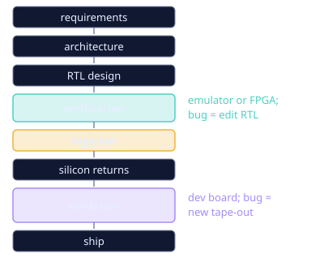
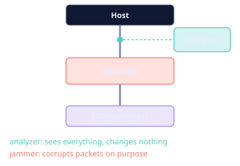
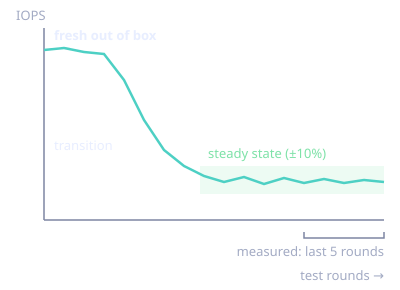
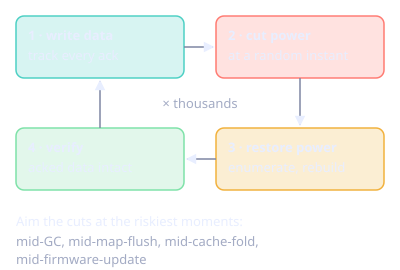

# Chapter 7 — SSD Testing

Chapters 1–6 built the solid-state drive (SSD) from the inside out — media, controller, flash physics, the flash translation layer (FTL), PCIe (Peripheral Component Interconnect Express) and NVMe (Non-Volatile Memory Express). This final chapter turns to **practice**: how drives are actually validated before they ship. It is the least theoretical chapter and the most immediately usable one — the tools (FIO, the Flexible I/O tester, and IOMeter), the lab equipment (emulators, analyzers, jammers), and the standardized methods (endurance from JEDEC, the JEDEC Solid State Technology Association; performance from SNIA, the Storage Networking Industry Association) are what real bench work is made of.

!!! abstract "In this chapter"
    - **The software tools** — FIO ⭐⭐ and the GUI benchmarks, with their data-pattern traps (§7.1)
    - **Verification vs validation** — a vocabulary distinction with a price tag (§7.2)
    - **The lab equipment** — emulator vs FPGA, protocol analyzers, jammers (§7.3)
    - **Regression** (§7.4) · **DevSleep testing** (§7.5) · **PCIe interop** (§7.6) · **Measuring WA** ⭐ (§7.7)
    - **Endurance testing** ⭐⭐ — JESD218A sample-size math and temperature acceleration (§7.8)
    - **Certification bodies** (§7.9) · **SNIA performance methodology** ⭐⭐ — purge, precondition, steady state (§7.10)
    - **Modern developments** — io_uring and the current tool landscape (§7.11) · **FTL & power-loss test suites** (§7.12)

    Short on time? §7.1, §7.8, and §7.10 map directly onto real bench work.

---

## 7.1 SSD testing software

### 7.1.1 FIO — the king of performance testing ⭐⭐

**FIO (Flexible I/O tester)** is the one tool to actually learn. Open source, written by **Jens Axboe** — maintainer of the Linux **block layer** (the layer between filesystem and driver, the one closest to the SSD) and author of the Deadline and CFQ I/O schedulers. The tool comes from the same mind that owns the kernel path it exercises.

**Five concepts first — storage-testing fundamentals, not FIO trivia:**

- **Threads** — parallel I/O tasks. One core runs one thread at a time; more parallelism needs more threads.
- **Sync vs async** — *the* key idea. Issuing a command takes microseconds; completing it takes hundreds of microseconds. In **sync** mode the thread sleeps until each command returns — leaving an enterprise SSD's 8–16 channels × 4–16 parallel units (**32–256 concurrent commands' worth of hardware**) almost entirely idle. **Async** mode fires without waiting and collects completions later, keeping every parallel unit fed. ([Chapter 2](ch2-controllers-afa.md#213-back-end)'s parallelism, seen from the test bench.)
- **Queue depth** — the cap on outstanding async commands (depth 64 = at most 64 in flight). The same concept as [Chapter 6](ch6-nvme.md#63-the-three-treasures-in-detail)'s submission queue (SQ) depth, from the other side of the cable.
- **DirectIO** — Linux normally routes I/O through the kernel page cache, which is fast, volatile, and **hides the device's true speed**. `direct=1` bypasses it. Essential for honest numbers.
- **Offset / BIO** — start the test at a byte offset; BIO is the kernel's block-request structure (LBA, size, buffer).

**A real command, flag by flag:**

```
fio -rw=randwrite -ioengine=libaio -direct=1 -thread -numjobs=1 \
    -iodepth=64 -filename=/dev/sdb4 -size=10G -name=job1 -bs=4k \
    --output TestResult.log
```

- `-rw=randwrite` — access pattern: `randwrite`/`randread`, sequential `write`/`read`, or mixes.
- `-ioengine=libaio` — async engine (`sync` for synchronous; see §7.11 for the modern successor).
- `-direct=1` — bypass the page cache. **Almost always 1.**
- `-thread`, `-numjobs=1` — threads, and threads per job (total = jobs × numjobs).
- `-iodepth=64` — queue depth.
- `-filename=/dev/sdb4` — device, partition, or file.
- `-size=10G`, `-bs=4k` — data per thread; block size (this is where the classic 4K IOPS test lives).

**Reading the output:** the aggregate line first — `aggrb=784568KB/s` ÷ 4 KB ≈ **196K input/output operations per second (IOPS)**. Latency splits into **slat** (submission), **clat** (completion), **lat** (total), plus **percentiles**: `90.00th=[684]` means 90% of I/Os finished within 684 µs — this is how tail latency and quality of service (QoS, [Ch 1 §1.5.2](ch1-overview.md#152-performance)) are actually read off a bench run.

**FIO also verifies data integrity:** `-verify=<algo>` (crc32c, md5, sha256…) writes then reads back and compares; `verify=meta` embeds timestamps and LBAs into each block, catching the wrong-LBA mix-ups that [Chapter 6 §6.6](ch6-nvme.md#66-end-to-end-data-protection)'s Reference Tag exists for. (Mind the memory cost — FIO keeps every block's checksum in random-access memory (RAM).) This **R/W/C — read/write/compare** — pattern recurs through the whole chapter.

### 7.1.2–7.1.6 The GUI benchmarks — know each one's data-pattern trap

Five consumer/Windows tools with graphical user interfaces (GUIs), one recurring gotcha: **compressible vs incompressible test data changes everything on a compressing controller** (SandForce, [Ch 1 §1.3](ch1-overview.md#13-a-short-history-of-solid-state-storage)):

- **AS SSD Benchmark** — sequential, 4K, 4K-QD64 (exposes queuing), access time; composite score. Uses **incompressible (random) data** — realistic. Also flags the AHCI (Advanced Host Controller Interface) state and 4K partition alignment. Needs ≥2 GB free; a full run ~1 hour.
- **ATTO Disk Benchmark** — sweeps block sizes 512 B → 8 K. Defaults to **all-zero (highly compressible) data** → flattering ceiling numbers on compressing drives, not typical use.
- **CrystalDiskMark** — sequential, 512K, 4K, 4K-QD32. Defaults to **incompressible**, with 0Fill/1Fill compressible options (the title bar tells you which). Larger test files reduce cache interference but wear the drive more.
- **PCMark Vantage** — whole-PC benchmark whose storage part replays real application traces (boot, app launch, media). Long obsolete — see §7.11.
- **IOMeter** — the most configurable: LBA range, queue depth, data pattern, random/sequential mix, R/W ratio, duration; reports IOPS, MB/s, response time, processor (CPU) load. No report window — export the CSV.

---

## 7.2 Verification vs Validation ⭐

Chinese uses 測試 for everything; English engineering splits it, and the split hinges on the chip-design flow: requirements → architecture → design of the application-specific integrated circuit (ASIC) → **tape-out** → silicon returns.

- **Verification** = testing *before the chip exists* (emulator or field-programmable gate array (FPGA)) — *helping the ASIC do the thing right.*
- **Validation** = testing *the returned silicon* (dev board) — *confirming the ASIC did the thing right.*

{ .sdd-fig }
/// figure-caption
Verification happens before tape-out, validation after it. The same bug costs a design edit on one side of the line and a new chip, or a firmware workaround, on the other.
///

The distinction carries a price tag: a bug caught in verification costs a register-transfer level (RTL) edit and a re-run. The same bug caught in validation can cost a **re-tape-out** (metal fix) or a permanent firmware workaround papering over hardware. That asymmetry is why pre-silicon verification soaks up so much engineering.

---

## 7.3 Test equipment

### 7.3.1 Emulator vs FPGA

First, **simulation vs emulation**: a *simulator* is software modeling the chip's function; an *emulator* is hardware reproducing the chip's design at speed. Controller verification uses both an emulator (e.g., Cadence Palladium) and FPGAs, with clean trade-offs:

- **Price:** emulator ~$1M+; FPGA ~$1K–10K.
- **Capacity:** emulator swallows the whole ASIC (billions of gates); an FPGA holds a slice — the front end (PCIe+NVMe) on one, the flash controller on another.
- **Debug:** the emulator exports internal signals and waveforms easily; the FPGA connects naturally to protocol/logic analyzers.
- **Speed:** FPGA wins big — booting an operating system (OS) takes hours on FPGA, *days* on an emulator.

Either way, the payoff is the same: **firmware development starts before silicon returns**, skipping the bring-up phase of guessing whether each hang is hardware or code.

### 7.3.2 Protocol analyzer ⭐

An **analyzer is a wiretap**: inserted invisibly on the link, it records everything host and drive say to each other — it's exactly the instrument that captured [Chapter 6 §6.5](ch6-nvme.md#65-trace-analysis-a-real-read-as-pcie-packets)'s trace. Analyzers for SATA (Serial AT Attachment) and SAS (Serial Attached SCSI, the Small Computer System Interface's serial form) come from SerialTek and LeCroy; PCIe analyzers (LeCroy, SerialTek, Agilent) attach through **interposer** cards and decode NVMe/AHCI on top of raw PCIe. Unlike a scope, an analyzer parses every lane's traffic *as protocol* and offers **triggers**.

**The hard part is capturing across power-state transitions.** A real case: a configuration write (CfgWr) writes the wrong value — but only with Active State Power Management (ASPM) enabled. Power transitions stress the link and corrupt packets, and to catch it the analyzer must lock on within tens of **FTS** (Fast Training Sequences) of the link leaving electrical idle. *Tools are dead; people are alive* — knowing when to capture and where to trigger is the engineer's craft, not the instrument's.

### 7.3.3 Jammer ⭐

??? example "🎬 Animate this — The Packet Dresser & ACK/NAK Lab"

    Negative acknowledgments (NAK) and acknowledgments (ACK) at work: dress a Transaction Layer Packet (TLP) layer by layer, then let the Jammer corrupt the wire and watch the link recover.

    [Animation page](../animations/packet-dresser.md) · [open full-screen ↗](../animations/files/packet_dresser.html)

    <iframe src="../../animations/files/packet_dresser.html" width="100%" height="640" class="sdd-anim" loading="lazy" title="The Packet Dresser & ACK/NAK Lab"></iframe>


**The motivation.** A drive ships into unknown hosts, operating systems, drivers, and electrical environments — someday, some host *will* send it garbage. The classic vignette: the SSD lovingly reads the data, corrects it with its error-correcting code (ECC), presents an `X_RDY`, awaits its `R_RDY` — and the host coldly answers `R_ERR`. The requirement — *no matter how many times the host abuses you, treat it like your first love* — is called **robustness**, and it demands deep error handling in RTL and firmware. The problem: those error paths might not fire once in a week of normal lab time, and nobody can enumerate every possible abuse.

**The jammer is the answer.** If the analyzer is a wiretap, the **jammer is a corrupt mail carrier**: all traffic passes through it, and it can open, alter, or replace packets in flight. Turn a good `R_RDY` into `R_ERR`; inject a cyclic redundancy check (CRC) error into a Data FIS (Frame Information Structure, the SATA packet); swallow an SDB entirely — then watch: does the device recover? does the host retry, and how many times? does the driver restart the link? *Better to make trouble for yourself than to let customers find it.* (The animation above has a working Jammer scene — corrupt the wire and watch ACK/NAK save the day.)

{ .sdd-fig }
/// figure-caption
The analyzer listens and the jammer meddles. Together they let you watch a fault happen and check that both sides recover from it.
///

---

## 7.4 Regression testing

Firmware changes constantly — features, fixes, tuning — and every change risks resurrecting last month's bug or hatching a new one. **Regression testing** re-runs existing cases to prove the new build didn't break the old behavior.

You can't re-run everything on every build — not enough people, drives, or hours. So select: frequently-failing tests (stress), user-visible functions (benchmarks), core paths, features just completed or in flight, **data-integrity (R/W/C) tests**, and **boundary-value tests**. Done well, regression testing saves on the order of 60% of bug-fix time and 40% of cost — the physician Bian Que's principle: treat the disease while it's still in the skin.

---

## 7.5 DevSleep testing

**DevSleep** (Device Sleep) is the <10 mW SATA state from [Ch 1 §1.5.5](ch1-overview.md#155-power-thermals). Testing it needs two abilities: put the drive to sleep, and *prove* it's asleep. State detection reads the **SATA Status Register** (bits [11:8] = interface power-management state); but the physical-layer timing parameters need a real instrument — a SATA analyzer with a DevSleep-capable interposer cable.

Two canonical cases:

- **IPM-12 (entry):** assert DevSleep and keep talking to the drive — it must **not** answer. Timing: the host must hold the DevSleep signal ≥ **10 ms** (MDAT — the length of the lullaby); the device must be asleep within **100 ms** (DXET). The cruel twist: while DevSleep is asserted, the host hammers **COMRESET** — if the device notices and wakes, **it fails**. A proper sleeper sleeps through the doorbell.
- **IPM-13 (exit):** waking needs no full power-up — a **COMWAKE** brings the link to PHY-Ready. The device must respond to the OOB (out-of-band) signal within **20 ms** of DevSleep de-assertion (DETO). Responding at all passes IPM-13; completing OOB is a separate test.

---

## 7.6 PCIe InterOp

**PCI-SIG** runs Compliance Workshops with two distinct sports:

**Compliance — you fight only your future spouse:** the product is tested against *the spec*, in five areas — **Electrical** (PHY Tx/Rx), **Configuration** (config space), **Link Protocol**, **Transaction Protocol**, **Platform BIOS** (Basic Input/Output System). Pass all five and the device joins the **Integrators List** — the honor roll.

**Interoperability — the sword-fighting summit:** your product against *everyone else's*. The canonical session, step by step: read both sides' **Link Capability Registers** (speed [3:0], width [9:4]); note your SSD is Gen3 ×4 and the partner Root Complex (RC) Gen3 ×16; plug in; power on and confirm the OS enumerates the drive and the **Link Status Register** reports Gen3 ×4; physically mask lanes down to ×1 and re-verify (the link must negotiate down gracefully); run a data transfer. Results go to PCI-SIG.

The preparation lesson: before the workshop, do it yourself against ~10 recent motherboards (Intel/ASUS/Gigabyte…), power-cycling each ~200 times while checking negotiated speed and width — which is only feasible with **automation**.

---

## 7.7 Measuring write amplification ⭐

[Chapter 4](ch4-ftl.md#432-write-amplification) defined write amplification (WA) = flash writes ÷ host writes. Measuring it is an exercise in SMART data (Self-Monitoring, Analysis and Reporting Technology, the drive's health counters):

- **Host-written bytes** — usually reported directly (e.g., SandForce SMART attribute 241, *Lifetime writes from host*).
- **Flash-written bytes** — often *not* reported directly. Derive it: **flash-written ≈ average wear-leveling count × capacity**, where the wear-leveling (WL) count is the average P/E cycles across blocks (e.g., Micron SMART attribute 173).

In internal testing this becomes trivial with one conversation: ask the firmware team to **expose both counters** in SMART, and any test engineer can compute the drive's real WA from a bench run. A tiny example of the firmware ↔ test collaboration that this whole chapter runs on.

---

## 7.8 Endurance testing ⭐⭐

??? example "🎬 Animate this — The SSD Calculator Bundle"

    This section's formulas as live sliders — move an input and watch the answer (and the curve) recompute.

    [Animation page](../animations/ssd-calculators.md) · [open full-screen ↗](../animations/files/ssd_calculators.html)

    <iframe src="../../animations/files/ssd_calculators.html" width="100%" height="640" class="sdd-anim" loading="lazy" title="The SSD Calculator Bundle"></iframe>


**JEDEC** governs endurance qualification with two specs: **JESD218A** (the *method*) and **JESD219** (the *workload*). (JESD218 has been revised since — revision B in 2016 and revision C in 2025 — but the method and arithmetic below carry over.) The vocabulary:

- **TBW** (terabytes written) — the endurance rating ([Ch 1 §1.5.3](ch1-overview.md#153-endurance)).
- **FFR (Functional Failure Requirement)** — allowed cumulative functional failures across the whole test.
- **Data retention** — holding data unpowered ([Ch 3 §3.3.6](ch3-nand-flash.md#336-data-retention-how-long-does-data-survive)).
- **UBER** (uncorrectable bit error rate) — uncorrectable errors ÷ bits read.

Enterprise and client requirements differ on operating time, temperatures, UBER, and retention. Crucially, **JESD218A tests endurance *and* retention together** — write the drive to its TBW, then prove it still holds data. Two methods: **Direct** (straight-ahead) and **Extrapolation** (the shortcut); Direct first.

**Direct method:** hammer the drive to its rated limit — at the required high/low temperatures, with the JESD219 workload (for client drives, ~**400 million** write/trim/flush commands with read-back verification), and a **retention test immediately after** the writes end.

**The sample-size calculation — the part to actually master:**

- **Rule 1:** a product family's *first* qualification pulls samples from **≥3 non-consecutive production lots**; repeats can use one lot.
- **Rule 2:** two constraints on sample size **SS**, using **UCL** (Upper Confidence Limit — a lookup table value, not something you derive; with zero accepted failures, UCL = 0.92):

\[
\mathrm{UCL_{FF}} \le \mathrm{FFR} \times SS
\qquad\qquad
\mathrm{UCL_{DE}} \le \min(\mathrm{TBW},\mathrm{TBR}) \times 8\times10^{12} \times \mathrm{UBER} \times SS
\]

!!! example "Worked example — the 31-drive answer"
    FFR = 3%, UBER = 10⁻¹⁶, TBW = 100 TB:

    - Functional-failure constraint: SS ≥ 0.92 ÷ 0.03 = **30.1**
    - Data-error constraint: SS ≥ 0.92 ÷ (100 × 8×10¹² × 10⁻¹⁶) = **11.5**
    - Take the larger, round up → **31 drives**.
    - Plug SS = 31 back into the data-error side: UCL ≤ 100 × 8×10¹² × 10⁻¹⁶ × 31 = 2.48 → reverse lookup → **at most 1 data error allowed**.
    - **Verdict: test 31 drives; pass = zero functional failures and ≤1 data error.** (The calculator bundle above reproduces this computation with sliders.)

**Temperature acceleration — the clever part.** Heat ages flash faster, so time compresses: at **86 °C**, ~50 hours of workload ≈ one year at room temperature; at 48 °C the same year costs ~3,000 hours. Strategies: **ramped** (all drives cycle hot/cold together) or **split-flow** (half hot, half cold); low leg ≤ 25 °C, high leg bounded by Tmax.

**Determining Tmax — a worked chain:** a 160 GB triple-level-cell (TLC) drive at 500 P/E → TBW = 80 TB → one workload pass ≈ 1 TBW → 80 passes → at ~5 h/pass, **400 hours** → the JESD218A table maps 400 h (client, ramped) to **Tmax = 66 °C**.

**The full direct/ramped flow:** sample selection → endurance writes → (optional component-level room-temp retention) → write the retention data set → (optional product-level check) → **high-temperature bake** → power on and compare → judge against the two formulas. The retention tail is the point: **write → power off → bake → power on → compare.**

**Extrapolation method:** finish faster by inflating P/E per hour — modify the workload, or **shrink the drive in firmware** (a 160 GB drive limited to 40 GB drops from 400 h to 100 h, with the bake adjusted 66 °C → 79 °C). The critical caveat: shrinking user capacity **must shrink internal OP proportionally**, or the test drive enjoys artificially luxurious over-provisioning, its WA drops below the real product's ([Ch 4 §4.3.2](ch4-ftl.md#432-write-amplification)'s arithmetic working against you), and the whole test flatters.

---

## 7.9 Certification

The external gauntlet, body by body:

- **SATA-IO** — two event tiers: **Plugfest** (development-stage, informal vendor-to-vendor, results private) and **IW / Interoperability Workshop** (production hardware, SATA-IO-run procedures, results submitted; passing joins the **Integrators List**).
- **PCI-SIG Compliance Program** — §7.6's five areas (the Configuration area has a dedicated tool, PCIE CV); passing lists the device.
- **UNH-IOL** — the University of New Hampshire InterOperability Laboratory, the public test lab of record for NVMe. It maintains **Conformance** and **Interoperability** suites tracking the NVMe spec, with two tool tiers: **IOL INTERACT PC Edition** (open-source, with a graphical interface) and the **Teledyne-LeCroy Edition** (drives a PCIe exerciser/analyzer, auto-runs conformance, auto-captures traces). Conformance + interoperability (VDbench) earns the **NVMe Integrators List**.

---

## 7.10 Performance testing: the SNIA methodology ⭐⭐

??? example "🎬 Animate this — The Toy SSD Sandbox"

    This section's walkthrough as a live simulation — write, overwrite, collect, and watch WA respond to the over-provisioning (OP) slider.

    [Animation page](../animations/toy-ssd-sandbox.md) · [open full-screen ↗](../animations/files/toy_ssd_sandbox.html)

    <iframe src="../../animations/files/toy_ssd_sandbox.html" width="100%" height="640" class="sdd-anim" loading="lazy" title="The Toy SSD Sandbox"></iframe>


**SNIA**'s performance-test specification rests on the truth from [Ch 1 §1.5.2](ch1-overview.md#152-performance): **SSD performance depends on drive state**, so honest measurement requires a controlled, repeatable state.

**The three phases** (watch them emerge live in the sandbox's throughput sparkline):

- **FOB (Fresh Out of Box)** — inflated, unsustainable numbers; never report these.
- **Transition** — performance declining toward its true level as garbage collection (GC) awakens ([Ch 4 §4.3](ch4-ftl.md#43-garbage-collection)).
- **Steady state** — performance settles into a band; **every reported metric must be measured here.** Definition: variation **≤ ±10%** across the measurement window.

{ .sdd-fig }
/// figure-caption
The three phases (schematic). Only the steady-state band is reported, and the measurement window is the last five rounds once the band holds.
///

**Four setup concepts:**

- **Purge** — before every test, return the drive to a known clean state ("back to FOB"): ATA (AT Attachment) Security Erase / Sanitize (Block Erase), SCSI Format Unit, or a vendor tool. Otherwise the previous test's write history contaminates this one's results. What each erase command really reaches inside the drive is the subject of [Supplement F §F.4](../supplements/f-security.md#f4-erasing-an-ssd-why-deleted-data-lingers).
- **Precondition** — drive it *into* steady state deliberately: **WIPC** (workload-independent preconditioning: generic writes) then **WDPC** (workload-dependent preconditioning: the test workload itself).
- **Active range** — the LBA span the test targets.
- **Data pattern** — **random (incompressible) data, always** (§7.1.2's lesson, codified).

**The canonical IOPS procedure:**

1. **Purge.**
2. **WIPC:** write the full drive **twice**, 128 KB sequential.
3. **WDPC + measure:** random I/O over a matrix of **7 R/W mixes** (100/0, 95/5, 65/35, 50/50, 35/65, 5/95, 0/100) × **8 block sizes** (1024K…4K, 512B) = **56 cells per round**, one minute each. Judge steady state on the **4 KB, 100%-write** cell; when round *x* reaches steady state, rounds (x−4)…x form the measurement window. Not steady by round 25? Continue, or accept x = 25. **No interruptions between steps 2 and 3.**

**Throughput and latency variants:** same skeleton, smaller matrices. Throughput: just 1024 K sequential read and write (judge on write). Latency: 3 mixes × 3 block sizes, with **queue depth = threads = 1** — because latency means *per-command* time, and any queuing would measure throughput wearing latency's clothes.

**Write Saturation Test (optional):** sustained random 4K writes for days, watching behavior degrade and stabilize — the methodology behind the famous 18-month TechReport experiment that wrote to six consumer drives until every one of them died; the last survivor, a Samsung 840 Pro, passed **2.4 PB** written.

---

## 7.11 Modern developments: io_uring and today's toolbox

*Test methodology ages slower than hardware: JEDEC's endurance specs, SNIA's performance discipline, and the certification bodies all remain current essentially as described. The tooling moved — and one change rhymes beautifully with Chapter 6.*

**The async-I/O sequel: io_uring.** §7.1's async story centered on `libaio`. Its successor came from the same author — **Jens Axboe** built **io_uring** into the Linux kernel in 2019, and it has become the high-performance I/O path for demanding storage work. The elegant part: io_uring is built on **two ring buffers shared between application and kernel — a submission queue and a completion queue** — *exactly the SQ/CQ producer-consumer design of [Chapter 6 §6.3](ch6-nvme.md#63-the-three-treasures-in-detail)*. The idea that made the device interface fast (rings, batched submissions, minimal expensive transitions) was applied to the software stack above it. Practically: FIO ships an `io_uring` engine (`-ioengine=io_uring`), and for maximum-IOPS testing of a fast NVMe drive it beats `libaio` on per-I/O overhead. It is the current best-practice engine. [Supplement H](../supplements/h-host-stack.md) follows the host's whole I/O path and works through the standard inspection tools: nvme-cli, lspci, iostat and blktrace.

**Tool landscape.** FIO remains *the* serious standard; IOMeter persists through forks. **CrystalDiskMark** is actively maintained and now defaults to NVMe-shaped patterns (high-queue-depth `RND4K Q…T…` tests). **PCMark Vantage is obsolete** — its successors are **PCMark 10**'s storage test (real application traces) and **3DMark Storage** for gaming workloads. ATTO and AS SSD live on, still carrying the compressible-data caveat.

**Standards.** JESD218/219 still govern endurance; SNIA's spec still governs performance measurement. **UNH-IOL**'s suites now track **NVMe 2.x, NVMe/TCP (over the Transmission Control Protocol), and NVMe over Fabrics (NVMe-oF)** — the modular family from [Ch 6 §6.9](ch6-nvme.md#69-modern-developments-the-nvme-2x-era). **PCI-SIG** compliance extends to Gen4/5/6 — and Gen6's PAM4 (4-level pulse-amplitude modulation) signaling ([Ch 5 §5.14](ch5-pcie.md#514-modern-developments-pcie-40-70)) makes the electrical leg dramatically harder.

---

## 7.12 FTL-module and power-loss testing

*Second-edition additions — both squarely in firmware-validation territory, and both direct validations of Chapter 4's machinery.*

### 7.12.1 Testing the FTL's modules

**Garbage collection.** Fill the drive past FOB into steady state and confirm **foreground GC** engages at the free-block threshold — the §7.10 transition curve *is* GC becoming visible. Confirm **background GC** runs during idle with a neat trick: idle-time GC is invisible in I/O but plainly visible in the **power trace** — the drive draws active power while "doing nothing." Then measure WA under sequential vs random patterns to validate victim selection ([Ch 4 §4.3.3](ch4-ftl.md#433-gc-implementation-three-steps)): random-workload WA must stay within design targets.

**Wear leveling.** Run a deliberately skewed workload — hammer a small hot LBA range while a large cold region sits frozen (exactly [Ch 4 §4.5](ch4-ftl.md#45-wear-leveling)'s nightmare scenario) — then dump **per-block erase counts** via vendor command or SMART. Pass = the max−min spread (or max/mean ratio) stays within spec, proving static WL genuinely relocates cold data onto worn blocks instead of letting the hot range burn through.

### 7.12.2 Power-loss recovery testing ⭐⭐

The validation of [Ch 4 §4.6](ch4-ftl.md#46-power-loss-recovery) — the most firmware-intensive reliability feature a drive has. If you work on PLR, journaling, or mount-time code paths, this is the suite that judges that work.

**Device-level test.** A **programmable power module** cuts the drive's power at *random instants* during active writes — thousands of automated cycles. Each cycle:

1. Write tracked, verifiable data — FIO `verify=meta` (embedding LBAs and sequence stamps) or a journaling tool recording exactly which writes were **acknowledged**.
2. Cut power without warning (Ch 4's "abnormal power loss," made routine).
3. Restore power. The drive must **enumerate** (bricking is never acceptable), **rebuild its map** (the metadata-scan + snapshot mechanism), and become ready within a bounded time.
4. Verify: every **acknowledged** write intact (especially data completed by a Flush or with Force Unit Access); in-flight unacknowledged data may die (allowed); and **no previously committed data destroyed** — i.e., no Lower-Page corruption ([Ch 3 §3.3.4](ch3-nand-flash.md#334-mlcs-rules-and-the-lower-page-corruption-trap)), the classic failure this test exists to catch.

{ .sdd-fig }
/// figure-caption
The power-loss loop, run thousands of times. The cuts are aimed at the moments with the most state in flight.
///

Aim the cuts at the **nasty windows** deliberately: mid-GC, mid-map-flush, mid-SLC-cache-migration, mid-firmware-update — the moments with maximum state in flight. For enterprise drives, also validate the **capacitor**: measure hold-up time on a scope and confirm it covers the worst-case cache flush ([Ch 2 §2.8.3](ch2-controllers-afa.md#283-power-loss-protection-capacitors-that-buy-milliseconds) sizes what's being measured).

**Whole-system test.** Cut **AC to the entire host** mid-workload. This exercises the full stack — page cache, filesystem journal ([Supplement C](../supplements/c-flash-file-systems.md)), driver, *then* drive — and reproduces the real event (blackout, yanked cord). Its diagnostic value is separation: **device-level loss** (the SSD's fault) vs **OS-level loss** (data that never left the page cache — not the drive's fault). Exactly the distinction you need when a customer says "the power went out and my file is gone."

---

## Coda: the whole book

Seven chapters, one arc, built on the toolkit of [Chapter 0](ch0-foundations.md):

1. **Overview** — what an SSD is, and the fact that generates the field: *flash cannot be overwritten in place.*
2. **Controller & arrays** — the brain; channels × dies = parallelism; and what changes when you stack whole drives into arrays.
3. **Flash physics** — electrons trapped behind an insulator, and the complete catalog of how that goes wrong.
4. **FTL** — the software that turns a fragile medium into a reliable disk: mapping, GC, WA, wear leveling, power-loss recovery. *The heart of the subject.*
5. **PCIe** — the road: a tree of point-to-point serial links carrying dressed-up packets.
6. **NVMe** — the traffic system: rings, doorbells, eight steps.
7. **Testing** — proof that all of it works under abuse.

Two threads run through everything. **Chapters 3 → 4 → 7:** flash is unreliable and wears out; firmware compensates with algorithms; testing proves the algorithms survive contact with reality. **Chapters 5 → 6 → 7:** PCIe carries the bits; NVMe gives them meaning; analyzers and jammers let you watch — and sabotage — the conversation. And the modern sections traced how 2018's snapshot evolved: host-managed flash became **ZNS/FDP** (zoned namespaces and flexible data placement), PCIe reached **Gen7** via PAM4, NVMe **modularized and gained TCP**, and even the OS's I/O path (**io_uring**) borrowed NVMe's ring design.

From trapped electrons to test bench: the model is complete. The [supplements](../supplements/a-ecc-coding-theory.md) go deeper where the chapters pointed — ECC theory (A), Universal Flash Storage (B), flash file systems (C), power management (D), storage in space (E), security and sanitization (F), firmware boot, update and debug (G), the host's software stack and tools (H), and data-center drives (I) — and the [reference section](../reference/glossary.md) keeps the glossary, formulas, and quizzes one click away.

---

## Key vocabulary

| Term | 中文 | Meaning |
|---|---|---|
| performance testing | 性能測試（台：效能測試） | Measuring throughput, IOPS and latency under defined workloads and drive states. → [§7.10](#710-performance-testing-the-snia-methodology) |
| thread | 線程（台：執行緒） | One stream of execution; a benchmark uses several to keep many I/Os in flight. → [§7.1.1](#711-fio-the-king-of-performance-testing) |
| queue depth | 隊列深度（台：佇列深度） | How many commands a test keeps outstanding at once. → [§7.1.1](#711-fio-the-king-of-performance-testing) |
| synchronous / asynchronous | 同步 / 異步（台：同步 / 非同步） | Waiting for each I/O to finish before issuing the next, versus issuing many and collecting completions later. → [§7.1.1](#711-fio-the-king-of-performance-testing) |
| sequential / random read-write | 順序 / 隨機讀寫（台：循序 / 隨機讀寫） | Accessing consecutive addresses versus scattered ones; the two stress a drive very differently. → [§7.1.1](#711-fio-the-king-of-performance-testing) |
| data verification | 數據校驗（台：資料驗證） | Writing known data, reading it back and comparing (R/W/C) to catch corruption. → [§7.1.1](#711-fio-the-king-of-performance-testing) |
| verification / validation | 驗證 / 確認 | Testing the design before the chip exists, versus testing the real silicon afterwards. → [§7.2](#72-verification-vs-validation) |
| simulation / emulation | 仿真 / 模擬 | Modelling a chip in software, versus reproducing its design in hardware that runs at speed. → [§7.3.1](#731-emulator-vs-fpga) |
| protocol analyzer | 協議分析儀（台：協定分析儀） | An instrument that records and decodes every packet on a link without changing it. → [§7.3.2](#732-protocol-analyzer) |
| logic analyzer | 邏輯分析儀 | An instrument that captures many digital signals over time for debugging. → [§7.3.1](#731-emulator-vs-fpga) |
| trigger | 觸發 | The condition that makes an analyzer start or keep a capture. → [§7.3.2](#732-protocol-analyzer) |
| robustness | 健壯性（台：強健性） | Continuing to work correctly when the host or link misbehaves. → [§7.3.3](#733-jammer) |
| error handling | 錯誤處理 | The firmware and hardware paths that detect errors and recover from them. → [§7.3.3](#733-jammer) |
| regression test | 回歸測試 | Re-running existing tests on each new build to catch anything it broke. → [§7.4](#74-regression-testing) |
| boundary-value test | 邊界值測試 | Testing at the edges of allowed inputs, where bugs cluster. → [§7.4](#74-regression-testing) |
| endurance test | 耐久度測試 | Writing a drive to its rated TBW and then checking that it still retains data. → [§7.8](#78-endurance-testing) |
| data retention | 數據保持（台：資料保存） | Keeping data readable while unpowered; JESD218 checks it after the endurance writes. → [§7.8](#78-endurance-testing) |
| terabytes written (TBW) | 總寫入量 | The endurance rating: how much data the host may write over the drive's life. → [§7.8](#78-endurance-testing) |
| sample size | 樣本大小（台：樣本數） | How many drives a qualification must test, set by the FFR and UBER constraints. → [§7.8](#78-endurance-testing) |
| temperature acceleration | 溫度加速 | Testing hot so that flash ages faster and a year of use fits into days. → [§7.8](#78-endurance-testing) |
| certification | 認證 | Passing an industry body's tests, such as PCI-SIG's or UNH-IOL's, to join its Integrators List. → [§7.9](#79-certification) |
| conformance/compliance test | 一致性測試（台：符合性測試） | Testing a product against the specification itself. → [§7.6](#76-pcie-interop) |
| interoperability test | 交互性測試（台：互通性測試） | Testing a product against other vendors' products. → [§7.6](#76-pcie-interop) |
| fresh out of box (FOB) | 全新盤（台：全新碟） | A new, empty drive, whose numbers are higher than it can sustain. → [§7.10](#710-performance-testing-the-snia-methodology) |
| steady state | 穩定態（台：穩態） | The phase where performance varies by no more than ±10%; SNIA measures only here. → [§7.10](#710-performance-testing-the-snia-methodology) |
| purge | 擦除（台：清除） | Returning a drive to a known clean state before a test, by Security Erase, Sanitize or a vendor tool. → [§7.10](#710-performance-testing-the-snia-methodology) |
| preconditioning | 預處理 | Writing a drive into steady state before measuring: generic writes first, then the test workload. → [§7.10](#710-performance-testing-the-snia-methodology) |
| write saturation test | 飽和寫測試（台：飽和寫入測試） | Sustained random writes for days, to watch performance degrade and settle. → [§7.10](#710-performance-testing-the-snia-methodology) |

---

## Check yourself

1. In FIO, what's the difference between sync and async mode, and why does sync mode waste an enterprise SSD's performance? (Reference the drive's internal parallelism.)

    ??? success "Answer"
        In sync mode a thread issues one command and sleeps until it completes, so it has only one command in flight. An enterprise SSD has 8–16 channels with 4–16 dies each, enough hardware for 32–256 commands at once, so sync mode leaves almost all of it idle. Async mode keeps issuing commands without waiting, up to the queue depth, and collects the completions later, which keeps the parallel units busy. See [§7.1.1](#711-fio-the-king-of-performance-testing).

2. Why must a real FIO benchmark use `-direct=1`? What does the kernel do otherwise that corrupts the measurement?

    ??? success "Answer"
        Without it, Linux routes I/O through its page cache in RAM: reads can be served from memory and writes acknowledged before they reach the drive. The result measures the page cache, not the SSD; `-direct=1` bypasses the cache so every I/O hits the device. See [§7.1.1](#711-fio-the-king-of-performance-testing).

3. A benchmark reports great numbers using all-0 test data on a SandForce drive. Why is that misleading, and which two tools default to compressible vs incompressible data?

    ??? success "Answer"
        A SandForce controller compresses data inline, and all-zero data compresses almost to nothing, so the drive writes far less to flash than the benchmark believes; real, incompressible data won't go that fast. ATTO defaults to compressible all-zero data; AS SSD (and CrystalDiskMark) default to incompressible random data. See [§7.1.2–7.1.6](#712716-the-gui-benchmarks-know-each-ones-data-pattern-trap).

4. Distinguish Verification from Validation. Why is a bug found in Validation so much more expensive than one found in Verification?

    ??? success "Answer"
        Verification tests the design before the chip exists, on an emulator or FPGA; validation tests the real silicon after tape-out. A bug found in verification costs an RTL edit and a re-run. In validation the chip already exists, so the fix is a new tape-out (at least a metal fix) or a permanent firmware workaround for the hardware. See [§7.2](#72-verification-vs-validation).

5. An Analyzer is a "wiretap"; a Jammer is a "mail carrier." Explain what each does and give one thing a Jammer lets you test that an Analyzer cannot.

    ??? success "Answer"
        An analyzer sits invisibly on the link and records everything both sides say, decoded as protocol and with triggers, but changes nothing. A jammer sits in the path and can alter, corrupt or drop packets in flight. Only a jammer can test error handling: for example, inject a CRC error into a data packet, or turn a good handshake into an error, and check that the device and host recover. See [§7.3.2](#732-protocol-analyzer) and [§7.3.3](#733-jammer).

6. You need to measure a drive's write amplification. What two numbers do you need, where do they come from, and what's the formula for flash-written data if SMART doesn't report it directly?

    ??? success "Answer"
        Host-written bytes and flash-written bytes, both from SMART. Host writes are usually reported directly (SandForce attribute 241, for example). If flash writes aren't, estimate flash-written ≈ average wear-leveling count × capacity, where the count is the average P/E cycles across blocks. Then WA = flash-written ÷ host-written. See [§7.7](#77-measuring-write-amplification).

7. Endurance test, worked: FFR=2%, UBER=10⁻¹⁶, TBW=50. Roughly how many drives (use UCL=0.92), and which of the two formulas dominates?

    ??? success "Answer"
        About 46 drives. Functional failures: SS ≥ 0.92 ÷ 0.02 = 46. Data errors: SS ≥ 0.92 ÷ (50 × 8×10¹² × 10⁻¹⁶) = 0.92 ÷ 0.04 = 23. The larger requirement wins, so the functional-failure formula dominates and 46 drives must be tested. See [§7.8](#78-endurance-testing).

8. Explain temperature acceleration in endurance testing. If 400 hours of workload maps to 66°C, what happens to the required time if you test cooler?

    ??? success "Answer"
        Heat speeds up the mechanisms that wear flash out and leak its charge, so a hot test compresses time: about 50 hours at 86 °C equals a year at room temperature. The JESD218 table maps the test duration to a maximum temperature, so 400 hours corresponds to 66 °C. Test cooler and each hour ages the flash less, so the required time grows; at 48 °C a year's equivalent takes about 3,000 hours. See [§7.8](#78-endurance-testing).

9. When Extrapolation testing shrinks a drive via firmware to save time, what must *also* be shrunk proportionally, and why?

    ??? success "Answer"
        The internal over-provisioning. Otherwise the smaller logical drive keeps the full drive's spare flash, its write amplification drops below the real product's, its flash wears more slowly than it would in service, and the test flatters the drive. See [§7.8](#78-endurance-testing).

10. Why must all SNIA performance metrics be measured in steady state, not FOB? What's the numerical definition of steady state?

    ??? success "Answer"
        Fresh-out-of-box numbers come from an empty drive with no garbage collection running, so they are higher than anything the drive can sustain; only steady state shows what a user gets over time. Steady state means performance varies by no more than ±10% across the measurement window. See [§7.10](#710-performance-testing-the-snia-methodology).

11. In the SNIA IOPS test, what's the purpose of Purge and the two-step Precondition (WIPC then WDPC)?

    ??? success "Answer"
        Purge returns the drive to a known, clean state, so earlier tests don't contaminate the results. Workload-independent preconditioning (WIPC) writes the whole drive twice sequentially to fill it and wake garbage collection; workload-dependent preconditioning (WDPC) then runs the test's own workload until performance reaches steady state, so the measurements reflect that workload. See [§7.10](#710-performance-testing-the-snia-methodology).

12. Why does the SNIA *latency* test set queue depth and thread count to 1, unlike the IOPS test?

    ??? success "Answer"
        Latency is the time one command takes. With more commands queued, each also waits behind the others, so the result would measure queuing, really throughput, instead of the drive's own response time. Queue depth 1 with one thread makes every measurement a single command's round trip. See [§7.10](#710-performance-testing-the-snia-methodology).

13. **(Modern)** io_uring's design mirrors something you learned in Chapter 6. What is it, and why did applying that idea to the software I/O path improve performance?

    ??? success "Answer"
        It uses two rings shared between the application and the kernel, a submission queue and a completion queue: the same producer/consumer design as NVMe's SQ and CQ. Applications can submit and reap many I/Os without a system call for each, cutting the per-I/O cost of switching between user and kernel mode, so FIO's io_uring engine reaches higher IOPS than libaio on fast drives. See [§7.11](#711-modern-developments-io_uring-and-todays-toolbox).

14. **(Modern)** In power-loss testing, acknowledged writes must survive and in-flight writes may die — but a third category of failure is never acceptable. What is it, and which Chapter 3 mechanism causes it?

    ??? success "Answer"
        Losing data that was committed earlier, data the drive acknowledged long before the power cut. On multi-level-cell (MLC) and triple-level-cell (TLC) flash, Lower-Page corruption causes it: losing power partway through programming an Upper Page can destroy the Lower Page stored in the same cells. See [§7.12.2](#7122-power-loss-recovery-testing) and [Ch 3 §3.3.4](ch3-nand-flash.md#334-mlcs-rules-and-the-lower-page-corruption-trap).

---

??? info "📖 Book page map — for readers of 《深入淺出SSD》"

    This chapter follows Chapter 7 of《深入淺出SSD》(SSDFans, 2018), pp. 1–54;
    §7.11 is a post-2018 supplement and §7.12 covers 2nd-edition topics
    (their §11.3–11.4). Original figures by section:

    | Section | Book pages | Key figures/tables |
    |---|---|---|
    | 7.1 Software tools | pp. 1–15 | FIO output listings |
    | 7.2 V&V | pp. 15–16 | — |
    | 7.3 Equipment | pp. 16–27 | Figs 7-9…7-16 |
    | 7.4 Regression | pp. 27–29 | — |
    | 7.5 DevSleep | pp. 29–32 | Table 7-1, Fig 7-18 |
    | 7.6 PCIe InterOp | pp. 32–36 | — |
    | 7.7 WA testing | pp. 36–37 | — |
    | 7.8 Endurance | pp. 37–46 | Tables 7-5…7-9, Fig 7-23 |
    | 7.9 Certification | pp. 46–50 | — |
    | 7.10 Performance | pp. 50–54 | Fig 7-27 (three phases), Table 7-10 |

??? info "🔎 Sources for the 2026 update"

    Sections 7.8 and 7.10 were checked in November 2026 against these sources:

    - JESD218's revisions, with revision C superseding B.03 in May 2025 — [standards listing](https://shop.standards.ie/en-ie/standards/jedec-jesd218b-03-2024-1378529_saig_jedec_jedec_3449693/)
    - The TechReport endurance experiment: all six drives worn out, the last past 2.4 PB (March 2015) — [PC Perspective](https://pcper.com/2015/03/the-tech-report-endurance-test-ends-just-after-2-4pb/), [PC Gamer](https://pcgamer.com/two-ssds-survive-after-more-than-2-petabytes-of-write-tests)

*The core chapters end here. Next: [Supplement A — ECC Coding Theory](../supplements/a-ecc-coding-theory.md), building Hamming → BCH (Bose–Chaudhuri–Hocquenghem) → LDPC (low-density parity-check) codes from first principles.*
