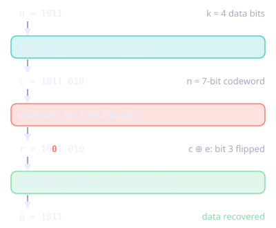
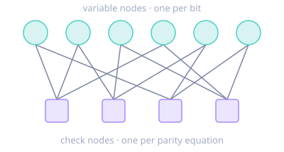
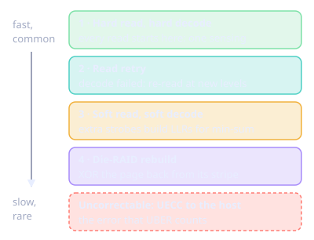

# Supplement A — ECC Coding Theory

The core chapters treated error correction *conceptually*: [Chapter 3](../core/ch3-nand-flash.md#343-ecc-error-correcting-codes) showed the escalation from Hamming codes to BCH (Bose–Chaudhuri–Hocquenghem) and LDPC (low-density parity-check) codes, why denser NAND flash needs stronger error-correcting codes (ECC), and how soft-decision LDPC became the production standard. This supplement supplies the *mathematics underneath* — reconstructed from standard coding-theory references (the book's 2nd edition devotes a chapter to this material), with every concept worked as a concrete numerical example you can trace by hand and check against the [BCH & LDPC animation](../animations/ecc-bch-ldpc.md).

One note on the 🔬 marks: LDPC decoding is among the most **patent-active** areas in the whole solid-state drive (SSD) stack — decoder variants, log-likelihood-ratio generation schemes, and soft-read strategies are filed constantly. For readers doing patent or literature research, 🔬 flags the areas where filings concentrate; understanding the math here is what lets you *read* those patents instead of bouncing off them.

!!! abstract "In this supplement"
    - **The framing** — storage as a communication problem: signal, noise, channel (§A.1–A.2)
    - **The foundations** ⭐⭐ — Hamming distance, parity, the G and H matrices, syndromes — with Hamming(7,4) worked by hand (§A.3)
    - **LDPC** ⭐⭐ — sparse matrices and the Tanner-graph picture (§A.4); bit-flipping and sum-product decoding, both worked (§A.5)
    - **Encoding** — why LDPC's weak spot is manageable: QC-LDPC (§A.6)
    - **Inside the drive** ⭐⭐ — hard vs soft reads, LLRs from multiple strobes, the escalation ladder (§A.7)
    - **The modern landscape** — min-sum variants, LLR optimization, and where the patents cluster (§A.8)

    Short on time? §A.3 and §A.5 are the core.

---

## A.1 Signal and noise: the framing ⭐

Everything about ECC starts from one reframe: **storing data in flash is a communication problem.** Writing a bit and reading it later is exactly like transmitting it through a noisy channel — the "channel" being the flash cell *over time*. [Chapter 3](../core/ch3-nand-flash.md#331-the-five-problems-a-catalog-to-know-cold) catalogued the noise: P/E wear, read disturb, program disturb, cell coupling, charge leakage. Each nudges a cell's threshold voltage; a big enough nudge and a 0 reads as 1 — a **bit flip**.

So the cell is a noisy channel, the raw flip probability is the **raw bit error rate (RBER)** of [Chapter 1](../core/ch1-overview.md#154-data-reliability), and ECC's job is to add structured **redundancy** so the original data survives some flips — driving the **uncorrectable bit error rate (UBER)** that users see far below the raw rate. The whole field is one optimization: maximum correction power for minimum redundancy.

## A.2 The communication-system model

The standard model maps directly onto an SSD:

{ .sdd-fig }
/// figure-caption
The communication-system model, traced with the Hamming(7,4) example of §A.3.3. The encoder adds structure, the channel adds an error, and the decoder uses the structure to find the error and remove it.
///

- **u** — the k user bits. **Encoder** — produces an n-bit **codeword c** (n > k); the extra n−k bits are **parity**.
- **Channel** — the flash, which adds an **error vector e** by exclusive OR (XOR): wherever e holds a 1, the stored bit flips, so the read-back word is r = c ⊕ e.
- **Decoder** — uses the parity structure to deduce e and recover û.

Two numbers rule everything:

- **Code rate R = k/n** — the fraction that's real data. Higher rate = less overhead, weaker protection. In flash terms, parity lives in the page's **spare area** ([Ch 3 §3.4.3](../core/ch3-nand-flash.md#343-ecc-error-correcting-codes)), so spare-area size caps correction strength.
- **Correction capability t** — flips fixable per codeword.

The game: **maximize t at a given R.** BCH and LDPC are two answers.

---

## A.3 The foundations ⭐⭐

### A.3.1 Hamming distance — the concept everything rests on

The **Hamming distance** between two codewords = the number of positions where they differ (`10110` vs `10011` → positions 3 and 4 → distance 2; equivalently, the count of 1s in their XOR).

A code's **minimum distance d\_min** — the smallest distance between any two valid codewords — single-handedly determines its power:

- **Detection:** up to **d\_min − 1** errors (fewer flips can't accidentally land on another valid codeword).
- **Correction:** up to **t = ⌊(d\_min − 1)/2⌋** errors.

**The geometric picture — this is the "aha":** every n-bit word is a point in space; valid codewords are scattered among them. Draw a ball of radius t around each codeword. If d\_min ≥ 2t + 1, the balls don't overlap — so any received word with ≤ t flips falls inside *exactly one* ball, and decoding is just snapping to the nearest codeword. Designing a good code = **packing codewords far apart** while keeping enough of them to carry data. Everything that follows — parity matrices, BCH, LDPC — is machinery for buying large d\_min cheaply.

### A.3.2 Parity: the cornerstone

??? example "🎬 Animate this — How ECC finds and fixes a bit — Hamming visualizer"

    Flip a bit and watch the parity checks announce its location — the syndrome idea made tangible.

    [Animation page](../animations/ecc-bit-correction.md) · [open full-screen ↗](../animations/files/ecc_bit_correction.html)

    <iframe src="../../animations/files/ecc_bit_correction.html" width="100%" height="640" class="sdd-anim" loading="lazy" title="How ECC finds and fixes a bit — Hamming visualizer"></iframe>


The simplest code: **one parity bit** — append the bit that makes the total count of 1s even. Data `1011` (three 1s) → codeword `10111`. Any single flip makes the parity odd → detected. But d\_min = 2, so t = ⌊1/2⌋ = 0: you know *a* bit flipped, never *which* — and two flips cancel invisibly.

The leap to real codes: use **several parity bits, each over a different, overlapping subset** of the data. Then the *pattern* of failed checks pinpoints the flipped bit — correction, not just detection. The machinery for expressing this is two matrices.

### A.3.3 The generator matrix G and parity-check matrix H ⭐⭐

A **linear block code** is defined over the two-element Galois field GF(2) — binary arithmetic where + is XOR — by:

**The generator matrix G (k × n)**, which encodes: **c = u·G** (mod 2). In **systematic form** G = [I\_k | P]: an identity block (the first k codeword bits *are* the data) followed by the parity-generating block P.

**The parity-check matrix H ((n−k) × n)**, which verifies: **H·cᵀ = 0** for every valid codeword. Given G = [I\_k | P], the matching H = [Pᵀ | I\_{n−k}]. Each *row* of H is one parity equation: "these bits must XOR to zero."

**The syndrome — how errors announce themselves.** For a received r = c ⊕ e:

```
s = H·rᵀ = H·(c ⊕ e)ᵀ = H·cᵀ ⊕ H·eᵀ = 0 ⊕ H·eᵀ = H·eᵀ
```

**The syndrome depends only on the error, never on the data.** s = 0 → clean. s ≠ 0 → for a single-bit error, **s equals the column of H at the flipped position** — look up the matching column, flip that bit back, done.

!!! example "Worked example — Hamming(7,4), traced by hand"
    k = 4 data bits, n = 7, three parity bits, rate 4/7, d\_min = 3 → corrects t = 1.

    ```
         ┌ 1 0 0 0 │ 1 1 0 ┐            ┌ 1 1 0 1 │ 1 0 0 ┐
    G =  │ 0 1 0 0 │ 1 0 1 │       H =  │ 1 0 1 1 │ 0 1 0 │
         │ 0 0 1 0 │ 0 1 1 │            └ 0 1 1 1 │ 0 0 1 ┘
         └ 0 0 0 1 │ 1 1 1 ┘
    ```

    **Encode** u = [1 0 1 1]: bits 1–4 = the data; bit 5 = 1⊕0⊕0⊕1 = **0**; bit 6 = 1⊕0⊕1⊕1 = **1**; bit 7 = 0⊕0⊕1⊕1 = **0** → **c = `1011 010`** (and H·cᵀ = 0 ✓).

    **Channel flips bit 3** → r = `10`**`0`**`1 010`.

    **Syndrome** s = H·rᵀ: row 1 = 1⊕1 = **0**; row 2 = 1⊕1⊕1 = **1**; row 3 = 1 = **1** → **s = [0,1,1]**.

    **Locate:** which column of H reads [0,1,1] top-to-bottom? **Column 3.** Flip bit 3 → `1011010` → data bits 1–4 = **1011** ✓ recovered.

    That's the entire mechanism of linear block codes. (The Hamming visualizer above runs exactly this loop interactively.)

### A.3.4 Where BCH fits

**BCH codes** (named for Bose, Chaudhuri and Hocquenghem) generalize Hamming to **multiple** errors: cyclic linear codes built over the finite field **GF(2^m)**, with H constructed from powers of a primitive element α so the code has a *designed* minimum distance for a chosen t. Decoding is **algebraic and deterministic**: from the syndrome, build the **error-locator polynomial** (Berlekamp–Massey), find its roots (Chien search) to locate the errors, flip them. It is **hard-decision**: bits in, and either success (≤ t errors) or declared failure (> t).

BCH's ceiling — and why NAND outgrew it: more correction needs rapidly more parity and hardware, and **BCH's algebraic decoder cannot use soft information.** It knows "this bit is 0," never "this bit is *probably* 0 but I'm unsure." (Soft add-ons such as Chase decoding exist, but they work by re-running the hard decoder on many trial patterns.) As triple-level (TLC) and then quad-level (QLC) cells pushed RBER up, that discarded confidence became unaffordable. Enter LDPC.

---

## A.4 LDPC and the Tanner graph ⭐⭐

### A.4.1 What LDPC is

An **LDPC code** is *also* just a linear block code with a parity-check matrix H — with one special property: **H is sparse** ("low-density": a handful of 1s per row and column, regardless of code length). That single structural choice is the entire secret — it's what makes near-optimal **iterative, soft-decision decoding** computationally feasible.

The history is a great story: **Robert Gallager invented LDPC codes in his 1960 MIT doctoral thesis** (published as a paper in 1962 and a book in 1963) — and they were **forgotten for about 35 years**, because the hardware of the day couldn't afford the decoding. Rediscovered in the mid-1990s (MacKay and Neal, among others), they swept communications: satellite television (chosen for DVB-S2 in 2003), Wi-Fi (an option from 802.11n in 2009) and 10-gigabit Ethernet, then hard-disk read channels and SSDs, and, from 2017, the data channels of 5G. LDPC is now the ECC standard for high-density NAND.

Traits worth knowing: **regular** LDPC has uniform row/column weights, **irregular** varies them (and performs better — production uses irregular); LDPC shines at **long codewords** (thousands of bits — flash pages oblige); and it decodes **iteratively with soft inputs** — the payoff of §A.5.

### A.4.2 The Tanner graph

Sparse H has a beautiful picture — the **Tanner graph** (introduced by Michael Tanner in 1981), bipartite:

- **Variable nodes (VN)** — one per codeword bit ("the bits").
- **Check nodes (CN)** — one per row of H ("the constraints").
- An **edge** joins VN *i* to CN *j* iff H[j][i] = 1.

"Low density" = **few edges**; decoding is message-passing along them, and sparsity keeps that cheap (and keeps short cycles — which degrade decoding — rare).

!!! example "Worked example — a small Tanner graph"
    A sparse 4×6 H (6 bits, 4 checks; column weight 2, row weight 3):

    ```
          v1 v2 v3 v4 v5 v6
     c1 ┌  1  1  0  1  0  0 ┐      c1: v1 ⊕ v2 ⊕ v4 = 0
     c2 │  0  1  1  0  1  0 │      c2: v2 ⊕ v3 ⊕ v5 = 0
     c3 │  1  0  0  0  1  1 │      c3: v1 ⊕ v5 ⊕ v6 = 0
     c4 └  0  0  1  1  0  1 ┘      c4: v3 ⊕ v4 ⊕ v6 = 0
    ```

    Every bit touches exactly 2 checks, every check ties 3 bits — a regular (2,3) LDPC code. §A.5 decodes on this exact graph.

{ .sdd-fig }
/// figure-caption
The example's Tanner graph: one edge for every 1 in H. Each bit sits in two checks and each check ties three bits; decoding sends messages back and forth along these twelve edges.
///

---

## A.5 LDPC decoding ⭐⭐

??? example "🎬 Animate this — Stronger ECC in action — BCH & LDPC"

    BCH's algebraic error hunt and an LDPC Tanner graph converging by message passing, side by side.

    [Animation page](../animations/ecc-bch-ldpc.md) · [open full-screen ↗](../animations/files/ecc_bch_ldpc.html)

    <iframe src="../../animations/files/ecc_bch_ldpc.html" width="100%" height="640" class="sdd-anim" loading="lazy" title="Stronger ECC in action — BCH & LDPC"></iframe>


Decoding runs on the Tanner graph by **message passing** (belief propagation): nodes exchange messages along edges, refining beliefs until every check is satisfied. Two flavors — hard-decision (bit-flipping, cheap) and soft-decision (sum-product, powerful). Both are 🔬 territory: the message-update rules and their approximations are what most LDPC patents optimize.

### A.5.1 Bit-flipping (hard decision) ⭐

Intuition: **a bit sitting in many failed checks is probably the liar — flip it.**

1. Load the hard bits into the variable nodes.
2. Each check node XORs its connected bits: 0 = satisfied, 1 = unsatisfied (the set of results is the syndrome).
3. All satisfied → done.
4. Otherwise, count each bit's unsatisfied checks.
5. Flip the bit(s) with the highest count; repeat from 2 (up to an iteration cap).

!!! example "Worked example — bit-flipping on the small graph"
    All-zero codeword sent; **bit 3 flips** → received `0 0 1 0 0 0`. (On the graph in §A.4.2, v3's two edges lead to c2 and c4.)

    **Iteration 1:** c1 = 0 ✓ · c2 = v2⊕v3⊕v5 = **1 ✗** · c3 = 0 ✓ · c4 = v3⊕v4⊕v6 = **1 ✗**

    | bit | in checks | # unsatisfied |
    |---|---|---|
    | v1 | c1, c3 | 0 |
    | v2 | c1, c2 | 1 |
    | **v3** | **c2, c4** | **2 ← max** |
    | v4 | c1, c4 | 1 |
    | v5 | c2, c3 | 1 |
    | v6 | c3, c4 | 1 |

    Flip v3 → `000000`. **Iteration 2:** all checks pass → done. Corrected.

Fast and cheap — but hard-decision: it discards the knowledge that some bits were read confidently and others were borderline. Using that confidence is the next algorithm, and it is dramatically stronger.

### A.5.2 Sum-product / belief propagation (soft decision) ⭐⭐

LDPC's superpower. Each variable node starts not with a bit but with a **log-likelihood ratio (LLR)**:

\[
L(\text{bit}) = \log \frac{P(\text{bit}=0 \mid \text{reading})}{P(\text{bit}=1 \mid \text{reading})}
\]

- **Sign** = the hard guess (positive → probably 0).
- **Magnitude** = the **confidence** (|L| large → sure; |L| ≈ 0 → coin flip).

A cell read far from any threshold yields a confident, large-|L| value; a cell read *at* the boundary yields L ≈ 0. **This is exactly the information BCH throws away.**

The decoder passes LLR messages around the Tanner graph in two half-steps per iteration:

1. **Variable → check:** each bit tells each of its checks its best current belief — channel LLR plus everything heard from its *other* checks (never echoing back what that check just said):
   `q(i→j) = L(cᵢ) + Σ r(j′→i) over j′ ≠ j`
2. **Check → variable:** each check tells each of its bits what value would satisfy the parity, given the *other* bits:
   `r(j→i) = 2·atanh( ∏ tanh(q(i′→j)/2) ) over i′ ≠ i`
   The **sign** works out to the XOR of the other bits' signs (parity logic); the **magnitude** is dominated by the *least confident* sibling — a chain as strong as its weakest link. (Hold that thought for min-sum.)

After each iteration: total LLR per bit = channel + all incoming check messages; take signs as the tentative word; test H·ĉᵀ = 0; stop on success or iterate to a cap.

The magic is **propagation**: a confidently-read bit lends its certainty, through shared checks, to uncertain neighbors; over iterations the constraint network pulls borderline bits into global consistency — correcting error rates that defeat any hard-decision scheme at the same code rate. This is why LDPC keeps UBER at spec even as NAND RBER climbs.

**Min-sum 🔬 — what production actually ships.** The tanh/atanh product is exact but hardware-hostile. **Min-sum** approximates the check update as: *sign = product of the other signs; magnitude = minimum of the other magnitudes* — pure comparisons, no transcendentals, and it directly encodes the weakest-link insight. Plain min-sum slightly overestimates confidence, so real decoders correct it — **normalized min-sum** (scale < 1), **offset min-sum** (subtract a constant), and **layered** schedules for faster convergence. **This family is where a large share of SSD ECC patents live** — the exact scalings, offsets, quantizations, and schedules are endlessly optimized and filed.

---

## A.6 LDPC encoding

The asymmetry worth understanding: decoding is elegant *because H is sparse* — but the derived G is generally **dense**, making naive c = u·G an expensive multiply over thousands of bits. Practical fixes:

- **Approximate lower-triangular form** (Richardson–Urbanke): permute H nearly triangular so parity bits fall out by cheap back-substitution.
- **QC-LDPC (quasi-cyclic)** 🔬 — build H from small **circulant** blocks (cyclically shifted identities). This is what real hardware uses: the block structure makes encoding *and* decoding parallel and compact (the code stores as a table of shift values). QC-LDPC construction is its own patent-active corner.

Net: **LDPC trades harder encoding for much stronger, soft-capable decoding** — the right trade for flash, where the decoder works on every single read.

---

## A.7 The LDPC codec inside the SSD ⭐⭐

The math lands in the drive through one central distinction: **hard-decision vs soft-decision reads.**

**Hard read (the fast path).** Read each cell at the normal reference voltage(s), get hard bits, decode. One flash read; works fine while RBER is low. Modern decoders even assign coarse fixed-magnitude LLRs to hard bits and run soft-*style* decoding — free correction margin. This is attempt #1 on every read the drive ever does.

**Soft read (the strong path).** When hard decoding fails to converge — the flash has aged; retention or read disturb has shifted the distributions ([Ch 3 §3.4.1](../core/ch3-nand-flash.md#341-sources-of-read-error-consolidated)) — the controller escalates: **re-read the same cells at several shifted reference voltages** to localize each cell's threshold precisely. This extends Chapter 3's **Read Retry**, but instead of hunting one better threshold, the multiple strobes build a **fine-grained LLR per bit**:

{ .sdd-fig }
/// figure-caption
What extra strobes buy. A hard read sorts cells only by side, so a misread cell near the reference (red) gets the same confident ±4 as a cell far from it. Five strobes split the axis into six bins, and the LLRs, computed here from the two bells drawn, fall to ±1 near the reference: the decoder learns which bits to doubt.
///

Graded LLRs into the min-sum decoder correct error rates no hard scheme touches — **which is precisely why LDPC, not BCH, owns TLC and QLC**: more bits per cell = more states in the same voltage window = more overlap = soft decoding stops being optional. (QLC's sixteen levels make it the enabling technology.)

**The cost 🔬.** Every extra strobe is another sensing of the array — latency, plus a little self-inflicted read disturb. So controllers run a **tiered escalation**, and managing the ladder — how many strobes, at which offsets, when to escalate, how to quantize LLRs, how to adapt per-block as wear accumulates — is both a rich engineering problem and one of the hottest filing areas (recent filings cover seven-strobe soft-read schemes, self-correcting min-sum variants, and QLC LLR optimization).

**The full ladder, end to end:** hard decode, read retry, soft decode, then a rebuild from the drive's internal RAID (redundant array of independent disks) stripe across dies.

{ .sdd-fig }
/// figure-caption
The escalation ladder. A read moves down a rung only when decoding fails and stops at the first rung that succeeds, so nearly every read ends on rung 1. Rung 4 is the die-level RAID of [Ch 3 §3.4.4](../core/ch3-nand-flash.md#344-raid-inside-the-ssd); the bottom is the UBER event of [Ch 1 §1.5.4](../core/ch1-overview.md#154-data-reliability).
///

Only when every rung fails does the drive report an uncorrectable ECC error (UECC) to the host. This is the coding theory of this supplement running live inside every read a drive serves — the thread that connects Chapter 1 (RBER/UBER), Chapter 3 (noise, retry, RAID), and the mathematics here.

---

## A.8 Modern developments & the patent landscape

*The current state of practice, and where the innovation concentrates — useful both as an update and as a map for patent or literature research.*

**Min-sum variants are the production reality.** Production decoders don't run exact tanh sum-product at flash throughput. The workhorses are normalized/offset min-sum and especially **layered normalized min-sum** — check nodes updated in layers for faster convergence and lower latency. Research is making these *adaptive*, tuning the decoder per block from the codeword's reliability profile. 🔬 Scaling factors, offsets, layer schedules, message quantization: the crux of most modern decoder patents.

**LLR generation is the other battleground.** A decoder is only as good as its input LLRs, and LLR accuracy decays as the NAND ages and distributions drift. Hence a whole class of filings on **LLR optimization**: threshold-voltage models of the specific NAND, clever quantization, amplifying the near-zero LLRs that matter most to min-sum, deriving soft information from neighboring cells or XORed internal soft-bit reads (a standard QLC technique). Representative directions from recent filings: per-decoder dynamic LLR control that tracks rising RBER, and self-corrected min-sum variants that protect the least-confident variable nodes — small gains per read that add up to real endurance across a fleet.

**Read-performance-aware decoding.** Soft strobes cost latency, so a research thread minimizes them: LLR schemes built from cumulative cell distributions, and hiding soft-read latency in idle time and channel parallelism, with research prototypes reporting large read-performance gains over naive soft decoding. 🔬 "Minimum sensing, maximum correction" is both practically vital (soft reads set a drive's worst-case read latency) and heavily filed.

**Beyond LDPC?** **Polar codes** (5G's control-channel code) have been studied for storage but haven't displaced LDPC in NAND. The near-term reality: **LDPC plus ever-smarter soft-read/LLR strategies**, hardening in step with QLC and the penta-level cell (PLC, 5 bits per cell), demonstrated but still not shipping in 2026 — where the voltage window is sliced so finely that soft decoding *is* the product. The patent action isn't about replacing LDPC; it's about squeezing it: better LLRs, cheaper decoders, fewer strobes.

---

## Key takeaways

1. **Flash storage is a noisy channel**; ECC is communication theory wearing a storage badge. RBER in, UBER out, spare area as the budget.
2. **d\_min decides everything**: detect d\_min − 1, correct ⌊(d\_min−1)/2⌋. Code design is packing codewords far apart.
3. **G encodes, H checks, the syndrome fingers the error** — and depends only on the error, never the data. Hamming(7,4) is the whole mechanism in miniature.
4. **BCH = algebraic, deterministic, hard-decision** — it cannot use confidence, and that ceiling is why NAND outgrew it.
5. **LDPC = sparse H + Tanner graph + message passing.** Bit-flipping shows the idea; sum-product with LLRs is the power; min-sum variants are what ships.
6. **Soft reads turn Read Retry into LLR generation** — multiple strobes map each cell's uncertainty, and the escalation ladder (hard → retry → soft → RAID → UECC) governs every read a drive serves.
7. **The patent map 🔬**: min-sum message rules, LLR generation/quantization, strobe-minimization, QC-LDPC construction — that's where the field files.

---

## Key vocabulary

| Term | 中文 | Meaning |
|---|---|---|
| RBER / UBER | 原始誤碼率 / 不可糾正誤碼率（台：原始位元錯誤率 / 無法更正位元錯誤率） | The raw bit error rate of the flash before ECC, and the uncorrectable bit error rate users see after it. → [§A.1](#a1-signal-and-noise-the-framing) |
| redundancy / parity | 冗餘 / 校驗位（台：冗餘 / 同位元） | Extra bits stored with the data so that errors can be detected and corrected. → [§A.1](#a1-signal-and-noise-the-framing) |
| codeword | 碼字 | The n bits the encoder produces from k data bits: the data plus its parity. → [§A.2](#a2-the-communication-system-model) |
| code rate R = k/n | 碼率（台：編碼率） | The fraction of a codeword that is data; a higher rate means less overhead and weaker protection. → [§A.2](#a2-the-communication-system-model) |
| Hamming distance | 漢明距離 | The number of positions in which two words differ. → [§A.3.1](#a31-hamming-distance-the-concept-everything-rests-on) |
| minimum distance dmin | 最小距離 | The smallest Hamming distance between any two codewords; it fixes how many errors a code can detect and correct. → [§A.3.1](#a31-hamming-distance-the-concept-everything-rests-on) |
| correction capability t | 糾錯能力（台：錯誤更正能力） | How many bit errors per codeword a code can always fix: t = ⌊(dmin − 1)/2⌋. → [§A.3.1](#a31-hamming-distance-the-concept-everything-rests-on) |
| GF(2) | 二元域（台：二元有限體） | The two-element Galois field, where addition is XOR and multiplication is AND. → [§A.3.3](#a33-the-generator-matrix-g-and-parity-check-matrix-h) |
| Hamming code | 漢明碼 | The single-error-correcting code family; Hamming(7,4) protects 4 data bits with 3 parity bits. → [§A.3.3](#a33-the-generator-matrix-g-and-parity-check-matrix-h) |
| generator matrix G | 生成矩陣 | The k × n matrix that encodes: c = u·G. → [§A.3.3](#a33-the-generator-matrix-g-and-parity-check-matrix-h) |
| parity-check matrix H | 校驗矩陣（台：同位檢查矩陣） | The (n − k) × n matrix whose rows are the parity equations; every codeword satisfies H·cᵀ = 0. → [§A.3.3](#a33-the-generator-matrix-g-and-parity-check-matrix-h) |
| systematic form | 系統形式 | G = [I \| P], so the data appears unchanged in the codeword, followed by its parity. → [§A.3.3](#a33-the-generator-matrix-g-and-parity-check-matrix-h) |
| syndrome s = H·rᵀ | 伴隨式（台：症狀） | The parity-check results for a received word; it depends only on the error and is zero when no error is detected. → [§A.3.3](#a33-the-generator-matrix-g-and-parity-check-matrix-h) |
| BCH code | BCH碼 | An algebraic, cyclic code that corrects several errors per codeword from hard bits. → [§A.3.4](#a34-where-bch-fits) |
| error-locator polynomial | 錯誤位置多項式 | In BCH decoding, the polynomial built from the syndrome whose roots give the error positions. → [§A.3.4](#a34-where-bch-fits) |
| low-density parity-check code (LDPC) | 低密度奇偶校驗碼（台：低密度同位元檢查碼） | A linear code whose parity-check matrix is sparse, decoded iteratively with soft information. → [§A.4.1](#a41-what-ldpc-is) |
| regular / irregular LDPC | 規則 / 非規則（台：規則 / 不規則） | Uniform versus varied row and column weights in H; production codes are irregular. → [§A.4.1](#a41-what-ldpc-is) |
| Tanner graph | Tanner圖 | The bipartite graph of a code: variable nodes for bits, check nodes for parity equations, an edge for every 1 in H. → [§A.4.2](#a42-the-tanner-graph) |
| variable node (VN) | 變量節點（台：變數節點） | A Tanner-graph node for one codeword bit. → [§A.4.2](#a42-the-tanner-graph) |
| check node (CN) | 校驗節點（台：檢查節點） | A Tanner-graph node for one parity equation, a row of H. → [§A.4.2](#a42-the-tanner-graph) |
| bit-flipping | 比特翻轉（台：位元翻轉） | A hard-decision iterative decoder that flips the bits sitting in the most failed checks. → [§A.5.1](#a51-bit-flipping-hard-decision) |
| belief propagation / sum-product | 置信傳播 / 和積算法（台：信念傳遞 / 和積演算法） | The soft-decision iterative decoder that passes LLR messages along the Tanner graph. → [§A.5.2](#a52-sum-product-belief-propagation-soft-decision) |
| log-likelihood ratio (LLR) | 對數似然比（台：對數概似比） | log P(bit = 0) / P(bit = 1) given the reading: the sign is the best guess, the size is the confidence. → [§A.5.2](#a52-sum-product-belief-propagation-soft-decision) |
| min-sum | 最小和算法（台：最小和演算法） | The hardware-friendly approximation of sum-product: the sign from the product of signs, the size from the smallest input. → [§A.5.2](#a52-sum-product-belief-propagation-soft-decision) |
| normalized / offset min-sum | 歸一化 / 偏移最小和（台：正規化 / 偏移最小和） | Min-sum corrected for its overconfidence, by scaling the messages down or subtracting a constant. → [§A.5.2](#a52-sum-product-belief-propagation-soft-decision) |
| QC-LDPC | 準循環LDPC碼 | Quasi-cyclic LDPC: H built from small circulant blocks, which makes encoders and decoders compact and parallel. → [§A.6](#a6-ldpc-encoding) |
| hard / soft decision read | 硬判決 / 軟判決讀取（台：硬式決策 / 軟式決策讀取） | One sensing that yields bits only, versus several strobes that also yield each bit's confidence. → [§A.7](#a7-the-ldpc-codec-inside-the-ssd) |
| read retry | 重讀（台：重新讀取） | Re-reading at shifted reference voltages when decoding fails; soft reads extend it. → [§A.7](#a7-the-ldpc-codec-inside-the-ssd) |
| uncorrectable ECC error (UECC) | 不可糾正ECC錯誤（台：無法更正的ECC錯誤） | A read that every rung of the escalation ladder failed to correct; it is the event UBER counts. → [§A.7](#a7-the-ldpc-codec-inside-the-ssd) |

---

## Check yourself

1. Why is storing data in flash mathematically the same problem as transmitting over a noisy channel? Name the "noise sources" (from Chapter 3).

    ??? success "Answer"
        Writing a bit and reading it back later is a transmission through time, and the flash cell is the channel: the stored threshold voltage is the signal, and physical effects disturb it before it is read. The noise sources are program/erase wear, which damages the tunnel oxide and widens the distributions; data retention, the slow leakage of stored charge; read disturb and program disturb, where operations on neighbouring cells push charge in; and cell-to-cell coupling. Each moves a cell's threshold voltage, a large enough move reads as a bit flip, and so the same encoder–channel–decoder mathematics applies. See [§A.1](#a1-signal-and-noise-the-framing).

2. A code has dmin = 5. How many errors can it detect? How many can it correct? Show the formulas.

    ??? success "Answer"
        It detects up to dmin − 1 = 4 errors and corrects up to t = ⌊(dmin − 1)/2⌋ = ⌊4/2⌋ = 2. See [§A.3.1](#a31-hamming-distance-the-concept-everything-rests-on).

3. Explain the "balls around codewords" geometric picture. Why does larger dmin mean more correction power?

    ??? success "Answer"
        Treat every n-bit word as a point, and draw a ball of radius t (all words within t flips) around each codeword. If dmin ≥ 2t + 1 the balls don't overlap, so a received word with at most t errors lies in exactly one ball and decodes to that ball's codeword: decoding is snapping to the nearest codeword. A larger dmin leaves room for bigger balls that still don't touch, so more flips can be absorbed, at the price of fewer codewords, and so less data, for a given length. See [§A.3.1](#a31-hamming-distance-the-concept-everything-rests-on).

4. Why can a single parity bit *detect* one error but not *correct* it? (Answer in terms of dmin.)

    ??? success "Answer"
        A single parity bit gives dmin = 2. One flip makes the parity odd, so it is detected (dmin − 1 = 1), but t = ⌊(2 − 1)/2⌋ = 0. The received word is at distance 1 from several codewords at once, since flipping any one of its bits restores even parity, so there is no unique nearest codeword and no way to tell which bit flipped. Two flips restore even parity and pass unseen. See [§A.3.2](#a32-parity-the-cornerstone).

5. Given the Hamming(7,4) G above, encode `u = [1 1 0 0]`. Then flip bit 6 and show that the syndrome points to bit 6.

    ??? success "Answer"
        c = u·G adds rows 1 and 2 of G: the data 1100, then parity 1⊕1 = 0, 1⊕0 = 1 and 0⊕1 = 1, so c = `1100 011` (every row of H gives 0). Flip bit 6: r = `1100 001`. Row 1 of H checks bits 1, 2, 4, 5: 1⊕1⊕0⊕0 = 0. Row 2 checks bits 1, 3, 4, 6: 1⊕0⊕0⊕0 = 1. Row 3 checks bits 2, 3, 4, 7: 1⊕0⊕0⊕1 = 0. So s = [0,1,0], which is column 6 of H: flip bit 6 back. See [§A.3.3](#a33-the-generator-matrix-g-and-parity-check-matrix-h).

6. What is a syndrome, and why is it so useful that it "depends only on the error, not the data"?

    ??? success "Answer"
        The syndrome s = H·rᵀ is the vector of parity-check results for the received word. Every codeword gives H·cᵀ = 0, so s = H·eᵀ: the data cancels out and only the error pattern remains. The decoder therefore never needs to know the data. s = 0 means no detectable error, and a nonzero s points at the error directly: for a single flip it equals the column of H at that position, and for multi-error codes such as BCH it is the input to the algebraic decoder. See [§A.3.3](#a33-the-generator-matrix-g-and-parity-check-matrix-h).

7. What single structural property makes a code "LDPC," and what does that property buy you at decoding time?

    ??? success "Answer"
        Its parity-check matrix H is sparse: only a few 1s in each row and column, however long the code. That makes the Tanner graph small, with a number of edges that grows only linearly with the code length, so each round of message passing is cheap. Each check involves only a few bits, so its messages stay informative, and short cycles are rare, so iterative soft decoding performs close to optimally. See [§A.4.1](#a41-what-ldpc-is).

8. Draw (or describe) the Tanner graph for this H: rows `[1 1 1 0]`, `[0 1 1 1]`. How many variable nodes, how many check nodes, and which bits does each check tie together?

    ??? success "Answer"
        Four variable nodes, one per column (v1–v4), and two check nodes, one per row. c1 ties v1, v2 and v3; c2 ties v2, v3 and v4. So v1 and v4 have one edge each and v2 and v3 two each. Because v2 and v3 both join both checks, the graph contains a four-edge cycle, the kind of short cycle that weakens iterative decoding. See [§A.4.2](#a42-the-tanner-graph).

9. Run one iteration of bit-flipping: on the 6-bit example code, the all-zero word is sent and **bit 5** flips. Which checks fail, which bit has the most failed checks, and what gets flipped?

    ??? success "Answer"
        The received word is `000010`. c1 = v1⊕v2⊕v4 = 0 ✓, c2 = v2⊕v3⊕v5 = 1 ✗, c3 = v1⊕v5⊕v6 = 1 ✗ and c4 = v3⊕v4⊕v6 = 0 ✓. Counting failed checks: v5, which sits in c2 and c3, has 2; v1, v2, v3 and v6 have 1; v4 has 0. Flip v5 to get `000000`, and on the next iteration every check passes. See [§A.5.1](#a51-bit-flipping-hard-decision).

10. In an LLR, what does the sign encode and what does the magnitude encode? Why is a cell read *at* a state boundary given an LLR near zero?

    ??? success "Answer"
        The sign is the hard decision (positive means the bit is more likely 0, negative more likely 1), and the magnitude is the confidence. A cell read exactly at the boundary between two states is as likely to have come from either one, so P(bit = 0 | reading) ≈ P(bit = 1 | reading); their ratio is about 1, and its logarithm is about 0. See [§A.5.2](#a52-sum-product-belief-propagation-soft-decision).

11. In the sum-product check-node update, why does the outgoing message's magnitude depend most on the *least* confident incoming bit? How does min-sum exploit this?

    ??? success "Answer"
        A check tells a bit what it must be for the parity equation to hold, and that conclusion is only as reliable as all the other bits in the equation: if any one of them might be wrong, so might the inferred value. In the exact update each other bit contributes a factor tanh(|q|/2), which is below 1 and close to 0 for an unsure bit, so the product, and with it the outgoing magnitude, is pulled down by the least confident input. Min-sum keeps exactly that: the outgoing sign is the product of the other signs and the magnitude is the smallest of the other magnitudes, which needs only comparisons. A product of numbers below 1 is smaller than its smallest factor, so plain min-sum overstates the confidence; normalized and offset min-sum correct for it. See [§A.5.2](#a52-sum-product-belief-propagation-soft-decision).

12. Why can BCH *not* use soft information, and why does that make LDPC the standard for TLC/QLC specifically?

    ??? success "Answer"
        BCH's decoder is algebraic: it computes syndromes from hard bits and solves for the error positions over a finite field (Berlekamp–Massey, then Chien search), and nothing in that algebra accepts "probably 0." Soft add-ons such as Chase decoding exist, but they work by re-running the hard decoder on many trial patterns. TLC and QLC pack 8 or 16 states into the same voltage window, so neighbouring bells overlap and raw error rates climb past what a hard-decision code can fix with the parity that fits in the spare area. LDPC's soft decoding uses the confidence that multi-strobe reads provide and corrects far more errors at the same code rate, so for TLC and QLC it is the practical choice. See [§A.3.4](#a34-where-bch-fits) and [§A.7](#a7-the-ldpc-codec-inside-the-ssd).

13. Trace the SSD's ECC escalation ladder from a fast hard read all the way to a UECC event. Where do soft reads fit, and what do they cost?

    ??? success "Answer"
        A read starts with one sensing at the default reference voltages and a hard decode, often LDPC fed fixed-size LLRs; nearly every read ends there. If it fails, read retry re-reads at shifted references and decodes again. Next a soft read adds strobes around each reference, builds a graded LLR for every bit and runs the min-sum decoder. If that fails, the controller can add strobes or decode harder, then rebuild the page from its die-level RAID stripe. If everything fails, it reports an uncorrectable error (UECC) to the host, the event UBER counts. Soft reads sit in the middle of the ladder, and each extra strobe is another array sensing plus more data moved to the controller, so they cost latency, which shows up as tail latency, plus a little read disturb and decoder time. See [§A.7](#a7-the-ldpc-codec-inside-the-ssd).

14. **(Patent-relevant)** Name two distinct areas where LDPC-in-SSD patents concentrate, and explain what each is trying to improve.

    ??? success "Answer"
        Any two of these four. Min-sum decoder rules (normalization factors, offsets, layered schedules, message quantization) aim at more correction per gate and per watt, with faster convergence. LLR generation (strobe placement, LLR tables that adapt per block or with wear, quantization, soft information from neighbouring cells) aims at better decoder inputs as the NAND ages. Strobe minimization and latency-aware decoding aim at the same correction with fewer sensings and lower tail latency. QC-LDPC construction aims at codes that are compact and parallel in hardware without losing correction strength. See [§A.8](#a8-modern-developments-the-patent-landscape).

---

??? info "📖 Provenance"

    The core chapters of《深入淺出SSD》(1st edition) treat ECC conceptually;
    the 2nd edition adds a full mathematics chapter. This supplement
    reconstructs that material from standard coding-theory references
    (Gallager's thesis; MacKay; Richardson–Urbanke) in the same worked-example
    style as the rest of this site, tied to the two ECC animations. Its
    figures are original drawings; the soft-read LLRs are computed from the
    bells drawn.

??? info "🔎 Sources for the 2026 update"

    Sections A.4.1 and A.8 were brought up to date in November 2026 against these sources:

    - Gallager's 1960 MIT doctoral thesis, published as a paper in January 1962 and as an MIT Press book in 1963 — [MIT DSpace](https://dspace.mit.edu/handle/1721.1/11804)
    - Where LDPC spread: DVB-S2 (2003), 802.11n (2009), 10-gigabit Ethernet, and 5G's data channels (December 2017) — [Wikipedia: Low-density parity-check code](https://en.wikipedia.org/wiki/Low-density_parity-check_code)
    - Penta-level cells: Solidigm's 2022 prototype drive — [Solidigm](https://news.solidigm.com/en-WW/217006-solidigm-demonstrates-world-s-first-penta-level-cell-ssd-at-flash-memory-summit); SK hynix's split-cell research shown at IEDM in December 2025, still not a product — [Blocks and Files](https://www.blocksandfiles.com/flash/2026/01/15/sk-hynix-developing-split-cell-5-bit-flash/4090388)

*Next: [Supplement B — UFS](b-ufs.md): Universal Flash Storage, the phone-world counterpart to NVMe (Non-Volatile Memory Express) — its layered stack, its packet format, its secure partition, and the features that let a phone's storage borrow host memory.*
