# Supplement C — Flash File Systems (EXT4 & F2FS)

This supplement climbs one layer *above* the drive: the **operating-system filesystem** that decides how files map onto the block device a solid-state drive (SSD) presents. (It reconstructs a 2nd-edition topic from the Linux kernel documentation and the research literature.)

The payoff, stated up front: **everything [Chapter 4](../core/ch4-ftl.md) taught about the flash translation layer (FTL), F2FS (the Flash-Friendly File System) re-implements at the filesystem layer.** Its "cleaning" *is* garbage collection (GC). Its multi-head logging *is* hot/cold separation. Its Node Address Table *is* a mapping-table indirection. Its checkpoint *is* the power-loss snapshot. So this chapter is largely *Chapter 4 seen from the host's side of the interface* — an easy read if you know the concepts, and an illuminating one: you'll watch the same problem get solved twice, at two layers, and see why that double-solving is itself a problem that Zoned Namespaces (ZNS) finally fixes.

**The framing question.** Classic filesystems (EXT4, the fourth extended filesystem, and its ancestors) were designed for the **hard disk drive (HDD)**: they assume in-place overwrite is cheap and optimize for *seek locality*. On flash both assumptions are wrong — there is no head to park near the data, and in-place overwrite is physically impossible ([Ch 3](../core/ch3-nand-flash.md)). Two responses emerged: **(a)** retrofit the HDD filesystem with flash awareness (EXT4 + Trim + alignment — works, still dominant, suboptimal), or **(b)** design a flash-native filesystem from scratch — **F2FS**, the interesting one.

**A taxonomy to orient by** — three kinds of "flash-related" filesystems, at different layers:

| Category | Examples | Manages raw NAND? | Assumes an FTL below? |
|---|---|---|---|
| HDD filesystem (retrofitted) | EXT4, XFS, NTFS | No | Yes — treats the SSD as a black box |
| Flash-native, FTL-based | **F2FS** | No | **Yes** — cooperates with the FTL |
| Raw-flash filesystem | JFFS2, UBIFS, YAFFS | **Yes** — own WL/ECC | No — talks to bare NAND |

This supplement covers the first two; the third gets a short coda (§C.3) for embedded context.

!!! abstract "In this supplement"
    - **EXT4** ⭐ — block groups, inodes, extents, journaling — and its five failures on flash (§C.1)
    - **F2FS** ⭐⭐ — the log-structured design; SIT/NAT/SSA; multi-head logging; cleaning; checkpoints — each mapped to its Chapter-4 twin (§C.2)
    - **The log-on-log problem and the ZNS fix** ⭐ — the deep cross-layer insight (§C.2.5)
    - **Raw-flash filesystems** — when there is no FTL to cooperate with (§C.3)

---

## C.1 EXT4: the HDD-era filesystem ⭐

### C.1.1 Lineage

The **ext** family is Linux's historical default: **ext2** (1993 — classic inodes + bitmaps, no journaling) → **ext3** (2001 — added journaling) → **ext4** (2008 — extents, volumes to 1 EiB, delayed allocation). It remains the default or fallback on most Linux systems and many Android boot/recovery partitions. Hold one fact: EXT4 was engineered in and for the **rotational-disk era** — its goals were short seeks and cheap in-place updates, exactly the properties flash lacks.

### C.1.2 On-disk structure

The volume divides into **block groups**:

{ .sdd-fig }
/// figure-caption
An EXT4 volume is a row of block groups, and every group carries its own bookkeeping ahead of its data, so a file's metadata can sit near its blocks: a seek-saving layout from the disk era.
///

- **Superblock** — filesystem-wide metadata, replicated across groups.
- **Group descriptors** — where each group's bitmaps and inode table live.
- **Block / inode bitmaps** — one bit per block/inode: free or used.
- **Inode table** — the array of **inodes**: fixed-size (typically 256 B) per-file records holding permissions, owner, timestamps, size, and — crucially — **pointers to the file's data blocks**.
- **Data blocks** — the contents. (Modern EXT4's "flex block groups" cluster several groups' metadata together — a seek-locality optimization, i.e., an HDD instinct.)

### C.1.3 In-memory structure

Mounted, EXT4 keeps hot structures in random-access memory (RAM): cached inodes, the **dentry cache** (name → inode), the page cache, in-memory bitmaps and superblock. Writes buffer in RAM and flush later — which is why sudden power loss can lose recent writes: the same buffering hazard as [Ch 4 §4.6](../core/ch4-ftl.md#46-power-loss-recovery), one layer up. The **Virtual File System (VFS)** sits above everything, giving applications one application programming interface (API) whatever filesystem lies beneath.

### C.1.4 Extents ⭐

EXT4's headline improvement — and a perfect parallel to [Ch 4 §4.2.1](../core/ch4-ftl.md#421-mapping-granularity)'s mapping-granularity trade-off:

- **ext2/3: indirect block mapping** — one pointer per data block, with single/double/triple indirect pointer blocks for large files. Fine-grained and flexible, but a 1 GB file needs ~256K pointers chased through indirection. *The filesystem's version of page mapping: flexible, big tables.*
- **ext4: extents** — one record `(logical start, physical start, length)` describes a contiguous run up to 128 MB, stored in a B-tree. A large contiguous file needs a handful of extents. *The filesystem's version of block/hybrid mapping: compact, wants contiguity.*

Both layers face the identical choice — fine granularity (big metadata, any layout) vs coarse contiguity (tiny metadata, needs order) — and both chose according to their workload.

### C.1.5 Allocation strategy

EXT4 fights hard for contiguity (an HDD instinct — fewer seeks): **delayed allocation** (assign physical blocks at flush time, when the full size is known), **multiblock allocation** (grab runs, not single blocks), **persistent preallocation** (reserve ahead for known-size files). The irony on flash: all this *physical*-locality effort targets a device whose FTL **scatters the data anyway** ([Ch 4 §4.2](../core/ch4-ftl.md#42-mapping-management)). Contiguous *logical* layout still helps — fewer extents, cleaner Trim, bigger sequential transfers — but the seek-avoidance rationale evaporates.

### C.1.6 Journaling ⭐

EXT4's crash consistency = a **journal** (JBD2): write intentions durably first; replay on remount after a crash. Three modes — **journal** (data + metadata journaled; safest, everything written twice), **ordered** (default: metadata journaled, data forced down *first* so metadata never points at garbage), **writeback** (metadata only, no ordering; fastest, least safe) — plus metadata/journal checksums. Conceptually this *is* [Ch 4 §4.6](../core/ch4-ftl.md#46-power-loss-recovery)'s recovery machinery at the filesystem layer. But note the price: journaling writes some data **twice** — filesystem-level write amplification, stacked on top of the device's own.

### C.1.7 Why flash deserves better ⭐

EXT4 *works* on SSDs — as a rotational design under protest:

1. **In-place update model** — every overwrite becomes an out-of-place write + garbage inside the FTL: write amplification (WA) and wear, manufactured at the source.
2. **Journaling doubles writes** — compounding the FTL's own amplification.
3. **Seek-locality optimizations are pointless** — effort spent on a problem flash doesn't have.
4. **Zero FTL awareness** — EXT4 knows nothing of erase-block sizes, GC units, or hot/cold sensitivity; it can't cooperate.
5. **Random-write-heavy metadata** — bitmaps, inodes, journal commits scatter small random writes, flash's worst diet ([Ch 4 §4.3.1](../core/ch4-ftl.md#431-the-gc-principle-via-a-toy-ssd)).

Five failures; one purpose-built answer.

---

## C.2 F2FS: the flash-native filesystem ⭐⭐

**F2FS (Flash-Friendly File System)** was created by **Jaegeuk Kim at Samsung** — first patch October 2012, merged that December for **Linux 3.8**, and still maintained by Kim today. It is now the **default userdata filesystem on billions of Android devices** (Pixel, most Galaxy since the Note 10, Xiaomi, OPPO, OnePlus, Huawei…).

**The one defining decision: F2FS is log-structured.** All writes are **sequential appends** to an active log; nothing is overwritten in place; old locations go stale and await cleaning. Stop and notice — *that is exactly how flash itself behaves* ([Ch 3](../core/ch3-nand-flash.md#311-how-a-flash-cell-works)) *and exactly how the FTL manages it* ([Ch 4](../core/ch4-ftl.md#43-garbage-collection)). F2FS makes the filesystem move the way the medium moves, converting EXT4's random in-place writes into the sequential appends flash loves — eliminating the problem *at the source*, before it ever crosses the interface.

Classic log-structured file systems (LFS: Sprite LFS, 1992) had two notorious problems; F2FS's cleverness is fixing both, and both fixes are Chapter-4 ideas wearing filesystem clothes.

### C.2.1 Disk layout ⭐

F2FS divides the volume into **2 MB segments** (512 × 4 KB blocks), grouped into **sections**, grouped into **zones** — and here's the cooperation EXT4 never offered: **the section size is set to match the FTL's GC unit, and zones align to the device's internal parallel structure.** Filesystem and FTL pull in the same direction by construction.

Six areas:

- **SB** — the superblock: partition basics, duplicated.
- **CP (Checkpoint)** — the consistent snapshot; F2FS's power-loss recovery (§C.2.2).
- **SIT (Segment Information Table)** — per-segment **valid-block count + bitmap**. *The exact twin of the FTL's valid page count (VPC) and valid-page bitmap from [Ch 4 §4.3.3](../core/ch4-ftl.md#433-gc-implementation-three-steps)* — how cleaning finds its victims.
- **NAT (Node Address Table)** — node ID → physical address. *The mapping-table indirection, one layer up* (the wandering-tree fix, below).
- **SSA (Segment Summary Area)** — which node owns each block. *The twin of the FTL's physical-to-logical (P2L) table* — how cleaning finds a moved block's owner.
- **Main area** — the append-only logs of nodes and data.

{ .sdd-fig }
/// figure-caption
The six F2FS areas. The five on the left are metadata, updated in place; the main area is append-only. In green, each structure's twin inside the drive's FTL.
///

(The metadata areas need random-write access — which is why F2FS on a purely sequential zoned device keeps them in a small conventional region. That detail returns in §C.2.5.)

### C.2.2 The four algorithms ⭐⭐

Each with its Chapter-4 twin:

**(1) Multi-head logging = hot/cold separation.** Up to **six active logs** at once, split by temperature × type (hot/warm/cold × node/data). Hot data streams into one log, cold into another — so a reclaimed segment's contents tend to die *together* (cheap cleaning) and cold data stops being dragged around with hot neighbors. *This is [Ch 4 §4.5](../core/ch4-ftl.md#45-wear-leveling)'s cold/hot separation and the multi-stream and Flexible Data Placement (FDP) idea of [§4.11](../core/ch4-ftl.md#411-modern-developments-from-sdf-to-zns-and-fdp), implemented in the filesystem.* Recent kernels make the link literal: when the drive exposes write streams, Linux's interface to FDP on NVMe (Non-Volatile Memory Express) drives, F2FS steers its hot, warm and cold data logs into separate streams.

**(2) Cleaning = garbage collection.** Literally, with the same design menu as [Ch 4 §4.3](../core/ch4-ftl.md#43-garbage-collection):

- **Victim selection:** **greedy** (fewest valid blocks) for foreground urgency; **cost-benefit** (valid count weighed against segment age, favoring old cold segments) for background work.
- **Foreground vs background** cleaning — reactive under pressure, proactive when idle.
- **The mechanics:** SIT finds the low-validity victim → SSA identifies each valid block's owner → copy valid blocks to a free log → update NAT → the victim frees after the next checkpoint. Step for step, SSD GC.
- **The pragmatic hybrid:** default **copy-and-compaction** while free segments are plentiful; switch to **threaded logging** (write into holes of dirty segments — no cleaning required) when the volume fills and cleaning costs would spike. LFS's classic high-utilization weakness, patched with a mode switch.

**(3) The NAT kills the wandering tree.** The naive-LFS disease: move a data block → its inode's pointer must change → the inode moves → the directory pointing at it must change → the directory moves → … a cascade to the root on every write. F2FS interposes the **Node Address Table**: nodes reference each other by **node ID**, and only the NAT maps IDs to physical addresses. A node moves? One NAT entry updates; every parent still holds the same ID. **The snowball stops at the NAT** — *precisely why the FTL's mapping table exists* ([Ch 4 §4.2](../core/ch4-ftl.md#42-mapping-management)): an indirection layer so data can relocate freely without dragging its referrers along. Same disease, same cure, one layer up.

**(4) Checkpoints = power-loss snapshots.** Periodic consistent snapshots into the CP area, with a **shadow-copy** discipline: two copies of CP/NAT/SIT, one always last-known-good, so an interrupted checkpoint can't corrupt the survivor. After a crash: roll back to the stable checkpoint, then **roll forward** through recent logged writes. *[Ch 4 §4.6](../core/ch4-ftl.md#46-power-loss-recovery)'s snapshot + tail-replay, verbatim.*

### C.2.3 The scorecard

Why F2FS beats EXT4 on flash, in one list: sequential-only writes (random writes eliminated at the source) · FTL-aligned layout (cooperation, not opacity) · hot/cold separation (cheaper cleaning, lower device WA) · NAT indirection (no wandering tree) · **no double-write journal** (checkpoint + roll-forward instead) · lower total write amplification, hence longer flash life — Chapter 4's goal, pursued from above.

Measured (the FAST 2015 paper): up to **3.1×** over EXT4 on iozone and **2×** on SQLite on mobile; up to **40%** faster realistic workloads; up to **2.5×** on Serial AT Attachment (SATA) SSDs server-side.

### C.2.4 Since then: compression and encryption

- **Transparent compression** — per-file/directory **LZO and LZ4** (Linux 5.6), **zstd** (5.7). Android uses it aggressively: flash reads are fast enough that decompression is nearly free, so capacity is saved — and *writes shrink*, which is endurance (Chapter 4's goal yet again). Recent kernels keep refining it (on-demand compress/decompress ioctls).
- **Inline encryption** (fscrypt) with hardware inline-crypto support, which Android relies on — plus inline small files/directories stored directly in the inode.

### C.2.5 The log-on-log problem — and the ZNS fix ⭐

The deepest insight in this supplement. Run F2FS on a normal SSD and look at the layers:

{ .sdd-fig }
/// figure-caption
Log-on-log. On a conventional SSD two logs are stacked, each with its own map and its own collector, and their write amplification multiplies; on a zoned device F2FS's log is the only one.
///

**A log running on top of a log.** Two independent layers both writing out-of-place, both keeping maps, both garbage-collecting — neither aware of the other. F2FS cleans a segment (rewriting valid data to new logical addresses); the FTL sees fresh writes, relocates them again internally, and schedules its own GC. The two collectors interfere, and write amplification **multiplies**: filesystem WA × device WA. Solving the same problem twice, and paying twice.

**Zoned storage collapses the two logs into one.** F2FS supports zoned block devices — host-managed shingled hard drives since Linux 4.10, and NVMe ZNS SSDs since Linux 5.10 taught it zones whose usable capacity is smaller than their size. On a zoned device ([Ch 4 §4.11](../core/ch4-ftl.md#411-modern-developments-from-sdf-to-zns-and-fdp), [Ch 6 §6.10.1](../core/ch6-nvme.md#6101-zns-mechanics-zones-states-and-zone-append)), the drive exposes its zones directly and abandons internal placement/GC; **F2FS's log segments map straight onto the zones.** One log. F2FS *is* the flash manager; the device just obeys. Filesystem WA and device WA merge, the write amplification factor (WAF) approaches 1, the mapping DRAM (dynamic random-access memory) shrinks, quad-level-cell (QLC) flash gets easier — and **F2FS is the reference filesystem for driving ZNS**, the natural host-side ending of the story that runs from software-defined flash (SDF) through ZNS.

**Phones got there first.** Zoned UFS (Universal Flash Storage), the mobile counterpart of ZNS ([Supplement B](b-ufs.md#b9-modern-developments-ufs-41-and-50)), shipped in Google's Pixel 10 Pro phones in 2025, on the 512 GB and larger models, with F2FS as the single log. The work behind it, spanning device firmware, the UFS driver, the block layer, F2FS and Android, is described in a FAST '26 paper from SK hynix, Google and Seoul National University; Linux 6.9 had already hardened F2FS for the large zoned sections such devices use.

**Android adoption, precisely stated:** F2FS dominates the **userdata** partition on modern flagships; EXT4 persists on boot/recovery partitions and budget devices. "F2FS won userdata," not "F2FS replaced EXT4 everywhere."

**Caveats, for balance:** F2FS's fsck and power-loss recovery are less battle-hardened than EXT4's journaling — under frequent brutal power cycling it can recover slowly or, rarely, lose data where EXT4 wouldn't; it caps at 16 TiB; no native RAID5/6. Flash-optimized performance and endurance vs decades of maturity: the ecosystem sensibly uses both.

---

## C.3 The third category: raw-flash filesystems

For completeness and embedded context: JFFS2 (Journalling Flash File System 2), UBIFS (UBI File System) and YAFFS (Yet Another Flash File System) run on **bare NAND flash with no controller at all** — doing their own wear leveling, bad-block management, and error correction (ECC) against raw chips. Their home is deeply embedded systems (routers, IoT, microcontrollers) where flash is soldered raw to the board.

The contrast is the point: F2FS and JFFS2 both "understand flash," **at different layers**. JFFS2 *replaces* the FTL; F2FS *cooperates with* one. Anything behind a SATA, NVMe, UFS or eMMC (embedded MultiMediaCard) interface has a controller, so F2FS (or EXT4) is the right layer there; raw-flash filesystems appear only where no controller exists.

---

## Key takeaways

1. **EXT4 is a rotational design on parole**: in-place updates, double-write journaling, seek optimizations, and FTL-blindness — five ways it manufactures write amplification on flash.
2. **F2FS's whole design is one decision** — log-structured, like the medium — plus the machinery to make LFS livable: NAT (kills the wandering tree), multi-head logs (hot/cold), greedy/cost-benefit cleaning, shadow-copied checkpoints.
3. **Every F2FS structure has a Chapter-4 twin**: SIT ≈ VPC/VPBM, SSA ≈ P2L, NAT ≈ the mapping table, checkpoint ≈ the power-loss snapshot, cleaning ≈ GC. Same problems, one layer up.
4. **Log-on-log is the hidden tax** of a flash-native filesystem on a conventional SSD — two mappers, two collectors, multiplied WA. **ZNS collapses the logs into one**, F2FS is the filesystem built to hold the pen, and Zoned UFS phones have shipped that way since 2025.
5. **Layer determines tool**: raw NAND → JFFS2/UBIFS; managed device → F2FS or EXT4; zoned device → F2FS as the single log.

---

## Key vocabulary

| Term | 中文 | Meaning |
|---|---|---|
| filesystem | 文件系統（台：檔案系統） | The operating-system layer that maps files and directories onto a block device. → [§C.1](#c1-ext4-the-hdd-era-filesystem) |
| Virtual File System (VFS) | 虛擬文件系統（台：虛擬檔案系統） | The kernel layer that gives applications one interface above every filesystem. → [§C.1.3](#c13-in-memory-structure) |
| block group | 塊組（台：區塊群組） | EXT4's fixed subdivision of a volume, each with its own bitmaps and inode table. → [§C.1.2](#c12-on-disk-structure) |
| inode | 索引節點 | A fixed-size per-file record of attributes plus pointers to the file's data. → [§C.1.2](#c12-on-disk-structure) |
| block / inode bitmap | 塊位圖 / inode位圖（台：區塊點陣圖 / inode點陣圖） | One bit per block or inode, marking it free or used. → [§C.1.2](#c12-on-disk-structure) |
| extent | 區段（extent） | One record (logical start, physical start, length) mapping a contiguous run of blocks. → [§C.1.4](#c14-extents) |
| indirect blocks | 間接塊（台：間接區塊） | ext2/3's scheme of one pointer per block, with pointer blocks for large files. → [§C.1.4](#c14-extents) |
| delayed allocation | 延遲分配（台：延遲配置） | Choosing physical blocks at flush time, when a write's full size is known. → [§C.1.5](#c15-allocation-strategy) |
| journaling | 日誌 | Writing an intended change durably before applying it, so a crash can be replayed. → [§C.1.6](#c16-journaling) |
| ordered / writeback / journal mode | 有序 / 回寫 / 日誌模式 | EXT4's journaling modes, from metadata-only with data first, to metadata-only, to everything journaled. → [§C.1.6](#c16-journaling) |
| log-structured file system (LFS) | 日誌結構文件系統（台：日誌結構檔案系統） | A filesystem that only appends to a log and cleans stale copies later. → [§C.2](#c2-f2fs-the-flash-native-filesystem) |
| Flash-Friendly File System (F2FS) | 閃存友好文件系統（台：快閃記憶體友善檔案系統） | Linux's flash-native log-structured filesystem, the default for Android userdata. → [§C.2](#c2-f2fs-the-flash-native-filesystem) |
| segment / section / zone | 段 / 節 / 區 | F2FS's allocation units: a 2 MB segment, a group of segments, a group of sections. → [§C.2.1](#c21-disk-layout) |
| superblock (SB) | 超級塊（台：超級區塊） | Filesystem-wide metadata, kept in more than one copy. → [§C.2.1](#c21-disk-layout) |
| checkpoint (CP) | 檢查點 | F2FS's consistent on-disk snapshot, the starting point of power-loss recovery. → [§C.2.1](#c21-disk-layout) |
| shadow copy | 影子副本（台：影子複本） | Keeping two copies and updating them alternately, so one is always valid. → [§C.2.2](#c22-the-four-algorithms) |
| Segment Information Table (SIT) | 段信息表（台：區段資訊表） | Per-segment valid-block counts and bitmaps, the twin of the FTL's VPC. → [§C.2.1](#c21-disk-layout) |
| Node Address Table (NAT) | 節點地址表（台：節點位址表） | The map from node ID to physical address, the twin of the FTL's mapping table. → [§C.2.1](#c21-disk-layout) |
| Segment Summary Area (SSA) | 段摘要區（台：區段摘要區） | The record of which node owns each block, the twin of the FTL's P2L table. → [§C.2.1](#c21-disk-layout) |
| node | 節點 | F2FS's metadata unit: an inode, a direct node or an indirect node. → [§C.2.2](#c22-the-four-algorithms) |
| wandering tree | 漫遊樹（雪球效應） | In a naive LFS, the cascade of pointer rewrites up to the root after every move; the NAT stops it. → [§C.2.2](#c22-the-four-algorithms) |
| multi-head logging | 多頭日誌 | Up to six open logs splitting hot, warm and cold nodes and data. → [§C.2.2](#c22-the-four-algorithms) |
| cleaning | 清理 | F2FS's garbage collection, choosing victims greedily or by cost-benefit. → [§C.2.2](#c22-the-four-algorithms) |
| copy-and-compaction / threaded logging | 複製壓縮 / 填洞式日誌 | F2FS's two write schemes: clean then append, or write into the holes of dirty segments when space is short. → [§C.2.2](#c22-the-four-algorithms) |
| log-on-log | 日誌疊日誌 | A log-structured filesystem on a log-structured FTL: two maps, two collectors, multiplied WA. → [§C.2.5](#c25-the-log-on-log-problem-and-the-zns-fix) |
| zoned F2FS | 分區F2FS | F2FS writing its log straight into the zones of a ZNS or Zoned UFS device, leaving one log. → [§C.2.5](#c25-the-log-on-log-problem-and-the-zns-fix) |
| raw-flash filesystem (JFFS2 / UBIFS) | 原始閃存文件系統（台：原始快閃記憶體檔案系統） | A filesystem that manages bare NAND itself, replacing the FTL. → [§C.3](#c3-the-third-category-raw-flash-filesystems) |

---

## Check yourself

1. Why is a filesystem designed for hard drives (like EXT4) a poor fit for flash? Name at least three of the five limitations.

    ??? success "Answer"
        Any three of these five. It updates data in place, which the FTL must turn into out-of-place writes plus garbage, raising write amplification and wear. Its journal writes some data twice. It spends effort on seek locality, which flash doesn't need. It knows nothing of erase blocks, GC units or hot and cold data, so it can't cooperate with the FTL. And its metadata (bitmaps, inodes, journal commits) produces small random writes, flash's worst workload. See [§C.1.7](#c17-why-flash-deserves-better).

2. What is an inode, and what's the difference between EXT2/3's indirect-block mapping and EXT4's extents? Which Chapter-4 mapping tradeoff does this parallel?

    ??? success "Answer"
        An inode is a fixed-size per-file record of attributes (permissions, owner, timestamps, size) plus the pointers to the file's data blocks. ext2/3 keep one pointer per block, with indirect pointer blocks for large files: flexible, but big tables. EXT4 keeps extents, one (logical start, physical start, length) record per contiguous run of up to 128 MB: compact, but it wants contiguous layout. It parallels Chapter 4's mapping granularity: fine-grained page mapping with large tables versus coarse block or hybrid mapping with small tables that needs order. See [§C.1.4](#c14-extents).

3. Explain EXT4 journaling and its three modes. Why does journaling contribute to write amplification on flash?

    ??? success "Answer"
        Journaling writes the intended change durably to a journal first and then applies it; after a crash the journal is replayed, so the filesystem comes back consistent. Journal mode logs data and metadata (safest, everything written twice); ordered mode, the default, logs only metadata but forces the data down first, so metadata never points at garbage; writeback mode logs only metadata with no ordering (fastest, least safe). Every journaled block is written twice, once to the journal and once in place, so the filesystem multiplies writes before the FTL adds its own amplification. See [§C.1.6](#c16-journaling).

4. What single design decision defines F2FS, and why does it make the filesystem "match" the flash underneath it?

    ??? success "Answer"
        It is log-structured: every write is a sequential append to an active log, nothing is overwritten in place, and stale copies are cleaned later. Flash itself can't overwrite in place, and the FTL already writes out of place and collects garbage, so a log-structured filesystem moves the way the medium moves and turns random overwrites into the sequential appends flash handles best. See [§C.2](#c2-f2fs-the-flash-native-filesystem).

5. F2FS's SIT and SSA are the filesystem-layer twins of which two SSD-FTL structures from Chapter 4? What is each used for during cleaning?

    ??? success "Answer"
        The SIT, with each segment's valid-block count and bitmap, is the twin of the FTL's valid page count and bitmap (VPC/VPBM); cleaning uses it to pick victim segments with few valid blocks. The SSA, recording the node that owns each block, is the twin of the P2L table; cleaning uses it to find who points at each valid block it moves, so that pointer can be updated. See [§C.2.1](#c21-disk-layout).

6. Describe the "wandering tree" problem in a naive log-structured filesystem, and explain precisely how the NAT solves it. Which FTL structure is the NAT analogous to, and why?

    ??? success "Answer"
        Moving a data block changes its address, so the inode pointing at it must be rewritten; that moves the inode, so the directory pointing at the inode must be rewritten, and so on up to the root: every write cascades. The NAT breaks the chain. Nodes refer to each other by node ID, and only the NAT maps IDs to addresses, so when a node moves one NAT entry changes and every parent still holds the same ID. It is the FTL's mapping table: an indirection layer that lets data move freely without updating everything that refers to it. See [§C.2.2](#c22-the-four-algorithms).

7. F2FS "cleaning" is which Chapter-4 mechanism? Name its two victim-selection policies and which is used foreground vs background.

    ??? success "Answer"
        Garbage collection. Greedy selection, the segment with the fewest valid blocks, is used in the foreground, when free space is urgently needed; cost-benefit selection, which weighs valid blocks against segment age and favours old, cold segments, is used in the background, when the system is idle. See [§C.2.2](#c22-the-four-algorithms).

8. What is F2FS multi-head logging, and which Chapter-4 wear-leveling concept does it implement?

    ??? success "Answer"
        F2FS keeps up to six logs open at once, split by temperature (hot, warm, cold) and by type (node or data), so data with similar lifetimes is written together and dies together, which makes cleaning cheap. It implements hot/cold data separation, the idea behind Chapter 4's wear leveling and, inside the drive, multi-stream and FDP placement. See [§C.2.2](#c22-the-four-algorithms).

9. How does F2FS achieve power-loss recovery, and how is its checkpoint+shadow-copy scheme analogous to something in Chapter 4 §4.6?

    ??? success "Answer"
        It writes periodic checkpoints, consistent snapshots of its metadata, and keeps two copies of the checkpoint, NAT and SIT, updating them alternately, so one is always a complete last-known-good version even if a checkpoint is interrupted. After a crash it rolls back to the last stable checkpoint and then rolls forward through the writes logged since. That is Chapter 4 §4.6's recovery: restore the last snapshot of the map, then replay the tail of recent writes. See [§C.2.2](#c22-the-four-algorithms).

10. **(The key insight)** Explain the "log-on-log" problem when F2FS runs on a normal SSD. What compounds, and why?

    ??? success "Answer"
        F2FS and the FTL are both log-structured: each writes out of place, keeps its own map and runs its own garbage collection, and neither knows about the other. When F2FS cleans a segment it rewrites the valid data to new addresses; the FTL sees those as new writes, places them again and later collects them again. The collectors interfere, mapping work is duplicated, and write amplification compounds: the filesystem's WA multiplied by the device's. See [§C.2.5](#c25-the-log-on-log-problem-and-the-zns-fix).

11. **(Modern)** How does running F2FS on a ZNS/zoned device fix the log-on-log problem? What happens to write amplification and DRAM, and why is F2FS the natural filesystem for ZNS?

    ??? success "Answer"
        A zoned device exposes its zones, which must be written sequentially and reset whole, and gives up its own placement and garbage collection. F2FS writes its log segments straight into the zones, keeping its small random-write metadata in a conventional region, so there is a single log: F2FS's cleaning is the only GC, total WA falls to roughly the filesystem's own, and the device no longer needs a large page-level map in DRAM. F2FS is natural for this because it is already log-structured and section-aligned, so its segments line up with zones; it is the reference filesystem for ZNS, and Zoned UFS phones shipped with it in 2025. See [§C.2.5](#c25-the-log-on-log-problem-and-the-zns-fix).

12. Distinguish F2FS from JFFS2/UBIFS. Both "know about flash" — what's the crucial difference in *which layer* they operate at, and when would you use each?

    ??? success "Answer"
        JFFS2 and UBIFS run on raw NAND with no controller and replace the FTL, doing their own wear leveling, bad-block management and error correction. F2FS runs on a managed device that has an FTL, and cooperates with it. Use JFFS2 or UBIFS only where flash chips are attached raw, as in routers and microcontrollers; anything behind a SATA, NVMe, UFS or eMMC interface already has a controller, so F2FS or EXT4 is the right layer. See [§C.3](#c3-the-third-category-raw-flash-filesystems).

---

??? info "📖 Provenance"

    Flash file systems are a 2nd-edition topic (their Chapter 12), not in the
    1st edition of《深入淺出SSD》. This supplement reconstructs the material
    from the Linux kernel documentation, the F2FS FAST 2015 paper, and
    current kernel sources, organized around the Chapter-4 concept mapping.
    Its figures are original drawings.

??? info "🔎 Sources for the 2026 update"

    Sections C.2.2 and C.2.5 were brought up to date in November 2026 against these sources:

    - F2FS on zoned devices: host-managed SMR drives since Linux 4.10, zone capacity for ZNS since Linux 5.10 — [zonedstorage.io](https://zonedstorage.io/docs/filesystems/f2fs)
    - Linux 6.9's zoned large-section work for Android — [Phoronix](https://phoronix.com/news/Linux-6.9-F2FS)
    - F2FS's hot, warm and cold data logs mapped onto the drive's write streams — [kernel.org F2FS documentation](https://www.kernel.org/doc/html/latest/filesystems/f2fs.html)
    - Zoned UFS in the Pixel 10 Pro (2025) and the cross-layer work behind it — [USENIX FAST '26](https://www.usenix.org/conference/fast26/presentation/kim-jungae); only on 512 GB and larger models — [9to5Google](https://9to5google.com/?p=685930)

*Next: [Supplement D — SSD Power Management](d-power-management.md): Active State Power Management (ASPM) for links, NVMe power states, Device Sleep (DevSleep) and friends — the machinery the core chapters kept deferring to "the power chapter."*
