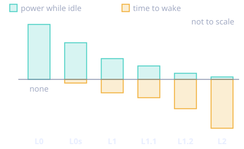

# Supplement D — SSD Power Management

Power kept appearing at the edges of the core chapters — [Chapter 1](../core/ch1-overview.md#155-power-thermals)'s drive power states, [Chapter 7](../core/ch7-testing.md#75-devsleep-testing)'s tests of the Serial AT Attachment (SATA) Device Sleep (DevSleep) state, [Supplement B](b-ufs.md#b6-ufs-low-power)'s HIBERN8 (hibernate) link state — always with the details deferred. This supplement consolidates the whole story, reconstructed from the Peripheral Component Interconnect Express (PCIe) and Non-Volatile Memory Express (NVMe) specifications and current industry sources (the book's 2nd edition scatters it across three sections).

Power management is worth a supplement for one practical reason: **it is firmware's job.** The firmware defines how many power states a controller has, implements every entry/exit sequence, and tunes the idle timers that decide when to drop into each state (Phison's E12 controller defines five power states — a firmware choice, not a spec mandate). It's also a testing topic — Chapter 7's IPM-12/13 DevSleep cases are exactly power-state validation.

!!! tip "The one idea that unifies everything"
    **Every low-power state trades power savings against exit latency.** The deeper the state, the less it draws — and the longer it takes to wake. So firmware must choose *when* to descend: too eager hurts responsiveness; too lazy drains the battery. Enterprise drives lean awake (consistent latency is the product); consumer and mobile drives lean asleep (battery is the product). Every design decision in this supplement is this one trade-off, restated.

**The second key idea: power management is layered.** There isn't one mechanism — there are several, at different layers, operating simultaneously, and deep idle requires them all to cooperate. This stack is the map for the whole supplement:

{ .sdd-fig }
/// figure-caption
The five layers of power management, from the host's system states down to the sideband pins. Each layer has its own states and its own driver, and the drive reaches its idle floor only when every layer is down.
///

A PCIe solid-state drive (SSD) reaches near-zero idle only when the **link** is in L1.2, under Active State Power Management (ASPM), *and* the **controller** is in a deep non-operational state, under Autonomous Power State Transition (APST). Either layer left awake, and the floor is unreachable. That coordination is the crux.

!!! abstract "In this supplement"
    - **PCIe link states & ASPM** ⭐⭐ — L0…L3, the L1 substates, CLKREQ# (§D.1)
    - **PCIe device states** ⭐ — D0…D3cold, PME, and RTD3 for Modern Standby (§D.2)
    - **NVMe power states & APST** ⭐⭐ — the PS ladder, static/dynamic management, autonomous transitions (§D.3)
    - **SATA consolidated** — Partial/Slumber/DevSleep mapped onto the PCIe ladder (§D.4) · **Host S-states** (§D.5)
    - **Practical realities** — Modern Standby, OS effects, AC-vs-DC gating, data-center policy (§D.6)

---

## D.1 PCIe link power states & ASPM ⭐⭐

[Chapter 5](../core/ch5-pcie.md#510-pcie-reset)'s link training and status state machine (LTSSM) includes a ladder of **link power states**, each step saving more and waking slower:

| State | What's powered | Exit latency | Notes |
|---|---|---|---|
| **L0** | everything | none | fully active |
| **L0s** | most; quick-recovery standby | ~ns–µs | idles *one direction* of the link; fully autonomous |
| **L1** | main power on, PLL may stop | ~µs–tens of µs | both directions quiet; woken via **CLKREQ#** |
| **L1.1** | L1 + common-mode voltage kept | longer | substate: partial link shutdown |
| **L1.2** | common-mode keeper **off** | longest of the L1 family | substate: near-full shutdown, **maximum savings** |
| **L2** | only Vaux | very long | link dead; wake via Beacon/WAKE# |
| **L3** | nothing | — | off |

{ .sdd-fig }
/// figure-caption
The link ladder as a trade-off, not to scale: each step to the right draws less power while idle and takes longer to wake.
///

**ASPM — Active State Power Management** — is the mechanism that drops the link into L0s/L1 **autonomously, in hardware, with no driver involvement**: the link notices idleness, powers down its physical layer (PHY), and wakes on the next transaction. Because it's automatic and cheap, it's the workhorse of notebook battery life.

- A device advertises **L0s only** or **L0s + L1**. L0s quiets one direction; L1 shuts the link down more completely — including the reference clock — until the clock-request signal CLKREQ# asserts. More savings, more exit latency.
- The **L1 substates** go deeper: L1.1 keeps the common-mode voltage (faster resume); L1.2 drops even that (deepest idle, slowest resume).
- **CLKREQ# is the PCIe deep-sleep pin** — the analog of SATA's Device Sleep signal (DEVSLP) line from [Chapter 7 §7.5](../core/ch7-testing.md#75-devsleep-testing). Same role: a dedicated sideband wire gating the deepest state.
- **Where it's configured:** BIOS (Basic Input/Output System) setup options (Off / L0s / L1 / Auto), the operating system's policy (Windows exposes it as "Link State Power Management": Off / Moderate / Maximum), and vendor firmware thresholds.
- **PCIe 6.0 changed the bottom rungs.** In its Flit mode L0s is gone, and a new **L0p** takes its place: the link sheds some of its lanes while traffic keeps flowing on the rest, scaling power with bandwidth instead of stopping.

**The trade-off in practice:** waking a sleeping link means re-establishing it — the "ASPM exit latency." Acceptable when battery is king; visible when latency is king — which is why **enterprise and latency-sensitive deployments often disable the L1 substates** outright ([Chapter 1](../core/ch1-overview.md#152-performance)'s tail-latency obsession, meeting its power-management consequence).

---

## D.2 PCIe device power states ⭐

Distinct from the *link*'s L-states are the *device*'s **D-states** — defined by the PCI (Peripheral Component Interconnect) Power Management spec, controlled by **software** through the PM Capability register:

| State | Meaning |
|---|---|
| **D0** | fully operational — the only state where real work happens |
| **D1, D2** | optional intermediates; rare in SSDs |
| **D3hot** | low power with **Vaux present** — config space still reachable; can signal wake (PME) |
| **D3cold** | **main power removed** — deepest; waking means re-initialization |

**The coupling:** a device's D-state constrains its link's L-state — D0 permits L0/L0s/L1; D3 forces L2/L3. Software sets the coarse device state; ASPM autonomously fine-idles the link within it.

**PME — Power Management Event** — is the device-initiated wake: a signal propagating up to the host requesting a return to D0/L0 (central for network cards waking on packets; available to SSDs for timer/maintenance wakes).

**RTD3 — Runtime D3 — the modern one that matters.** ⭐ Putting the device into **D3cold while the system is running**: near-zero idle power, restored on demand. Per the NVMe consortium's guidance, RTD3 gives zero-power idle, and drives supporting APST can coordinate their own descent toward it. It's what lets a laptop NVMe drive draw essentially nothing between keystrokes — and it's a hard requirement of **Modern Standby**: the recommendation is **RTD3 resume ≤ 100 ms** so the whole system can resume in under a second. At shutdown, the operating-system driver sets Shutdown Notification and waits for the drive's reported RTD3 entry latency (Linux allows at least 5 seconds) before cutting power.

---

## D.3 NVMe power states & APST ⭐⭐

NVMe layers its own power model on top of PCIe's. Among the capabilities the host reads at [Identify](../core/ch6-nvme.md#62-nvme-overview-the-command-model) time is a table of up to **32 power states (PS0–PS31)**, each descriptor carrying:

- **MP (Maximum Power)** in that state.
- **Operational vs non-operational** — operational states process I/O at graded power/performance; non-operational states are pure sleep, no I/O.
- **ENLAT (entry latency) / EXLAT (exit latency)** — and the exit latency is the crucial one: the power-vs-latency trade-off, quantified per state.
- **Relative throughput/latency** — how performance scales across the operational states.

The states form the expected ladder: a few operational rungs (full → reduced performance) above deeper non-operational sleeps. The **firmware defines the ladder** — count, depths, latencies (Phison's E12: five states).

**Static power management:** the host picks a power budget and pins the controller, via **Set Features (Power Management)**, to a state whose MP fits — a thermally-limited chassis capping its drive.

**Dynamic power management:** the host moves the state on the fly to track workload — full power busy, low power light — complementing (per the NVMe consortium, not replacing) the controller's own autonomous and thermal management.

**APST — Autonomous Power State Transition** ⭐ — NVMe's analog of ASPM, one layer up: the **controller drops itself into deeper non-operational states after host-configured idle intervals**, no software in the loop per transition. Configured once (a table of idle thresholds via the APST feature), self-managing thereafter. Per Phison, APST is standard on client drives for a blunt reason: a drive that never self-transitions sits at active-idle power and quietly drains the battery.

{ .sdd-fig }
/// figure-caption
One idle period, not to scale. The link parks within moments of the last I/O; the controller descends in steps, after idle times the host configured; and the deepest state costs the longest climb back when I/O returns.
///

**ASPM + APST together — the whole point.** They manage *different layers* and **both are required** for deep idle: ASPM parks the **link**; APST parks the **controller and the NAND flash**. The sub-10 mW idle watermark (the DevSleep territory of Chapter 7) needs L1.2 *and* a deep non-operational PS, coordinated. Miss either, miss the target.

*(NVMe also defines **ACTP (Active Power)** — the largest average power over a 10-second window — and hooks into the thermal throttling of [Ch 1 §1.5.5](../core/ch1-overview.md#155-power-thermals).)*

---

## D.4 SATA power management, consolidated

The SATA equivalents from Chapters 1 and 7, unified. SATA's **ALPM (Aggressive Link Power Management)** ladder:

- **Active** → **Partial** (PHY low-power, ~10 µs recovery) → **Slumber** (deeper, ~10 ms) → **DevSleep** (< 10 mW; near-total power-down, gated by the dedicated DEVSLP pin, exit via COMWAKE — the IPM-12/13 tests of [Ch 7 §7.5](../core/ch7-testing.md#75-devsleep-testing), with their minimum DEVSLP assertion time (MDAT) and DevSleep exit timeout (DETO)).

The cross-interface mapping is clean: **Partial/Slumber ≈ L0s/L1; DevSleep ≈ L1.2 + RTD3 (with DEVSLP playing CLKREQ#'s role).** Same ladder, same trade-off, different connector — which is why the Chapter 7 test methodology generalizes to NVMe drives with a power module on the CLKREQ# sideband.

---

## D.5 Host system power states

At the top, the Advanced Configuration and Power Interface (ACPI) **S-states** drive everything ([Ch 1 §1.5.5](../core/ch1-overview.md#155-power-thermals)): **S0** working · **S1/S2** light sleep (rare) · **S3** suspend-to-RAM (main memory kept alive, SSD down to a low D/L state) · **S4** hibernate — **memory contents written to the SSD**, then power off (the drive is the hibernation image's *destination*) · **S5** soft-off.

Down the stack: the S-state drives the D-state, the D-state constrains the L-state, and within that envelope ASPM and APST do their autonomous fine idling. The SSD follows the host's lead — but *how well* it follows (depth reached, wake speed) is the firmware's power design and timer tuning.

---

## D.6 Practical realities

*Where spec meets messy practice.*

**Modern Standby made RTD3 first-class.** The industry's shift from S3 sleep to Modern Standby (instant-on, always-connected) means the drive must idle at near-zero and resume inside the 1-second system budget — hence the ≤ 100 ms RTD3 resume recommendation and OEM guidance to reject drives that don't report RTD3 latencies. The RTD3 resume path is now a headline firmware deliverable.

**The operating system is part of the system under test.** A revealing bench study: the *same* NVMe drive in the *same* laptop spends far longer in L1.2 under Ubuntu than under Windows — Windows wakes the drive frequently enough to keep it out of its deepest state. Lesson for validation: a drive that sleeps beautifully under one operating system may never sleep under another; measure the platform, not just the device. (This is precisely what [Ch 7 §7.5](../core/ch7-testing.md#75-devsleep-testing)-style setups with programmable power modules capture — on PCIe, watching the CLKREQ# sideband.)

**AC vs DC gating.** Platforms commonly allow L1 substates on battery but not on wall power unless ASPM is forced to maximum savings; desktops often skip the lowest states entirely (idle watts traded for responsiveness) while laptops implement the full ladder. The "right" tuning is product-specific — a desktop drive, an ultrabook drive, and a ruggedized-notebook drive want three different policies, which is why controller vendors co-tune firmware power settings with each device maker.

**Data centers mostly skip deep link idle — with a twist.** Per the NVMe consortium, L1-substate features see little data-center use (high duty cycles make the latency tax pointless) — *but* they're re-emerging for warm/cold-storage drives, where idle watts are operating cost. The enterprise-vs-consumer split from Chapter 1 holds, softened by the cold-tier economics that also drive the quad-level-cell (QLC) story of [Ch 4 §4.11](../core/ch4-ftl.md#411-modern-developments-from-sdf-to-zns-and-fdp).

**The recurring theme: defaults never fit.** Vendors tune state counts, idle thresholds, and entry/exit sequences per product, per chassis, per airflow. Power-state tuning is one of the most concrete examples of firmware ↔ product-team collaboration in the whole SSD business.

---

## Key takeaways

1. **One trade-off, everywhere:** deeper = cheaper to hold, dearer to leave. Enterprise stays awake; mobile dives deep. Every mechanism in this supplement is that sentence with an acronym attached.
2. **Five layers must cooperate** — S-states → D-states → L-states → NVMe PS → sideband pins — and the drive's idle floor is set by the *least* cooperative layer.
3. **ASPM parks the link, APST parks the controller** — hardware-autonomous and firmware-autonomous respectively, and deep idle requires both.
4. **RTD3 is the modern centerpiece**: D3cold at runtime, ≤ 100 ms resume, mandated in practice by Modern Standby.
5. **The SATA ladder maps 1:1 onto PCIe's** (Partial/Slumber/DevSleep ≈ L0s/L1/L1.2+RTD3), so one test methodology serves both.
6. **Validate the platform, not the drive alone** — the operating system, the power source, and the chassis decide whether your beautiful low-power design ever actually runs.

---

## Key vocabulary

| Term | 中文 | Meaning |
|---|---|---|
| power-vs-latency trade-off | 功耗與延遲的權衡（台：功耗與延遲的取捨） | Deeper states draw less power but take longer to wake: the principle behind every state. → [§D.1](#d1-pcie-link-power-states-aspm) |
| L0 / L0s / L1 / L2 / L3 | 鏈路電源狀態（台：鏈結電源狀態） | The PCIe link power states, from fully active to off. → [§D.1](#d1-pcie-link-power-states-aspm) |
| L1.1 / L1.2 | L1子狀態 | The L1 substates: partial and near-complete link shutdown. → [§D.1](#d1-pcie-link-power-states-aspm) |
| Active State Power Management (ASPM) | 活動狀態電源管理（台：主動狀態電源管理） | Hardware that drops an idle link into L0s or L1 by itself, with no driver involved. → [§D.1](#d1-pcie-link-power-states-aspm) |
| clock request (CLKREQ#) | 時鐘請求信號（台：時脈請求訊號） | The PCIe sideband pin that gates the deep link states, like SATA's DEVSLP. → [§D.1](#d1-pcie-link-power-states-aspm) |
| L0p | L0p部分通道狀態 | PCIe 6.0's Flit-mode state that switches some lanes off while traffic keeps flowing. → [§D.1](#d1-pcie-link-power-states-aspm) |
| D0 / D1 / D2 / D3hot / D3cold | 設備電源狀態（台：裝置電源狀態） | The PCIe device power states, set by software. → [§D.2](#d2-pcie-device-power-states) |
| Power Management Event (PME) | 電源管理事件 | A wake request that the device sends to the host. → [§D.2](#d2-pcie-device-power-states) |
| Runtime D3 (RTD3) | 運行時D3（台：執行階段D3） | Putting the device into D3cold while the system keeps running, for near-zero idle power. → [§D.2](#d2-pcie-device-power-states) |
| RTD3 resume latency (RTD3R) | RTD3恢復延遲（台：RTD3回復延遲） | How long the drive takes to come back from RTD3; Modern Standby wants 100 ms or less. → [§D.2](#d2-pcie-device-power-states) |
| NVMe power state (PS0–PS31) | NVMe電源狀態 | Up to 32 controller power states, described in the Identify data. → [§D.3](#d3-nvme-power-states-apst) |
| operational / non-operational state | 可操作 / 不可操作狀態（台：運作 / 非運作狀態） | NVMe states that can process I/O, versus pure sleep states that can't. → [§D.3](#d3-nvme-power-states-apst) |
| MP / ENLAT / EXLAT | 最大功耗 / 進入延遲 / 退出延遲（台：最大功率 / 進入延遲 / 離開延遲） | A power-state descriptor's maximum power, entry latency and exit latency. → [§D.3](#d3-nvme-power-states-apst) |
| static power management | 靜態電源管理 | The host pins the drive to one state that fits a power budget. → [§D.3](#d3-nvme-power-states-apst) |
| dynamic power management | 動態電源管理 | The host changes the power state on the fly to follow the workload. → [§D.3](#d3-nvme-power-states-apst) |
| Autonomous Power State Transition (APST) | 自主電源狀態轉換（台：自動電源狀態轉換） | The NVMe controller descending into sleep states by itself after idle times the host set. → [§D.3](#d3-nvme-power-states-apst) |
| Active Power (ACTP) | 活動功耗（台：作用中功率） | NVMe's largest average power over a 10-second window. → [§D.3](#d3-nvme-power-states-apst) |
| Aggressive Link Power Management (ALPM) | 積極鏈路電源管理（台：積極鏈結電源管理） | SATA's ladder of link power states. → [§D.4](#d4-sata-power-management-consolidated) |
| Partial / Slumber / DevSleep | 部分 / 休眠 / 設備睡眠（台：部分 / 休眠 / 裝置睡眠） | SATA's low-power states, roughly L0s, L1, and L1.2 plus RTD3. → [§D.4](#d4-sata-power-management-consolidated) |
| Device Sleep signal (DEVSLP) | 設備睡眠信號（台：裝置睡眠訊號） | The SATA pin that puts the drive into DevSleep. → [§D.4](#d4-sata-power-management-consolidated) |
| S0–S5 | 系統電源狀態 | The host's ACPI system power states, from working to soft-off. → [§D.5](#d5-host-system-power-states) |
| Modern Standby | 新式待機（台：新式待命） | Windows' instant-on, always-connected standby, which relies on RTD3. → [§D.6](#d6-practical-realities) |

---

## Check yourself

1. State the single tradeoff that governs every low-power state, and explain why enterprise and consumer drives resolve it differently.

    ??? success "Answer"
        Power saved against exit latency: the deeper the state, the less it draws and the longer it takes to wake. Enterprise drives resolve it toward staying awake, because consistent latency is what they sell and they are rarely idle; consumer and mobile drives resolve it toward sleeping, because battery life is what they sell and they are idle most of the time. See the opening of this supplement and [§D.6](#d6-practical-realities).

2. Power management is "layered." Name the five layers from host down to PHY signal, and who controls each (OS / software / hardware / firmware).

    ??? success "Answer"
        Host system states S0–S5, set by the operating system through ACPI; device states D0–D3cold, set by software (the driver); link states L0–L3, which ASPM enters by itself in hardware; NVMe power states PS0–PS31, which the controller's firmware enters by itself through APST (or the host sets); and the sideband pins, CLKREQ# on PCIe and DEVSLP on SATA, which gate the deepest states. See the opening of this supplement.

3. List the PCIe link states L0 → L3 in order of decreasing power, and say which one gives maximum savings among the L1 substates.

    ??? success "Answer"
        L0 (active), L0s, L1 with its substates L1.1 and L1.2, then L2 and L3 (off). Among the L1 substates L1.2 saves the most: it turns off even the common-mode voltage keeper, at the cost of the slowest exit in the L1 family. See [§D.1](#d1-pcie-link-power-states-aspm).

4. What is ASPM, and what makes it different from software-driven power management? Which sideband pin gates its deepest states, and what's the SATA equivalent?

    ??? success "Answer"
        Active State Power Management drops an idle link into L0s or L1 by itself, in hardware, and wakes it on the next transaction, with no driver involved in each transition; software-driven management needs a driver or the operating system to decide and command every change. Its deepest states are gated by the CLKREQ# sideband pin; SATA's equivalent is the DEVSLP pin. See [§D.1](#d1-pcie-link-power-states-aspm).

5. Distinguish PCIe *link* states (L) from *device* states (D). What's the difference between D3hot and D3cold?

    ??? success "Answer"
        Link states describe the connection between two ports and are mostly entered by hardware; device states describe the whole device and are set by software, and the device state limits which link states are allowed (D3 forces L2 or L3). In D3hot the device is in low power but keeps auxiliary power, so it still answers configuration requests and can signal a wake; in D3cold main power is removed, and waking means full re-initialization. See [§D.2](#d2-pcie-device-power-states).

6. What is RTD3, and why is it essential for Modern Standby systems? What's the resume-latency target?

    ??? success "Answer"
        Runtime D3 puts the device into D3cold while the system keeps running, so an idle drive draws essentially nothing and is powered back on when needed. Modern Standby keeps the system nominally on and promises instant resume, so the drive must reach near-zero idle without a system sleep and come back fast. The target is an RTD3 resume of 100 ms or less, so the whole system resumes in under a second. See [§D.2](#d2-pcie-device-power-states).

7. An NVMe power state descriptor has several fields. Name four, and explain the operational vs non-operational distinction.

    ??? success "Answer"
        Maximum power (MP), whether the state is operational, entry latency (ENLAT), exit latency (EXLAT), and the relative throughput and latency of the operational states. Operational states process I/O at graded power and performance; non-operational states are pure sleep, and the controller processes no I/O until it returns to an operational state. See [§D.3](#d3-nvme-power-states-apst).

8. Distinguish static from dynamic NVMe power management. Which command does the host use to set the power state?

    ??? success "Answer"
        Static: the host picks a power budget once and pins the controller to a state whose maximum power fits, as a thermally limited chassis does. Dynamic: the host changes the state on the fly to follow the workload. Both use Set Features with the Power Management feature. See [§D.3](#d3-nvme-power-states-apst).

9. What is APST, and at which layer does it operate? Why are ASPM *and* APST both needed to reach the lowest idle power?

    ??? success "Answer"
        Autonomous Power State Transition lets the NVMe controller move itself into deeper non-operational states after idle times the host configured once; it works at the NVMe controller layer, while ASPM works at the PCIe link layer. Deep idle needs both because they park different hardware: ASPM puts the link into L1.2, APST puts the controller and the NAND into a deep sleep state, and either one left awake keeps the drive above its idle floor. See [§D.3](#d3-nvme-power-states-apst).

10. Map the SATA states (Partial, Slumber, DevSleep) onto their PCIe/NVMe equivalents.

    ??? success "Answer"
        Partial ≈ L0s, Slumber ≈ L1, and DevSleep ≈ L1.2 plus RTD3, with the DEVSLP pin playing the role of CLKREQ#. See [§D.4](#d4-sata-power-management-consolidated).

11. In the host S-states, what specifically happens to the contents of main memory (RAM) in S4, and what role does the SSD play?

    ??? success "Answer"
        In S4, hibernate, the contents of main memory are written to storage and the system powers off; on resume they are read back. The SSD is the destination of that hibernation image, so its write and read speed set how long hibernating and resuming take. See [§D.5](#d5-host-system-power-states).

12. **(Practical)** The same SSD sleeps deeper under Linux than Windows on the same laptop. What does this tell you about validating low-power behavior, and how does it connect to the Chapter 7 DevSleep testing?

    ??? success "Answer"
        Low-power behaviour belongs to the whole platform, not to the drive alone: the operating system, its drivers and its background activity decide how often the drive is woken, so a drive that sleeps deeply under one system may rarely reach its deepest state under another. Validation must measure state residency on the real platforms and operating systems. It is the same approach as Chapter 7's DevSleep testing, where a programmable power module watches the sideband signal; on PCIe that means watching CLKREQ# to see how long the link really stays in L1.2. See [§D.6](#d6-practical-realities).

13. **(Firmware)** Given that firmware "defines the number of power states" and tunes their thresholds, describe two concrete decisions you'd have to make when implementing power management for a new client SSD.

    ??? success "Answer"
        Any two such decisions: how many power states to define and what each draws (say, three operational states and two non-operational ones); the entry and exit latencies to report for each; the idle times after which APST descends; whether to support the L1 substates and RTD3, and how fast resume must be (100 ms or less for Modern Standby); and how the policy changes per platform, such as on battery versus wall power. Each choice trades idle power against wake latency. See [§D.3](#d3-nvme-power-states-apst) and [§D.6](#d6-practical-realities).

---

??? info "📖 Provenance"

    Power management is scattered across the 2nd edition (their §8.14, §8.15,
    §9.8) and absent from the 1st. This supplement reconstructs and unifies
    the material from the PCIe and NVMe specifications, the NVMe
    consortium's guidance, and vendor engineering sources. Its figures are original
    drawings.

??? info "🔎 Sources for the 2026 update"

    Section D.1 was brought up to date in November 2026 against these sources:

    - PCIe 6.0's Flit mode drops L0s and adds L0p, which scales the link width while traffic flows — [Cadence](https://community.cadence.com/cadence_blogs_8/b/fv/posts/understanding-pcie-6-0-power-state-l0p-vs-l0s-vs-l1), [Synopsys](https://www.synopsys.com/designware-ip/technical-bulletin/pcie-6-designs.html)

*Next: [Supplement E — Aerospace Storage](e-aerospace-storage.md): SSDs in orbit — radiation effects on NAND flash, hardening techniques, and reliability engineering for space. The final supplement.*
