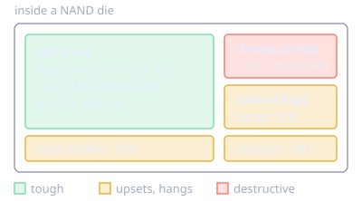

# Supplement E — Aerospace / Space Storage

Space is the ultimate reliability exam, and this closing supplement works by taking *everything [Chapter 3](../core/ch3-nand-flash.md) taught about how flash fails* — threshold-voltage drift, charge trapping in the oxide, retention loss, bit errors — and asking: **what happens when radiation accelerates all of it and adds brand-new failure modes on top?** (Reconstructed from the space-radiation-effects literature — NASA's Electronic Parts and Packaging program (NEPP), the IEEE (Institute of Electrical and Electronics Engineers) Nuclear and Space Radiation Effects Conference (NSREC) — and the radiation-tolerant-memory industry; the 2nd edition gives the topic a section alongside computational storage.)

The satisfying part: nearly every mitigation turns out to be a Chapter-3/4 concept pushed to its extreme. **Memory scrubbing is Read Scrub. Redundancy is the drive's internal RAID (redundant array of independent disks). The preference for single-level cells (SLC) is the voltage-margin argument. Even "why solid-state at all" has the same answer as Chapter 1** — no moving parts. So this supplement teaches something genuinely new (radiation physics) while consolidating the reliability thread of the whole site.

!!! abstract "In this supplement"
    - **Why spacecraft store, and why solid-state** ⭐ — the tape-to-SSR transition; the radiation environment; orbit sets the requirement (§E.1)
    - **TID** ⭐ — cumulative dose as radiation-accelerated aging (§E.2.1) · **SEE** ⭐ — from bit-flips to chip-killing latchup (§E.2.2)
    - **Where NAND is tough and where it's soft** (§E.2.3) · **Rad-hard vs COTS-plus-mitigation** ⭐⭐ (§E.2.4–E.2.5)
    - **Current practice** — NewSpace, density pull, testing standards (§E.2.6)
    - **Coda** — the complete map of the core chapters and supplements

---

## E.1 Background: why space needs storage, and why solid-state ⭐

**Every spacecraft needs non-volatile memory** — boot code, flight parameters, and above all **payload data**: Earth-observation imagery, telescope frames, sensor logs, stored on board and downlinked when a ground station comes into view. The equipment class is the **Solid State Recorder (SSR)** or **Mass Memory Unit (MMU)**.

**The tape-to-solid-state transition is Chapter 1's story, retold in orbit.** For decades, spacecraft storage often meant an actual **tape recorder** — magnetic tape and motors, spinning in space. Solid state displaced it, per NASA's own guidance, for **the reliability of having no moving parts** — the solid-state drive (SSD) versus hard disk drive (HDD) argument of [Ch 1 §1.2](../core/ch1-overview.md#12-ssd-vs-hdd) with the stakes raised: in orbit, "nothing mechanical to break" isn't a convenience, it's mission survival. No repair technicians make house calls at 700 km.

**But space breaks the ground rules.** On Earth, flash's enemies are wear, disturb, and retention ([Ch 3 §3.3](../core/ch3-nand-flash.md#33-why-flash-is-hard-the-failure-modes)). In space a new, dominant enemy joins: **radiation.**

**The radiation environment**, three sources:

- **Galactic Cosmic Rays (GCR)** — high-energy protons and heavy ions from outside the solar system. Sparse but ferocious: one heavy ion carries enough energy to disrupt or destroy a circuit node, and shielding barely helps — they punch through spacecraft walls.
- **Solar particle events** — proton/ion bursts from flares and coronal mass ejections; sporadic, sometimes intense.
- **Trapped radiation** — the **Van Allen belts**, particles caught in Earth's magnetic field.

**Orbit sets the dose — the key engineering variable:** **Low Earth orbit (LEO)** is comparatively protected (though it crosses the **South Atlantic Anomaly**, where the inner belt dips low) — ~100 krad tolerance covers years. **Medium Earth orbit (MEO) and geostationary orbit (GEO)** sit in or above the belts: much harsher. **Deep space** belongs to the cosmic rays, unshielded by any magnetosphere. **Jupiter-class environments** are the brutal end of the scale. Dose is quantified two ways, matching the two damage categories below: **cumulative dose** (total ionizing dose, TID) and **particle flux** (the rate of single-event effects, SEE).

---

## E.2 Radiation effects & mitigation ⭐⭐

Radiation damages electronics in **two fundamentally different ways** — slow accumulation and instantaneous strikes. The split organizes everything.

{ .sdd-fig }
/// figure-caption
Radiation's two kinds of damage. The slow kind ages the chip the way wear does; the instant kind ranges from a flipped bit to a dead chip, and each tier calls for a different defence.
///

### E.2.1 TID — Total Ionizing Dose: radiation-accelerated aging ⭐

**TID** is the accumulated ionizing dose over the mission, in **rad/krad** (or grays). Radiation crossing the chip's oxide layers creates electron-hole pairs, and some charge **traps in the oxide — permanently** — shifting transistor behavior until the device degrades out of spec.

This should feel familiar: [Ch 3 §3.3.2](../core/ch3-nand-flash.md#332-endurance-the-physics-of-wearing-out) taught that *wear* damages flash by accumulating **charge traps in the tunnel oxide**. **TID is the same damage by a different cause** — radiation instead of program/erase stress. Recent (2024–25) radiation testing of 3D NAND flash reads like Chapter 3's symptom list, radiation-driven:

- **The raw bit error rate (RBER) climbs** with dose (Chapter 1's metric, new driver).
- **Threshold-voltage distributions shift** — the Vt drift picture again.
- **Standby and read currents rise** — trapped-charge leakage.
- **Program/erase timings degrade** — charge pumps and cell physics shift.
- **Retention worsens** — trapped charge accelerates the leakage of [Ch 3 §3.3.6](../core/ch3-nand-flash.md#336-data-retention-how-long-does-data-survive).

Two more Chapter-3 echoes: the **stored data pattern** influences post-irradiation error counts (the pattern-sensitivity that motivates [randomization](../core/ch3-nand-flash.md#345-data-randomization), reappearing under radiation), and **charge-trap** 3D NAND shows superior TID resistance in some studies — the insulator that helps scaling ([Ch 3 §3.1.6](../core/ch3-nand-flash.md#316-charge-trap-flash-the-other-way-to-hold-an-electron)) also helps in orbit.

**TID = aging on fast-forward**, and Chapter 3's endurance physics is the right lens for it.

### E.2.2 SEE — Single Event Effects: the instantaneous ones ⭐

An **SEE** is the work of **one particle strike** depositing charge along its ionized track. The family divides into **soft (recoverable)** and **hard (destructive)**:

**Soft, recoverable:**

- **SEU (Single Event Upset)** — the classic: **a bit flips** — in a cell, a register, the controller's static random-access memory (SRAM). Correct it, rewrite it, move on. *A Chapter-3 bit error with a cosmic cause — exactly what the error-correcting code (ECC) exists for.*
- **MBU (Multiple-Bit Upset)** — one particle flips **several adjacent bits**. *The nasty one for ECC:* the codes of [Supplement A](a-ecc-coding-theory.md) assume errors scatter somewhat independently; a clustered strike can overwhelm a codeword. The defense is interleaving (§E.2.5).
- **SET (Single Event Transient)** — a momentary voltage glitch that can propagate and latch as a wrong value.

**Functional and hard:**

- **SEFI (Single Event Functional Interrupt)** — the strike corrupts **control logic or a state machine**: the device hangs or misbehaves until **reset or power-cycled**. A first-order concern for complex NAND controllers — more logic, more targets. *(The robustness theme of [Ch 7 §7.3.3](../core/ch7-testing.md#733-jammer) — a SEFI is hardware-induced malformed-state chaos.)*
- **SEL (Single Event Latchup)** — **the dangerous one**: the strike triggers the parasitic thyristor inside CMOS (complementary metal–oxide–semiconductor) logic, creating a **self-sustaining high-current short**. Cut power fast or the chip cooks. Demands active protection.
- **SEGR (single-event gate rupture) and SEB (single-event burnout)** — destructive events at **high-voltage nodes**. This one is NAND-specific in a poetic way: recall [Ch 3 §3.1.4](../core/ch3-nand-flash.md#314-read-write-erase-the-actual-voltages) — **erase needs ~20 V from on-chip charge pumps**, and precisely those nodes are where a strike can rupture an oxide. The mechanism that makes flash erasable creates its radiation soft spot.

The destructive subset (SEL/SEGR/SEB) is collectively **catastrophic SEE (CSEE)** — the main obstacle to flying commercial parts.

### E.2.3 Where NAND is tough, and where it's soft

A crucial nuance: the **cell array itself is relatively robust to strikes** — the stored charge per bit is large compared to what one particle deposits. **The vulnerability concentrates in the periphery**: charge pumps (SEGR), sense amps and page buffers (SEU), and above all the **control logic** (SEFI). Radiation usually breaks the *machinery around* the array before it erases your bits.

{ .sdd-fig }
/// figure-caption
Where a die is tough and where it is soft. The array's large stored charge shrugs off most strikes; the periphery that runs it takes the damage, from upsets and hangs to destruction at the high-voltage pumps.
///

And [Ch 3 §3.1.2](../core/ch3-nand-flash.md#312-slc-mlc-tlc-the-threshold-voltage-picture)'s trade-off becomes a survival rule: fewer bits per cell = wider voltage margins = more tolerance for radiation-induced Vt shift. **Space storage favors SLC** — today often commercial triple-level-cell (TLC) 3D NAND run in SLC mode, which NASA's beam tests found far less prone to upsets than the same flash storing several bits per cell — and quad-level cells (QLC) stay on the ground. The margin argument, upgraded from economics to mission assurance.

### E.2.4 Mitigation: two philosophies ⭐⭐

**Philosophy 1 — Radiation-hardened (rad-hard): build resistant silicon.**

- **RHBD (radiation hardening by design):** guard rings against latchup, hardened cells, enclosed-geometry transistors.
- **RHBP (radiation hardening by process):** substrates like silicon-on-insulator (SOI) that structurally preclude latchup.
- **The catch:** rad-hard parts are expensive, low-volume, and **generations behind** commercial density and speed. Through the 1990s this was the only respectable option.

**Philosophy 2 — commercial off-the-shelf (COTS) parts + system-level mitigation (the modern trend): accept upsets, engineer recovery.** Fly **commercial** (or upscreened industrial/automotive) NAND — cheap, dense, fast — and handle radiation at the system level with redundancy, strong ECC, scrubbing, and active protection. This is **"radiation-tolerant"** rather than radiation-hardened: individual parts *will* upset; the system detects and recovers. Now standard for LEO and the NewSpace/CubeSat world, where cost rules and the environment is milder.

### E.2.5 The system-level toolkit — Chapter 3/4, extremized ⭐

| Technique | What it does | You know it from… |
|---|---|---|
| **Memory scrubbing (EDAC)** | continuously read-correct-rewrite so SEUs never accumulate past ECC | **Read Scrub**, [Ch 3 §3.3.6](../core/ch3-nand-flash.md#336-data-retention-how-long-does-data-survive) — same technique, different trigger |
| **Strong / interleaved ECC** | Reed-Solomon or concatenated codes with **bit interleaving**, so an MBU's clustered flips land in *different* codewords | **ECC**, [Ch 3 §3.4](../core/ch3-nand-flash.md#34-fighting-back-the-data-integrity-stack) + [Supplement A](a-ecc-coding-theory.md), extended for clustered strikes |
| **Redundancy / RAID across chips** | parity striping so a dead or corrupted device rebuilds | **in-SSD RAID**, [Ch 3 §3.4.4](../core/ch3-nand-flash.md#344-raid-inside-the-ssd) |
| **TMR (Triple Modular Redundancy)** | triplicate critical logic, majority-vote every output | new — RAID for logic gates |
| **SEL protection** | current monitors that cut/cycle power at the latchup signature | new — the anti-destruction defense |
| **Watchdog + SEFI recovery** | detect the hung controller, reset, reinitialize | recovery robustness, [Ch 4 §4.6](../core/ch4-ftl.md#46-power-loss-recovery) + [Ch 7 §7.12](../core/ch7-testing.md#712-ftl-module-and-power-loss-testing) |
| **SLC + margin + derating** | wide margins, conservative operation | the SLC argument, [Ch 3 §3.1.2](../core/ch3-nand-flash.md#312-slc-mlc-tlc-the-threshold-voltage-picture) |
| **FPGA controllers** | reconfigurable, TMR'd, config-scrubbed — updatable in orbit | the FPGA-controller thread, [Ch 2 §2.7](../core/ch2-controllers-afa.md#27-computational-storage-ssds-that-compute) / [Ch 4 §4.10](../core/ch4-ftl.md#410-host-based-ftl) |

Score it: scrubbing = Read Scrub, redundancy = RAID, strong ECC = Supplement A, SLC = margins, SEFI recovery = power-loss robustness. **Space storage is the terrestrial reliability toolkit at maximum volume**, plus two genuinely new defenses (triple modular redundancy, TMR, and latchup protection) for failure modes Earth doesn't serve.

### E.2.6 Current practice & trends

**A spectrum, not a binary.** Missions pick their point: pure rad-hard (deep space, GEO, most expensive) → upscreened COTS (tested industrial/automotive parts) → pure commercial (cheapest; short CubeSat missions). The industry maxim: *meet the spec, don't overdo it* — excess hardening burns budget; too little risks an on-orbit failure whose only fix is another launch. Orbit and mission life set the requirement; the balancing act is the job.

**NewSpace drove the COTS revolution.** Mega-constellations (thousands of LEO satellites) can't afford rad-hard prices or densities, so the market moved decisively to **COTS-plus-mitigation** — productized in modules like 3D Plus's radiation-tolerant memory stacks: commercial-density NAND, wrapped in built-in protection, sold plug-and-play. Meanwhile even CubeSat designers, after enough lessons, give rad-hard parts a second look for critical functions.

**Density is the pull.** Modern imaging, synthetic-aperture-radar and hyperspectral missions generate torrents that only commercial-density 3D NAND can affordably hold — so the trend is *up in density, harder on mitigation*: the same density-vs-reliability tension that runs from [Ch 3](../core/ch3-nand-flash.md#312-slc-mlc-tlc-the-threshold-voltage-picture)'s table of single-, multi- and triple-level cells to QLC's soft-decision LDPC (low-density parity-check) decoding, now with a launch manifest attached.

**Testing and standards.** Heavy-ion and proton beam campaigns at accelerator facilities measure SEE cross-sections and the linear energy transfer (LET) threshold (the energy-deposition level where upsets begin); Co-60 gamma sources deliver TID. The institutions: NASA NEPP, IEEE NSREC and its data workshop, the European Space Agency's component standards; the procedures: JESD57, MIL-STD-883. Connecting to [Chapter 7](../core/ch7-testing.md): this is reliability qualification with a different stressor — same mindset, stress → characterize → qualify, all the way to orbit. (And fittingly for a book by a Chinese engineering team: China's program practices the same COTS-plus-mitigation philosophy — the DAMPE "Wukong" dark-matter probe flew SEL-protected industrial-grade parts.)

---

## Key takeaways

1. **Space chose solid-state for Chapter 1's reason** — no moving parts — and then had to solve problems Chapter 3 never met.
2. **Two damage modes, two clocks:** TID accumulates like wear (trapped oxide charge, drifting Vt, fading retention); SEEs strike instantly, from correctable bit-flips to chip-killing latchup.
3. **The array is tougher than its servants** — the cells shrug off strikes that hang state machines and rupture charge-pump oxides. Periphery first.
4. **SLC's wide margins graduate from economics to mission assurance** — space flies 1 bit per cell, even on TLC silicon.
5. **Rad-hard hardens the silicon; rad-tolerant hardens the *system*** — and NewSpace economics moved the industry decisively toward COTS + scrubbing + interleaved ECC + RAID + TMR + SEL protection.
6. **Almost the whole toolkit is Chapter 3/4 at maximum volume** — which is why this topic makes the perfect final exam for the rest of the site.

---

## Key vocabulary

| Term | 中文 | Meaning |
|---|---|---|
| solid-state recorder / mass memory unit (SSR / MMU) | 固態記錄器 / 大容量存儲單元（台：固態記錄器 / 大容量記憶體單元） | A spacecraft's flash-based data store for payload data and flight software. → [§E.1](#e1-background-why-space-needs-storage-and-why-solid-state) |
| galactic cosmic rays (GCR) | 銀河宇宙射線 | High-energy particles from outside the solar system that shielding barely stops. → [§E.1](#e1-background-why-space-needs-storage-and-why-solid-state) |
| solar particle event (SPE) | 太陽粒子事件 | A burst of protons and ions from a solar flare or coronal mass ejection. → [§E.1](#e1-background-why-space-needs-storage-and-why-solid-state) |
| Van Allen belts | 范艾倫輻射帶 | The regions where Earth's magnetic field traps charged particles. → [§E.1](#e1-background-why-space-needs-storage-and-why-solid-state) |
| South Atlantic Anomaly | 南大西洋異常區 | Where the inner belt dips low, giving low orbits a dose hot spot. → [§E.1](#e1-background-why-space-needs-storage-and-why-solid-state) |
| LEO / MEO / GEO | 低軌 / 中軌 / 地球靜止軌道（台：低軌道 / 中軌道 / 地球同步軌道） | Low, medium and geostationary Earth orbit, in rising order of radiation. → [§E.1](#e1-background-why-space-needs-storage-and-why-solid-state) |
| total ionizing dose (TID) | 總電離劑量（台：總游離劑量） | Radiation damage accumulated over a mission as charge trapped in oxides, like wear sped up. → [§E.2.1](#e21-tid-total-ionizing-dose-radiation-accelerated-aging) |
| rad / krad / gray | 拉德 / 千拉德 / 戈瑞（台：雷德 / 千雷德 / 戈雷） | Units of absorbed radiation dose (1 gray = 100 rad). → [§E.2.1](#e21-tid-total-ionizing-dose-radiation-accelerated-aging) |
| single-event effect (SEE) | 單粒子效應（台：單一事件效應） | Damage from one particle strike, from a flipped bit to a destroyed chip. → [§E.2.2](#e22-see-single-event-effects-the-instantaneous-ones) |
| single-event upset (SEU) | 單粒子翻轉（台：單一事件翻轉） | A bit flipped by a particle strike; correctable. → [§E.2.2](#e22-see-single-event-effects-the-instantaneous-ones) |
| multiple-bit upset (MBU) | 多位翻轉（台：多位元翻轉） | One strike flipping several adjacent bits, which can overwhelm a codeword. → [§E.2.2](#e22-see-single-event-effects-the-instantaneous-ones) |
| single-event transient (SET) | 單粒子瞬態（台：單一事件暫態） | A momentary voltage glitch that can be latched as a wrong value. → [§E.2.2](#e22-see-single-event-effects-the-instantaneous-ones) |
| single-event functional interrupt (SEFI) | 單粒子功能中斷（台：單一事件功能中斷） | A strike that hangs control logic until a reset or power cycle. → [§E.2.2](#e22-see-single-event-effects-the-instantaneous-ones) |
| single-event latch-up (SEL) | 單粒子閂鎖（台：單一事件閂鎖） | A strike that turns on a parasitic thyristor and short-circuits the chip unless power is cut. → [§E.2.2](#e22-see-single-event-effects-the-instantaneous-ones) |
| single-event gate rupture / burnout (SEGR / SEB) | 單粒子柵穿 / 燒毀（台：單一事件閘極破裂 / 燒毀） | Destructive strikes at high-voltage nodes such as NAND's charge pumps. → [§E.2.2](#e22-see-single-event-effects-the-instantaneous-ones) |
| catastrophic SEE (CSEE) | 災難性單粒子效應（台：災難性單一事件效應） | The destructive subset: latch-up, gate rupture and burnout. → [§E.2.2](#e22-see-single-event-effects-the-instantaneous-ones) |
| linear energy transfer (LET) | 線性能量傳輸（台：線性能量轉移） | Energy a particle deposits per unit of path; upsets begin above a threshold LET. → [§E.2.6](#e26-current-practice-trends) |
| RHBD / RHBP | 設計加固 / 工藝加固（台：設計強化 / 製程強化） | Radiation hardening by design (layout, cells) and by process (substrates such as SOI). → [§E.2.4](#e24-mitigation-two-philosophies) |
| silicon on insulator (SOI) | 絕緣體上矽（台：絕緣層上覆矽） | A substrate that isolates transistors and so prevents latch-up. → [§E.2.4](#e24-mitigation-two-philosophies) |
| rad-hard vs rad-tolerant | 抗輻射加固 / 耐輻射（台：抗輻射強化 / 耐輻射） | Hardened silicon versus commercial parts made safe by system-level mitigation. → [§E.2.4](#e24-mitigation-two-philosophies) |
| commercial off-the-shelf (COTS) | 商用現貨（台：現成商用品） | Ordinary commercial parts, cheap and dense but not built for radiation. → [§E.2.4](#e24-mitigation-two-philosophies) |
| upscreening | 升級篩選 | Testing and qualifying commercial parts for use in space. → [§E.2.6](#e26-current-practice-trends) |
| EDAC / scrubbing | 錯誤檢測與糾正 / 刷新（台：錯誤偵測與更正 / 刷新） | Error detection and correction run continuously: read, correct, rewrite, so upsets never pile up. → [§E.2.5](#e25-the-system-level-toolkit-chapter-34-extremized) |
| triple modular redundancy (TMR) | 三模冗餘（台：三重模組冗餘） | Three copies of critical logic with a majority vote on every output. → [§E.2.5](#e25-the-system-level-toolkit-chapter-34-extremized) |
| radiation hardness assurance (RHA) | 抗輻射保證 | The process of showing that parts and system will survive the mission's radiation. → [§E.2.6](#e26-current-practice-trends) |

---

## Check yourself

1. Spacecraft storage moved from tape recorders to solid-state for the same reason SSDs beat HDDs in Chapter 1. What is that reason, and why does it matter *more* in space?

    ??? success "Answer"
        No moving parts: a tape recorder, like a hard disk, depends on motors and mechanisms that wear and fail, while solid-state storage has nothing mechanical to break. It matters more in space because nothing can be repaired: a mechanical failure in orbit can end the mission, and launch vibration and thermal cycling are hard on mechanisms. See [§E.1](#e1-background-why-space-needs-storage-and-why-solid-state).

2. Name the three sources of space radiation, and explain why orbit (LEO vs GEO vs deep space) determines the storage-reliability requirement.

    ??? success "Answer"
        Galactic cosmic rays from outside the solar system, solar particle events from flares and coronal mass ejections, and particles trapped in the Van Allen belts. The orbit decides how much of each a spacecraft meets: low Earth orbit is partly shielded by the magnetosphere (apart from the South Atlantic Anomaly), medium and geostationary orbits sit in or beyond the belts and take far more, and deep space has no magnetic shield against cosmic rays. So the orbit and the mission's length set the total dose and the strike rate the storage must survive. See [§E.1](#e1-background-why-space-needs-storage-and-why-solid-state).

3. What is TID, and by what physical mechanism does it damage a chip? Name three of its effects on NAND, and explain why it's essentially "radiation-accelerated aging" (connect it to Chapter 3 wear).

    ??? success "Answer"
        Total ionizing dose is the radiation dose accumulated over a mission. Radiation crossing the chip's oxides creates electron-hole pairs, and some of the charge is trapped in the oxide permanently, gradually shifting how the transistors behave. In NAND it raises the raw bit error rate, shifts the threshold-voltage distributions, increases leakage, slows program and erase, and worsens retention (any three). It is aging on fast-forward because it is Chapter 3's wear mechanism, charge trapped in the oxide, caused by radiation instead of program/erase cycles. See [§E.2.1](#e21-tid-total-ionizing-dose-radiation-accelerated-aging).

4. Distinguish soft SEEs from hard SEEs. Give an example of each and say which needs only correction, which needs a reset, and which can destroy the chip.

    ??? success "Answer"
        Soft effects are recoverable: a single-event upset flips a bit, and correction (ECC or a rewrite) fixes it. Functional ones, the single-event functional interrupt, corrupt control logic and need a reset or power cycle. Hard effects are destructive: single-event latch-up creates a self-sustaining short that destroys the chip unless power is cut quickly, and gate rupture or burnout permanently damages high-voltage nodes. See [§E.2.2](#e22-see-single-event-effects-the-instantaneous-ones).

5. Why is MBU (multiple-bit upset) especially dangerous for the ECC codes from Supplement A, and what ECC technique helps?

    ??? success "Answer"
        Codes such as BCH (Bose–Chaudhuri–Hocquenghem) and LDPC correct up to a certain number of errors per codeword and work best when errors are scattered. One particle can flip several adjacent bits, putting many errors into one codeword and exceeding what it can correct. Interleaving helps: physically adjacent bits are assigned to different codewords, so a clustered strike becomes one or two errors in each of several codewords, each within its limit. See [§E.2.2](#e22-see-single-event-effects-the-instantaneous-ones) and [§E.2.5](#e25-the-system-level-toolkit-chapter-34-extremized).

6. Why is the NAND floating-gate array *relatively* robust to single strikes, while the device as a whole is still vulnerable? Where does the vulnerability actually concentrate?

    ??? success "Answer"
        Each cell stores far more charge than one passing particle deposits, so a strike rarely changes a stored bit; that holds for charge-trap cells as well as floating gates. The vulnerability is in the periphery around the array: the charge pumps (gate rupture and burnout), the sense amplifiers and page buffers (upsets), and above all the control logic and state machines (functional interrupts). See [§E.2.3](#e23-where-nand-is-tough-and-where-its-soft).

7. NAND has a specific SEGR/burnout vulnerability tied to one of its normal operations. Which operation, and why (recall Chapter 3 §3.1.4)?

    ??? success "Answer"
        Erase. It needs about 20 V, generated on the chip by charge pumps, and those high-voltage nodes are where a strike can rupture an oxide or burn out a device: the mechanism that makes flash erasable creates its radiation weak spot. See [§E.2.2](#e22-see-single-event-effects-the-instantaneous-ones).

8. Why does space storage favor SLC over cells that store more bits (MLC, TLC, QLC)? Connect this to the margin argument from Chapter 3.

    ??? success "Answer"
        Radiation shifts threshold voltages, and SLC has only two states with a wide margin between them, so it tolerates much more shift before a bit reads wrong; multi-level (MLC), TLC and QLC cells pack more states into the same window, with narrower margins. NASA's beam tests found commercial 3D NAND far less prone to upsets in SLC mode than when storing several bits per cell. It is Chapter 3's margin argument, raised from economics to mission assurance. See [§E.2.3](#e23-where-nand-is-tough-and-where-its-soft).

9. Contrast the two mitigation philosophies (rad-hard vs COTS-plus-mitigation). Why has the industry been shifting toward the second, and for which missions?

    ??? success "Answer"
        Rad-hard builds radiation-resistant silicon, by design or by process (guard rings, hardened cells, silicon-on-insulator): robust, but expensive, low-volume and generations behind commercial density and speed. COTS-plus-mitigation flies commercial parts and makes the system tolerant, with redundancy, strong interleaved ECC, scrubbing, latch-up protection and watchdogs. The shift came from cost and density, driven by NewSpace constellations and CubeSats; it suits low Earth orbit and shorter missions, while deep-space and geostationary missions still lean on rad-hard parts. See [§E.2.4](#e24-mitigation-two-philosophies) and [§E.2.6](#e26-current-practice-trends).

10. Match each space-mitigation technique to its Chapter-3/4 twin: (a) memory scrubbing, (b) cross-device parity, (c) SLC margin, (d) watchdog/SEFI recovery.

    ??? success "Answer"
        (a) Memory scrubbing is Read Scrub. (b) Cross-device parity is the in-drive RAID across dies of Ch 3 §3.4.4. (c) SLC margin is the threshold-voltage margin argument of Ch 3 §3.1.2. (d) Watchdog and SEFI recovery are power-loss recovery and robustness, Ch 4 §4.6 and Ch 7. See [§E.2.5](#e25-the-system-level-toolkit-chapter-34-extremized).

11. What does "meet the spec but don't overdo it" mean in the context of choosing radiation tolerance, and what's the risk on each side?

    ??? success "Answer"
        Choose just enough radiation tolerance for the orbit and the mission's life. Over-hardening spends budget, mass and density on protection the mission doesn't need; under-hardening risks an on-orbit failure nobody can repair, whose only fix is another launch. See [§E.2.6](#e26-current-practice-trends).

12. **(Trend)** Why are modern missions pushing toward higher-density commercial NAND despite the reliability cost, and how is this the space-storage version of a tension you saw throughout this site?

    ??? success "Answer"
        Imaging, synthetic-aperture-radar and hyperspectral missions produce data volumes that only dense commercial 3D NAND can store affordably, so missions accept weaker parts and strengthen the mitigation around them. It is the density-versus-reliability tension that runs through the whole site: each step from SLC to MLC, TLC and QLC adds capacity and costs margin, endurance and error rate, which stronger ECC and firmware must buy back. See [§E.2.6](#e26-current-practice-trends).

---

## 🎓 Coda: the complete journey

This supplement closes the set — seven core chapters and five supplements. The whole map:

**The core chapters:** [Chapter 1](../core/ch1-overview.md) is the overview: what a solid-state drive is, and why *flash can't overwrite in place*. [Chapter 2](../core/ch2-controllers-afa.md) is the brain, from controllers to all-flash arrays: channels × dies. [Chapter 3](../core/ch3-nand-flash.md) is NAND flash: trapped electrons and every way they escape. [Chapter 4](../core/ch4-ftl.md) is the flash translation layer (FTL), the software that tames the medium. [Chapter 5](../core/ch5-pcie.md) is the road, Peripheral Component Interconnect Express (PCIe); [Chapter 6](../core/ch6-nvme.md) is its traffic system, Non-Volatile Memory Express (NVMe); and [Chapter 7](../core/ch7-testing.md), testing, is the proof.

**The supplements:** [A — ECC theory](a-ecc-coding-theory.md) (the math under Chapter 3's codes) · [B — Universal Flash Storage (UFS)](b-ufs.md) (the stack, re-derived for mobile) · [C — Flash file systems](c-flash-file-systems.md) (the FTL's mirror image in the operating system, and log-on-log) · [D — Power management](d-power-management.md) (the layered power-vs-latency machine) · **E — Aerospace** (the reliability toolkit at maximum).

**The threads that run through everything:**

- **Reliability:** fragile flash (Ch 3) → compensating firmware (Ch 4) → proof under stress (Ch 7) → the mathematics (Supp A) → the extreme case (Supp E).
- **The interface stack:** PCIe carries bits (Ch 5) → NVMe gives them meaning (Ch 6) → UFS replays it for mobile (Supp B) → power management idles it all (Supp D).
- **Host ↔ device cooperation:** the FTL hides flash (Ch 4) → the host starts helping, through the Host Memory Buffer (HMB) and the Host Performance Booster (HPB) → the filesystem cooperates from above (Supp C) → Zoned Namespaces (ZNS) and Flexible Data Placement (FDP) formalize the partnership (§4.11, §6.9).
- **The eternal tension:** more bits per cell = more capacity, worse everything else — from Chapter 3's table of single-, multi- and triple-level cells, through QLC's mandatory soft-decision LDPC, to why space still flies SLC.

From a single trapped electron to a satellite's mass memory: the model is complete. The [glossary](../reference/glossary.md), [formula sheet](../reference/formulas.md), and [quizzes](../reference/quizzes.md) are one click away — and every chapter's animations are collected in the [gallery](../animations/index.md).

---

??? info "📖 Provenance"

    Aerospace storage is a 2nd-edition topic (their §3.2), reconstructed here
    from the space-radiation-effects literature (NASA NEPP, IEEE NSREC/REDW,
    JESD57, MIL-STD-883) and radiation-tolerant-memory industry sources,
    mapped throughout onto this site's Chapters 1, 3, 4, and 7. Its figures
    are original drawings.

??? info "🔎 Sources for the 2026 update"

    Section E.2.3 was brought up to date in November 2026 against these sources:

    - NASA Goddard's radiation tests of commercial 96- and 176-layer TLC 3D NAND, which can also run in SLC mode — [NASA NTRS, 2023](https://ntrs.nasa.gov/api/citations/20230010164/downloads/20230010164-Wilcox-2023-NSREC-DW-Paper_v2.pdf)
    - SSD radiation assurance for automotive and industrial drives configured as SLC or TLC — [NASA NEPP, 2024](https://nepp.nasa.gov/docs/tasks/075-EEE-Parts-Assurance/NEPP-2024-Paper-Wilcox-SSD-Radiation-Assurance-with-Active-Testing-20250000802.pdf)
    - 3D NAND's lower upset susceptibility in SLC mode than in multi-bit modes — [NASA NTRS, 2018](https://ntrs.nasa.gov/api/citations/20180000792/downloads/20180000792.pdf)
