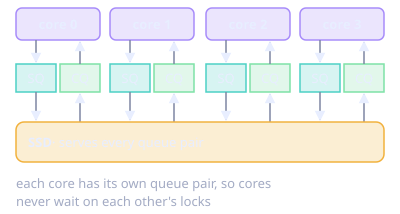

# Supplement H — The Host Side: OS Stack & Tools

The core chapters look at a solid-state drive (SSD) from the inside out. This supplement turns around and stands on the host: it follows one read through the Linux storage stack, shows how the stack keeps a drive's many queues busy, compares the ways software waits for completions, and then puts the standard tools to work, reading a drive's identity and health, its PCIe (Peripheral Component Interconnect Express) link, and its live I/O.

Linux is used throughout because its stack is open and its tools are standard; Windows and other systems make the same choices under other names. All command outputs below are **illustrative**: their format follows the real tools, but the drives and numbers are invented.

!!! abstract "In this supplement"
    - **One read, traced** ⭐⭐ — from a system call down to the drive and back (§H.1)
    - **Queues per core** — blk-mq and NVMe queue pairs (§H.2)
    - **Waiting for completions** ⭐ — interrupts, polling, io_uring and SPDK (§H.3)
    - **The tools** ⭐⭐ — nvme-cli and smartctl (§H.4), lspci (§H.5), sysfs, iostat and blktrace (§H.6)

    Short on time? §H.1 and §H.4 carry the most.

---

## H.1 One read, traced ⭐⭐

[Chapter 0](../core/ch0-foundations.md#03-how-a-computer-is-wired) sketched the path of a read; here it is with the Linux layers named:

{ .sdd-fig }
/// figure-caption
One read through the Linux storage stack. Everything above the drive is software on the host's processor; the layers exist so that any filesystem works with any drive.
///

1. **The application** asks for data with a system call, a classic `read()` or a request submitted through io_uring (§H.3).
2. **The Virtual File System (VFS)** routes the call to the right filesystem, which looks up the file's metadata and turns "these bytes of this file" into logical block addresses (LBAs) ([Supplement C](c-flash-file-systems.md)). If the data is already in the **page cache**, the host's copy of recently used file data in DRAM (dynamic random-access memory), the read ends here without touching the drive.
3. **The block layer**, called blk-mq for "multi-queue", wraps the request in a structure, merges it with neighbors where possible, and places it on a queue belonging to the CPU (central processing unit) core that issued it (§H.2).
4. **The driver for NVMe (Non-Volatile Memory Express)** turns the request into a 64-byte NVMe command, writes it into that core's submission queue in host memory, and writes the new tail index to the drive's **doorbell** register ([Chapter 6](../core/ch6-nvme.md#62-nvme-overview-the-command-model)).
5. **The SSD** fetches the command, reads the flash, and writes the data straight into host memory by DMA (direct memory access).
6. **Completion**: the drive posts an entry to the completion queue and raises an MSI-X (message-signaled) interrupt, or the host finds the entry by polling. The driver completes the request, the block layer finishes it, and the application wakes with its data.

The host-side layers cost a few microseconds in total, small beside a flash read of tens of microseconds, but not negligible against the fastest drives, which is what §H.3 is about.

## H.2 Queues per core

Older block layers had one request queue per device, protected by a lock. Once SSDs could complete hundreds of thousands of requests per second, cores spent their time waiting for that lock. **blk-mq**, merged into Linux in 2014, replaced it with two levels of queues:

- **software queues**, one per CPU core, where requests are staged;
- **hardware queues**, one per queue the device offers, onto which the software queues are mapped.

NVMe was designed for exactly this. A drive offers many I/O queue pairs, often 64 or more, each a submission queue (SQ) and a completion queue (CQ), and the driver gives each core its own pair when it can:

{ .sdd-fig }
/// figure-caption
One queue pair per core. A core submits and completes entirely on its own queues, and the completion's interrupt is steered back to the same core, so no two cores ever contend for a queue.
///

Each completion queue has its own interrupt vector, steered to the core that owns the queue, so the completion is handled on the core that issued the request, with its data still in that core's cache. The result is that a request travels from application to drive and back without taking a single lock shared with another core.

**I/O schedulers**, which reorder requests, matter little here. They were invented to cut hard-disk seeks; an SSD has no seeks and does its own scheduling, so Linux uses the **none** scheduler for NVMe drives by default. The alternatives (mq-deadline, kyber, bfq) mostly serve slower devices or fairness between workloads.

## H.3 Interrupts, polling, io_uring and SPDK ⭐

The faster the drive, the more the host's own overhead shows. [Chapter 0 §0.9](../core/ch0-foundations.md#09-interrupts-polling-and-dma) introduced the basic trade-off: interrupts free the core while it waits but cost a few microseconds each, while polling notices completion at once but keeps a core busy. Linux offers four arrangements:

| Model | Submission | Completion | Best for |
|---|---|---|---|
| classic system calls | one system call per request (`read`, `write`) | interrupt | simple programs, modest rates |
| **io_uring** | requests placed in a ring shared with the kernel; many per system call, or none with kernel-side polling | interrupt, or polled | high rates with ordinary files and the kernel's protections |
| io_uring with polled queues | as above | the kernel polls dedicated NVMe queues | the lowest latency inside the kernel |
| **SPDK** | the application writes NVMe commands itself, from user space | the application polls the completion queue | maximum IOPS per core, with dedicated cores |

**io_uring** (Linux 5.1, 2019) gives an application its own pair of rings, a submission ring and a completion ring, shared with the kernel: the same producer–consumer design as NVMe's queues ([Ch 0 §0.10](../core/ch0-foundations.md#010-queues-and-ring-buffers)). The application can queue many requests and submit them with one system call, or with none if a kernel thread polls the ring. It can also pass raw NVMe commands through to the drive.

The **Storage Performance Development Kit (SPDK)** goes further: it takes the drive away from the kernel entirely and drives it from user space with a polling driver, so there are no system calls, no interrupts and no context switches on the I/O path. The price is that the application owns the drive, with no filesystem and no kernel protection, and that its polling cores stay at 100% busy whether or not there is work.

The choice is a trade of cores for latency. A server answering requests at microsecond latency dedicates cores to polling; a laptop interrupts and sleeps.

## H.4 Looking at a drive: nvme-cli and smartctl ⭐⭐

The `nvme` command, from the **nvme-cli** package, speaks to a drive in its own protocol. Five subcommands answer most questions.

**Identity: `nvme id-ctrl`** prints the Identify Controller data ([Chapter 6](../core/ch6-nvme.md)). A few of its fields, illustratively:

```text
$ sudo nvme id-ctrl /dev/nvme0
mn      : Example NVMe SSD 1TB
fr      : 2.1.0
mdts    : 9
frmw    : 0x16
apsta   : 0x1
nn      : 1
```

- `mn` and `fr` are the model number and firmware revision.
- `mdts` is the largest transfer one command may carry, as a power of two in units of the minimum memory page: 2⁹ × 4 KiB = 2 MiB.
- `frmw` describes the firmware slots ([Supplement G §G.3](g-firmware.md#g3-updating-firmware-in-the-field)): 0x16 is binary 1 0110, meaning slot 1 is writable (bit 0 is 0), there are 3 slots (bits 3–1 are 011), and activation without a reset is supported (bit 4 is 1).
- `apsta` = 1 says the drive supports autonomous power state transitions ([Supplement D §D.3](d-power-management.md#d3-nvme-power-states-apst)).
- `nn` is the number of namespaces it can hold.

**Health: `nvme smart-log`** prints the SMART (Self-Monitoring, Analysis and Reporting Technology) / Health Information log ([Supplement G §G.4](g-firmware.md#g4-what-the-drive-tells-you-health-and-logs)):

```text
$ sudo nvme smart-log /dev/nvme0
critical_warning          : 0
temperature               : 38 °C (311 K)
available_spare           : 100%
available_spare_threshold : 10%
percentage_used           : 3%
Data Units Read           : 12,345,678 (6.32 TB)
Data Units Written        : 9,876,543 (5.06 TB)
power_cycles              : 456
power_on_hours            : 2,345
unsafe_shutdowns          : 12
media_errors              : 0
num_err_log_entries       : 0
```

A data unit is 1,000 sectors of 512 bytes, so 9,876,543 units are 9,876,543 × 512,000 B ≈ 5.06 TB written. Read this log for trends rather than single values: rising `media_errors`, falling `available_spare` and a climbing `unsafe_shutdowns` count each tell a story.

**Errors and history:** `nvme error-log` lists recent failed commands with their status codes and LBAs, and `nvme persistent-event-log` prints the drive's timestamped history of resets, firmware changes and thermal events.

**Firmware: `nvme fw-log`** shows which firmware slot is active and the revision in each; `nvme fw-download` and `nvme fw-commit` perform the update itself.

**For the vendor: `nvme telemetry-log`** saves the drive's telemetry to a file to send to the vendor; the host can't decode it ([Supplement G §G.4](g-firmware.md#g4-what-the-drive-tells-you-health-and-logs)).

**smartctl**, from the smartmontools package, reads the same health data in a format that also covers SATA (Serial AT Attachment) and SAS (Serial Attached SCSI, the Small Computer System Interface) drives, which makes it the usual choice for monitoring a mixed fleet: `smartctl -a /dev/nvme0` prints identity, health and the error log together.

## H.5 Looking at the link: lspci ⭐

A drive can only be as fast as its PCIe link, and a link that trained to a lower speed or fewer lanes than it should is one of the most common, and most invisible, performance faults. `lspci -vv` shows it:

```text
$ sudo lspci -vv -s 01:00.0
01:00.0 Non-Volatile memory controller: Example Corp NVMe SSD
        LnkCap: Port #0, Speed 16GT/s, Width x4, ASPM L1, Exit Latency L1 <64us
        LnkCtl: ASPM L1 Enabled; RCB 64 bytes, Disabled- CommClk+
        LnkSta: Speed 16GT/s, Width x4
        L1SubCap: PCI-PM_L1.2+ PCI-PM_L1.1+ ASPM_L1.2+ ASPM_L1.1+ L1_PM_Substates+
```

- **LnkCap** is what the device *can* do: here 16 GT/s (gigatransfers per second, PCIe 4.0) on 4 lanes.
- **LnkSta** is what the link actually *trained* to. If it says 8 GT/s or x2 here, the drive is running at half its bandwidth, from a slot that offers fewer lanes, a riser or cable that degrades the signal, or a platform setting ([Chapter 5](../core/ch5-pcie.md)).
- **LnkCtl** shows whether Active State Power Management (ASPM) is enabled, and **L1SubCap** which L1 substates the device supports ([Supplement D §D.1](d-power-management.md#d1-pcie-link-power-states-aspm)). A drive that never reaches low idle power often turns out to have ASPM disabled here.

## H.6 Watching I/O: sysfs, iostat and blktrace

**sysfs** exposes each block device's settings as files under `/sys/block/nvme0n1/queue/`: the I/O scheduler (`scheduler`), the largest request the kernel will build (`max_sectors_kb`), the queue depth (`nr_requests`), and whether the device is treated as rotational (`rotational`, 0 for an SSD). The `mq/` directory beside it lists the hardware queues and the CPU cores mapped to each.

**iostat**, from the sysstat package, shows live per-device statistics every interval. Its extended form, illustratively, during a random-read benchmark:

```text
$ iostat -x nvme0n1 1
Device     r/s       rkB/s      r_await  aqu-sz  %util
nvme0n1    152000.0  608000.0   0.21     31.9    100.0
```

The columns check each other, which is the best way to learn them. Throughput is IOPS (input/output operations per second) × size: 152,000 reads/s × 4 KiB = 608,000 kB/s. And the average queue length `aqu-sz` is Little's law ([Ch 0 §0.5](../core/ch0-foundations.md#05-latency-throughput-and-iops)), IOPS × latency: 152,000/s × 0.21 ms ≈ 32 requests in flight.

One column misleads: **%util** only says the device had *at least one* request in flight all the time. For a hard disk that serves one request at a time, 100% means saturated. An SSD serves many requests in parallel, so it can show 100% while still able to deliver much more, as raising the queue depth would show.

**blktrace** records every event in a request's life inside the block layer, and `blkparse` prints them. Illustratively, one 4 KiB read:

```text
259,0  3  1  0.000000000  4321  Q  R 1953125 + 8 [fio]
259,0  3  2  0.000001250  4321  G  R 1953125 + 8 [fio]
259,0  3  3  0.000002100  4321  D  R 1953125 + 8 [fio]
259,0  3  4  0.000083400     0  C  R 1953125 + 8 [0]
```

Each line gives the device, the CPU core, a sequence number, a timestamp in seconds, the process, the **action** and the request: a read (R) of 8 sectors (4 KiB) at sector 1,953,125. The actions trace the path of §H.1: **Q** queued by the block layer, **G** given a request structure, **D** dispatched to the driver, **C** completed. Here the drive took from D to C, about 81 µs, while the host's own layers took about 2 µs, which is how to tell a slow drive from a slow stack.

For load generation rather than observation, the standard tool is **fio**, whose use for measuring SSDs properly is covered in [Chapter 7](../core/ch7-testing.md).

---

## Key takeaways

1. **One read crosses six layers**: system call, VFS and filesystem, blk-mq, the NVMe driver, the drive, and the completion path back, and the page cache can end it before the drive is involved.
2. **blk-mq and NVMe give each core its own queue pair** with its own interrupt, so a request never takes a lock shared with another core.
3. **SSDs need no I/O scheduler**: Linux uses "none" for NVMe, because schedulers were built to cut seeks.
4. **Waiting is a trade of cores for latency**: interrupts free the core; io_uring batches and can poll; SPDK polls from user space at the cost of dedicated cores.
5. **nvme-cli reads the drive in its own terms**: id-ctrl for identity and capabilities, smart-log for health, error and event logs for history, fw-log for firmware, telemetry for the vendor.
6. **Check the link**: LnkSta below LnkCap means the drive is running slower than it can.
7. **Make the numbers check each other**: iostat's throughput is IOPS × size and its queue length is Little's law, while %util says little about an SSD; blktrace separates drive time from host time.

---

## Key vocabulary

| Term | 中文 | Meaning |
|---|---|---|
| system call | 系統調用（台：系統呼叫） | A request from an application to the operating-system kernel, such as read(). → [§H.1](#h1-one-read-traced) |
| Virtual File System (VFS) | 虛擬文件系統（台：虛擬檔案系統） | The kernel layer that routes file operations to the right filesystem. → [§H.1](#h1-one-read-traced) |
| page cache | 頁緩存（台：頁面快取） | The kernel's copy of recently used file data in DRAM, which can answer a read without the drive. → [§H.1](#h1-one-read-traced) |
| block layer (blk-mq) | 塊層（台：區塊層） | The kernel layer that queues, merges and dispatches block requests, one software queue per core. → [§H.2](#h2-queues-per-core) |
| hardware queue | 硬件隊列（台：硬體佇列） | A block-layer queue mapped onto one of the device's own queues. → [§H.2](#h2-queues-per-core) |
| I/O queue pair (SQ / CQ) | I/O隊列對（台：I/O佇列對） | An NVMe submission queue and its completion queue, ideally one pair per core. → [§H.2](#h2-queues-per-core) |
| interrupt affinity | 中斷親和性 | Steering a queue's interrupt to the core that owns the queue. → [§H.2](#h2-queues-per-core) |
| I/O scheduler | I/O調度器（台：I/O排程器） | Kernel code that reorders requests; NVMe drives use "none". → [§H.2](#h2-queues-per-core) |
| io_uring | io_uring異步接口（台：io_uring非同步介面） | Linux's asynchronous I/O interface built on submission and completion rings shared with the kernel. → [§H.3](#h3-interrupts-polling-io_uring-and-spdk) |
| polled I/O | 輪詢式I/O | Finding completions by checking the completion queue instead of waiting for an interrupt. → [§H.3](#h3-interrupts-polling-io_uring-and-spdk) |
| SPDK | SPDK存儲開發套件（台：SPDK儲存開發套件） | The Storage Performance Development Kit, which drives NVMe from user space by polling. → [§H.3](#h3-interrupts-polling-io_uring-and-spdk) |
| nvme-cli | nvme命令行工具（台：nvme命令列工具） | The standard Linux tool for sending NVMe administrative commands and reading logs. → [§H.4](#h4-looking-at-a-drive-nvme-cli-and-smartctl) |
| Identify Controller | 識別控制器數據（台：識別控制器資料） | The data block describing a drive's model, firmware and capabilities. → [§H.4](#h4-looking-at-a-drive-nvme-cli-and-smartctl) |
| MDTS | 最大數據傳輸大小（台：最大資料傳輸量） | Maximum data transfer size: the largest transfer one command may carry. → [§H.4](#h4-looking-at-a-drive-nvme-cli-and-smartctl) |
| data unit | 數據單元（台：資料單位） | SMART's counting unit for data read and written: 1,000 × 512 bytes. → [§H.4](#h4-looking-at-a-drive-nvme-cli-and-smartctl) |
| smartctl | smartctl工具 | The smartmontools program that reads health data from NVMe, SATA and SAS drives. → [§H.4](#h4-looking-at-a-drive-nvme-cli-and-smartctl) |
| LnkCap / LnkSta | 鏈路能力 / 鏈路狀態（台：鏈結能力 / 鏈結狀態） | What a PCIe link can do versus what it actually trained to. → [§H.5](#h5-looking-at-the-link-lspci) |
| sysfs | sysfs文件系統（台：sysfs檔案系統） | The kernel's file-based view of devices and their settings, under /sys. → [§H.6](#h6-watching-io-sysfs-iostat-and-blktrace) |
| iostat | iostat統計工具 | A tool that prints per-device I/O rates, latencies and queue lengths. → [§H.6](#h6-watching-io-sysfs-iostat-and-blktrace) |
| %util | 設備利用率（台：裝置使用率） | The share of time a device had at least one request in flight; misleading for SSDs. → [§H.6](#h6-watching-io-sysfs-iostat-and-blktrace) |
| blktrace | blktrace跟蹤工具（台：blktrace追蹤工具） | A tool that records each request's events inside the block layer. → [§H.6](#h6-watching-io-sysfs-iostat-and-blktrace) |

---

## Check yourself

1. A program reads a file it read a second ago. Why might the SSD never see the request?

    ??? success "Answer"
        The first read left the data in the page cache, the kernel's copy of recently used file data in DRAM. The second read is answered from there by the filesystem layer, so no request ever reaches the block layer or the drive. See [§H.1](#h1-one-read-traced).

2. Why did Linux replace the single-queue block layer with blk-mq, and what does a request gain from running on its own core's queue pair?

    ??? success "Answer"
        With one queue per device protected by a lock, cores spent their time waiting for each other once SSDs reached hundreds of thousands of requests per second. blk-mq gives each core its own software queue, mapped onto the drive's hardware queues, and NVMe gives each core its own submission and completion queues with an interrupt steered back to that core. A request then goes from application to drive and back without taking a lock shared with another core, and its completion runs where its data is already in cache. See [§H.2](#h2-queues-per-core).

3. Why does Linux use the "none" I/O scheduler for NVMe drives?

    ??? success "Answer"
        I/O schedulers reorder requests mainly to cut hard-disk seeks and rotational delay. An SSD has neither, serves many requests in parallel, and does its own internal scheduling, so reordering in the host adds overhead without benefit. See [§H.2](#h2-queues-per-core).

4. Compare classic system calls, io_uring and SPDK for an application doing millions of small reads per second.

    ??? success "Answer"
        Classic system calls cost one call and usually one interrupt per request, which caps the rate per core. io_uring shares submission and completion rings with the kernel, so many requests go in one system call, or none with kernel-side polling, while keeping the kernel's filesystems and protections. SPDK drives the NVMe queues from user space by polling, with no system calls or interrupts at all, for the most IOPS per core, but the application owns the drive and dedicates cores that stay fully busy. See [§H.3](#h3-interrupts-polling-io_uring-and-spdk).

5. `nvme id-ctrl` reports `mdts : 5` on a drive with a 4 KiB minimum page size. What is the largest transfer one command can carry?

    ??? success "Answer"
        2⁵ × 4 KiB = 128 KiB. Larger requests must be split into several commands, which the block layer does automatically. See [§H.4](#h4-looking-at-a-drive-nvme-cli-and-smartctl).

6. A drive's smart-log shows `Data Units Written : 20,000,000`. How many bytes is that, and what else would you need to estimate write amplification?

    ??? success "Answer"
        20,000,000 × 512,000 B = 1.024 × 10¹³ bytes, about 10.2 TB written by the host. Write amplification is flash writes ÷ host writes, so you would also need the amount actually written to the flash, which drives report only in vendor-specific logs. See [§H.4](#h4-looking-at-a-drive-nvme-cli-and-smartctl).

7. `lspci -vv` shows `LnkCap: Speed 16GT/s, Width x4` but `LnkSta: Speed 16GT/s, Width x2`. What does that mean for the drive, and what would you check?

    ??? success "Answer"
        The drive could use four lanes but the link trained to only two, so it has half its interface bandwidth, and sequential throughput will hit that ceiling. Check whether the slot or M.2 socket is wired for only two lanes or shares lanes with another device, and look for a riser, cable or adapter that degrades the signal. See [§H.5](#h5-looking-at-the-link-lspci).

8. iostat shows r/s = 50,000, r_await = 0.4 ms and %util = 100%. What is the average queue length, and is the drive saturated?

    ??? success "Answer"
        By Little's law, 50,000/s × 0.4 ms = 20 requests in flight on average. 100% util only means at least one request was always outstanding; an SSD serves many in parallel, so it may well deliver more IOPS at a higher queue depth. Saturation shows as IOPS that stop rising while latency climbs as the queue depth grows. See [§H.6](#h6-watching-io-sysfs-iostat-and-blktrace).

9. In a blktrace of one read, D is at 0.000002 s and C at 0.000150 s, while Q was at 0.000000 s. Where did the time go?

    ??? success "Answer"
        From Q to D, about 2 µs, the request moved through the host's block layer to the driver. From D to C, about 148 µs, it was with the drive. Almost all the latency is the drive's, so the host stack is not the problem. See [§H.6](#h6-watching-io-sysfs-iostat-and-blktrace).

10. Which nvme-cli subcommands would you use to answer: which firmware is running, has the drive been losing power unsafely, and what does the vendor need to diagnose a hang?

    ??? success "Answer"
        `nvme fw-log` shows the active slot and each slot's firmware revision; `nvme smart-log` shows the unsafe-shutdowns count, with `nvme persistent-event-log` for the timeline; and `nvme telemetry-log` saves the internal state the vendor needs. See [§H.4](#h4-looking-at-a-drive-nvme-cli-and-smartctl).

---

??? info "📖 Provenance"

    This supplement is original to this site; 《深入淺出SSD》 does not cover
    the host software stack. It follows the Linux kernel's block layer and
    NVMe driver, io_uring (introduced in Linux 5.1), SPDK, and the
    nvme-cli, smartmontools, pciutils, sysstat and blktrace tools. All
    command outputs are illustrative: real formats, invented values. Its
    figures are original drawings.

*Next: [Supplement I — Data-center SSDs](i-data-center.md): tail latency, form factors, fleet management, and the drives built for clouds.*
