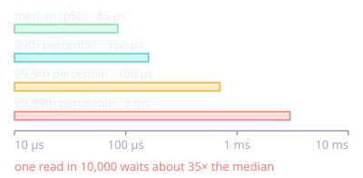
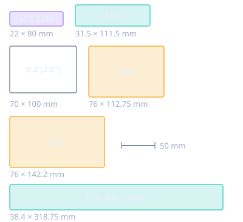
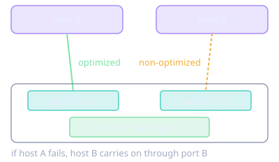

# Supplement I — Data-Center SSDs

Most solid-state drives ever made sit in laptops, one SSD (solid-state drive) per machine, but most flash by capacity now sits in data centers, in drives bought by the hundred thousand by a handful of cloud operators. Those buyers want different things from a laptop owner: latency that stays predictable under load, hardware they can swap without opening a server, drives they can monitor and update by the rack, and as many terabytes per watt as physics allows. This supplement covers what that changes, from the specifications the largest buyers write to the form factors and protocols built for them.

It draws on most of the book: power-loss protection from [Ch 2 §2.8.3](../core/ch2-controllers-afa.md#283-power-loss-protection-capacitors-that-buy-milliseconds), the mapping table from [Chapter 4](../core/ch4-ftl.md), the PCIe (Peripheral Component Interconnect Express) link and the NVMe (Non-Volatile Memory Express) protocol from [Chapters 5](../core/ch5-pcie.md) and [6](../core/ch6-nvme.md), and the logs and updates of [Supplement G](g-firmware.md).

!!! abstract "In this supplement"
    - **Consistent latency** ⭐⭐ — why the 99.99th percentile matters more than the average (§I.1)
    - **Form factors** ⭐ — U.2, U.3 and the EDSFF family, hot-swap and thermals (§I.2)
    - **The OCP specification** — what the largest buyers require (§I.3)
    - **Power-loss protection and endurance classes** (§I.4)
    - **Dual port, multipath and fleet management** — ANA, NVMe-MI and the BMC (§I.5–I.6)
    - **The capacity race and CXL** ⭐ — 245 TB QLC drives, large indirection units, FDP, and Compute Express Link (§I.7–I.8)

    Short on time? §I.1 and §I.7 carry the most.

---

## I.1 What data centers want: consistent latency ⭐⭐

A web page or a database query in a data center fans out to many drives at once and must wait for the slowest one. If a request touches 100 drives and each answers slowly 1% of the time, most requests hit at least one slow drive: 1 − 0.99¹⁰⁰ ≈ 63%. That arithmetic is why operators judge drives by their **tail latency**, the time that 99%, 99.9% or 99.99% of requests beat ([Ch 0 §0.5](../core/ch0-foundations.md#05-latency-throughput-and-iops)), and why quality of service in a data center means a short tail, not a fast average.

{ .sdd-fig }
/// figure-caption
Read latency by percentile, illustrative values. The median looks excellent; the tail is what a large service actually feels.
///

Almost everything in the tail is the drive doing something other than the request at hand:

- **garbage collection** competing with host reads for the same dies ([Ch 4 §4.3](../core/ch4-ftl.md#43-garbage-collection));
- a read stuck behind a **program or erase** on the same die, which take milliseconds ([Chapter 3](../core/ch3-nand-flash.md));
- **read retries** and soft decoding on worn or long-unread data ([Supplement A §A.7](a-ecc-coding-theory.md#a7-the-ldpc-codec-inside-the-ssd));
- background work such as wear leveling, read scrub and map flushes.

Data-center firmware attacks the tail with techniques that cost a little throughput: suspending a program or erase to let a read through, pacing garbage collection steadily instead of in bursts, and placing data so that one workload's churn doesn't land on another's dies (§I.7). Specifications then measure the result: a drive must hold its 99.99th-percentile latency under a defined mixed workload, not just reach a headline IOPS (input/output operations per second) figure.

## I.2 Form factors: U.2, U.3 and EDSFF ⭐

Laptops use the M.2 card; servers need drives that slide in from the front, can be swapped while the server runs, and can be cooled in dense rows.

- **U.2** puts an NVMe drive in the familiar 2.5-inch case, with a connector carrying four PCIe lanes, or two ports of two lanes each. **U.3** keeps the size but defines a "tri-mode" bay that accepts NVMe, SAS (Serial Attached SCSI, the Small Computer System Interface) or SATA (Serial AT Attachment) drives through one connector.
- **EDSFF** (the Enterprise and Data Center Standard Form Factor family) was designed from scratch for flash, without a case built around a spinning disk:
    - **E1.S**, a small card, now the common choice for hyperscale servers;
    - **E1.L**, the long "ruler", for maximum capacity per rack unit;
    - **E3.S** and **E3.L**, wider forms for the PCIe 5.0 and 6.0 generations, higher power and larger capacities, and a shape that can also hold CXL devices (§I.8).

{ .sdd-fig }
/// figure-caption
Data-center SSD form factors, to scale. Each EDSFF shape trades length, width and thickness for capacity, power and cooling; the E1.L ruler fills the depth of a server.
///

Three properties matter as much as size:

- **Hot-swap**: a drive can be pulled and replaced while the server runs. The connector mates power and ground before signals, and the drive must survive the sudden loss of power when pulled (§I.4).
- **Power envelope**: each form factor and thickness has a power limit, from around ten watts for small drives to tens of watts for the large E3 forms. More power means more flash dies working in parallel, so the envelope caps performance.
- **Thermals**: drives sit in rows in front of the fans, so their shape decides how air flows past them. EDSFF cases are designed as airflow channels and carry their own heat sinks, and every drive throttles itself before it overheats ([Ch 2 §2.8.5](../core/ch2-controllers-afa.md#285-temperature-sensors-and-throttling)).

## I.3 The OCP Datacenter NVMe SSD specification

The largest buyers don't negotiate requirements drive by drive. Through the **Open Compute Project (OCP)**, operators including Meta, Microsoft, Google, Dell and HPE publish the **Datacenter NVMe SSD Specification**, and vendors build drives to it. Version 2.7 (2026) is current; earlier versions date back to 2020. It turns this whole book into a checklist, covering among other things:

- **Performance and latency**: required IOPS and 99.99th-percentile latencies under defined workloads, and a latency-monitoring log that records the slowest commands.
- **Health and debug**: extended SMART (Self-Monitoring, Analysis and Reporting Technology) data, an error-recovery log, and a common telemetry format, so one fleet tool reads every vendor's drives ([Supplement G §G.4](g-firmware.md#g4-what-the-drive-tells-you-health-and-logs)).
- **Firmware**: signed images, activation without a reset, and rules for how updates behave ([Supplement G §G.3](g-firmware.md#g3-updating-firmware-in-the-field)).
- **Security**: attestation, sanitization and debug-port locking ([Supplement F](f-security.md)).
- **Power**: power states, power-loss protection and, in version 2.7, power measured by the device itself.
- **Capacity drives**: version 2.7 adds requirements aimed at high-capacity QLC (quad-level cell) drives.

The specification is why data-center drives from competing vendors behave alike in the ways an operator's software depends on.

## I.4 Power-loss protection and endurance classes

**Power-loss protection (PLP)** is universal in data-center drives. Capacitors on the board hold enough energy for the controller to finish writing everything it has acknowledged when power vanishes ([Ch 2 §2.8.3](../core/ch2-controllers-afa.md#283-power-loss-protection-capacitors-that-buy-milliseconds)). Two consequences make it essential here. A drive with PLP can acknowledge a write as soon as the data reaches its own DRAM (dynamic random-access memory), which cuts write latency. And a flush command, which a database issues constantly, can complete at once, because cached data is already safe.

**Endurance classes** sort drives by how much writing they are built for, stated in **drive writes per day (DWPD)** over the warranty, usually five years ([Ch 1 §1.5.3](../core/ch1-overview.md#153-endurance)):

| Class | DWPD | Typical use | Flash |
|---|---|---|---|
| read-intensive | about 1 | content delivery, analytics, AI training data | TLC or QLC |
| mixed-use | about 3 | databases, virtual machines | TLC, more over-provisioning |
| write-intensive | 10 or more | logging, caching tiers | TLC with large over-provisioning, or SLC |
| capacity (QLC) | well under 1 | archives, data lakes, AI datasets | QLC |

The classes are made mostly of the same flash with different over-provisioning, firmware and warranty: a mixed-use 3.2 TB drive is often the read-intensive 3.84 TB drive with more of its flash held back ([Ch 0 §0.1](../core/ch0-foundations.md#01-units-bits-bytes-and-the-two-kinds-of-kilo)).

## I.5 Dual port, multipath and ANA

A storage array keeps working when one of its controllers fails because every drive is reachable from both. **Dual-port** NVMe drives make that possible: the four lanes of a U.2 or EDSFF connector split into two independent ports of two lanes, each connected to a different host or controller.

{ .sdd-fig }
/// figure-caption
A dual-port SSD. Both hosts see the same namespace; the drive tells them which path to prefer, and the other path is ready if the first one fails.
///

When several paths lead to the same namespace, hosts need to know which to use. NVMe's **Asymmetric Namespace Access (ANA)** lets the drive or subsystem report a state for each path: *optimized*, *non-optimized*, *inaccessible* and a few transitional states. The host's multipath driver sends I/O down optimized paths, keeps the others ready, and switches when a state changes. The same mechanism serves NVMe over Fabrics, where the paths run through network switches instead of a server backplane ([Ch 6 §6.8](../core/ch6-nvme.md#68-nvme-over-fabrics)).

## I.6 Managing fleets: NVMe-MI and the BMC

An operator with a million drives can't depend on each server's operating system to report on its own drives: the system may be busy, crashed or being reinstalled. Servers therefore have a separate **baseboard management controller (BMC)**, a small computer that stays on whenever the server has power and talks to the operator's management network.

The BMC reaches each drive **out of band**, without the host's involvement, through the **NVMe Management Interface (NVMe-MI)**. Its messages travel over the Management Component Transport Protocol (MCTP), carried on the drive's SMBus (System Management Bus) sideband pins or over PCIe itself ([Ch 2 §2.8.6](../core/ch2-controllers-afa.md#286-sideband-signals-reset-clock-wake-and-management)). Through it the BMC can:

- read temperature and health even when the host operating system is down;
- inventory drives by model, serial number and firmware revision;
- run attestation with SPDM, the Security Protocol and Data Model ([Supplement F §F.6](f-security.md#f6-attestation-spdm-and-caliptra));
- and on many platforms, update firmware without the host at all.

Fleet management is the reason data-center drives are specified so tightly: one tool must read health, telemetry and logs from every drive in the building, whoever made it.

## I.7 The capacity race: QLC, large indirection units and FDP ⭐

Data growth, much of it for AI, has made capacity per drive the fastest-moving number in storage. In 2026, drives of about **245 TB** built from QLC flash are shipping from several vendors, and 256 TB has been announced, in U.2 and E3 forms. A rack of them holds what took many racks of hard disks, at a fraction of the power.

Size breaks a rule from Chapter 4. A page-level map needs about 4 bytes for every 4 KiB of capacity, roughly capacity ÷ 1,000 of DRAM ([Ch 4 §4.2.2](../core/ch4-ftl.md#422-how-mapping-works-and-the-dram-question)). For a 245 TB drive that is about 245 GB of DRAM, which is neither affordable nor able to fit on the board. Capacity drives therefore map in larger units, an **indirection unit (IU)** of 16 KiB, 64 KiB or more, which divides the map by 4, 16 or more.

The price is paid by small writes. A 4 KiB write into a 16 KiB unit forces the drive to read the unit, merge the new data and write all 16 KiB back: write amplification of at least 4, on flash with the lowest endurance. Capacity drives are therefore built for workloads that write in large, aligned pieces, and hosts are asked to cooperate:

- **write in IU-sized, aligned pieces**, which the drive advertises as its preferred write granularity and alignment;
- **place data deliberately** with **Flexible Data Placement (FDP)**, so data with similar lifetimes lands in the same erase blocks and garbage collection has little to copy ([Ch 4 §4.11](../core/ch4-ftl.md#411-modern-developments-from-sdf-to-zns-and-fdp)).

FDP has become the main tool for running QLC at scale: it keeps the standard block interface, unlike zoned namespaces, while letting the host separate streams of data, bringing write amplification close to 1 for well-behaved workloads.

## I.8 CXL: memory over the PCIe wires

**Compute Express Link (CXL)** reuses the PCIe physical layer to carry three protocols: CXL.io, which is essentially PCIe; CXL.cache, which lets a device cache host memory coherently; and **CXL.mem**, which lets the host use memory on a device as ordinary memory, with load and store instructions instead of read and write commands. The specification has moved quickly, through memory pooling and switching in versions 2.0 and 3.x, to **CXL 4.0** in November 2025, which doubles the signalling rate to 128 GT/s (gigatransfers per second) and adds bundled ports.

For storage the main effect so far is indirect. **CXL memory expanders**, DRAM on a card in an E3 or add-in form factor, add capacity and bandwidth without more processor memory channels, and memory pooling lets racks share it. That changes the memory–storage boundary that Chapter 0's latency ladder drew ([Ch 0 §0.5](../core/ch0-foundations.md#05-latency-throughput-and-iops)): between DRAM at about 100 ns and an SSD at about 100 µs, CXL places memory at a few hundred nanoseconds. Devices that put flash behind a CXL memory interface, with a DRAM cache in front, are being explored too, though flash's microsecond latency means they behave as a very large, slower memory tier rather than as a faster SSD.

---

## Key takeaways

1. **The tail is the product**: a request that fans out to many drives waits for the slowest, so data-center drives are judged at the 99.99th percentile and their firmware trades a little throughput for a shorter tail.
2. **EDSFF replaced the disk-shaped case**: E1.S for density, E1.L for capacity, E3 for the PCIe 5.0 and 6.0 era, all hot-swappable and shaped for airflow and power.
3. **The OCP specification is the buyers' checklist**: latency, logs, telemetry, firmware, security and power, so drives from different vendors manage alike.
4. **PLP is universal** and buys fast writes and flushes; **endurance classes** are mostly the same flash with different over-provisioning and warranty.
5. **Dual ports and ANA keep data reachable** through a controller failure; **NVMe-MI** lets the BMC manage drives with the host down.
6. **Capacity drives map in large units** to fit their DRAM, so small writes amplify; aligned writes and FDP make QLC work at scale.
7. **CXL puts memory on PCIe wires**, filling the gap between DRAM and flash on the latency ladder.

---

## Key vocabulary

| Term | 中文 | Meaning |
|---|---|---|
| tail latency | 尾延遲 | The latency that 99%, 99.9% or 99.99% of requests beat, which describes the slow ones. → [§I.1](#i1-what-data-centers-want-consistent-latency) |
| quality of service (QoS) | 服務質量（台：服務品質） | In storage, how consistent latency is, usually stated as tail-latency limits. → [§I.1](#i1-what-data-centers-want-consistent-latency) |
| program/erase suspend | 編程/擦除暫停（台：寫入/抹除暫停） | Pausing a long flash operation so that a waiting read can run first. → [§I.1](#i1-what-data-centers-want-consistent-latency) |
| U.2 / U.3 | U.2 / U.3接口（台：U.2 / U.3介面） | The 2.5-inch NVMe drive form, and its tri-mode bay that also takes SAS and SATA drives. → [§I.2](#i2-form-factors-u2-u3-and-edsff) |
| EDSFF (E1.S, E1.L, E3.S, E3.L) | 企業及數據中心標準外形（台：企業與資料中心標準外形） | The family of flash-first form factors for servers. → [§I.2](#i2-form-factors-u2-u3-and-edsff) |
| hot-swap | 熱插拔 | Replacing a drive while the server keeps running. → [§I.2](#i2-form-factors-u2-u3-and-edsff) |
| power envelope | 功耗上限（台：功率上限） | The most power a form factor and slot allow a drive to draw. → [§I.2](#i2-form-factors-u2-u3-and-edsff) |
| OCP Datacenter NVMe SSD Specification | OCP數據中心NVMe SSD規範（台：OCP資料中心NVMe SSD規範） | The Open Compute Project's requirements for data-center drives, written by their largest buyers. → [§I.3](#i3-the-ocp-datacenter-nvme-ssd-specification) |
| power-loss protection (PLP) | 掉電保護（台：斷電保護） | Stored energy that lets the drive finish acknowledged writes when power is lost. → [§I.4](#i4-power-loss-protection-and-endurance-classes) |
| drive writes per day (DWPD) | 每日全盤寫入次數（台：每日全碟寫入次數） | How many times the full capacity can be written each day over the warranty. → [§I.4](#i4-power-loss-protection-and-endurance-classes) |
| endurance class | 耐久等級 | Read-intensive, mixed-use or write-intensive: drives sorted by DWPD. → [§I.4](#i4-power-loss-protection-and-endurance-classes) |
| dual port | 雙端口（台：雙埠） | Splitting a drive's lanes into two independent ports for two hosts. → [§I.5](#i5-dual-port-multipath-and-ana) |
| multipath | 多路徑 | Reaching the same namespace through more than one path, for failover. → [§I.5](#i5-dual-port-multipath-and-ana) |
| Asymmetric Namespace Access (ANA) | 非對稱命名空間訪問（台：非對稱命名空間存取） | NVMe's per-path state reports (optimized, non-optimized, inaccessible) that steer multipath I/O. → [§I.5](#i5-dual-port-multipath-and-ana) |
| baseboard management controller (BMC) | 基板管理控制器 | A server's always-on management computer, which talks to the operator's network. → [§I.6](#i6-managing-fleets-nvme-mi-and-the-bmc) |
| NVMe Management Interface (NVMe-MI) | NVMe管理接口（台：NVMe管理介面） | The out-of-band protocol a BMC uses to monitor and manage drives without the host. → [§I.6](#i6-managing-fleets-nvme-mi-and-the-bmc) |
| out-of-band management | 帶外管理（台：頻外管理） | Managing a device over a separate path that works even when the host is down. → [§I.6](#i6-managing-fleets-nvme-mi-and-the-bmc) |
| indirection unit (IU) | 映射單元（台：對應單位） | The size of the data each map entry covers; larger units shrink the map. → [§I.7](#i7-the-capacity-race-qlc-large-indirection-units-and-fdp) |
| Flexible Data Placement (FDP) | 靈活數據放置（台：彈性資料配置） | NVMe's way for the host to tell the drive which data belongs together. → [§I.7](#i7-the-capacity-race-qlc-large-indirection-units-and-fdp) |
| Compute Express Link (CXL) | 計算快速鏈路（台：運算快速連結） | Protocols on the PCIe physical layer that let devices share coherent memory with the host. → [§I.8](#i8-cxl-memory-over-the-pcie-wires) |
| CXL memory expander | CXL內存擴展器（台：CXL記憶體擴充裝置） | A card that adds DRAM to a server over CXL rather than memory channels. → [§I.8](#i8-cxl-memory-over-the-pcie-wires) |

---

## Check yourself

1. A request fans out to 50 drives, and each drive is slow on 1% of its requests. What fraction of requests hits at least one slow drive, and what does that imply for how drives are specified?

    ??? success "Answer"
        1 − 0.99⁵⁰ ≈ 0.39, so about 39% of requests wait for a slow drive, even though each drive is slow only 1% of the time. Services feel the tail far more than the average, so data-center drives are specified and judged at the 99.9th or 99.99th percentile. See [§I.1](#i1-what-data-centers-want-consistent-latency).

2. Name three causes of tail latency inside an SSD, and one firmware technique against each.

    ??? success "Answer"
        Garbage collection competing for dies, countered by pacing it steadily instead of in bursts. A read waiting behind a program or erase on the same die, countered by suspending the long operation to let the read through. Read retries and soft decoding on worn data, countered by refreshing data before it degrades and by tuning read levels in advance. Separating workloads' data, for example with FDP, also keeps one workload's background work off another's dies. See [§I.1](#i1-what-data-centers-want-consistent-latency).

3. Why did the data center move from U.2 to EDSFF, and what is each EDSFF shape for?

    ??? success "Answer"
        U.2 keeps the 2.5-inch case designed around a spinning disk, which wastes space and airflow for flash. EDSFF was designed for flash: E1.S is a small card for dense, general-purpose servers; E1.L is a long ruler for maximum capacity per rack unit; E3.S and E3.L are wider forms for PCIe 5.0 and 6.0 with higher power, and can also hold CXL devices. All are hot-swappable and shaped as airflow channels. See [§I.2](#i2-form-factors-u2-u3-and-edsff).

4. What does the OCP Datacenter NVMe SSD Specification do for an operator that buys drives from several vendors?

    ??? success "Answer"
        It makes the drives behave alike where the operator's software depends on them: the same latency and performance targets, the same health, error, latency and telemetry logs, the same firmware-update and security behavior, and the same power features. One fleet tool can then monitor, update and debug every vendor's drives. See [§I.3](#i3-the-ocp-datacenter-nvme-ssd-specification).

5. Why can a drive with power-loss protection complete flush commands almost instantly?

    ??? success "Answer"
        A flush asks the drive to make all acknowledged data durable. With PLP the stored energy guarantees that anything in the drive's DRAM will reach flash even if power fails, so cached data is already safe and the drive can complete the flush at once instead of writing everything out first. Databases flush constantly, so this matters. See [§I.4](#i4-power-loss-protection-and-endurance-classes).

6. A 3.84 TB read-intensive drive is rated at 1 DWPD over five years. How many terabytes can be written, and why might the same hardware be sold as a 3.2 TB mixed-use drive?

    ??? success "Answer"
        3.84 TB × 1 × 365 × 5 ≈ 7,000 TB. Selling the same flash as 3.2 TB holds back more of it as over-provisioning, which lowers write amplification and spreads wear, so the vendor can rate it for more writes per day, about 3 DWPD. See [§I.4](#i4-power-loss-protection-and-endurance-classes).

7. How do dual ports and ANA keep a namespace available when a storage controller fails?

    ??? success "Answer"
        The drive's lanes form two independent ports, each connected to a different controller or host, and both reach the same namespace. ANA reports each path's state, for example optimized through port A and non-optimized through port B, so hosts normally use A; when A's controller fails, its path becomes inaccessible and I/O moves to B. See [§I.5](#i5-dual-port-multipath-and-ana).

8. Why does a data center manage drives out of band, and what path does NVMe-MI use?

    ??? success "Answer"
        The host operating system may be down, busy or being reinstalled, and an operator managing many drives needs inventory, health and updates regardless. The BMC, which stays on whenever the server has power, uses NVMe-MI messages carried by MCTP over the drive's SMBus pins or over PCIe to read temperature and health, inventory drives, run attestation and, on many platforms, update firmware. See [§I.6](#i6-managing-fleets-nvme-mi-and-the-bmc).

9. A 245 TB drive maps data in 4 KiB units with 4-byte entries. How much DRAM would its map need, and what do capacity drives do instead?

    ??? success "Answer"
        245 × 10¹² ÷ 4,096 × 4 B ≈ 2.4 × 10¹¹ B, about 240 GB, which is neither affordable nor able to fit on the board. Capacity drives map in larger indirection units, 16 KiB, 64 KiB or more, which divide the map by 4, 16 or more. See [§I.7](#i7-the-capacity-race-qlc-large-indirection-units-and-fdp).

10. On a drive with a 16 KiB indirection unit, what does a random 4 KiB write cost, and how can the host avoid it?

    ??? success "Answer"
        The drive must read the whole 16 KiB unit, merge the new 4 KiB and write all 16 KiB back, so the write is amplified at least four times, on low-endurance QLC flash. The host avoids it by writing in aligned pieces of the advertised size, and by using FDP to place data with similar lifetimes together so garbage collection has little to copy. See [§I.7](#i7-the-capacity-race-qlc-large-indirection-units-and-fdp).

11. What does CXL.mem let a host do that NVMe does not, and where does CXL memory sit on the latency ladder?

    ??? success "Answer"
        CXL.mem lets the host use memory on a device directly with load and store instructions, as ordinary memory, while NVMe moves blocks of data with read and write commands. CXL-attached DRAM sits at a few hundred nanoseconds: slower than local DRAM at about 100 ns but far faster than an SSD at about 100 µs, filling the gap between them. See [§I.8](#i8-cxl-memory-over-the-pcie-wires).

---

??? info "📖 Provenance"

    This supplement is original to this site; 《深入淺出SSD》 predates most
    of what it covers. It is written against the OCP Datacenter NVMe SSD
    Specification 2.7, the NVMe base specification 2.x (Asymmetric Namespace
    Access, Flexible Data Placement), NVMe-MI, the Storage Networking Industry Association's (SNIA) EDSFF
    specifications (SFF-TA-1006, 1007 and 1008) and CXL 4.0. Its figures are
    original drawings; the latency percentiles are illustrative.

??? info "🔎 Sources for the 2026 update"

    The dated facts were checked in November 2026 against these sources:

    - The OCP Datacenter NVMe SSD Specification 2.7 and its contributors — [Open Compute Project](https://www.opencompute.org/documents/datacenter-nvme-ssd-specification-v2-7-final-pdf-1), with its additions (QLC capacity drives, device-measured power) previewed at [SNIA SDC 2025](https://www.snia.org/sites/default/files/2025-09/SNIA-SDC25-Stenfort-OCP-Storage-Project-Update.pdf)
    - 245 TB QLC drives shipping (Micron 6600 ION, May 2026) — [HPCwire](https://www.hpcwire.com/off-the-wire/micron-ships-245tb-6600-ion-ssd-for-rack-scale-ai-storage/); Kioxia LC9 — [StorageReview](https://www.storagereview.com/news/245tb-kioxia-lc9-ssd-sets-new-ssd-density-record); Sandisk's 256 TB announcement — [Tom's Hardware](https://www.tomshardware.com/pc-components/ssds/sandisk-unveils-colossal-new-256tb-ssd-with-new-ultraqlc-flash-memory-enterprise-grade-ssds-for-high-density-storage-also-come-in-128tb)
    - CXL 4.0 (November 2025), 128 GT/s and bundled ports — [CXL Consortium via Business Wire](https://www.businesswire.com/news/home/20251118275848/en/CXL-Consortium-Releases-the-Compute-Express-Link-4.0-Specification-Increasing-Speed-and-Bandwidth)

*This supplement completes the set. The [glossary](../reference/glossary.md), [formula sheet](../reference/formulas.md) and [quizzes](../reference/quizzes.md) gather every page's terms, equations and questions.*
